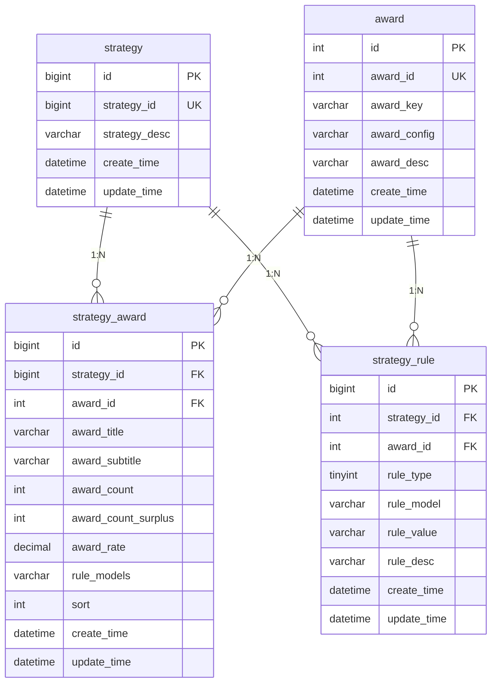
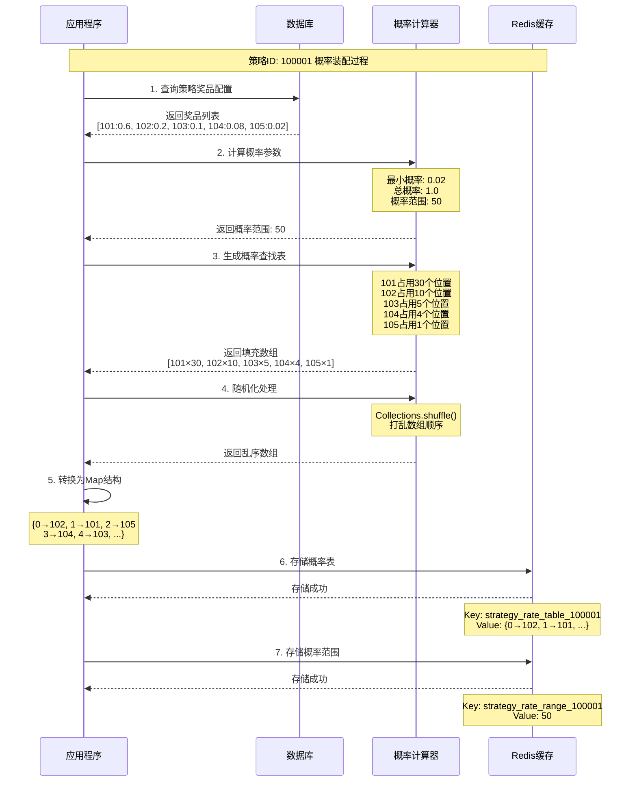
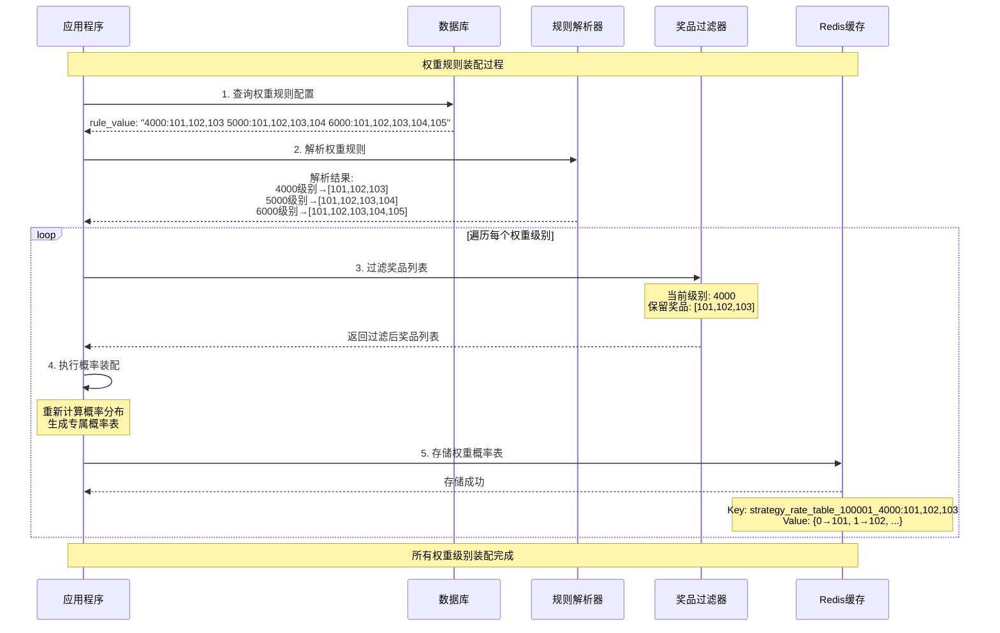
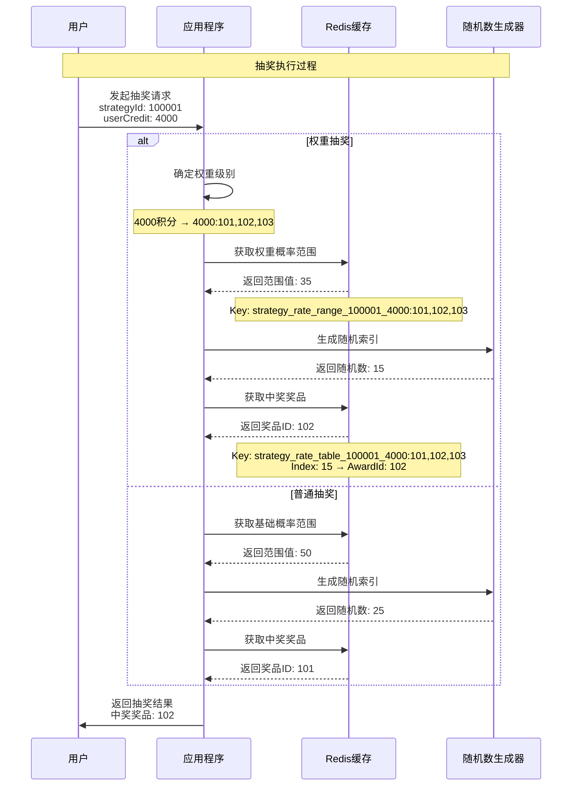

# Big-Market 大营销平台项目笔记

## 1. 系统架构和表结构设计

### 1.1 系统架构概述

Big-Market 是一个基于 **DDD（领域驱动设计）** 架构的大营销平台项目，主要用于实现抽奖系统功能。项目采用 Spring Boot 3.2.0 + MyBatis + MySQL 8.0 技术栈。

#### 1.1.1 模块架构

项目采用多模块Maven结构，遵循DDD分层架构：

```
Big-Market (父模块)
├── Big-Market-app          # 应用启动层
├── Big-Market-trigger      # 触发器层 (接口层)
├── Big-Market-domain       # 领域层 (核心业务逻辑)
├── Big-Market-infrastructure # 基础设施层 (数据访问)
└── Big-Market-types        # 通用类型层
```

#### 1.1.2 DDD分层架构说明

| 层级 | 模块 | 职责 | 主要内容 |
|------|------|------|----------|
| **应用层** | Big-Market-app | 应用启动和配置 | Spring Boot启动类、配置文件、线程池配置 |
| **接口层** | Big-Market-trigger | 对外接口适配 | HTTP接口、定时任务、消息监听器 |
| **领域层** | Big-Market-domain | 核心业务逻辑 | 实体、值对象、聚合、领域服务、仓储接口 |
| **基础设施层** | Big-Market-infrastructure | 技术实现 | 数据访问、外部接口调用、仓储实现 |
| **通用层** | Big-Market-types | 通用类型定义 | 枚举、异常、通用工具类 |

#### 1.1.3 技术栈

- **框架**: Spring Boot 3.2.0
- **数据库**: MySQL 8.0.22
- **ORM**: MyBatis 2.1.4
- **连接池**: HikariCP
- **缓存**: Google Guava Cache
- **JSON**: FastJSON 2.0.28
- **工具库**: Apache Commons Lang3, Google Guava
- **认证**: JWT (jjwt, java-jwt)

### 1.2 数据库表结构设计

#### 1.2.1 表结构概览

系统目前包含3个核心表，构成了抽奖系统的基础数据模型：

| 表名 | 中文名称 | 主要功能 |
|------|----------|----------|
| `award` | 奖品表 | 存储奖品基础信息和发奖策略配置 |
| `strategy` | 抽奖策略表 | 定义抽奖策略的基本信息 |
| `strategy_award` | 策略奖品关联表 | 配置策略下的奖品概率和库存 |
| `strategy_rule` | 策略规则表 | 定义抽奖规则和限制条件 |

#### 1.2.2 详细表结构

##### 1. award 奖品表

```sql
CREATE TABLE `award` (
    `id` int(11) unsigned NOT NULL AUTO_INCREMENT COMMENT '自增ID',
    `award_id` int(8) NOT NULL COMMENT '抽奖奖品ID - 内部流转使用',
    `award_key` varchar(32) NOT NULL COMMENT '奖品对接标识 - 每一个都是一个对应的发奖策略',
    `award_config` varchar(32) NOT NULL COMMENT '奖品配置信息',
    `award_desc` varchar(128) NOT NULL COMMENT '奖品内容描述',
    `create_time` datetime NOT NULL DEFAULT CURRENT_TIMESTAMP COMMENT '创建时间',
    `update_time` datetime NOT NULL DEFAULT CURRENT_TIMESTAMP ON UPDATE CURRENT_TIMESTAMP COMMENT '更新时间',
    PRIMARY KEY (`id`)
) ENGINE=InnoDB DEFAULT CHARSET=utf8mb4;
```

**字段说明：**
- `award_id`: 奖品的唯一标识，用于系统内部流转
- `award_key`: 奖品对接标识，对应不同的发奖策略（如：user_credit_random、openai_use_count、openai_model）
- `award_config`: 奖品配置参数，如积分范围、使用次数等
- `award_desc`: 奖品的描述信息

##### 2. strategy 抽奖策略表

```sql
CREATE TABLE `strategy` (
    `id` bigint(11) unsigned NOT NULL AUTO_INCREMENT COMMENT '自增ID',
    `strategy_id` bigint(8) NOT NULL COMMENT '抽奖策略ID',
    `strategy_desc` varchar(128) NOT NULL COMMENT '抽奖策略描述',
    `create_time` datetime NOT NULL DEFAULT CURRENT_TIMESTAMP COMMENT '创建时间',
    `update_time` datetime NOT NULL DEFAULT CURRENT_TIMESTAMP ON UPDATE CURRENT_TIMESTAMP COMMENT '更新时间',
    PRIMARY KEY (`id`),
    KEY `idx_strategy_id` (`strategy_id`)
) ENGINE=InnoDB DEFAULT CHARSET=utf8mb4;
```

**字段说明：**
- `strategy_id`: 抽奖策略的唯一标识
- `strategy_desc`: 策略描述信息

##### 3. strategy_award 策略奖品关联表

```sql
CREATE TABLE `strategy_award` (
    `id` bigint(11) unsigned NOT NULL AUTO_INCREMENT COMMENT '自增ID',
    `strategy_id` bigint(8) NOT NULL COMMENT '抽奖策略ID',
    `award_id` int(8) NOT NULL COMMENT '抽奖奖品ID - 内部流转使用',
    `award_title` varchar(128) NOT NULL COMMENT '抽奖奖品标题',
    `award_subtitle` varchar(128) DEFAULT NULL COMMENT '抽奖奖品副标题',
    `award_count` int(8) NOT NULL DEFAULT '0' COMMENT '奖品库存总量',
    `award_count_surplus` int(8) NOT NULL DEFAULT '0' COMMENT '奖品库存剩余',
    `award_rate` decimal(6,4) NOT NULL COMMENT '奖品中奖概率',
    `rule_models` varchar(256) DEFAULT NULL COMMENT '规则模型，rule配置的模型同步到此表，便于使用',
    `sort` int(2) NOT NULL DEFAULT '0' COMMENT '排序',
    `create_time` datetime NOT NULL DEFAULT CURRENT_TIMESTAMP COMMENT '创建时间',
    `update_time` datetime NOT NULL DEFAULT CURRENT_TIMESTAMP ON UPDATE CURRENT_TIMESTAMP COMMENT '修改时间',
    PRIMARY KEY (`id`),
    KEY `idx_strategy_id_award_id` (`strategy_id`,`award_id`)
) ENGINE=InnoDB DEFAULT CHARSET=utf8mb4;
```

**字段说明：**
- `award_rate`: 奖品中奖概率，使用decimal(6,4)精确控制概率
- `award_count/award_count_surplus`: 库存管理，支持库存扣减
- `rule_models`: 关联的规则模型，支持多规则组合

##### 4. strategy_rule 策略规则表

```sql
CREATE TABLE `strategy_rule` (
    `id` bigint(11) unsigned NOT NULL AUTO_INCREMENT COMMENT '自增ID',
    `strategy_id` int(8) NOT NULL COMMENT '抽奖策略ID',
    `award_id` int(8) DEFAULT NULL COMMENT '抽奖奖品ID【规则类型为策略，则不需要奖品ID】',
    `rule_type` tinyint(1) NOT NULL DEFAULT '0' COMMENT '抽象规则类型；1-策略规则、2-奖品规则',
    `rule_model` varchar(16) NOT NULL COMMENT '抽奖规则类型【rule_random - 随机值计算、rule_lock - 抽奖几次后解锁、rule_luck_award - 幸运奖(兜底奖品)】',
    `rule_value` varchar(64) NOT NULL COMMENT '抽奖规则比值',
    `rule_desc` varchar(128) NOT NULL COMMENT '抽奖规则描述',
    `create_time` datetime NOT NULL DEFAULT CURRENT_TIMESTAMP COMMENT '创建时间',
    `update_time` datetime NOT NULL DEFAULT CURRENT_TIMESTAMP ON UPDATE CURRENT_TIMESTAMP COMMENT '更新时间',
    PRIMARY KEY (`id`),
    KEY `idx_strategy_id_award_id` (`strategy_id`,`award_id`)
) ENGINE=InnoDB DEFAULT CHARSET=utf8mb4;
```

**字段说明：**
- `rule_type`: 规则类型，1-策略规则（全局）、2-奖品规则（针对特定奖品）
- `rule_model`: 规则模型类型
  - `rule_random`: 随机值计算
  - `rule_lock`: 抽奖次数解锁机制
  - `rule_luck_award`: 幸运奖（兜底奖品）
  - `rule_weight`: 权重规则
  - `rule_blacklist`: 黑名单规则
- `rule_value`: 规则的具体配置值

#### 1.2.3 表关系图



#### 1.2.4 业务规则设计

##### 规则模型类型

| 规则模型 | 说明 | 应用场景 | 配置示例 |
|----------|------|----------|----------|
| `rule_random` | 随机值计算 | 随机积分奖品 | `1,1000` (1-1000随机积分) |
| `rule_lock` | 解锁机制 | 抽奖次数达到后解锁高级奖品 | `1` (抽奖1次后解锁) |
| `rule_luck_award` | 兜底奖品 | 保底机制，确保用户有奖品 | `1,100` (1-100随机积分) |
| `rule_weight` | 权重规则 | 消耗积分必中奖 | `6000,102,103,104...` |
| `rule_blacklist` | 黑名单规则 | 黑名单用户处理 | `1` (启用黑名单) |

##### 奖品类型

根据数据分析，系统支持以下奖品类型：
- **积分奖品**: 随机积分奖励
- **使用次数**: OpenAI服务使用次数（5次、10次、20次、100次）
- **模型权限**: OpenAI模型访问权限（GPT-4、DALL-E-2、DALL-E-3）
- **组合奖品**: 多种模型权限组合

## 2. 策略概率装配与权重装配机制

### 2.1 核心概念

#### 2.1.1 策略概率装配

**策略概率装配**是将数据库中配置的奖品概率信息转换为高效的**概率查找表**的过程，目的是在抽奖时能够快速、准确地根据概率分布选择奖品。

**核心思想：** 将概率转换为数组索引，通过随机数生成索引来实现概率抽奖。

**技术优势：**
- **O(1)时间复杂度**：通过数组索引直接获取结果
- **内存预计算**：启动时装配，运行时无需计算
- **精确概率控制**：支持小数点后4位精度

#### 2.1.2 策略权重装配

**策略权重装配**是根据用户的**消耗积分**或**等级**等条件，为不同用户群体提供不同奖品池的机制。

**核心思想：** 消耗积分越多，能够获得的奖品种类越丰富，实现"花钱越多，奖品越好"的营销策略。

**业务价值：**
- **差异化营销**：不同用户群体享受不同奖品池
- **消费激励**：鼓励用户消耗更多积分
- **精准运营**：根据用户价值提供对应服务

### 2.2 概率装配算法原理

#### 2.2.1 概率转换算法

假设有以下奖品配置：
- 奖品A：概率 0.01 (1%)
- 奖品B：概率 0.05 (5%)
- 奖品C：概率 0.1 (10%)
- 奖品D：概率 0.84 (84%)

**算法步骤：**

1. **计算概率范围**
```java
// 最小概率：0.01
// 总概率：1.0
// 概率范围：1.0 ÷ 0.01 = 100
BigDecimal rateRange = totalAwardRate.divide(minAwardRate, 0, RoundingMode.CEILING);
```

2. **生成概率查找表**
```java
// 概率范围 = 100
// 奖品A (1%)：占用 100 × 0.01 = 1 个位置
// 奖品B (5%)：占用 100 × 0.05 = 5 个位置
// 奖品C (10%)：占用 100 × 0.1 = 10 个位置
// 奖品D (84%)：占用 100 × 0.84 = 84 个位置

// 最终数组：[A, B,B,B,B,B, C,C,C,C,C,C,C,C,C,C, D,D,D,D...84个D]
```

3. **随机化和索引映射**
```java
// 乱序处理，避免规律性
Collections.shuffle(strategyAwardSearchRateTables);

// 转换为Map结构：{索引 -> 奖品ID}
// {0: 102, 1: 105, 2: 102, 3: 104, ...}
```

#### 2.2.2 抽奖执行过程

```java
// 1. 生成随机数：random.nextInt(100) → 假设得到 45
// 2. 从Redis获取：map.get(45) → 假设得到奖品ID 104
// 3. 返回中奖结果：奖品ID 104
```

### 2.3 权重装配机制

#### 2.3.1 权重规则配置

权重规则的配置格式：`积分值:奖品ID列表`

**配置示例：**
```
rule_value: "4000:102,103,104,105 5000:102,103,104,105,106,107 6000:102,103,104,105,106,107,108,109"
```

**含义解释：**
- **4000积分**：可以抽取奖品 102,103,104,105（基础奖品池）
- **5000积分**：可以抽取奖品 102,103,104,105,106,107（中级奖品池）
- **6000积分**：可以抽取奖品 102,103,104,105,106,107,108,109（高级奖品池）

#### 2.3.2 权重装配过程

**装配示例：**

假设原始策略包含奖品：102,103,104,105,106,107,108,109

1. **4000积分级别**：
   - 过滤奖品：保留 102,103,104,105
   - 生成概率表：`strategy_100001_4000:102,103,104,105`

2. **5000积分级别**：
   - 过滤奖品：保留 102,103,104,105,106,107
   - 生成概率表：`strategy_100001_5000:102,103,104,105,106,107`

3. **6000积分级别**：
   - 过滤奖品：保留 102,103,104,105,106,107,108,109
   - 生成概率表：`strategy_100001_6000:102,103,104,105,106,107,108,109`

### 2.4 Redis存储结构设计

#### 2.4.1 存储Key设计

```java
public static class RedisKey {
    // 策略基础信息
    public static String STRATEGY_KEY = "big_market_strategy_key_";
    // 策略奖品列表
    public static String STRATEGY_AWARD_KEY = "big_market_strategy_award_key_";
    // 概率查找表
    public static String STRATEGY_RATE_TABLE_KEY = "big_market_strategy_rate_table_key_";
    // 概率范围
    public static String STRATEGY_RATE_RANGE_KEY = "big_market_strategy_rate_range_key_";
}
```

#### 2.4.2 实际存储示例

**基础策略存储：**
```redis
# 概率查找表
big_market_strategy_rate_table_key_100001: {0: 102, 1: 105, 2: 102, ...}
# 概率范围
big_market_strategy_rate_range_key_100001: 10000
```

**权重策略存储：**
```redis
# 4000积分级别
big_market_strategy_rate_table_key_100001_4000:102,103,104,105: {0: 102, 1: 103, ...}
big_market_strategy_rate_range_key_100001_4000:102,103,104,105: 5000

# 6000积分级别
big_market_strategy_rate_table_key_100001_6000:102,103,104,105,106,107,108,109: {0: 108, 1: 102, ...}
big_market_strategy_rate_range_key_100001_6000:102,103,104,105,106,107,108,109: 10000
```

### 2.5 策略装配时序图解

#### 2.5.1 概率装配处理时序



#### 2.5.2 权重装配处理时序



#### 2.5.3 抽奖执行时序



```mermaid

```

### 2.6 核心代码实现

#### 2.6.1 策略装配核心方法

```java
@Service
public class StrategyArmoryDispatch implements IStrategyArmory, IStrategyDispatch {

    /**
     * 装配抽奖策略配置
     * @param strategyId 策略ID
     * @return 装配结果
     */
    @Override
    public boolean assembleLotteryStrategy(Long strategyId) {
        // 1. 查询策略配置
        List<StrategyAwardEntity> strategyAwardEntities = repository.queryStrategyAwardList(strategyId);
        assembleLotteryStrategy(String.valueOf(strategyId), strategyAwardEntities);

        // 2. 权重策略配置 - 使用于 rule_weight 权重规则配置
        StrategyEntity strategyEntity = repository.queryStrategyEntityByStrategyId(strategyId);
        String ruleWeight = strategyEntity.getRuleWeight();
        if (null == ruleWeight) return true;

        StrategyRuleEntity strategyRuleEntity = repository.queryStrategyRule(strategyId, ruleWeight);
        if (null == strategyRuleEntity) {
            throw new AppException(ResponseCode.STRATEGY_RULE_WEIGHT_IS_NULL.getCode(),
                                 ResponseCode.STRATEGY_RULE_WEIGHT_IS_NULL.getInfo());
        }

        Map<String, List<Integer>> ruleWeightValueMap = strategyRuleEntity.getRuleWeightValues();
        Set<String> keys = ruleWeightValueMap.keySet();
        for (String key : keys) {
            List<Integer> ruleWeightValues = ruleWeightValueMap.get(key);
            ArrayList<StrategyAwardEntity> strategyAwardEntitiesClone = new ArrayList<>(strategyAwardEntities);
            strategyAwardEntitiesClone.removeIf(entity -> !ruleWeightValues.contains(entity.getAwardId()));
            assembleLotteryStrategy(String.valueOf(strategyId).concat("_").concat(key), strategyAwardEntitiesClone);
        }

        return true;
    }

    /**
     * 概率装配核心算法
     */
    private void assembleLotteryStrategy(String key, List<StrategyAwardEntity> strategyAwardEntities) {
        // 1. 获取最小概率值
        BigDecimal minAwardRate = strategyAwardEntities.stream()
                .map(StrategyAwardEntity::getAwardRate).min(BigDecimal::compareTo).orElse(BigDecimal.ZERO);

        // 2. 获取概率值总和
        BigDecimal totalAwardRate = strategyAwardEntities.stream()
                .map(StrategyAwardEntity::getAwardRate).reduce(BigDecimal.ZERO, BigDecimal::add);

        // 3. 用 1 % 0.0001 获取概率范围，百分位、千分位、万分位
        BigDecimal rateRange = totalAwardRate.divide(minAwardRate, 0, RoundingMode.CEILING);

        // 4. 生成策略奖品概率查找表
        ArrayList<Integer> strategyAwardSearchRateTables = new ArrayList<>(rateRange.intValue());
        for (StrategyAwardEntity strategyAward : strategyAwardEntities) {
            Integer awardId = strategyAward.getAwardId();
            BigDecimal awardRate = strategyAward.getAwardRate();

            // 计算出每个概率值需要存放到查找表的数量，循环填充
            for (int i=0; i<rateRange.multiply(awardRate).setScale(0, RoundingMode.CEILING).intValue(); i++) {
                strategyAwardSearchRateTables.add(awardId);
            }
        }

        // 5. 对存储的奖品进行乱序操作
        Collections.shuffle(strategyAwardSearchRateTables);

        // 6. 生成出Map集合，key值，对应的就是后续的概率值。通过概率来获得对应的奖品ID
        HashMap<Integer, Integer> shuffledStrategyAwardSearchRateTables = new HashMap<>();
        for (int i=0; i<strategyAwardSearchRateTables.size(); i++) {
            shuffledStrategyAwardSearchRateTables.put(i, strategyAwardSearchRateTables.get(i));
        }

        // 7. 存储到 Redis
        repository.storeStrategyAwardSearchRateTable(key, rateRange, shuffledStrategyAwardSearchRateTables);
    }
}
```

#### 2.6.2 抽奖调度方法

```java
/**
 * 普通抽奖
 */
@Override
public Integer getRandomAwardId(Long strategyId) {
    // 分布式部署下，不一定为当前应用做的策略装配。也就是值不一定会保存到本应用，而是分布式应用，所以需要从 Redis 中获取。
    int rateRange = repository.getRateRange(strategyId);
    // 通过生成的随机值，获取概率值奖品查找表的结果
    return repository.getStrategyAwardAssemble(String.valueOf(strategyId), new SecureRandom().nextInt(rateRange));
}

/**
 * 权重抽奖
 */
@Override
public Integer getRandomAwardId(Long strategyId, String ruleWeightValue) {
    String key = String.valueOf(strategyId).concat("_").concat(ruleWeightValue);
    // 分布式部署下，不一定为当前应用做的策略装配。也就是值不一定会保存到本应用，而是分布式应用，所以需要从 Redis 中获取。
    int rateRange = repository.getRateRange(key);
    // 通过生成的随机值，获取概率值奖品查找表的结果
    return repository.getStrategyAwardAssemble(key, new SecureRandom().nextInt(rateRange));
}
```

### 2.7 详细执行步骤

#### 2.7.1 策略装配详细步骤

**步骤A：数据准备阶段**
1. 从数据库查询策略ID对应的所有奖品配置
2. 获取每个奖品的概率值（BigDecimal类型，精确到小数点后4位）
3. 检查策略是否包含权重规则配置

**步骤B：概率计算阶段**
1. 遍历所有奖品，找出最小概率值（如：0.0001）
2. 计算所有奖品概率的总和（通常为1.0000）
3. 计算概率范围：总和 ÷ 最小值 = 查找表大小（如：10000）

**步骤C：查找表生成阶段**
1. 创建ArrayList，大小为概率范围值
2. 遍历每个奖品：
   - 计算该奖品需要占用的位置数：范围 × 奖品概率
   - 将奖品ID重复添加到ArrayList中对应次数
3. 使用Collections.shuffle()打乱数组顺序
4. 将ArrayList转换为HashMap<索引, 奖品ID>

**步骤D：权重处理阶段**（如果存在权重规则）
1. 解析权重规则字符串：`"4000:102,103,104,105 5000:102,103,104,105,106,107"`
2. 按空格分割得到各个权重级别
3. 对每个权重级别：
   - 按冒号分割得到积分值和奖品列表
   - 过滤原始奖品列表，只保留权重规则中的奖品
   - 为过滤后的奖品列表执行步骤B和C
   - 使用包含权重标识的key存储到Redis

**步骤E：Redis存储阶段**
1. 存储概率范围：`big_market_strategy_rate_range_key_{key}` → 范围值
2. 存储概率查找表：`big_market_strategy_rate_table_key_{key}` → HashMap

#### 2.7.2 抽奖执行详细步骤

**普通抽奖流程：**
1. 接收策略ID参数
2. 从Redis获取概率范围：`getRateRange(strategyId)`
3. 生成随机索引：`new SecureRandom().nextInt(rateRange)`
4. 从Redis概率表获取奖品：`getStrategyAwardAssemble(key, randomIndex)`
5. 返回中奖奖品ID

**权重抽奖流程：**
1. 接收策略ID和权重值参数
2. 构造权重key：`strategyId + "_" + ruleWeightValue`
3. 从Redis获取对应权重级别的概率范围
4. 生成随机索引并获取奖品ID
5. 返回中奖结果

### 2.8 实际使用示例

#### 2.8.1 配置示例

**数据库配置：**

```sql
-- 策略表
INSERT INTO strategy (strategy_id, strategy_desc, rule_models)
VALUES (100001, '新用户注册抽奖', 'rule_weight');

-- 奖品表
INSERT INTO award (award_id, award_key, award_config, award_desc) VALUES
(101, 'user_credit_random', '1,100', '随机积分1-100'),
(102, 'user_credit_random', '1,200', '随机积分1-200'),
(103, 'openai_use_count', '5', 'OpenAI使用次数5次'),
(104, 'openai_use_count', '10', 'OpenAI使用次数10次'),
(105, 'openai_model', 'gpt-4', 'GPT-4模型权限');

-- 策略奖品关联表
INSERT INTO strategy_award (strategy_id, award_id, award_title, award_rate) VALUES
(100001, 101, '随机积分', 0.6000),
(100001, 102, '随机积分Plus', 0.2000),
(100001, 103, '5次使用权', 0.1000),
(100001, 104, '10次使用权', 0.0800),
(100001, 105, 'GPT-4权限', 0.0200);

-- 策略规则表
INSERT INTO strategy_rule (strategy_id, rule_type, rule_model, rule_value, rule_desc) VALUES
(100001, 1, 'rule_weight', '4000:101,102,103 5000:101,102,103,104 6000:101,102,103,104,105', '权重规则配置');
```

#### 2.8.2 代码使用示例

```java
@Test
public void testStrategyArmory() {
    // 1. 装配策略
    boolean success = strategyArmory.assembleLotteryStrategy(100001L);
    log.info("策略装配结果：{}", success);

    // 2. 普通抽奖测试
    for (int i = 0; i < 10; i++) {
        Integer awardId = strategyDispatch.getRandomAwardId(100001L);
        log.info("普通抽奖结果：{}", awardId);
    }

    // 3. 权重抽奖测试
    // 4000积分用户（只能抽到基础奖品）
    for (int i = 0; i < 5; i++) {
        Integer awardId = strategyDispatch.getRandomAwardId(100001L, "4000:101,102,103");
        log.info("4000积分抽奖结果：{}", awardId);
    }

    // 6000积分用户（可以抽到所有奖品）
    for (int i = 0; i < 5; i++) {
        Integer awardId = strategyDispatch.getRandomAwardId(100001L, "6000:101,102,103,104,105");
        log.info("6000积分抽奖结果：{}", awardId);
    }
}
```

#### 2.8.3 Redis存储结果示例

```redis
# 基础策略概率表（所有奖品）
127.0.0.1:6379> HGETALL big_market_strategy_rate_table_key_100001
1) "0"
2) "101"
3) "1"
4) "102"
5) "2"
6) "101"
...
9999) "101"

# 基础策略概率范围
127.0.0.1:6379> GET big_market_strategy_rate_range_key_100001
"10000"

# 4000积分权重策略概率表（只有101,102,103）
127.0.0.1:6379> HGETALL big_market_strategy_rate_table_key_100001_4000:101,102,103
1) "0"
2) "101"
3) "1"
4) "103"
5) "2"
6) "102"
...

# 6000积分权重策略概率表（包含所有奖品）
127.0.0.1:6379> HGETALL big_market_strategy_rate_table_key_100001_6000:101,102,103,104,105
1) "0"
2) "105"
3) "1"
4) "101"
5) "2"
6) "104"
...
```

这套策略装配机制通过巧妙的算法设计，将复杂的概率计算转换为简单的数组查找，既保证了抽奖的公平性和准确性，又提供了出色的性能表现，是一个非常优秀的抽奖系统核心设计。

