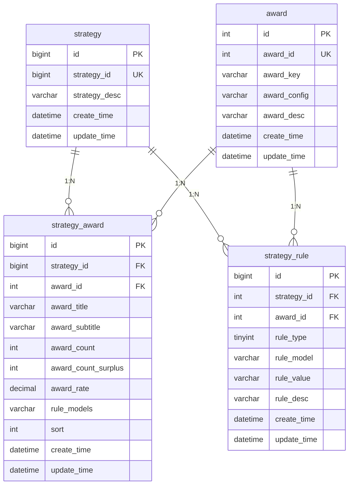
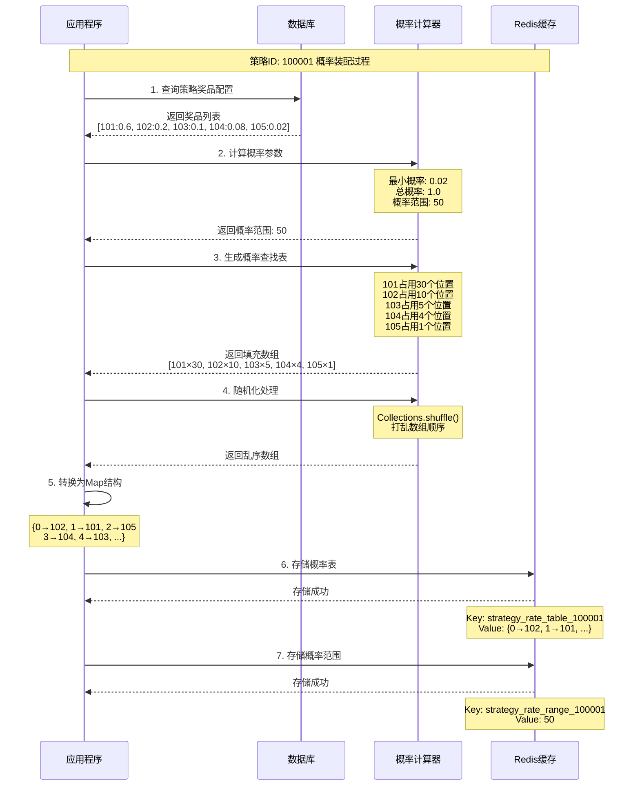
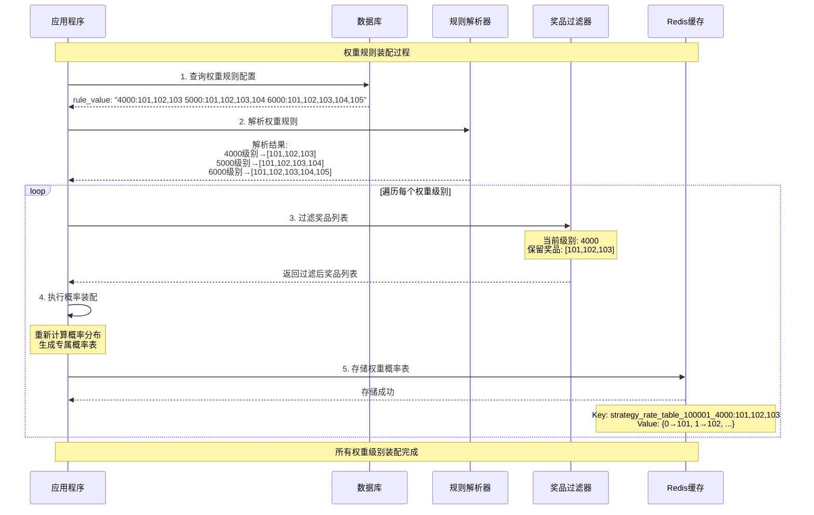
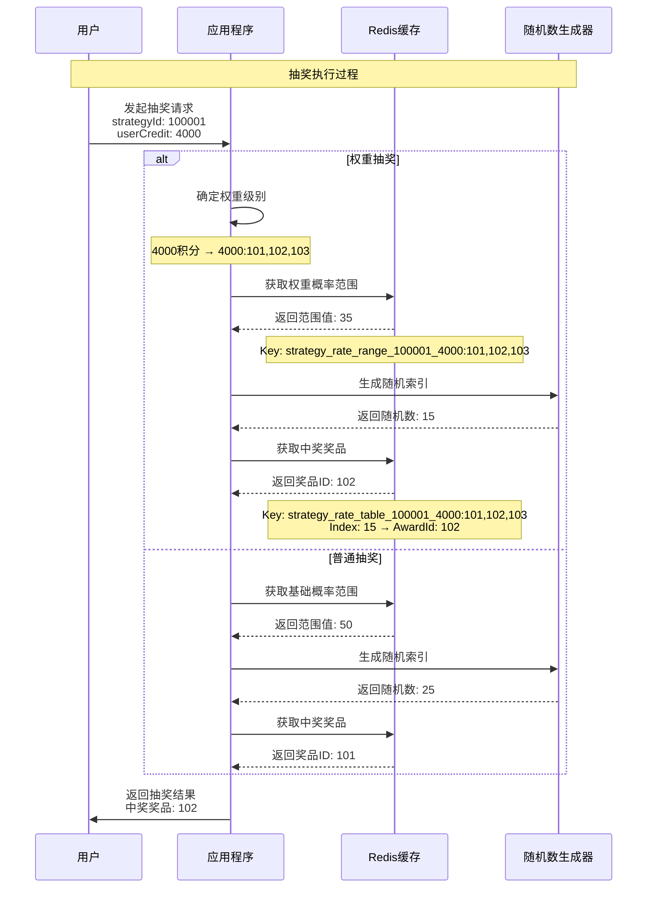
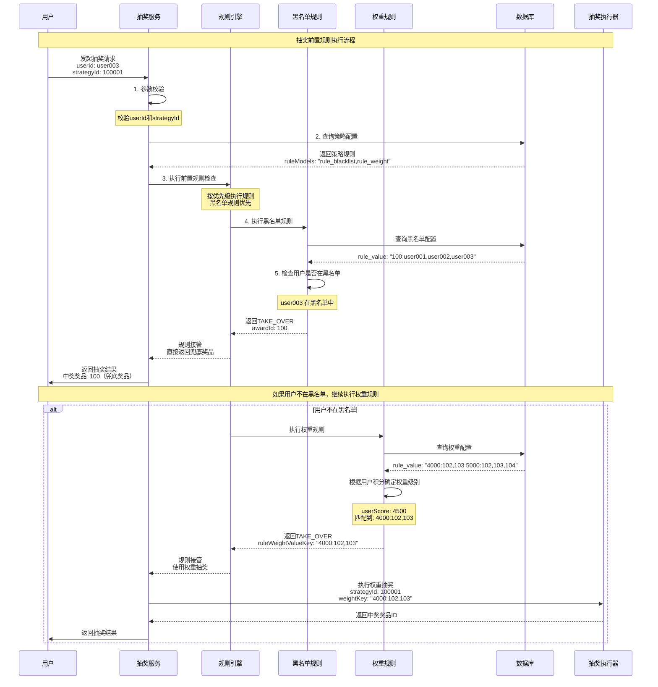
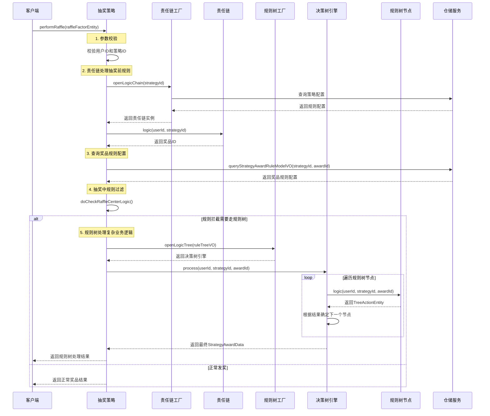
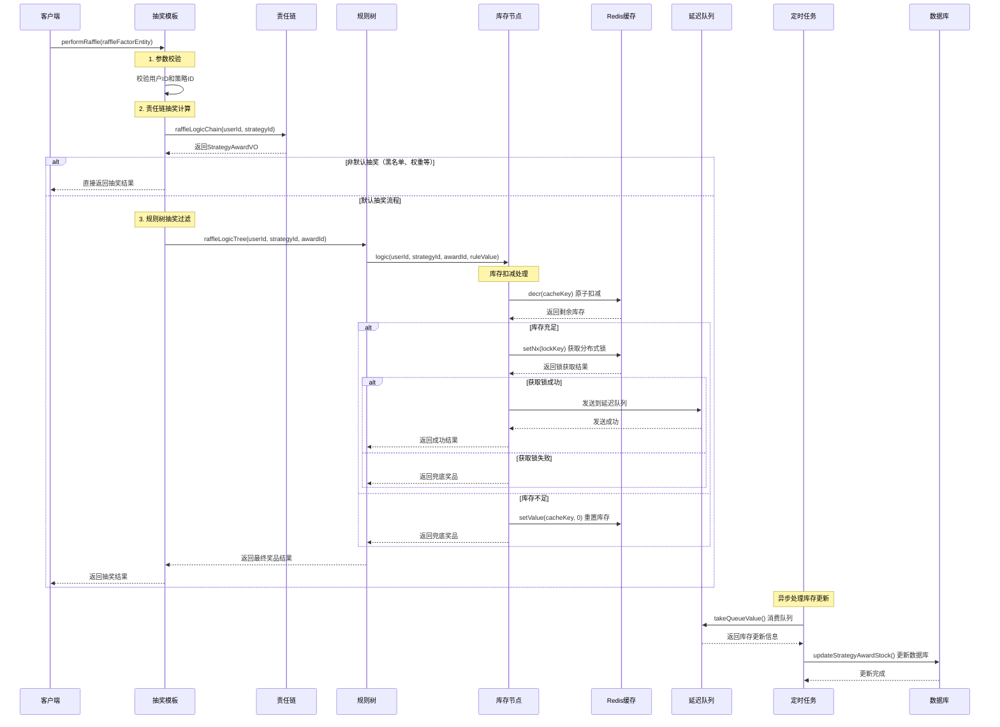

# Big-Market 大营销平台项目笔记

## 1. 系统架构和表结构设计

### 1.1 系统架构概述

Big-Market 是一个基于 **DDD（领域驱动设计）** 架构的大营销平台项目，主要用于实现抽奖系统功能。项目采用 Spring Boot 3.2.0 + MyBatis + MySQL 8.0 技术栈。

#### 1.1.1 模块架构

项目采用多模块Maven结构，遵循DDD分层架构：

```
Big-Market (父模块)
├── Big-Market-app          # 应用启动层
├── Big-Market-trigger      # 触发器层 (接口层)
├── Big-Market-domain       # 领域层 (核心业务逻辑)
├── Big-Market-infrastructure # 基础设施层 (数据访问)
└── Big-Market-types        # 通用类型层
```

#### 1.1.2 DDD分层架构说明

| 层级 | 模块 | 职责 | 主要内容 |
|------|------|------|----------|
| **应用层** | Big-Market-app | 应用启动和配置 | Spring Boot启动类、配置文件、线程池配置 |
| **接口层** | Big-Market-trigger | 对外接口适配 | HTTP接口、定时任务、消息监听器 |
| **领域层** | Big-Market-domain | 核心业务逻辑 | 实体、值对象、聚合、领域服务、仓储接口 |
| **基础设施层** | Big-Market-infrastructure | 技术实现 | 数据访问、外部接口调用、仓储实现 |
| **通用层** | Big-Market-types | 通用类型定义 | 枚举、异常、通用工具类 |

#### 1.1.3 技术栈

- **框架**: Spring Boot 3.2.0
- **数据库**: MySQL 8.0.22
- **ORM**: MyBatis 2.1.4
- **连接池**: HikariCP
- **缓存**: Google Guava Cache
- **JSON**: FastJSON 2.0.28
- **工具库**: Apache Commons Lang3, Google Guava
- **认证**: JWT (jjwt, java-jwt)

### 1.2 数据库表结构设计

#### 1.2.1 表结构概览

系统目前包含3个核心表，构成了抽奖系统的基础数据模型：

| 表名 | 中文名称 | 主要功能 |
|------|----------|----------|
| `award` | 奖品表 | 存储奖品基础信息和发奖策略配置 |
| `strategy` | 抽奖策略表 | 定义抽奖策略的基本信息 |
| `strategy_award` | 策略奖品关联表 | 配置策略下的奖品概率和库存 |
| `strategy_rule` | 策略规则表 | 定义抽奖规则和限制条件 |

#### 1.2.2 详细表结构

##### 1. award 奖品表

```sql
CREATE TABLE `award` (
    `id` int(11) unsigned NOT NULL AUTO_INCREMENT COMMENT '自增ID',
    `award_id` int(8) NOT NULL COMMENT '抽奖奖品ID - 内部流转使用',
    `award_key` varchar(32) NOT NULL COMMENT '奖品对接标识 - 每一个都是一个对应的发奖策略',
    `award_config` varchar(32) NOT NULL COMMENT '奖品配置信息',
    `award_desc` varchar(128) NOT NULL COMMENT '奖品内容描述',
    `create_time` datetime NOT NULL DEFAULT CURRENT_TIMESTAMP COMMENT '创建时间',
    `update_time` datetime NOT NULL DEFAULT CURRENT_TIMESTAMP ON UPDATE CURRENT_TIMESTAMP COMMENT '更新时间',
    PRIMARY KEY (`id`)
) ENGINE=InnoDB DEFAULT CHARSET=utf8mb4;
```

**字段说明：**
- `award_id`: 奖品的唯一标识，用于系统内部流转
- `award_key`: 奖品对接标识，对应不同的发奖策略（如：user_credit_random、openai_use_count、openai_model）
- `award_config`: 奖品配置参数，如积分范围、使用次数等
- `award_desc`: 奖品的描述信息

##### 2. strategy 抽奖策略表

```sql
CREATE TABLE `strategy` (
    `id` bigint(11) unsigned NOT NULL AUTO_INCREMENT COMMENT '自增ID',
    `strategy_id` bigint(8) NOT NULL COMMENT '抽奖策略ID',
    `strategy_desc` varchar(128) NOT NULL COMMENT '抽奖策略描述',
    `create_time` datetime NOT NULL DEFAULT CURRENT_TIMESTAMP COMMENT '创建时间',
    `update_time` datetime NOT NULL DEFAULT CURRENT_TIMESTAMP ON UPDATE CURRENT_TIMESTAMP COMMENT '更新时间',
    PRIMARY KEY (`id`),
    KEY `idx_strategy_id` (`strategy_id`)
) ENGINE=InnoDB DEFAULT CHARSET=utf8mb4;
```

**字段说明：**
- `strategy_id`: 抽奖策略的唯一标识
- `strategy_desc`: 策略描述信息

##### 3. strategy_award 策略奖品关联表

```sql
CREATE TABLE `strategy_award` (
    `id` bigint(11) unsigned NOT NULL AUTO_INCREMENT COMMENT '自增ID',
    `strategy_id` bigint(8) NOT NULL COMMENT '抽奖策略ID',
    `award_id` int(8) NOT NULL COMMENT '抽奖奖品ID - 内部流转使用',
    `award_title` varchar(128) NOT NULL COMMENT '抽奖奖品标题',
    `award_subtitle` varchar(128) DEFAULT NULL COMMENT '抽奖奖品副标题',
    `award_count` int(8) NOT NULL DEFAULT '0' COMMENT '奖品库存总量',
    `award_count_surplus` int(8) NOT NULL DEFAULT '0' COMMENT '奖品库存剩余',
    `award_rate` decimal(6,4) NOT NULL COMMENT '奖品中奖概率',
    `rule_models` varchar(256) DEFAULT NULL COMMENT '规则模型，rule配置的模型同步到此表，便于使用',
    `sort` int(2) NOT NULL DEFAULT '0' COMMENT '排序',
    `create_time` datetime NOT NULL DEFAULT CURRENT_TIMESTAMP COMMENT '创建时间',
    `update_time` datetime NOT NULL DEFAULT CURRENT_TIMESTAMP ON UPDATE CURRENT_TIMESTAMP COMMENT '修改时间',
    PRIMARY KEY (`id`),
    KEY `idx_strategy_id_award_id` (`strategy_id`,`award_id`)
) ENGINE=InnoDB DEFAULT CHARSET=utf8mb4;
```

**字段说明：**
- `award_rate`: 奖品中奖概率，使用decimal(6,4)精确控制概率
- `award_count/award_count_surplus`: 库存管理，支持库存扣减
- `rule_models`: 关联的规则模型，支持多规则组合

##### 4. strategy_rule 策略规则表

```sql
CREATE TABLE `strategy_rule` (
    `id` bigint(11) unsigned NOT NULL AUTO_INCREMENT COMMENT '自增ID',
    `strategy_id` int(8) NOT NULL COMMENT '抽奖策略ID',
    `award_id` int(8) DEFAULT NULL COMMENT '抽奖奖品ID【规则类型为策略，则不需要奖品ID】',
    `rule_type` tinyint(1) NOT NULL DEFAULT '0' COMMENT '抽象规则类型；1-策略规则、2-奖品规则',
    `rule_model` varchar(16) NOT NULL COMMENT '抽奖规则类型【rule_random - 随机值计算、rule_lock - 抽奖几次后解锁、rule_luck_award - 幸运奖(兜底奖品)】',
    `rule_value` varchar(64) NOT NULL COMMENT '抽奖规则比值',
    `rule_desc` varchar(128) NOT NULL COMMENT '抽奖规则描述',
    `create_time` datetime NOT NULL DEFAULT CURRENT_TIMESTAMP COMMENT '创建时间',
    `update_time` datetime NOT NULL DEFAULT CURRENT_TIMESTAMP ON UPDATE CURRENT_TIMESTAMP COMMENT '更新时间',
    PRIMARY KEY (`id`),
    KEY `idx_strategy_id_award_id` (`strategy_id`,`award_id`)
) ENGINE=InnoDB DEFAULT CHARSET=utf8mb4;
```

**字段说明：**
- `rule_type`: 规则类型，1-策略规则（全局）、2-奖品规则（针对特定奖品）
- `rule_model`: 规则模型类型
  - `rule_random`: 随机值计算
  - `rule_lock`: 抽奖次数解锁机制
  - `rule_luck_award`: 幸运奖（兜底奖品）
  - `rule_weight`: 权重规则
  - `rule_blacklist`: 黑名单规则
- `rule_value`: 规则的具体配置值

#### 1.2.3 表关系图



#### 1.2.4 业务规则设计

##### 规则模型类型

| 规则模型 | 说明 | 应用场景 | 配置示例 |
|----------|------|----------|----------|
| `rule_random` | 随机值计算 | 随机积分奖品 | `1,1000` (1-1000随机积分) |
| `rule_lock` | 解锁机制 | 抽奖次数达到后解锁高级奖品 | `1` (抽奖1次后解锁) |
| `rule_luck_award` | 兜底奖品 | 保底机制，确保用户有奖品 | `1,100` (1-100随机积分) |
| `rule_weight` | 权重规则 | 消耗积分必中奖 | `6000,102,103,104...` |
| `rule_blacklist` | 黑名单规则 | 黑名单用户处理 | `1` (启用黑名单) |

##### 奖品类型

根据数据分析，系统支持以下奖品类型：
- **积分奖品**: 随机积分奖励
- **使用次数**: OpenAI服务使用次数（5次、10次、20次、100次）
- **模型权限**: OpenAI模型访问权限（GPT-4、DALL-E-2、DALL-E-3）
- **组合奖品**: 多种模型权限组合

## 2. 策略概率装配与权重装配机制

### 2.1 核心概念

#### 2.1.1 策略概率装配

**策略概率装配**是将数据库中配置的奖品概率信息转换为高效的**概率查找表**的过程，目的是在抽奖时能够快速、准确地根据概率分布选择奖品。

**核心思想：** 将概率转换为数组索引，通过随机数生成索引来实现概率抽奖。

**技术优势：**
- **O(1)时间复杂度**：通过数组索引直接获取结果
- **内存预计算**：启动时装配，运行时无需计算
- **精确概率控制**：支持小数点后4位精度

#### 2.1.2 策略权重装配

**策略权重装配**是根据用户的**消耗积分**或**等级**等条件，为不同用户群体提供不同奖品池的机制。

**核心思想：** 消耗积分越多，能够获得的奖品种类越丰富，实现"花钱越多，奖品越好"的营销策略。

**业务价值：**
- **差异化营销**：不同用户群体享受不同奖品池
- **消费激励**：鼓励用户消耗更多积分
- **精准运营**：根据用户价值提供对应服务

### 2.2 概率装配算法原理

#### 2.2.1 概率转换算法

假设有以下奖品配置：
- 奖品A：概率 0.01 (1%)
- 奖品B：概率 0.05 (5%)
- 奖品C：概率 0.1 (10%)
- 奖品D：概率 0.84 (84%)

**算法步骤：**

1. **计算概率范围**
```java
// 最小概率：0.01
// 总概率：1.0
// 概率范围：1.0 ÷ 0.01 = 100
BigDecimal rateRange = totalAwardRate.divide(minAwardRate, 0, RoundingMode.CEILING);
```

2. **生成概率查找表**
```java
// 概率范围 = 100
// 奖品A (1%)：占用 100 × 0.01 = 1 个位置
// 奖品B (5%)：占用 100 × 0.05 = 5 个位置
// 奖品C (10%)：占用 100 × 0.1 = 10 个位置
// 奖品D (84%)：占用 100 × 0.84 = 84 个位置

// 最终数组：[A, B,B,B,B,B, C,C,C,C,C,C,C,C,C,C, D,D,D,D...84个D]
```

3. **随机化和索引映射**
```java
// 乱序处理，避免规律性
Collections.shuffle(strategyAwardSearchRateTables);

// 转换为Map结构：{索引 -> 奖品ID}
// {0: 102, 1: 105, 2: 102, 3: 104, ...}
```

#### 2.2.2 抽奖执行过程

```java
// 1. 生成随机数：random.nextInt(100) → 假设得到 45
// 2. 从Redis获取：map.get(45) → 假设得到奖品ID 104
// 3. 返回中奖结果：奖品ID 104
```

### 2.3 权重装配机制

#### 2.3.1 权重规则配置

权重规则的配置格式：`积分值:奖品ID列表`

**配置示例：**
```
rule_value: "4000:102,103,104,105 5000:102,103,104,105,106,107 6000:102,103,104,105,106,107,108,109"
```

**含义解释：**
- **4000积分**：可以抽取奖品 102,103,104,105（基础奖品池）
- **5000积分**：可以抽取奖品 102,103,104,105,106,107（中级奖品池）
- **6000积分**：可以抽取奖品 102,103,104,105,106,107,108,109（高级奖品池）

#### 2.3.2 权重装配过程

**装配示例：**

假设原始策略包含奖品：102,103,104,105,106,107,108,109

1. **4000积分级别**：
   - 过滤奖品：保留 102,103,104,105
   - 生成概率表：`strategy_100001_4000:102,103,104,105`

2. **5000积分级别**：
   - 过滤奖品：保留 102,103,104,105,106,107
   - 生成概率表：`strategy_100001_5000:102,103,104,105,106,107`

3. **6000积分级别**：
   - 过滤奖品：保留 102,103,104,105,106,107,108,109
   - 生成概率表：`strategy_100001_6000:102,103,104,105,106,107,108,109`

### 2.4 Redis存储结构设计

#### 2.4.1 存储Key设计

```java
public static class RedisKey {
    // 策略基础信息
    public static String STRATEGY_KEY = "big_market_strategy_key_";
    // 策略奖品列表
    public static String STRATEGY_AWARD_KEY = "big_market_strategy_award_key_";
    // 概率查找表
    public static String STRATEGY_RATE_TABLE_KEY = "big_market_strategy_rate_table_key_";
    // 概率范围
    public static String STRATEGY_RATE_RANGE_KEY = "big_market_strategy_rate_range_key_";
}
```

#### 2.4.2 实际存储示例

**基础策略存储：**
```redis
# 概率查找表
big_market_strategy_rate_table_key_100001: {0: 102, 1: 105, 2: 102, ...}
# 概率范围
big_market_strategy_rate_range_key_100001: 10000
```

**权重策略存储：**
```redis
# 4000积分级别
big_market_strategy_rate_table_key_100001_4000:102,103,104,105: {0: 102, 1: 103, ...}
big_market_strategy_rate_range_key_100001_4000:102,103,104,105: 5000

# 6000积分级别
big_market_strategy_rate_table_key_100001_6000:102,103,104,105,106,107,108,109: {0: 108, 1: 102, ...}
big_market_strategy_rate_range_key_100001_6000:102,103,104,105,106,107,108,109: 10000
```

### 2.5 策略装配时序图解

#### 2.5.1 概率装配处理时序



#### 2.5.2 权重装配处理时序



#### 2.5.3 抽奖执行时序



```mermaid

```

### 2.6 核心代码实现

#### 2.6.1 策略装配核心方法

```java
@Service
public class StrategyArmoryDispatch implements IStrategyArmory, IStrategyDispatch {

    /**
     * 装配抽奖策略配置
     * @param strategyId 策略ID
     * @return 装配结果
     */
    @Override
    public boolean assembleLotteryStrategy(Long strategyId) {
        // 1. 查询策略配置
        List<StrategyAwardEntity> strategyAwardEntities = repository.queryStrategyAwardList(strategyId);
        assembleLotteryStrategy(String.valueOf(strategyId), strategyAwardEntities);

        // 2. 权重策略配置 - 使用于 rule_weight 权重规则配置
        StrategyEntity strategyEntity = repository.queryStrategyEntityByStrategyId(strategyId);
        String ruleWeight = strategyEntity.getRuleWeight();
        if (null == ruleWeight) return true;

        StrategyRuleEntity strategyRuleEntity = repository.queryStrategyRule(strategyId, ruleWeight);
        if (null == strategyRuleEntity) {
            throw new AppException(ResponseCode.STRATEGY_RULE_WEIGHT_IS_NULL.getCode(),
                                 ResponseCode.STRATEGY_RULE_WEIGHT_IS_NULL.getInfo());
        }

        Map<String, List<Integer>> ruleWeightValueMap = strategyRuleEntity.getRuleWeightValues();
        Set<String> keys = ruleWeightValueMap.keySet();
        for (String key : keys) {
            List<Integer> ruleWeightValues = ruleWeightValueMap.get(key);
            ArrayList<StrategyAwardEntity> strategyAwardEntitiesClone = new ArrayList<>(strategyAwardEntities);
            strategyAwardEntitiesClone.removeIf(entity -> !ruleWeightValues.contains(entity.getAwardId()));
            assembleLotteryStrategy(String.valueOf(strategyId).concat("_").concat(key), strategyAwardEntitiesClone);
        }

        return true;
    }

    /**
     * 概率装配核心算法
     */
    private void assembleLotteryStrategy(String key, List<StrategyAwardEntity> strategyAwardEntities) {
        // 1. 获取最小概率值
        BigDecimal minAwardRate = strategyAwardEntities.stream()
                .map(StrategyAwardEntity::getAwardRate).min(BigDecimal::compareTo).orElse(BigDecimal.ZERO);

        // 2. 获取概率值总和
        BigDecimal totalAwardRate = strategyAwardEntities.stream()
                .map(StrategyAwardEntity::getAwardRate).reduce(BigDecimal.ZERO, BigDecimal::add);

        // 3. 用 1 % 0.0001 获取概率范围，百分位、千分位、万分位
        BigDecimal rateRange = totalAwardRate.divide(minAwardRate, 0, RoundingMode.CEILING);

        // 4. 生成策略奖品概率查找表
        ArrayList<Integer> strategyAwardSearchRateTables = new ArrayList<>(rateRange.intValue());
        for (StrategyAwardEntity strategyAward : strategyAwardEntities) {
            Integer awardId = strategyAward.getAwardId();
            BigDecimal awardRate = strategyAward.getAwardRate();

            // 计算出每个概率值需要存放到查找表的数量，循环填充
            for (int i=0; i<rateRange.multiply(awardRate).setScale(0, RoundingMode.CEILING).intValue(); i++) {
                strategyAwardSearchRateTables.add(awardId);
            }
        }

        // 5. 对存储的奖品进行乱序操作
        Collections.shuffle(strategyAwardSearchRateTables);

        // 6. 生成出Map集合，key值，对应的就是后续的概率值。通过概率来获得对应的奖品ID
        HashMap<Integer, Integer> shuffledStrategyAwardSearchRateTables = new HashMap<>();
        for (int i=0; i<strategyAwardSearchRateTables.size(); i++) {
            shuffledStrategyAwardSearchRateTables.put(i, strategyAwardSearchRateTables.get(i));
        }

        // 7. 存储到 Redis
        repository.storeStrategyAwardSearchRateTable(key, rateRange, shuffledStrategyAwardSearchRateTables);
    }
}
```

#### 2.6.2 抽奖调度方法

```java
/**
 * 普通抽奖
 */
@Override
public Integer getRandomAwardId(Long strategyId) {
    // 分布式部署下，不一定为当前应用做的策略装配。也就是值不一定会保存到本应用，而是分布式应用，所以需要从 Redis 中获取。
    int rateRange = repository.getRateRange(strategyId);
    // 通过生成的随机值，获取概率值奖品查找表的结果
    return repository.getStrategyAwardAssemble(String.valueOf(strategyId), new SecureRandom().nextInt(rateRange));
}

/**
 * 权重抽奖
 */
@Override
public Integer getRandomAwardId(Long strategyId, String ruleWeightValue) {
    String key = String.valueOf(strategyId).concat("_").concat(ruleWeightValue);
    // 分布式部署下，不一定为当前应用做的策略装配。也就是值不一定会保存到本应用，而是分布式应用，所以需要从 Redis 中获取。
    int rateRange = repository.getRateRange(key);
    // 通过生成的随机值，获取概率值奖品查找表的结果
    return repository.getStrategyAwardAssemble(key, new SecureRandom().nextInt(rateRange));
}
```

### 2.7 详细执行步骤

#### 2.7.1 策略装配详细步骤

**步骤A：数据准备阶段**
1. 从数据库查询策略ID对应的所有奖品配置
2. 获取每个奖品的概率值（BigDecimal类型，精确到小数点后4位）
3. 检查策略是否包含权重规则配置

**步骤B：概率计算阶段**
1. 遍历所有奖品，找出最小概率值（如：0.0001）
2. 计算所有奖品概率的总和（通常为1.0000）
3. 计算概率范围：总和 ÷ 最小值 = 查找表大小（如：10000）

**步骤C：查找表生成阶段**
1. 创建ArrayList，大小为概率范围值
2. 遍历每个奖品：
   - 计算该奖品需要占用的位置数：范围 × 奖品概率
   - 将奖品ID重复添加到ArrayList中对应次数
3. 使用Collections.shuffle()打乱数组顺序
4. 将ArrayList转换为HashMap<索引, 奖品ID>

**步骤D：权重处理阶段**（如果存在权重规则）
1. 解析权重规则字符串：`"4000:102,103,104,105 5000:102,103,104,105,106,107"`
2. 按空格分割得到各个权重级别
3. 对每个权重级别：
   - 按冒号分割得到积分值和奖品列表
   - 过滤原始奖品列表，只保留权重规则中的奖品
   - 为过滤后的奖品列表执行步骤B和C
   - 使用包含权重标识的key存储到Redis

**步骤E：Redis存储阶段**
1. 存储概率范围：`big_market_strategy_rate_range_key_{key}` → 范围值
2. 存储概率查找表：`big_market_strategy_rate_table_key_{key}` → HashMap

#### 2.7.2 抽奖执行详细步骤

**普通抽奖流程：**
1. 接收策略ID参数
2. 从Redis获取概率范围：`getRateRange(strategyId)`
3. 生成随机索引：`new SecureRandom().nextInt(rateRange)`
4. 从Redis概率表获取奖品：`getStrategyAwardAssemble(key, randomIndex)`
5. 返回中奖奖品ID

**权重抽奖流程：**
1. 接收策略ID和权重值参数
2. 构造权重key：`strategyId + "_" + ruleWeightValue`
3. 从Redis获取对应权重级别的概率范围
4. 生成随机索引并获取奖品ID
5. 返回中奖结果

### 2.8 实际使用示例

#### 2.8.1 配置示例

**数据库配置：**

```sql
-- 策略表
INSERT INTO strategy (strategy_id, strategy_desc, rule_models)
VALUES (100001, '新用户注册抽奖', 'rule_weight');

-- 奖品表
INSERT INTO award (award_id, award_key, award_config, award_desc) VALUES
(101, 'user_credit_random', '1,100', '随机积分1-100'),
(102, 'user_credit_random', '1,200', '随机积分1-200'),
(103, 'openai_use_count', '5', 'OpenAI使用次数5次'),
(104, 'openai_use_count', '10', 'OpenAI使用次数10次'),
(105, 'openai_model', 'gpt-4', 'GPT-4模型权限');

-- 策略奖品关联表
INSERT INTO strategy_award (strategy_id, award_id, award_title, award_rate) VALUES
(100001, 101, '随机积分', 0.6000),
(100001, 102, '随机积分Plus', 0.2000),
(100001, 103, '5次使用权', 0.1000),
(100001, 104, '10次使用权', 0.0800),
(100001, 105, 'GPT-4权限', 0.0200);

-- 策略规则表
INSERT INTO strategy_rule (strategy_id, rule_type, rule_model, rule_value, rule_desc) VALUES
(100001, 1, 'rule_weight', '4000:101,102,103 5000:101,102,103,104 6000:101,102,103,104,105', '权重规则配置');
```

#### 2.8.2 代码使用示例

```java
@Test
public void testStrategyArmory() {
    // 1. 装配策略
    boolean success = strategyArmory.assembleLotteryStrategy(100001L);
    log.info("策略装配结果：{}", success);

    // 2. 普通抽奖测试
    for (int i = 0; i < 10; i++) {
        Integer awardId = strategyDispatch.getRandomAwardId(100001L);
        log.info("普通抽奖结果：{}", awardId);
    }

    // 3. 权重抽奖测试
    // 4000积分用户（只能抽到基础奖品）
    for (int i = 0; i < 5; i++) {
        Integer awardId = strategyDispatch.getRandomAwardId(100001L, "4000:101,102,103");
        log.info("4000积分抽奖结果：{}", awardId);
    }

    // 6000积分用户（可以抽到所有奖品）
    for (int i = 0; i < 5; i++) {
        Integer awardId = strategyDispatch.getRandomAwardId(100001L, "6000:101,102,103,104,105");
        log.info("6000积分抽奖结果：{}", awardId);
    }
}
```

#### 2.8.3 Redis存储结果示例

```redis
# 基础策略概率表（所有奖品）
127.0.0.1:6379> HGETALL big_market_strategy_rate_table_key_100001
1) "0"
2) "101"
3) "1"
4) "102"
5) "2"
6) "101"
...
9999) "101"

# 基础策略概率范围
127.0.0.1:6379> GET big_market_strategy_rate_range_key_100001
"10000"

# 4000积分权重策略概率表（只有101,102,103）
127.0.0.1:6379> HGETALL big_market_strategy_rate_table_key_100001_4000:101,102,103
1) "0"
2) "101"
3) "1"
4) "103"
5) "2"
6) "102"
...

# 6000积分权重策略概率表（包含所有奖品）
127.0.0.1:6379> HGETALL big_market_strategy_rate_table_key_100001_6000:101,102,103,104,105
1) "0"
2) "105"
3) "1"
4) "101"
5) "2"
6) "104"
...
```

这套策略装配机制通过巧妙的算法设计，将复杂的概率计算转换为简单的数组查找，既保证了抽奖的公平性和准确性，又提供了出色的性能表现，是一个非常优秀的抽奖系统核心设计。

## 3. 抽奖前置规则引擎

### 3.1 前置规则概述

#### 3.1.1 什么是抽奖前置规则？

**抽奖前置规则**是在正式执行抽奖逻辑之前，对用户的抽奖资格、权限和条件进行预先检查和过滤的机制。它是抽奖系统的"守门员"，确保只有符合条件的用户才能参与抽奖，并为不同用户提供差异化的抽奖体验。

**核心作用：**
- **资格校验**：检查用户是否有抽奖资格
- **权限控制**：根据用户等级提供不同奖品池
- **风险控制**：黑名单用户拦截和处理
- **业务规则**：实现复杂的营销策略

#### 3.1.2 规则引擎架构设计

**设计模式：** 策略模式 + 工厂模式 + 责任链模式

**核心组件：**
- **规则接口**：`ILogicFilter` - 统一的规则过滤接口
- **规则工厂**：`DefaultLogicFactory` - 管理和创建规则实例
- **规则注解**：`@LogicStrategy` - 标识规则类型
- **规则实体**：`RuleActionEntity` - 封装规则执行结果

### 3.2 规则引擎核心架构

#### 3.2.1 规则过滤接口设计

```java
/**
 * 抽奖规则过滤接口
 */
public interface ILogicFilter<T extends RuleActionEntity.RaffleEntity> {
    RuleActionEntity<T> filter(RuleMatterEntity ruleMatterEntity);
}
```

**接口特点：**
- **泛型设计**：支持不同阶段的规则实体（抽奖前、抽奖中、抽奖后）
- **统一入参**：`RuleMatterEntity` 包含规则执行所需的所有参数
- **统一出参**：`RuleActionEntity` 封装规则执行结果和后续动作

#### 3.2.2 规则工厂设计

```java
@Service
public class DefaultLogicFactory {
    public Map<String, ILogicFilter<?>> logicFilterMap = new ConcurrentHashMap<>();

    public DefaultLogicFactory(List<ILogicFilter<?>> logicFilters) {
        logicFilters.forEach(logic -> {
            LogicStrategy strategy = AnnotationUtils.findAnnotation(logic.getClass(), LogicStrategy.class);
            if (null != strategy) {
                logicFilterMap.put(strategy.logicMode().getCode(), logic);
            }
        });
    }

    public <T extends RuleActionEntity.RaffleEntity> Map<String, ILogicFilter<T>> openLogicFilter() {
        return (Map<String, ILogicFilter<T>>) (Map<?, ?>) logicFilterMap;
    }
}
```

**工厂特点：**
- **自动注册**：通过注解自动发现和注册规则实现
- **类型安全**：泛型确保类型安全
- **高性能**：使用ConcurrentHashMap提供线程安全的高性能访问

#### 3.2.3 规则执行结果设计

```java
@Data
@Builder
public class RuleActionEntity<T extends RuleActionEntity.RaffleEntity> {
    private String code = RuleLogicCheckTypeVO.ALLOW.getCode();
    private String info = RuleLogicCheckTypeVO.ALLOW.getInfo();
    private String ruleModel;
    private T data;
}
```

**结果类型：**
- **ALLOW (0000)**：放行，执行后续流程
- **TAKE_OVER (0001)**：接管，规则引擎控制后续流程

### 3.3 已实现的前置规则

#### 3.3.1 权重规则 (rule_weight)

**功能描述：** 根据用户积分等级，动态确定用户可参与的奖品池范围。

**规则配置格式：**
```
rule_value: "4000:102,103,104,105 5000:102,103,104,105,106,107 6000:102,103,104,105,106,107,108,109"
```

**核心实现：**

```java
@Component
@LogicStrategy(logicMode = DefaultLogicFactory.LogicModel.RULE_WIGHT)
public class RuleWeightLogicFilter implements ILogicFilter<RuleActionEntity.RaffleBeforeEntity> {

    @Override
    public RuleActionEntity<RuleActionEntity.RaffleBeforeEntity> filter(RuleMatterEntity ruleMatterEntity) {
        // 1. 获取用户积分（当前写死，实际应从数据库查询）
        Long userScore = 4500L;

        // 2. 解析权重规则配置
        Map<Long, String> analyticalValueGroup = getAnalyticalValue(ruleValue);

        // 3. 找出用户积分对应的权重级别
        Long nextValue = analyticalSortedKeys.stream()
                .filter(key -> userScore >= key)
                .findFirst()
                .orElse(null);

        if (null != nextValue) {
            return RuleActionEntity.<RuleActionEntity.RaffleBeforeEntity>builder()
                    .data(RuleActionEntity.RaffleBeforeEntity.builder()
                            .strategyId(strategyId)
                            .ruleWeightValueKey(analyticalValueGroup.get(nextValue))
                            .build())
                    .code(RuleLogicCheckTypeVO.TAKE_OVER.getCode())
                    .build();
        }

        return RuleActionEntity.<RuleActionEntity.RaffleBeforeEntity>builder()
                .code(RuleLogicCheckTypeVO.ALLOW.getCode())
                .build();
    }
}
```

**执行逻辑：**
1. 获取用户当前积分
2. 解析权重规则配置，得到积分-奖品映射
3. 根据用户积分找到对应的权重级别
4. 返回权重值Key，用于后续的权重抽奖

**业务价值：**
- **差异化服务**：不同积分用户享受不同奖品池
- **消费激励**：鼓励用户消耗更多积分获得更好奖品
- **精准营销**：根据用户价值提供对应的奖励

#### 3.3.2 黑名单规则 (rule_blacklist)

**功能描述：** 对黑名单用户进行拦截，直接返回指定的兜底奖品，避免正常抽奖流程。

**规则配置格式：**
```
rule_value: "100:user001,user002,user003"
```
- `100`：黑名单用户获得的兜底奖品ID
- `user001,user002,user003`：黑名单用户列表

**核心实现：**

```java
@Component
@LogicStrategy(logicMode = DefaultLogicFactory.LogicModel.RULE_BLACKLIST)
public class RuleBackListLogicFilter implements ILogicFilter<RuleActionEntity.RaffleBeforeEntity> {

    @Override
    public RuleActionEntity<RuleActionEntity.RaffleBeforeEntity> filter(RuleMatterEntity ruleMatterEntity) {
        String userId = ruleMatterEntity.getUserId();

        // 查询黑名单规则配置
        String ruleValue = repository.queryStrategyRuleValue(ruleMatterEntity.getStrategyId(),
                                                           ruleMatterEntity.getAwardId(),
                                                           ruleMatterEntity.getRuleModel());

        // 解析配置：100:user001,user002,user003
        String[] splitRuleValue = ruleValue.split(Constants.COLON);
        Integer awardId = Integer.parseInt(splitRuleValue[0]);
        String[] userBlackIds = splitRuleValue[1].split(Constants.SPLIT);

        // 检查用户是否在黑名单中
        for (String userBlackId : userBlackIds) {
            if (userId.equals(userBlackId)) {
                return RuleActionEntity.<RuleActionEntity.RaffleBeforeEntity>builder()
                        .ruleModel(DefaultLogicFactory.LogicModel.RULE_BLACKLIST.getCode())
                        .data(RuleActionEntity.RaffleBeforeEntity.builder()
                                .strategyId(ruleMatterEntity.getStrategyId())
                                .awardId(awardId)
                                .build())
                        .code(RuleLogicCheckTypeVO.TAKE_OVER.getCode())
                        .build();
            }
        }

        return RuleActionEntity.<RuleActionEntity.RaffleBeforeEntity>builder()
                .code(RuleLogicCheckTypeVO.ALLOW.getCode())
                .build();
    }
}
```

**执行逻辑：**
1. 获取用户ID
2. 查询黑名单规则配置
3. 解析配置得到兜底奖品ID和黑名单用户列表
4. 检查当前用户是否在黑名单中
5. 如果在黑名单中，直接返回兜底奖品；否则放行

### 3.4 规则执行流程

#### 3.4.1 规则执行时序图



#### 3.4.2 规则优先级和执行顺序

**规则执行原则：**
1. **黑名单规则优先**：最高优先级，一旦命中立即返回
2. **权重规则次之**：在黑名单检查通过后执行
3. **其他规则**：按配置顺序依次执行
4. **短路机制**：任何规则返回TAKE_OVER都会中断后续规则执行

**核心执行代码：**

```java
@Override
protected RuleActionEntity<RuleActionEntity.RaffleBeforeEntity> doCheckRaffleBeforeLogic(
        RaffleFactorEntity raffleFactorEntity, String... logics) {

    Map<String, ILogicFilter<RuleActionEntity.RaffleBeforeEntity>> logicFilterGroup = logicFactory.openLogicFilter();

    // 1. 黑名单规则优先过滤
    String ruleBackList = Arrays.stream(logics)
            .filter(str -> str.contains(DefaultLogicFactory.LogicModel.RULE_BLACKLIST.getCode()))
            .findFirst()
            .orElse(null);

    if (StringUtils.isNotBlank(ruleBackList)) {
        ILogicFilter<RuleActionEntity.RaffleBeforeEntity> logicFilter =
            logicFilterGroup.get(DefaultLogicFactory.LogicModel.RULE_BLACKLIST.getCode());

        RuleActionEntity<RuleActionEntity.RaffleBeforeEntity> ruleActionEntity =
            logicFilter.filter(ruleMatterEntity);

        // 黑名单命中则直接返回
        if (!RuleLogicCheckTypeVO.ALLOW.getCode().equals(ruleActionEntity.getCode())) {
            return ruleActionEntity;
        }
    }

    // 2. 其他规则按顺序执行
    List<String> ruleList = Arrays.stream(logics)
            .filter(s -> !s.equals(DefaultLogicFactory.LogicModel.RULE_BLACKLIST.getCode()))
            .collect(Collectors.toList());

    RuleActionEntity<RuleActionEntity.RaffleBeforeEntity> ruleActionEntity = null;
    for (String ruleModel : ruleList) {
        ILogicFilter<RuleActionEntity.RaffleBeforeEntity> logicFilter = logicFilterGroup.get(ruleModel);
        ruleActionEntity = logicFilter.filter(ruleMatterEntity);

        // 非放行结果则中断执行
        if (!RuleLogicCheckTypeVO.ALLOW.getCode().equals(ruleActionEntity.getCode())) {
            return ruleActionEntity;
        }
    }

    return ruleActionEntity;
}
```

#### 3.4.3 规则结果处理

**抽奖主流程中的规则结果处理：**

```java
@Override
public RaffleAwardEntity performRaffle(RaffleFactorEntity raffleFactorEntity) {
    // 1. 参数校验
    String userId = raffleFactorEntity.getUserId();
    Long strategyId = raffleFactorEntity.getStrategyId();

    // 2. 策略查询
    StrategyEntity strategy = repository.queryStrategyEntityByStrategyId(strategyId);

    // 3. 抽奖前规则过滤
    RuleActionEntity<RuleActionEntity.RaffleBeforeEntity> ruleActionEntity =
        this.doCheckRaffleBeforeLogic(raffleFactorEntity, strategy.ruleModels());

    // 4. 根据规则结果执行不同逻辑
    if (RuleLogicCheckTypeVO.TAKE_OVER.getCode().equals(ruleActionEntity.getCode())) {
        if (DefaultLogicFactory.LogicModel.RULE_BLACKLIST.getCode().equals(ruleActionEntity.getRuleModel())) {
            // 黑名单用户：直接返回兜底奖品
            return RaffleAwardEntity.builder()
                    .awardId(ruleActionEntity.getData().getAwardId())
                    .build();
        } else if (DefaultLogicFactory.LogicModel.RULE_WIGHT.getCode().equals(ruleActionEntity.getRuleModel())) {
            // 权重用户：使用权重抽奖
            RuleActionEntity.RaffleBeforeEntity raffleBeforeEntity = ruleActionEntity.getData();
            String ruleWeightValueKey = raffleBeforeEntity.getRuleWeightValueKey();
            Integer awardId = strategyDispatch.getRandomAwardId(strategyId, ruleWeightValueKey);
            return RaffleAwardEntity.builder()
                    .awardId(awardId)
                    .build();
        }
    }

    // 5. 规则放行：执行普通抽奖
    Integer awardId = strategyDispatch.getRandomAwardId(strategyId);
    return RaffleAwardEntity.builder()
            .awardId(awardId)
            .build();
}
```

### 3.5 规则扩展机制

#### 3.5.1 新增规则的步骤

**步骤1：定义规则枚举**
```java
public enum LogicModel {
    RULE_WIGHT("rule_weight","【抽奖前规则】根据抽奖权重返回可抽奖范围KEY"),
    RULE_BLACKLIST("rule_blacklist","【抽奖前规则】黑名单规则过滤"),
    RULE_LOCK("rule_lock","【抽奖前规则】抽奖次数解锁规则"),  // 新增规则
}
```

**步骤2：实现规则逻辑**
```java
@Component
@LogicStrategy(logicMode = DefaultLogicFactory.LogicModel.RULE_LOCK)
public class RuleLockLogicFilter implements ILogicFilter<RuleActionEntity.RaffleBeforeEntity> {

    @Override
    public RuleActionEntity<RuleActionEntity.RaffleBeforeEntity> filter(RuleMatterEntity ruleMatterEntity) {
        // 实现具体的规则逻辑
        return ruleActionEntity;
    }
}
```

**步骤3：配置数据库规则**
```sql
INSERT INTO strategy_rule (strategy_id, rule_type, rule_model, rule_value, rule_desc)
VALUES (100001, 1, 'rule_lock', '3', '抽奖3次后解锁高级奖品');
```

**步骤4：更新策略配置**
```sql
UPDATE strategy SET rule_models = 'rule_blacklist,rule_weight,rule_lock' WHERE strategy_id = 100001;
```

#### 3.5.2 规则设计原则

1. **单一职责**：每个规则只负责一个特定的业务逻辑
2. **无状态设计**：规则实现应该是无状态的，便于并发执行
3. **可配置性**：规则的具体参数应该通过数据库配置，而不是硬编码
4. **向后兼容**：新增规则不应该影响现有规则的执行
5. **性能考虑**：规则执行应该高效，避免复杂的数据库查询

### 3.6 测试示例和使用场景

#### 3.6.1 黑名单规则测试

**测试配置：**
```sql
-- 策略规则配置
INSERT INTO strategy_rule (strategy_id, rule_type, rule_model, rule_value, rule_desc)
VALUES (100001, 1, 'rule_blacklist', '100:user001,user002,user003', '黑名单用户兜底奖品');

-- 策略配置
UPDATE strategy SET rule_models = 'rule_blacklist,rule_weight' WHERE strategy_id = 100001;
```

**测试代码：**
```java
@Test
public void test_performRaffle_blacklist() {
    RaffleFactorEntity raffleFactorEntity = RaffleFactorEntity.builder()
            .userId("user003")  // 黑名单用户
            .strategyId(100001L)
            .build();

    RaffleAwardEntity raffleAwardEntity = raffleStrategy.performRaffle(raffleFactorEntity);

    log.info("请求参数：{}", JSON.toJSONString(raffleFactorEntity));
    log.info("测试结果：{}", JSON.toJSONString(raffleAwardEntity));
    // 预期结果：awardId = 100（兜底奖品）
}
```

**测试结果：**
```
请求参数：{"strategyId":100001,"userId":"user003"}
测试结果：{"awardId":100}
```

#### 3.6.2 权重规则测试

**测试配置：**
```sql
-- 权重规则配置
INSERT INTO strategy_rule (strategy_id, rule_type, rule_model, rule_value, rule_desc)
VALUES (100001, 1, 'rule_weight', '4000:102,103,104,105 5000:102,103,104,105,106,107 6000:102,103,104,105,106,107,108,109', '权重规则配置');
```

**测试代码：**
```java
@Test
public void test_performRaffle_weight() {
    // 设置用户积分为4500
    ReflectionTestUtils.setField(ruleWeightLogicFilter, "userScore", 4500L);

    RaffleFactorEntity raffleFactorEntity = RaffleFactorEntity.builder()
            .userId("xiaofuge")  // 普通用户
            .strategyId(100001L)
            .build();

    RaffleAwardEntity raffleAwardEntity = raffleStrategy.performRaffle(raffleFactorEntity);

    log.info("请求参数：{}", JSON.toJSONString(raffleFactorEntity));
    log.info("测试结果：{}", JSON.toJSONString(raffleAwardEntity));
    // 预期结果：awardId 在 102,103,104,105 范围内
}
```

#### 3.6.3 规则组合测试

**测试场景：** 黑名单用户 + 权重规则

```java
@Test
public void test_performRaffle_blacklist_priority() {
    // 即使设置了高积分，黑名单用户仍然只能获得兜底奖品
    ReflectionTestUtils.setField(ruleWeightLogicFilter, "userScore", 10000L);

    RaffleFactorEntity raffleFactorEntity = RaffleFactorEntity.builder()
            .userId("user001")  // 黑名单用户
            .strategyId(100001L)
            .build();

    RaffleAwardEntity raffleAwardEntity = raffleStrategy.performRaffle(raffleFactorEntity);

    // 验证黑名单规则优先级高于权重规则
    assertEquals(100, raffleAwardEntity.getAwardId().intValue());
}
```

### 3.7 业务应用场景

#### 3.7.1 电商平台会员等级抽奖

**场景描述：** 根据用户会员等级提供不同的抽奖奖品池

**规则配置：**
```sql
-- 会员等级权重规则
INSERT INTO strategy_rule (strategy_id, rule_type, rule_model, rule_value, rule_desc)
VALUES (200001, 1, 'rule_weight',
        '1000:201,202 3000:201,202,203,204 5000:201,202,203,204,205,206',
        '会员等级抽奖规则');
```

**奖品配置：**
- **普通会员(1000积分)**：优惠券、小额积分
- **银牌会员(3000积分)**：增加实物小礼品
- **金牌会员(5000积分)**：增加高价值奖品

#### 3.7.2 游戏平台防作弊抽奖

**场景描述：** 对疑似作弊用户进行限制，防止恶意刷奖

**规则配置：**
```sql
-- 作弊用户黑名单
INSERT INTO strategy_rule (strategy_id, rule_type, rule_model, rule_value, rule_desc)
VALUES (300001, 1, 'rule_blacklist',
        '301:cheat_user_001,cheat_user_002,cheat_user_003',
        '作弊用户黑名单');
```

**业务效果：**
- 作弊用户只能获得最低价值奖品
- 保护正常用户的抽奖体验
- 降低平台运营成本

#### 3.7.3 营销活动精准投放

**场景描述：** 根据用户消费能力和活跃度，提供差异化的营销奖励

**多规则组合：**
```sql
-- 组合规则配置
UPDATE strategy SET rule_models = 'rule_blacklist,rule_weight,rule_lock' WHERE strategy_id = 400001;

-- 黑名单规则：限制异常用户
INSERT INTO strategy_rule VALUES (400001, 1, 'rule_blacklist', '401:abnormal_users', '异常用户限制');

-- 权重规则：VIP用户特权
INSERT INTO strategy_rule VALUES (400001, 1, 'rule_weight', '10000:402,403,404,405', 'VIP用户特权');

-- 解锁规则：连续参与奖励
INSERT INTO strategy_rule VALUES (400001, 1, 'rule_lock', '7', '连续7天参与解锁特殊奖品');
```

### 3.8 前置规则引擎总结

#### 3.8.1 技术优势

1. **高度可扩展**：基于策略模式，新增规则无需修改现有代码
2. **配置驱动**：规则参数通过数据库配置，支持动态调整
3. **性能优异**：规则工厂缓存，避免重复创建对象
4. **类型安全**：泛型设计确保编译时类型检查
5. **易于测试**：每个规则独立，便于单元测试

#### 3.8.2 业务价值

1. **风险控制**：有效防范恶意用户和异常行为
2. **精准营销**：根据用户价值提供差异化服务
3. **运营灵活**：支持复杂的营销策略和业务规则
4. **用户体验**：确保合规用户获得良好的抽奖体验
5. **成本控制**：通过规则控制奖品发放，降低运营成本

#### 3.8.3 设计亮点

1. **责任链模式**：规则按优先级顺序执行，支持短路机制
2. **工厂模式**：自动发现和注册规则实现，降低耦合
3. **注解驱动**：通过注解标识规则类型，简化配置
4. **泛型设计**：支持不同阶段的规则实体，提高代码复用
5. **统一接口**：所有规则实现统一接口，便于管理和扩展

这套前置规则引擎为Big-Market抽奖系统提供了强大的业务规则处理能力，既保证了系统的灵活性和可扩展性，又满足了复杂业务场景的需求，是一个设计优秀的规则引擎实现。

## 4. 抽奖中置规则过滤功能

### 4.1 中置规则核心概念

#### 4.1.1 什么是抽奖中置规则过滤？

**抽奖中置规则过滤**是在抽奖算法执行完成、获得初步中奖奖品ID后，对该奖品进行业务规则校验的机制。它位于抽奖流程的中间环节，专门负责对具体奖品的获取条件进行检查。

**关键特征：**
- **执行时机**：抽奖完成后，奖品发放前
- **处理对象**：具体的中奖奖品ID
- **规则粒度**：奖品级别（`rule_type = 2`）
- **业务目标**：控制奖品的获取条件

#### 4.1.2 三阶段规则体系对比

| 规则阶段 | 执行时机 | 处理对象 | 规则类型 | 典型规则 | 业务目标 |
|---------|---------|---------|---------|---------|---------|
| **前置规则** | 抽奖前 | 用户资格 | 策略级别 (rule_type=1) | 黑名单、权重 | 准入控制 |
| **中置规则** | 抽奖后 | 中奖奖品 | 奖品级别 (rule_type=2) | 解锁、限制 | 奖品控制 |
| **后置规则** | 库存扣减后 | 发奖结果 | 兜底处理 | 幸运奖励 | 保底机制 |

#### 4.1.3 规则分类体系

```java
@Getter
@AllArgsConstructor
public enum LogicModel {
    // 前置规则（before）- 策略级别控制
    RULE_WIGHT("rule_weight","【抽奖前规则】根据抽奖权重返回可抽奖范围KEY", "before"),
    RULE_BLACKLIST("rule_blacklist","【抽奖前规则】黑名单规则过滤", "before"),

    // 中置规则（center）- 奖品级别控制
    RULE_LOCK("rule_lock","【抽奖中规则】抽奖N次后，对应奖品可解锁抽奖", "center"),

    // 后置规则（after）- 兜底处理
    RULE_LUCK_AWARD("rule_luck_award","【抽奖后规则】幸运激奖兜底", "after");

    private final String code;
    private final String info;
    private final String type;

    public static boolean isCenter(String code) {
        return "center".equals(LogicModel.valueOf(code.toUpperCase()).type);
    }
}
```

### 4.2 解锁规则 (rule_lock) 详解

#### 4.2.1 业务场景和价值

**业务场景：** 高价值奖品需要用户达到一定的参与次数才能解锁，实现渐进式奖励机制。

**典型应用：**
- **游戏平台**：稀有装备需要抽奖5次后解锁
- **电商平台**：iPhone需要购买3次后解锁
- **内容平台**：VIP权限需要签到7天后解锁

**业务价值：**
- **用户留存**：鼓励用户持续参与活动
- **成本控制**：防止新用户立即获得高价值奖品
- **体验优化**：创造"解锁成就"的游戏化体验
- **数据驱动**：为用户行为分析提供数据支持

#### 4.2.2 数据库配置设计

**奖品表配置：**
```sql
-- 配置需要解锁的奖品
INSERT INTO strategy_award VALUES
(7,100001,107,'增加dall-e-3画图模型','抽奖1次后解锁',200,200,0.2000,'rule_lock,rule_luck_award',7),
(8,100001,108,'增加100次使用','抽奖2次后解锁',199,199,0.1999,'rule_lock,rule_luck_award',8),
(9,100001,109,'解锁全部模型','抽奖6次后解锁',1,1,0.0001,'rule_lock,rule_luck_award',9);
```

**规则表配置：**
```sql
-- 解锁规则配置
INSERT INTO strategy_rule VALUES
(2,100001,107,2,'rule_lock','1','抽奖1次后解锁'),
(3,100001,108,2,'rule_lock','2','抽奖2次后解锁'),
(4,100001,109,2,'rule_lock','6','抽奖6次后解锁');

-- 兜底规则配置（解锁失败时的替代奖品）
INSERT INTO strategy_rule VALUES
(5,100001,107,2,'rule_luck_award','1,100','兜底奖品100以内随机积分'),
(6,100001,108,2,'rule_luck_award','1,100','兜底奖品100以内随机积分'),
(7,100001,109,2,'rule_luck_award','1,100','兜底奖品100以内随机积分');
```

**配置说明：**
- **奖品107**：需要抽奖1次后解锁，解锁失败给1-100随机积分
- **奖品108**：需要抽奖2次后解锁，解锁失败给1-100随机积分
- **奖品109**：需要抽奖6次后解锁，解锁失败给1-100随机积分

#### 4.2.3 解锁规则核心实现

```java
@Slf4j
@Component
@LogicStrategy(logicMode = DefaultLogicFactory.LogicModel.RULE_LOCK)
@RequiredArgsConstructor
public class RuleLockLogicFilter implements ILogicFilter<RuleActionEntity.RaffleCenterEntity> {

    private final IStrategyRepository repository;

    // 用户抽奖次数，后续从数据库/Redis中读取
    private Long userRaffleCount = 0L;

    @Override
    public RuleActionEntity<RuleActionEntity.RaffleCenterEntity> filter(RuleMatterEntity ruleMatterEntity) {
        log.info("规则过滤-次数锁 userId:{} strategyId:{} awardId:{} ruleModel:{}",
                ruleMatterEntity.getUserId(),
                ruleMatterEntity.getStrategyId(),
                ruleMatterEntity.getAwardId(),
                ruleMatterEntity.getRuleModel());

        // 1. 查询规则值配置：当前奖品ID对应的解锁次数
        String ruleValue = repository.queryStrategyRuleValue(
                ruleMatterEntity.getStrategyId(),
                ruleMatterEntity.getAwardId(),
                ruleMatterEntity.getRuleModel());
        long raffleCount = Long.parseLong(ruleValue);

        // 2. 判断用户抽奖次数是否达到解锁要求
        if (userRaffleCount >= raffleCount) {
            // 用户抽奖次数达到要求，规则放行
            return RuleActionEntity.<RuleActionEntity.RaffleCenterEntity>builder()
                    .code(RuleLogicCheckTypeVO.ALLOW.getCode())
                    .info(RuleLogicCheckTypeVO.ALLOW.getInfo())
                    .build();
        }

        // 3. 用户抽奖次数不足，规则拦截
        return RuleActionEntity.<RuleActionEntity.RaffleCenterEntity>builder()
                .code(RuleLogicCheckTypeVO.TAKE_OVER.getCode())
                .info(RuleLogicCheckTypeVO.TAKE_OVER.getInfo())
                .build();
    }
}
```

**核心逻辑：**
1. **查询解锁条件**：根据中奖奖品ID查询需要的抽奖次数
2. **获取用户数据**：查询用户当前的抽奖次数（当前为模拟数据）
3. **条件判断**：比较用户次数与解锁要求
4. **返回结果**：ALLOW（放行）或 TAKE_OVER（拦截）

### 4.3 中置规则执行流程

#### 4.3.1 抽奖主流程集成

```java
@Override
public RaffleAwardEntity performRaffle(RaffleFactorEntity raffleFactorEntity) {
    // 1-3. 前置规则处理（用户资格校验）

    // 4. 默认抽奖流程 - 获取初步中奖结果
    Integer awardId = strategyDispatch.getRandomAwardId(strategyId);

    // 5. 查询奖品规则配置
    StrategyAwardRuleModelVO strategyAwardRuleModelVO =
        repository.queryStrategyAwardRuleModelVO(strategyId, awardId);

    // 6. 抽奖中 - 规则过滤（关键步骤）
    RuleActionEntity<RuleActionEntity.RaffleCenterEntity> ruleActionCenterEntity =
        this.doCheckRaffleCenterLogic(RaffleFactorEntity.builder()
                .userId(userId)
                .strategyId(strategyId)
                .awardId(awardId)  // 传入中奖的奖品ID
                .build(),
            strategyAwardRuleModelVO.raffleCenterRuleModelList());

    // 7. 处理中置规则结果
    if (RuleLogicCheckTypeVO.TAKE_OVER.getCode().equals(ruleActionCenterEntity.getCode())){
        log.info("【临时日志】中奖中规则拦截，通过抽奖后规则 rule_luck_award 走兜底奖励。");
        return RaffleAwardEntity.builder()
                .awardDesc("中奖中规则拦截，通过抽奖后规则 rule_luck_award 走兜底奖励。")
                .build();
    }

    // 8. 中置规则放行，返回原始中奖结果
    return RaffleAwardEntity.builder()
            .awardId(awardId)
            .build();
}
```

#### 4.3.2 中置规则检查方法

```java
@Override
protected RuleActionEntity<RuleActionEntity.RaffleCenterEntity> doCheckRaffleCenterLogic(
        RaffleFactorEntity raffleFactorEntity, String... logics) {

    if (logics == null || 0 == logics.length) {
        return RuleActionEntity.<RuleActionEntity.RaffleCenterEntity>builder()
                .code(RuleLogicCheckTypeVO.ALLOW.getCode())
                .info(RuleLogicCheckTypeVO.ALLOW.getInfo())
                .build();
    }

    Map<String, ILogicFilter<RuleActionEntity.RaffleCenterEntity>> logicFilterGroup =
        logicFactory.openLogicFilter();

    RuleActionEntity<RuleActionEntity.RaffleCenterEntity> ruleActionEntity = null;
    for (String ruleModel : logics) {
        ILogicFilter<RuleActionEntity.RaffleCenterEntity> logicFilter =
            logicFilterGroup.get(ruleModel);

        // 构造规则物料实体
        RuleMatterEntity ruleMatterEntity = new RuleMatterEntity();
        ruleMatterEntity.setUserId(raffleFactorEntity.getUserId());
        ruleMatterEntity.setAwardId(raffleFactorEntity.getAwardId());  // 关键：奖品ID
        ruleMatterEntity.setStrategyId(raffleFactorEntity.getStrategyId());
        ruleMatterEntity.setRuleModel(ruleModel);

        // 执行规则过滤
        ruleActionEntity = logicFilter.filter(ruleMatterEntity);

        log.info("抽奖中规则过滤 userId: {} awardId: {} ruleModel: {} code: {} info: {}",
                raffleFactorEntity.getUserId(),
                raffleFactorEntity.getAwardId(),
                ruleModel,
                ruleActionEntity.getCode(),
                ruleActionEntity.getInfo());

        // 非放行结果则中断执行
        if (!RuleLogicCheckTypeVO.ALLOW.getCode().equals(ruleActionEntity.getCode())) {
            return ruleActionEntity;
        }
    }

    return ruleActionEntity;
}
```

### 4.4 测试示例和业务场景

#### 4.4.1 解锁规则测试

**测试配置：**
```sql
-- 配置解锁规则
INSERT INTO strategy_rule (strategy_id, award_id, rule_type, rule_model, rule_value, rule_desc) VALUES
(100001, 107, 2, 'rule_lock', '1', '抽奖1次后解锁'),
(100001, 108, 2, 'rule_lock', '2', '抽奖2次后解锁'),
(100001, 109, 2, 'rule_lock', '6', '抽奖6次后解锁');

-- 配置奖品规则关联
UPDATE strategy_award SET rule_models = 'rule_lock,rule_luck_award'
WHERE strategy_id = 100001 AND award_id IN (107, 108, 109);
```

**测试代码：**
```java
@Test
public void test_performRaffle_with_lock_rule() {
    // 设置用户抽奖次数为0（新用户）
    ReflectionTestUtils.setField(ruleLockLogicFilter, "userRaffleCount", 0L);

    RaffleFactorEntity raffleFactorEntity = RaffleFactorEntity.builder()
            .userId("xiaofuge")
            .strategyId(100001L)
            .build();

    RaffleAwardEntity raffleAwardEntity = raffleStrategy.performRaffle(raffleFactorEntity);

    log.info("请求参数：{}", JSON.toJSONString(raffleFactorEntity));
    log.info("测试结果：{}", JSON.toJSONString(raffleAwardEntity));

    // 如果抽中需要解锁的奖品，应该被拦截并走兜底奖励
    if (raffleAwardEntity.getAwardDesc() != null) {
        assertTrue(raffleAwardEntity.getAwardDesc().contains("中奖中规则拦截"));
    }
}

@Test
public void test_performRaffle_unlock_award() {
    // 设置用户抽奖次数为2（已达到解锁条件）
    ReflectionTestUtils.setField(ruleLockLogicFilter, "userRaffleCount", 2L);

    // 多次抽奖，验证解锁奖品能够正常获得
    for (int i = 0; i < 10; i++) {
        RaffleFactorEntity raffleFactorEntity = RaffleFactorEntity.builder()
                .userId("xiaofuge")
                .strategyId(100001L)
                .build();

        RaffleAwardEntity raffleAwardEntity = raffleStrategy.performRaffle(raffleFactorEntity);
        log.info("第{}次抽奖结果：{}", i+1, JSON.toJSONString(raffleAwardEntity));
    }
}
```

#### 4.4.2 实际运行效果

**新用户抽奖（次数不足）：**
```
规则过滤-次数锁 userId:xiaofuge strategyId:100001 awardId:107 ruleModel:rule_lock
抽奖中规则过滤 userId: xiaofuge awardId: 107 ruleModel: rule_lock code: 0001 info: 规则接管
【临时日志】中奖中规则拦截，通过抽奖后规则 rule_luck_award 走兜底奖励。
测试结果：{"awardDesc":"中奖中规则拦截，通过抽奖后规则 rule_luck_award 走兜底奖励。"}
```

**老用户抽奖（次数足够）：**
```
规则过滤-次数锁 userId:xiaofuge strategyId:100001 awardId:107 ruleModel:rule_lock
抽奖中规则过滤 userId: xiaofuge awardId: 107 ruleModel: rule_lock code: 0000 info: 规则放行
测试结果：{"awardId":107}
```

#### 4.4.3 业务应用场景

**场景1：游戏新手引导**
- **需求**：新用户前几次抽奖只能获得基础奖品，随着游戏深入逐步解锁高级奖品
- **配置**：
  ```sql
  -- 稀有装备需要抽奖5次后解锁
  INSERT INTO strategy_rule VALUES (200001, 2001, 2, 'rule_lock', '5', '稀有装备解锁');
  -- 传说装备需要抽奖10次后解锁
  INSERT INTO strategy_rule VALUES (200001, 2002, 2, 'rule_lock', '10', '传说装备解锁');
  ```

**场景2：电商平台会员激励**
- **需求**：高价值奖品需要用户达到一定购买次数才能获得
- **配置**：
  ```sql
  -- iPhone需要购买3次后解锁
  INSERT INTO strategy_rule VALUES (300001, 3001, 2, 'rule_lock', '3', 'iPhone解锁');
  -- 豪华旅游套餐需要购买10次后解锁
  INSERT INTO strategy_rule VALUES (300001, 3002, 2, 'rule_lock', '10', '豪华旅游解锁');
  ```

**场景3：内容平台用户留存**
- **需求**：优质内容权限需要用户连续签到一定天数才能解锁
- **配置**：
  ```sql
  -- VIP内容需要签到7天后解锁
  INSERT INTO strategy_rule VALUES (400001, 4001, 2, 'rule_lock', '7', 'VIP内容解锁');
  -- 专属课程需要签到30天后解锁
  INSERT INTO strategy_rule VALUES (400001, 4002, 2, 'rule_lock', '30', '专属课程解锁');
  ```

### 4.5 中置规则引擎总结

#### 4.5.1 技术特色

1. **精确控制**：针对具体奖品进行精细化控制，而非策略级别的粗粒度控制
2. **时机恰当**：在抽奖完成后执行，不影响抽奖算法的公平性和随机性
3. **灵活配置**：通过数据库配置规则参数，支持运营人员动态调整
4. **扩展性强**：基于统一的规则引擎框架，易于添加新的中置规则类型
5. **性能优异**：规则检查逻辑简单高效，不影响抽奖整体性能

#### 4.5.2 业务价值

1. **用户激励**：通过解锁机制激励用户持续参与，提高用户粘性和活跃度
2. **运营策略**：支持复杂的运营策略，如新手引导、会员激励、忠诚度奖励
3. **风险控制**：防止用户过早获得高价值奖品，有效控制运营成本
4. **精准营销**：根据用户行为数据提供个性化的奖品体验
5. **数据驱动**：为运营决策提供精确的数据支持，优化奖品配置策略

#### 4.5.3 设计亮点

1. **分阶段处理**：将规则按执行时机分类（前置、中置、后置），职责清晰
2. **类型安全**：使用泛型确保不同阶段规则的类型安全
3. **统一框架**：前置、中置、后置规则使用统一的处理框架，降低维护成本
4. **配置驱动**：规则逻辑与配置分离，提高系统灵活性
5. **可观测性**：详细的日志记录，便于问题排查和效果分析

#### 4.5.4 核心执行流程

**完整抽奖流程：**
1. **前置规则**：用户资格校验（黑名单、权重等）
2. **抽奖执行**：概率算法计算，获得初步中奖奖品ID
3. **中置规则**：对中奖奖品进行解锁条件检查
4. **结果处理**：
   - 解锁成功 → 正常获得奖品
   - 解锁失败 → 执行后置规则（兜底奖励）

#### 4.5.5 未来扩展方向

**可扩展的中置规则类型：**
- **时间限制规则 (rule_time_limit)**：特定时间段内限制某些奖品
- **频次限制规则 (rule_frequency_limit)**：限制用户获得同类奖品的频次
- **条件组合规则 (rule_condition_combo)**：多个条件组合判断
- **动态概率规则 (rule_dynamic_rate)**：根据用户行为动态调整奖品概率
- **库存限制规则 (rule_stock_limit)**：根据奖品库存动态控制

#### 4.5.6 与其他规则的协同

**规则协同机制：**
- **前置规则 + 中置规则**：先控制用户资格，再控制奖品获取
- **中置规则 + 后置规则**：解锁失败时自动触发兜底奖励
- **多规则组合**：支持一个奖品配置多个中置规则

**示例配置：**
```sql
-- 奖品同时配置解锁规则和兜底规则
UPDATE strategy_award SET rule_models = 'rule_lock,rule_luck_award'
WHERE strategy_id = 100001 AND award_id = 107;
```

这套抽奖中置规则过滤功能为Big-Market抽奖系统提供了强大的奖品级别控制能力，实现了从"用户控制"到"奖品控制"的精细化管理，是现代抽奖系统不可或缺的重要组成部分。通过解锁机制，不仅提升了用户体验和参与度，还为运营人员提供了灵活的策略配置工具，充分体现了技术服务业务的设计理念。

## 5. 抽奖责任链模式详解

### 5.1 责任链模式重构背景

#### 5.1.1 重构前的过滤器模式

**原有实现方式：**
- 使用`ILogicFilter`接口定义过滤规则
- 每个过滤器返回`RuleActionEntity`结果对象
- 在`DefaultRaffleStrategy`中顺序调用各个过滤器
- 需要判断每个过滤器的返回结果决定是否继续执行

**过滤器模式的调用方式：**
```java
// 过滤器模式的调用逻辑
for (String ruleModel : ruleList) {
    ILogicFilter<RuleActionEntity.RaffleBeforeEntity> logicFilter = logicFilterGroup.get(ruleModel);
    ruleActionEntity = logicFilter.filter(ruleMatterEntity);
    // 非放行结果则顺序过滤
    if (!RuleLogicCheckTypeVO.ALLOW.getCode().equals(ruleActionEntity.getCode())) {
        return ruleActionEntity;
    }
}
```

**过滤器模式的问题：**
1. **调用方复杂**：需要在调用方处理复杂的条件判断
2. **耦合度高**：调用方需要了解每个过滤器的具体返回值含义
3. **扩展性差**：新增规则类型时，调用方的判断逻辑会越来越复杂
4. **维护困难**：业务逻辑分散在调用方和过滤器中

#### 5.1.2 责任链模式的优势

**重构后的实现方式：**
- 使用`ILogicChain`接口定义责任链节点
- 每个节点直接返回最终结果（奖品ID）或传递给下一个节点
- 通过`DefaultChainFactory`动态构建责任链
- 链式调用，自动传递到下一个节点

**责任链模式的调用方式：**
```java
// 责任链模式的调用逻辑
ILogicChain logicChain = defaultChainFactory.openLogicChain(strategyId);
Integer awardId = logicChain.logic(userId, strategyId);
```

### 5.2 责任链核心架构设计

#### 5.2.1 接口层设计

**责任链接口：**
```java
/**
 * 责任链接口
 */
public interface ILogicChain extends ILogicChainArmory{
    /**
     * 责任链接口
     * @param userId 用户Id
     * @param strategyId 策略Id
     * @return 奖品Id
     */
    Integer logic(String userId, Long strategyId);
}
```

**装配接口：**
```java
/**
 * 装配接口
 */
public interface ILogicChainArmory {
    ILogicChain appendNext(ILogicChain next);
    ILogicChain next();
}
```

#### 5.2.2 抽象责任链实现

**抽象基类：**
```java
public abstract class AbstractLogicChain implements ILogicChain{
    private ILogicChain next;  // 持有下一个节点的引用

    @Override
    public ILogicChain appendNext(ILogicChain next) {
        this.next = next;  // 设置下一个节点
        return next;       // 返回下一个节点，支持链式调用
    }

    @Override
    public ILogicChain next() {
        return next;       // 获取下一个节点
    }

    protected abstract String ruleModel();
}
```

**设计特点：**
- **链式结构**：每个节点持有下一个节点的引用
- **链式调用**：`appendNext`方法返回下一个节点，支持链式构建
- **模板方法**：抽象方法`ruleModel()`由子类实现

### 5.3 具体责任链节点实现

#### 5.3.1 黑名单责任链节点

**功能描述：** 检查用户是否在黑名单中，如果在黑名单中直接返回固定奖品，否则传递给下一个节点。

**核心实现：**
```java
@Slf4j
@Component("rule_blacklist")
@RequiredArgsConstructor
public class BlackListLogicChain extends AbstractLogicChain {

    private final IStrategyRepository repository;

    @Override
    public Integer logic(String userId, Long strategyId) {
        log.info("抽奖责任链-黑名单 userId: {} strategyId: {} ruleModel: {}", userId, strategyId, ruleModel());

        String ruleValue = repository.queryStrategyRuleValue(strategyId, ruleModel());
        String[] splitRuleValue = ruleValue.split(Constants.COLON);
        Integer awardId = Integer.parseInt(splitRuleValue[0]);

        // 检查是否在黑名单中
        String[] userBlackIds = splitRuleValue[1].split(Constants.SPLIT);
        for (String userBlackId : userBlackIds) {
            if (userId.equals(userBlackId)) {
                // 情况1: 命中黑名单，直接返回固定奖品，不再传递
                log.info("抽奖责任链-黑名单接管 userId: {} strategyId: {} ruleModel: {} awardId: {}", userId, strategyId, ruleModel(), awardId);
                return awardId; // 直接返回，链条终止
            }
        }

        // 情况2: 未命中黑名单，传递给下一个节点
        log.info("抽奖责任链-黑名单放行 userId: {} strategyId: {} ruleModel: {}", userId, strategyId, ruleModel());
        return next().logic(userId, strategyId); // 调用下一个节点的logic方法
    }

    @Override
    protected String ruleModel() {
        return "rule_blacklist";
    }
}
```

**执行逻辑：**
1. **解析配置**：从数据库获取黑名单配置 `"100:user001,user002,user003"`
2. **检查用户**：判断当前用户是否在黑名单中
3. **处理结果**：
   - 在黑名单中：直接返回固定奖品ID，链条终止
   - 不在黑名单中：调用`next().logic()`传递给下一个节点

#### 5.3.2 权重责任链节点

**功能描述：** 根据用户积分等级，决定是否使用权重抽奖，如果权重命中则直接返回权重抽奖结果，否则传递给下一个节点。

**核心实现：**
```java
@Slf4j
@Component("rule_weight")
@RequiredArgsConstructor
public class RuleWeightLogicChain extends AbstractLogicChain {

    private final IStrategyRepository repository;
    private final IStrategyDispatch strategyDispatch;

    // 用户积分，实际应从数据库查询
    private final Long userScore = 4500L;

    @Override
    public Integer logic(String userId, Long strategyId) {
        log.info("抽奖责任链-权重开始 userId: {} strategyId: {} ruleModel: {}", userId, strategyId, ruleModel());

        String ruleValue = repository.queryStrategyRuleValue(strategyId, ruleModel());

        // 1. 根据用户ID查询用户抽奖消耗的积分值
        Map<Long, String> analyticalValueGroup = getAnalyticalValue(ruleValue);
        if (null == analyticalValueGroup || analyticalValueGroup.isEmpty()) {
            // 情况1: 没有权重配置，直接传递给下一个节点
            return next().logic(userId, strategyId);
        }

        // 2. 转换Keys值，并默认排序
        List<Long> analyticalSortedKeys = new ArrayList<>(analyticalValueGroup.keySet());
        Collections.sort(analyticalSortedKeys);

        // 3. 找出最小符合的值
        Long nextValue = analyticalSortedKeys.stream()
                .filter(key -> userScore >= key)
                .findFirst()
                .orElse(null);

        // 4. 权重抽奖
        if (null != nextValue) {
            // 情况2: 权重命中，直接返回抽奖结果，不再传递
            Integer awardId = strategyDispatch.getRandomAwardId(strategyId, analyticalValueGroup.get(nextValue));
            log.info("抽奖责任链-权重接管 userId: {} strategyId: {} ruleModel: {} awardId: {}", userId, strategyId, ruleModel(), awardId);
            return awardId; // 直接返回，链条终止
        }

        // 情况3: 权重未命中，传递给下一个节点
        log.info("抽奖责任链-权重放行 userId: {} strategyId: {} ruleModel: {}", userId, strategyId, ruleModel());
        return next().logic(userId, strategyId); // 调用下一个节点的logic方法
    }

    @Override
    protected String ruleModel() {
        return "rule_weight";
    }
}
```

**执行逻辑：**
1. **解析权重配置**：`"4000:102,103,104,105 5000:102,103,104,105,106,107"`
2. **匹配用户积分**：找到用户积分对应的权重级别
3. **处理结果**：
   - 权重命中：使用权重抽奖，直接返回结果，链条终止
   - 权重未命中：传递给下一个节点

#### 5.3.3 兜底责任链节点

**功能描述：** 作为责任链的最后一个节点，执行默认的随机抽奖逻辑，确保链条不会出现空指针异常。

**核心实现：**
```java
@Slf4j
@Component("default")
@RequiredArgsConstructor
public class DefaultLogicChain extends AbstractLogicChain {

    protected final IStrategyDispatch strategyDispatch;

    @Override
    public Integer logic(String userId, Long strategyId) {
        // 兜底节点：直接进行随机抽奖，不再传递
        Integer awardId = strategyDispatch.getRandomAwardId(strategyId);
        log.info("抽奖责任链-默认处理 userId: {} strategyId: {} ruleModel: {} awardId: {}", userId, strategyId, ruleModel(), awardId);
        return awardId; // 直接返回，链条终止
    }

    @Override
    protected String ruleModel() {
        return "default";
    }
}
```

**设计意义：**
- **兜底保障**：确保责任链总是能返回结果
- **避免空指针**：防止链条末尾调用`next()`时出现空指针异常
- **默认行为**：提供系统的默认抽奖行为

### 5.4 责任链工厂设计

#### 5.4.1 工厂核心功能

**责任链工厂：**
```java
@Service
public class DefaultChainFactory {

    private final Map<String, ILogicChain> logicChainGroup;
    private IStrategyRepository repository;

    public DefaultChainFactory(Map<String, ILogicChain> logicChainGroup, IStrategyRepository repository) {
        this.logicChainGroup = logicChainGroup;
        this.repository = repository;
    }

    /**
     * 通过策略ID，构建责任链
     * @param strategyId 策略ID
     * @return LogicChain
     */
    public ILogicChain openLogicChain(Long strategyId){
        StrategyEntity strategy = repository.queryStrategyEntityByStrategyId(strategyId);
        String[] ruleModels = strategy.ruleModels();

        // 如果未配置策略规则，则只装填一个默认责任链
        if (null == ruleModels || 0 == ruleModels.length) return logicChainGroup.get("default");

        // 按照配置顺序装填用户配置的责任链；rule_blacklist、rule_weight
        ILogicChain logicChain = logicChainGroup.get(ruleModels[0]);
        ILogicChain current = logicChain;
        for (int i = 1; i < ruleModels.length; i++) {
            ILogicChain nextChain = logicChainGroup.get(ruleModels[i]);
            current = current.appendNext(nextChain);
        }

        // 责任链的最后装填默认责任链
        current.appendNext(logicChainGroup.get("default"));

        return logicChain;
    }
}
```

#### 5.4.2 责任链构建过程详解

**构建步骤分析：**

假设策略配置的规则是 `["rule_blacklist", "rule_weight"]`：

**步骤1：获取第一个节点**
```java
ILogicChain logicChain = logicChainGroup.get(ruleModels[0]); // 获取 BlackListLogicChain
```
此时链条状态：`BlackListLogicChain (next = null)`

**步骤2：添加后续节点**
```java
for (int i = 1; i < ruleModels.length; i++) {
    ILogicChain nextChain = logicChainGroup.get(ruleModels[i]); // 获取 RuleWeightLogicChain
    current = current.appendNext(nextChain); // 将 RuleWeightLogicChain 设置为 BlackListLogicChain 的下一个节点
}
```
此时链条状态：`BlackListLogicChain -> RuleWeightLogicChain (next = null)`

**步骤3：添加兜底节点**
```java
current.appendNext(logicChainGroup.get("default")); // 将 DefaultLogicChain 设置为最后一个节点
```
最终链条状态：`BlackListLogicChain -> RuleWeightLogicChain -> DefaultLogicChain (next = null)`

### 5.5 节点间传递机制详解

#### 5.5.1 传递条件和逻辑

**每个节点的两种选择：**
1. **处理并终止**：当前节点能够处理请求，直接返回结果
2. **传递给下一个**：当前节点无法处理或不需要处理，调用`next().logic()`

**参数传递机制：**
```java
// 参数在整个链条中保持不变
return next().logic(userId, strategyId); // 原样传递参数
```

**返回值传递机制：**
```java
// 每个节点都返回Integer类型的奖品ID
public Integer logic(String userId, Long strategyId) {
    // 处理逻辑...
    if (shouldHandle) {
        return awardId; // 直接返回结果
    } else {
        return next().logic(userId, strategyId); // 返回下一个节点的结果
    }
}
```

#### 5.5.2 完整执行流程示例

**场景设置：**
- 用户：`user123`
- 策略ID：`100001L`
- 配置的规则链：`["rule_blacklist", "rule_weight"]`

**场景1：用户在黑名单中**
```
1. 调用: logicChain.logic("user123", 100001L)
2. BlackListLogicChain.logic() 执行
   - 检查黑名单: user123 在黑名单中
   - 返回: 固定奖品ID 101
   - 链条终止，不再调用后续节点

最终结果: 101
```

**场景2：用户不在黑名单，但权重命中**
```
1. 调用: logicChain.logic("user123", 100001L)
2. BlackListLogicChain.logic() 执行
   - 检查黑名单: user123 不在黑名单中
   - 调用: next().logic("user123", 100001L)
3. RuleWeightLogicChain.logic() 执行
   - 检查权重: 用户积分4500，命中4000权重档位
   - 返回: 权重抽奖结果 102
   - 链条终止

最终结果: 102
```

**场景3：用户不在黑名单，权重也未命中**
```
1. 调用: logicChain.logic("user123", 100001L)
2. BlackListLogicChain.logic() 执行
   - 检查黑名单: user123 不在黑名单中
   - 调用: next().logic("user123", 100001L)
3. RuleWeightLogicChain.logic() 执行
   - 检查权重: 用户积分不足，未命中任何权重档位
   - 调用: next().logic("user123", 100001L)
4. DefaultLogicChain.logic() 执行
   - 进行默认随机抽奖
   - 返回: 随机抽奖结果 103
   - 链条终止

最终结果: 103
```

### 5.6 抽奖策略中的使用

#### 5.6.1 主流程集成

**抽奖策略中的责任链使用：**
```java
@Override
public RaffleAwardEntity performRaffle(RaffleFactorEntity raffleFactorEntity) {
    // 1. 参数校验
    String userId = raffleFactorEntity.getUserId();
    Long strategyId = raffleFactorEntity.getStrategyId();

    // 2. 责任链处理抽奖（关键步骤）
    ILogicChain logicChain = defaultChainFactory.openLogicChain(strategyId);
    Integer awardId = logicChain.logic(userId, strategyId);

    // 3. 查询奖品规则「抽奖中（拿到奖品ID时，过滤规则）、抽奖后（扣减完奖品库存后过滤，抽奖中拦截和无库存则走兜底）」
    StrategyAwardRuleModelVO strategyAwardRuleModelVO = repository.queryStrategyAwardRuleModelVO(strategyId, awardId);

    // 4. 抽奖中 - 规则过滤
    RuleActionEntity<RuleActionEntity.RaffleCenterEntity> ruleActionCenterEntity = this.doCheckRaffleCenterLogic(RaffleFactorEntity.builder()
            .userId(userId)
            .strategyId(strategyId)
            .awardId(awardId)
            .build(), strategyAwardRuleModelVO.raffleCenterRuleModelList());

    if (RuleLogicCheckTypeVO.TAKE_OVER.getCode().equals(ruleActionCenterEntity.getCode())){
        log.info("【临时日志】中奖中规则拦截，通过抽奖后规则 rule_luck_award 走兜底奖励。");
        return RaffleAwardEntity.builder()
                .awardDesc("中奖中规则拦截，通过抽奖后规则 rule_luck_award 走兜底奖励。")
                .build();
    }

    return RaffleAwardEntity.builder()
            .awardId(awardId)
            .build();
}
```

**重构对比：**

**重构前（过滤器模式）：**
```java
// 复杂的条件判断逻辑
if (RuleLogicCheckTypeVO.TAKE_OVER.getCode().equals(ruleActionEntity.getCode())) {
    if (DefaultLogicFactory.LogicModel.RULE_BLACKLIST.getCode().equals(ruleActionEntity.getRuleModel())) {
        // 黑名单返回固定的奖品ID
        return RaffleAwardEntity.builder()
                .awardId(ruleActionEntity.getData().getAwardId())
                .build();
    } else if (DefaultLogicFactory.LogicModel.RULE_WIGHT.getCode().equals(ruleActionEntity.getRuleModel())) {
        // 权重用户使用权重抽奖
        RuleActionEntity.RaffleBeforeEntity raffleBeforeEntity = ruleActionEntity.getData();
        String ruleWeightValueKey = raffleBeforeEntity.getRuleWeightValueKey();
        Integer awardId = strategyDispatch.getRandomAwardId(strategyId, ruleWeightValueKey);
        return RaffleAwardEntity.builder()
                .awardId(awardId)
                .build();
    }
}
```

**重构后（责任链模式）：**
```java
// 简洁的调用方式
ILogicChain logicChain = defaultChainFactory.openLogicChain(strategyId);
Integer awardId = logicChain.logic(userId, strategyId);
```

### 5.10 责任链模式总结

#### 5.10.1 核心价值

责任链模式在Big-Market抽奖系统中的核心价值体现在：

1. **简化调用**：将复杂的规则处理逻辑简化为一次方法调用
2. **提高灵活性**：支持动态配置规则链，适应业务变化
3. **降低耦合**：调用方与具体规则实现解耦，提高系统稳定性
4. **增强扩展性**：新增规则成本低，系统扩展能力强

#### 5.10.2 设计亮点

1. **工厂模式集成**：通过工厂动态构建责任链，支持配置化管理
2. **Spring集成**：利用Spring的依赖注入自动装配责任链节点
3. **兜底机制**：通过默认节点确保责任链总是能返回结果
4. **日志完善**：详细的日志记录便于问题排查和效果分析

#### 5.10.3 实际效果

通过责任链模式的重构，Big-Market抽奖系统实现了：

1. **代码简化**：调用方代码从复杂的条件判断简化为一行调用
2. **维护性提升**：规则逻辑集中在各自的节点中，便于维护
3. **扩展性增强**：新增规则只需实现接口，无需修改现有代码
4. **配置化管理**：支持通过数据库配置动态调整规则链

总的来说，责任链模式的引入显著提升了Big-Market抽奖系统的架构质量，为系统的长期发展奠定了坚实的基础。虽然在调试和结果信息方面有所牺牲，但通过完善的日志记录可以很好地弥补这些不足，整体上是一个成功的架构重构案例。

## 6. 规则树设计模式详解

### 6.1 规则树模式概述

#### 6.1.1 什么是规则树模式？

**规则树模式**是一种基于决策树思想的设计模式，用于处理复杂的业务规则判断和流程控制。在Big-Market项目中，规则树主要用于处理**抽奖中到抽奖后**的复杂业务流程，通过树状结构来组织和执行多个相互关联的规则。

**核心特征：**
- **树状结构**：规则以树的形式组织，有根节点、中间节点和叶子节点
- **条件分支**：每个节点根据条件判断结果决定下一个执行节点
- **动态流转**：根据业务逻辑动态选择执行路径
- **结果导向**：最终返回具体的业务处理结果

#### 6.1.2 规则树与责任链的区别

| 对比维度 | 责任链模式 | 规则树模式 |
|---------|-----------|-----------|
| **结构形态** | 线性链条 | 树状结构 |
| **执行路径** | 顺序执行，单一路径 | 条件分支，多路径选择 |
| **适用场景** | 抽奖前的用户资格校验 | 抽奖中到抽奖后的复杂决策 |
| **决策方式** | 每个节点决定是否继续 | 每个节点决定下一个分支 |
| **复杂度** | 相对简单，线性处理 | 相对复杂，支持复杂决策逻辑 |

### 6.2 规则树核心架构设计

#### 6.2.1 核心接口设计

**规则树节点接口：**
```java
/**
 * 规则树接口
 */
public interface ILogicTreeNode {
    DefaultTreeFactory.TreeActionEntity logic(String userId, Long strategyId, Integer awardId);
}
```

**决策树引擎接口：**
```java
/**
 * 规则树组合接口
 */
public interface IDecisionTreeEngine {
    DefaultTreeFactory.StrategyAwardData process(String userId, Long strategyId, Integer awardId);
}
```

#### 6.2.2 数据模型设计

**规则树值对象：**
```java
@Data
@Builder
public class RuleTreeVO {
    /** 规则树ID */
    private Integer treeId;
    /** 规则树名称 */
    private String treeName;
    /** 规则树描述 */
    private String treeDesc;
    /** 规则根节点 */
    private String treeRootRuleNode;
    /** 规则节点 */
    private Map<String, RuleTreeNodeVO> treeNodeMap;
}
```

**规则树节点值对象：**
```java
@Data
@Builder
public class RuleTreeNodeVO {
    /** 规则树ID */
    private Integer treeId;
    /** 规则Key */
    private String ruleKey;
    /** 规则描述 */
    private String ruleDesc;
    /** 规则比值 */
    private String ruleValue;
    /** 规则连线 */
    private List<RuleTreeNodeLineVO> treeNodeLineVOList;
}
```

**规则树连线值对象：**
```java
@Data
@Builder
public class RuleTreeNodeLineVO {
    /** 规则树ID */
    private Integer treeId;
    /** 规则Key节点 From */
    private String ruleNodeFrom;
    /** 规则Key节点 To */
    private String ruleNodeTo;
    /** 限定类型；1:=;2:>;3:<;4:>=;5<=;6:enum[枚举范围] */
    private RuleLimitTypeVO ruleLimitType;
    /** 限定值（到下个节点） */
    private RuleLogicCheckTypeVO ruleLimitValue;
}
```

### 6.3 规则树工厂设计

#### 6.3.1 工厂核心实现

```java
@Service
@RequiredArgsConstructor
public class DefaultTreeFactory {
    private final Map<String, ILogicTreeNode> logicTreeNodeGroup;

    public IDecisionTreeEngine openLogicTree(RuleTreeVO ruleTreeVO) {
        return new DecisionTreeEngine(logicTreeNodeGroup, ruleTreeVO);
    }

    /**
     * 决策树动作实体
     */
    @Data
    @Builder
    public static class TreeActionEntity {
        private RuleLogicCheckTypeVO ruleLogicCheckType;
        private StrategyAwardData strategyAwardData;
    }

    @Data
    @Builder
    public static class StrategyAwardData {
        /** 抽奖奖品ID - 内部流转使用 */
        private Integer awardId;
        /** 抽奖奖品规则 */
        private String awardRuleValue;
    }
}
```

#### 6.3.2 决策树引擎实现

```java
@Slf4j
@RequiredArgsConstructor
public class DecisionTreeEngine implements IDecisionTreeEngine {

    private final Map<String, ILogicTreeNode> logicTreeNodeGroup;
    private final RuleTreeVO ruleTreeVO;

    @Override
    public DefaultTreeFactory.StrategyAwardData process(String userId, Long strategyId, Integer awardId) {
        DefaultTreeFactory.StrategyAwardData strategyAwardData = null;

        // 获取基础信息
        String nextNode = ruleTreeVO.getTreeRootRuleNode();
        Map<String, RuleTreeNodeVO> treeNodeMap = ruleTreeVO.getTreeNodeMap();

        // 获取起始节点「根节点记录了第一个要执行的规则」
        RuleTreeNodeVO ruleTreeNode = treeNodeMap.get(nextNode);
        while (null != nextNode) {
            // 获取决策节点
            ILogicTreeNode logicTreeNode = logicTreeNodeGroup.get(ruleTreeNode.getRuleKey());

            // 决策节点计算
            DefaultTreeFactory.TreeActionEntity logicEntity = logicTreeNode.logic(userId, strategyId, awardId);
            RuleLogicCheckTypeVO ruleLogicCheckTypeVO = logicEntity.getRuleLogicCheckType();
            strategyAwardData = logicEntity.getStrategyAwardData();

            log.info("决策树引擎【{}】treeId:{} node:{} code:{}",
                    ruleTreeVO.getTreeName(), ruleTreeVO.getTreeId(), nextNode, ruleLogicCheckTypeVO.getCode());

            // 获取下个节点
            nextNode = nextNode(ruleLogicCheckTypeVO.getCode(), ruleTreeNode.getTreeNodeLineVOList());
            ruleTreeNode = treeNodeMap.get(nextNode);
        }

        // 返回最终结果
        return strategyAwardData;
    }

    public String nextNode(String matterValue, List<RuleTreeNodeLineVO> treeNodeLineVOList) {
        if (null == treeNodeLineVOList || treeNodeLineVOList.isEmpty()) return null;
        for (RuleTreeNodeLineVO nodeLine : treeNodeLineVOList) {
            if (decisionLogic(matterValue, nodeLine)) {
                return nodeLine.getRuleNodeTo();
            }
        }
        throw new RuntimeException("决策树引擎，nextNode 计算失败，未找到可执行节点！");
    }

    public boolean decisionLogic(String matterValue, RuleTreeNodeLineVO nodeLine) {
        switch (nodeLine.getRuleLimitType()) {
            case EQUAL:
                return matterValue.equals(nodeLine.getRuleLimitValue().getCode());
            // 以下规则暂时不需要实现
            case GT:
            case LT:
            case GE:
            case LE:
            default:
                return false;
        }
    }
}
```

### 6.4 具体规则树节点实现

#### 6.4.1 次数锁节点

```java
@Slf4j
@Component("rule_lock")
public class RuleLockLogicTreeNode implements ILogicTreeNode {
    @Override
    public DefaultTreeFactory.TreeActionEntity logic(String userId, Long strategyId, Integer awardId) {
        // 简化实现：直接放行
        return DefaultTreeFactory.TreeActionEntity.builder()
                .ruleLogicCheckType(RuleLogicCheckTypeVO.ALLOW)
                .build();
    }
}
```

#### 6.4.2 库存节点

```java
@Slf4j
@Component("rule_stock")
public class RuleStockLogicTreeNode implements ILogicTreeNode {
    @Override
    public DefaultTreeFactory.TreeActionEntity logic(String userId, Long strategyId, Integer awardId) {
        // 库存检查逻辑（当前为模拟实现）
        return DefaultTreeFactory.TreeActionEntity.builder()
                .ruleLogicCheckType(RuleLogicCheckTypeVO.TAKE_OVER)
                .build();
    }
}
```

#### 6.4.3 兜底奖励节点

```java
@Slf4j
@Component("rule_lock_award")
public class RuleLuckAwardLogicTreeNode implements ILogicTreeNode {
    @Override
    public DefaultTreeFactory.TreeActionEntity logic(String userId, Long strategyId, Integer awardId) {
        // 兜底奖励：返回固定的兜底奖品
        return DefaultTreeFactory.TreeActionEntity.builder()
                .ruleLogicCheckType(RuleLogicCheckTypeVO.TAKE_OVER)
                .strategyAwardData(DefaultTreeFactory.StrategyAwardData.builder()
                        .awardId(101)
                        .awardRuleValue("1,100")
                        .build())
                .build();
    }
}
```

### 6.5 规则树执行流程详解

#### 6.5.1 决策树执行过程

**执行步骤：**

1. **初始化阶段**
   - 获取规则树配置（RuleTreeVO）
   - 确定根节点作为起始执行点
   - 构建节点映射表

2. **循环执行阶段**
   ```java
   while (null != nextNode) {
       // 1. 根据节点Key获取具体的规则节点实现
       ILogicTreeNode logicTreeNode = logicTreeNodeGroup.get(ruleTreeNode.getRuleKey());
   
       // 2. 执行节点业务逻辑
       TreeActionEntity logicEntity = logicTreeNode.logic(userId, strategyId, awardId);
   
       // 3. 获取执行结果
       RuleLogicCheckTypeVO ruleLogicCheckTypeVO = logicEntity.getRuleLogicCheckType();
       strategyAwardData = logicEntity.getStrategyAwardData();
   
       // 4. 根据执行结果确定下一个节点
       nextNode = nextNode(ruleLogicCheckTypeVO.getCode(), ruleTreeNode.getTreeNodeLineVOList());
       ruleTreeNode = treeNodeMap.get(nextNode);
   }
   ```

3. **结果返回阶段**
   - 返回最终的策略奖品数据
   - 包含奖品ID和规则值信息

#### 6.5.2 节点路径选择逻辑

**路径选择机制：**
```java
public String nextNode(String matterValue, List<RuleTreeNodeLineVO> treeNodeLineVOList) {
    if (null == treeNodeLineVOList || treeNodeLineVOList.isEmpty()) return null;

    for (RuleTreeNodeLineVO nodeLine : treeNodeLineVOList) {
        if (decisionLogic(matterValue, nodeLine)) {
            return nodeLine.getRuleNodeTo();
        }
    }

    throw new RuntimeException("决策树引擎，nextNode 计算失败，未找到可执行节点！");
}
```

**决策逻辑：**
```java
public boolean decisionLogic(String matterValue, RuleTreeNodeLineVO nodeLine) {
    switch (nodeLine.getRuleLimitType()) {
        case EQUAL:
            return matterValue.equals(nodeLine.getRuleLimitValue().getCode());
        case GT:
            // 大于比较逻辑
        case LT:
            // 小于比较逻辑
        // ... 其他比较类型
        default:
            return false;
    }
}
```

### 6.6 规则树在抽奖流程中的集成

#### 6.6.1 抽奖流程整体架构

```java
@Override
public RaffleAwardEntity performRaffle(RaffleFactorEntity raffleFactorEntity) {
    String userId = raffleFactorEntity.getUserId();
    Long strategyId = raffleFactorEntity.getStrategyId();

    // 1. 参数校验
    // ...

    // 2. 责任链处理抽奖（抽奖前规则）
    ILogicChain logicChain = defaultChainFactory.openLogicChain(strategyId);
    Integer awardId = logicChain.logic(userId, strategyId);

    // 3. 查询奖品规则配置
    StrategyAwardRuleModelVO strategyAwardRuleModelVO = repository.queryStrategyAwardRuleModelVO(strategyId, awardId);

    // 4. 抽奖中 - 规则过滤（传统过滤器方式）
    RuleActionEntity<RuleActionEntity.RaffleCenterEntity> ruleActionCenterEntity =
        this.doCheckRaffleCenterLogic(RaffleFactorEntity.builder()
                .userId(userId)
                .strategyId(strategyId)
                .awardId(awardId)
                .build(), strategyAwardRuleModelVO.raffleCenterRuleModelList());

    // 5. 规则树处理（抽奖中到抽奖后的复杂流程）
    // 这里是规则树的集成点，用于处理更复杂的业务逻辑
    if (RuleLogicCheckTypeVO.TAKE_OVER.getCode().equals(ruleActionCenterEntity.getCode())){
        log.info("【临时日志】中奖中规则拦截，通过抽奖后规则 rule_luck_award 走兜底奖励。");

        // 可以在这里集成规则树处理
        // IDecisionTreeEngine treeEngine = defaultTreeFactory.openLogicTree(ruleTreeVO);
        // StrategyAwardData result = treeEngine.process(userId, strategyId, awardId);

        return RaffleAwardEntity.builder()
                .awardDesc("中奖中规则拦截，通过抽奖后规则 rule_luck_award 走兜底奖励。")
                .build();
    }

    return RaffleAwardEntity.builder()
            .awardId(awardId)
            .build();
}
```

#### 6.6.2 规则树执行时序图



### 6.7 规则树的优势和特点

#### 6.7.1 设计优势

**1. 灵活的决策路径**
- 支持复杂的条件分支逻辑
- 可以根据不同条件选择不同的处理路径
- 比线性的责任链更适合复杂的业务决策

**2. 可视化的业务流程**
- 树状结构直观展示业务流程
- 便于业务人员理解和维护
- 支持流程图的可视化展示

**3. 高度的可配置性**
- 通过数据库配置规则树结构
- 支持动态调整业务流程
- 无需修改代码即可改变业务逻辑

**4. 良好的扩展性**
- 新增节点只需实现ILogicTreeNode接口
- 支持复杂的节点间关系配置
- 便于业务规则的快速迭代

#### 6.7.2 技术特点

**1. 状态机模式的应用**
- 每个节点代表一个状态
- 节点间的连线代表状态转换条件
- 支持复杂的状态转换逻辑

**2. 策略模式的集成**
- 每个节点实现不同的业务策略
- 通过工厂模式管理节点实例
- 支持运行时的策略选择

**3. 组合模式的体现**
- 规则树本身是一个组合结构
- 支持树的嵌套和组合
- 便于构建复杂的业务规则体系

#### 6.7.3 与责任链模式的协同

**分工明确：**
- **责任链**：处理抽奖前的用户资格校验（线性逻辑）
- **规则树**：处理抽奖中到抽奖后的复杂决策（树状逻辑）

**协同工作：**
```java
// 1. 责任链处理用户资格
ILogicChain logicChain = defaultChainFactory.openLogicChain(strategyId);
Integer awardId = logicChain.logic(userId, strategyId);

// 2. 规则树处理复杂业务逻辑
IDecisionTreeEngine treeEngine = defaultTreeFactory.openLogicTree(ruleTreeVO);
StrategyAwardData result = treeEngine.process(userId, strategyId, awardId);
```

### 6.8 规则树模式总结

#### 6.8.1 核心价值

**1. 业务逻辑可视化**
- 将复杂的业务流程以树状结构展现
- 便于业务人员理解和维护
- 支持业务流程的图形化配置

**2. 决策路径灵活化**
- 支持多分支的条件判断
- 可以根据不同条件选择不同路径
- 比线性处理更适合复杂业务场景

**3. 配置管理动态化**
- 通过数据库配置规则树结构
- 支持运行时动态调整业务流程
- 无需重启系统即可生效

**4. 系统扩展模块化**
- 新增业务规则只需实现节点接口
- 支持规则的热插拔和组合
- 便于系统的持续演进

#### 6.8.2 适用场景

**规则树模式特别适用于：**
1. **复杂的业务决策流程**
2. **需要多条件判断的场景**
3. **业务流程经常变化的系统**
4. **需要可视化配置的业务规则**
5. **多路径选择的处理逻辑**

规则树模式为Big-Market抽奖系统提供了处理复杂业务逻辑的强大工具，与责任链模式形成了完美的互补，共同构建了一个灵活、可扩展、易维护的规则引擎体系。通过规则树，系统能够优雅地处理抽奖中到抽奖后的各种复杂场景，为业务的快速发展提供了坚实的技术支撑。

## 7. 模板模式串联抽奖规则实现

### 7.1 模板模式概述

**模板模式**是一种行为型设计模式，它在抽象类中定义了算法的骨架，将一些步骤延迟到子类中实现。在Big-Market项目中，模板模式用于串联整个抽奖流程，将责任链、规则树等设计模式有机地组合在一起。

**核心特征：**
- **算法骨架固定**：抽奖流程的主要步骤在抽象类中定义
- **步骤可扩展**：具体的规则处理逻辑由子类实现
- **流程标准化**：确保所有抽奖策略都遵循统一的处理流程
- **职责分离**：将不同阶段的处理逻辑分离到不同的方法中

### 7.2 抽象模板类设计

```java
@Slf4j
public abstract class AbstractRaffleStrategy implements IRaffleStrategy, IRaffleStock{

    // 策略仓储服务
    protected IStrategyRepository repository;
    // 策略调度服务
    protected IStrategyDispatch strategyDispatch;
    // 抽奖的责任链
    protected final DefaultChainFactory defaultChainFactory;
    // 规则树工厂
    protected final DefaultTreeFactory defaultTreeFactory;

    @Override
    public RaffleAwardEntity performRaffle(RaffleFactorEntity raffleFactorEntity) {
        // 1. 参数校验
        String userId = raffleFactorEntity.getUserId();
        Long strategyId = raffleFactorEntity.getStrategyId();
        if (null == strategyId || StringUtils.isBlank(userId)) {
            throw new AppException(ResponseCode.ILLEGAL_PARAMETER.getCode(), ResponseCode.ILLEGAL_PARAMETER.getInfo());
        }

        // 2. 责任链抽奖计算【这步拿到的是初步的抽奖ID，之后需要根据ID处理抽奖】
        DefaultChainFactory.StrategyAwardVO chainStrategyAwardVO = raffleLogicChain(userId, strategyId);
        log.info("抽奖策略计算-责任链 {} {} {} {}", userId, strategyId, chainStrategyAwardVO.getAwardId(), chainStrategyAwardVO.getLogicModel());

        // 非默认抽奖（黑名单、权重等）直接返回结果
        if (!DefaultChainFactory.LogicModel.RULE_DEFAULT.getCode().equals(chainStrategyAwardVO.getLogicModel())) {
            return RaffleAwardEntity.builder()
                    .awardId(chainStrategyAwardVO.getAwardId())
                    .build();
        }

        // 3. 规则树抽奖过滤【奖品ID，会根据抽奖次数判断、库存判断、兜底兜里返回最终的可获得奖品信息】
        DefaultTreeFactory.StrategyAwardVO treeStrategyAwardVO = raffleLogicTree(userId, strategyId, chainStrategyAwardVO.getAwardId());
        log.info("抽奖策略计算-规则树 {} {} {} {}", userId, strategyId, treeStrategyAwardVO.getAwardId(), treeStrategyAwardVO.getAwardRuleValue());

        // 4. 返回抽奖结果
        return RaffleAwardEntity.builder()
                .awardId(treeStrategyAwardVO.getAwardId())
                .awardConfig(treeStrategyAwardVO.getAwardRuleValue())
                .build();
    }

    /**
     * 抽奖计算，责任链抽象方法
     */
    public abstract DefaultChainFactory.StrategyAwardVO raffleLogicChain(String userId, Long strategyId);

    /**
     * 抽奖结果过滤，决策树抽象方法
     */
    public abstract DefaultTreeFactory.StrategyAwardVO raffleLogicTree(String userId, Long strategyId, Integer awardId);
}
```

**模板方法的执行流程：**

1. **参数校验阶段**：验证用户ID和策略ID的有效性
2. **责任链处理阶段**：通过责任链处理抽奖前的规则（黑名单、权重等）
3. **规则树过滤阶段**：通过规则树处理抽奖中到抽奖后的复杂逻辑
4. **结果返回阶段**：构建并返回最终的抽奖结果

### 7.3 具体模板实现类

```java
@Service
@Slf4j
public class DefaultRaffleStrategy extends AbstractRaffleStrategy {

    public DefaultRaffleStrategy(IStrategyRepository repository, IStrategyDispatch strategyDispatch,
                               DefaultChainFactory defaultChainFactory, DefaultTreeFactory defaultTreeFactory) {
        super(repository, strategyDispatch, defaultChainFactory, defaultTreeFactory);
    }

    @Override
    public DefaultChainFactory.StrategyAwardVO raffleLogicChain(String userId, Long strategyId) {
        ILogicChain logicChain = defaultChainFactory.openLogicChain(strategyId);
        return logicChain.logic(userId, strategyId);
    }

    @Override
    public DefaultTreeFactory.StrategyAwardVO raffleLogicTree(String userId, Long strategyId, Integer awardId) {
        StrategyAwardRuleModelVO strategyAwardRuleModelVO = repository.queryStrategyAwardRuleModelVO(strategyId, awardId);
        if (null == strategyAwardRuleModelVO) {
            return DefaultTreeFactory.StrategyAwardVO.builder().awardId(awardId).build();
        }
        RuleTreeVO ruleTreeVO = repository.queryRuleTreeVOByTreeId(strategyAwardRuleModelVO.getRuleModels());
        if (null == ruleTreeVO) {
            throw new RuntimeException("存在抽奖策略配置的规则模型 Key，未在库表 rule_tree、rule_tree_node、rule_tree_line 配置对应的规则树信息 " + strategyAwardRuleModelVO.getRuleModels());
        }
        IDecisionTreeEngine treeEngine = defaultTreeFactory.openLogicTree(ruleTreeVO);
        return treeEngine.process(userId, strategyId, awardId);
    }

    @Override
    public StrategyAwardStockKeyVO takeQueueValue() throws InterruptedException {
        return repository.takeQueueValue();
    }

    @Override
    public void updateStrategyAwardStock(Long strategyId, Integer awardId) {
        repository.updateStrategyAwardStock(strategyId, awardId);
    }
}
```

**具体实现的职责：**
- **责任链集成**：调用责任链工厂创建并执行责任链
- **规则树集成**：调用规则树工厂创建并执行决策树
- **库存管理**：实现库存队列的消费和数据库更新逻辑

### 7.4 模板模式的优势和特点

#### 7.4.1 设计优势

**1. 流程标准化**
- 所有抽奖策略都遵循统一的处理流程
- 确保关键步骤不会被遗漏
- 便于系统的维护和扩展

**2. 职责分离**
- 抽象类定义算法骨架，具体类实现细节
- 责任链处理抽奖前规则，规则树处理抽奖后逻辑
- 每个组件职责单一，便于测试和维护

**3. 扩展性强**
- 新增抽奖策略只需继承抽象类并实现抽象方法
- 可以灵活组合不同的责任链和规则树
- 支持业务规则的快速迭代

**4. 代码复用**
- 公共的处理逻辑在抽象类中实现
- 避免重复代码，提高开发效率
- 统一的异常处理和日志记录

#### 7.4.2 模式协同工作

**1. 模板模式 + 责任链模式**
- 模板模式定义整体流程框架
- 责任链模式处理抽奖前的规则过滤
- 两者结合实现了灵活的规则处理机制

**2. 模板模式 + 规则树模式**
- 模板模式控制规则树的调用时机
- 规则树模式处理复杂的业务决策
- 实现了抽奖中到抽奖后的完整处理

**3. 多模式集成优势**
- 各模式职责清晰，互不干扰
- 可以独立演进和优化
- 形成了完整的抽奖规则引擎体系

### 7.5 模板模式总结

#### 7.5.1 核心价值

**1. 架构统一性**
- 提供了标准的抽奖处理流程
- 确保所有抽奖策略的一致性
- 便于系统的整体管控和优化

**2. 业务灵活性**
- 支持不同类型的抽奖策略实现
- 可以灵活组合各种规则处理方式
- 适应快速变化的业务需求

**3. 技术先进性**
- 采用了多种设计模式的组合应用
- 体现了现代分布式系统的设计理念
- 为系统扩展提供了良好的架构基础

#### 7.5.2 适用场景

**模板模式特别适用于：**
1. **流程相对固定但细节可变的场景**
2. **需要统一处理流程的业务系统**
3. **多种策略需要协同工作的复杂系统**
4. **对扩展性和维护性要求较高的项目**

模板模式在Big-Market抽奖系统中起到了承上启下的关键作用，它不仅串联了责任链和规则树等设计模式，还为整个抽奖系统提供了坚实的架构基础，确保了系统的可扩展性、可维护性和高性能。

## 8. 不超卖库存规则实现

### 8.1 库存扣减核心机制

**不超卖库存的核心思想：**
- **Redis原子操作**：使用Redis的`DECR`命令进行原子性库存扣减
- **分布式锁**：通过`SETNX`命令实现分布式锁，防止并发问题
- **异步更新**：使用延迟队列异步更新数据库，减少数据库压力
- **最终一致性**：保证缓存和数据库的最终一致性

### 8.2 库存扣减实现

```java
@Override
public Boolean subtractionAwardStock(String cacheKey) {
    // 1. 原子性扣减库存
    long surplus = redisService.decr(cacheKey);

    // 2. 库存不足处理
    if (surplus < 0) {
        redisService.setValue(cacheKey, 0);
        return false;
    }

    // 3. 分布式锁防止超卖
    String lockKey = cacheKey + Constants.UNDERLINE + surplus;
    Boolean lock = redisService.setNx(lockKey);
    if (!lock) {
        log.info("策略奖品库存加锁失败 {}", lockKey);
    }
    return lock;
}
```

**库存扣减流程解析：**

1. **原子扣减**：使用`redisService.decr(cacheKey)`原子性地将库存减1
2. **边界检查**：如果扣减后库存小于0，说明库存不足，重置为0并返回失败
3. **分布式锁**：使用`cacheKey + "_" + surplus`作为锁键，通过`SETNX`获取分布式锁
4. **防止超卖**：只有成功获取锁的请求才能真正扣减库存

**不超卖的保障机制：**

| 机制 | 作用 | 实现方式 |
|------|------|----------|
| **原子操作** | 确保库存扣减的原子性 | Redis DECR命令 |
| **分布式锁** | 防止并发扣减导致超卖 | Redis SETNX命令 |
| **边界检查** | 防止库存为负数 | 检查扣减后的值 |
| **锁键唯一** | 确保每次扣减的锁唯一 | cacheKey + "_" + surplus |

### 8.3 规则树中的库存节点

```java
@Slf4j
@Component("rule_stock")
public class RuleStockLogicTreeNode implements ILogicTreeNode {

    @Resource
    private IStrategyDispatch strategyDispatch;
    @Resource
    private IStrategyRepository strategyRepository;

    @Override
    public DefaultTreeFactory.TreeActionEntity logic(String userId, Long strategyId, Integer awardId, String ruleValue) {
        log.info("规则过滤-库存扣减 userId：{} strategyId：{} awardId：{}", userId, strategyId, awardId);

        // 1. 扣减库存
        Boolean status = strategyDispatch.subtractionAwardStock(strategyId, awardId);

        // 2. 扣减成功处理
        if (status) {
            // 写入延迟队列，延迟消费更新数据库记录
            strategyRepository.awardStockConsumeSendQueue(StrategyAwardStockKeyVO.builder()
                    .strategyId(strategyId)
                    .awardId(awardId)
                    .build());

            return DefaultTreeFactory.TreeActionEntity.builder()
                    .ruleLogicCheckType(RuleLogicCheckTypeVO.TAKE_OVER)
                    .strategyAwardVO(DefaultTreeFactory.StrategyAwardVO.builder()
                            .awardId(awardId)
                            .awardRuleValue(ruleValue)
                            .build())
                    .build();
        }

        // 3. 扣减失败，走兜底奖励
        return DefaultTreeFactory.TreeActionEntity.builder()
                .ruleLogicCheckType(RuleLogicCheckTypeVO.TAKE_OVER)
                .strategyAwardVO(DefaultTreeFactory.StrategyAwardVO.builder()
                        .awardId(101)  // 兜底奖品ID
                        .awardRuleValue("1,100")
                        .build())
                .build();
    }
}
```

**库存节点的处理逻辑：**

1. **库存扣减**：调用策略调度服务进行库存扣减
2. **成功处理**：扣减成功后发送到延迟队列，返回原奖品
3. **失败处理**：扣减失败时返回兜底奖品，保证用户体验

### 8.4 延迟队列异步更新

**延迟队列的作用：**
- **减少数据库压力**：避免每次库存扣减都直接操作数据库
- **提高性能**：异步处理，不阻塞主流程
- **批量处理**：可以将多个库存更新操作合并处理
- **容错机制**：即使更新失败也不影响用户体验

```java
@Override
public void awardStockConsumeSendQueue(StrategyAwardStockKeyVO strategyAwardStockKeyVO) {
    String cacheKey = Constants.RedisKey.STRATEGY_AWARD_COUNT_QUEUE_KEY;
    RBlockingQueue<StrategyAwardStockKeyVO> blockingQueue = redisService.getBlockingQueue(cacheKey);
    RDelayedQueue<StrategyAwardStockKeyVO> delayedQueue = redisService.getDelayedQueue(blockingQueue);
    // 延迟3秒后处理，避免频繁更新数据库
    delayedQueue.offer(strategyAwardStockKeyVO, 3, TimeUnit.SECONDS);
}

@Override
public StrategyAwardStockKeyVO takeQueueValue() {
    String cacheKey = Constants.RedisKey.STRATEGY_AWARD_COUNT_QUEUE_KEY;
    RBlockingQueue<StrategyAwardStockKeyVO> destinationQueue = redisService.getBlockingQueue(cacheKey);
    return destinationQueue.poll();
}

@Override
public void updateStrategyAwardStock(Long strategyId, Integer awardId) {
    StrategyAward strategyAward = new StrategyAward();
    strategyAward.setStrategyId(strategyId);
    strategyAward.setAwardId(awardId);
    strategyAwardDao.updateStrategyAwardStock(strategyAward);
}
```

**延迟队列的工作流程：**

1. **入队**：库存扣减成功后，将库存更新信息发送到延迟队列
2. **延迟**：设置3秒延迟，避免频繁的数据库操作
3. **出队**：定时任务从队列中获取待更新的库存信息
4. **更新**：执行数据库更新操作，保持数据一致性

### 8.5 定时任务消费队列

```java
@Slf4j
@Component()
@RequiredArgsConstructor
public class UpdateAwardCount {

    private final IRaffleStock raffleStock;

    @Scheduled(cron = "0/5 * * * * ?")
    public void exec() {
        try {
            log.info("定时任务，更新奖品消耗库存【延迟队列获取，降低对数据库的更新频次，不要产生竞争】");
            StrategyAwardStockKeyVO strategyAwardStockKeyVO = raffleStock.takeQueueValue();
            if (null == strategyAwardStockKeyVO) return;

            log.info("定时任务，更新奖品消耗库存 strategyId:{} awardId:{}",
                    strategyAwardStockKeyVO.getStrategyId(), strategyAwardStockKeyVO.getAwardId());
            raffleStock.updateStrategyAwardStock(strategyAwardStockKeyVO.getStrategyId(), strategyAwardStockKeyVO.getAwardId());
        } catch (Exception e) {
            log.error("定时任务，更新奖品消耗库存失败", e);
        }
    }
}
```

**定时任务的设计特点：**

- **定时执行**：每5秒执行一次，平衡实时性和性能
- **非阻塞**：如果队列为空直接返回，不阻塞线程
- **异常处理**：捕获异常并记录日志，保证任务稳定运行
- **批量处理**：可以在一次执行中处理多个库存更新

### 8.6 数据库更新SQL

```sql
update strategy_award
set award_count_surplus = award_count_surplus - 1
where strategy_id = #{strategyId} and award_id = #{awardId} and award_count_surplus > 0
```

**SQL设计要点：**
- **条件更新**：只有在库存大于0时才执行更新
- **原子操作**：单条SQL保证更新的原子性
- **防止负数**：通过条件判断防止库存变为负数

### 8.7 不超卖库存执行时序图



### 8.8 库存控制的技术特点

#### 8.8.1 高并发处理能力

**1. Redis原子操作**
- 使用Redis的DECR命令保证库存扣减的原子性
- 避免了传统数据库锁带来的性能瓶颈
- 支持大量并发请求的高效处理

**2. 分布式锁机制**
- 通过SETNX命令实现分布式锁
- 防止并发扣减导致的超卖问题
- 锁键设计保证每次扣减的唯一性

**3. 性能优化策略**
- 缓存优先策略，减少数据库访问
- 异步更新机制，提高系统响应速度
- 延迟队列批量处理，优化资源使用

#### 8.8.2 数据一致性保障

**1. 最终一致性模型**
- 采用最终一致性，平衡性能和一致性要求
- 缓存和数据库通过异步机制保持同步
- 定时任务确保数据的最终一致性

**2. 异常恢复机制**
- 库存扣减失败时的回滚处理
- 延迟队列的重试机制
- 完善的日志记录便于问题排查

**3. 容错处理**
- 库存不足时提供兜底奖品
- 异常情况下的降级处理
- 系统故障时的数据保护机制

### 8.9 不超卖库存规则总结

#### 8.9.1 核心价值

**1. 业务安全性**
- 彻底解决了高并发场景下的超卖问题
- 保证了抽奖活动的公平性和准确性
- 维护了用户体验和品牌信誉

**2. 技术先进性**
- 采用了Redis分布式锁的最佳实践
- 实现了高性能的库存管理方案
- 体现了现代分布式系统的设计理念

**3. 系统稳定性**
- 完善的异常处理和降级机制
- 异步处理减少了系统耦合度
- 定时任务保证了数据的最终一致性

#### 8.9.2 适用场景

**不超卖库存规则特别适用于：**
1. **高并发的商品秒杀场景**
2. **限量奖品的抽奖活动**
3. **需要精确库存控制的业务系统**
4. **对数据一致性要求较高的分布式系统**

