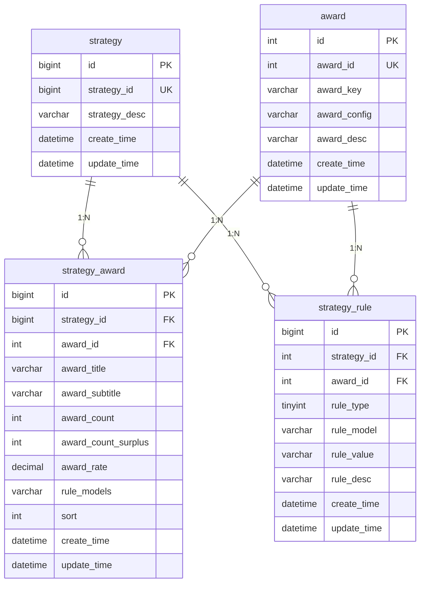

# Big-Market 大营销平台项目笔记

## 1. 系统架构和表结构设计

### 1.1 系统架构概述

Big-Market 是一个基于 **DDD（领域驱动设计）** 架构的大营销平台项目，主要用于实现抽奖系统功能。项目采用 Spring Boot 3.2.0 + MyBatis + MySQL 8.0 技术栈。

#### 1.1.1 模块架构

项目采用多模块Maven结构，遵循DDD分层架构：

```
Big-Market (父模块)
├── Big-Market-app          # 应用启动层
├── Big-Market-trigger      # 触发器层 (接口层)
├── Big-Market-domain       # 领域层 (核心业务逻辑)
├── Big-Market-infrastructure # 基础设施层 (数据访问)
└── Big-Market-types        # 通用类型层
```

#### 1.1.2 DDD分层架构说明

| 层级 | 模块 | 职责 | 主要内容 |
|------|------|------|----------|
| **应用层** | Big-Market-app | 应用启动和配置 | Spring Boot启动类、配置文件、线程池配置 |
| **接口层** | Big-Market-trigger | 对外接口适配 | HTTP接口、定时任务、消息监听器 |
| **领域层** | Big-Market-domain | 核心业务逻辑 | 实体、值对象、聚合、领域服务、仓储接口 |
| **基础设施层** | Big-Market-infrastructure | 技术实现 | 数据访问、外部接口调用、仓储实现 |
| **通用层** | Big-Market-types | 通用类型定义 | 枚举、异常、通用工具类 |

#### 1.1.3 技术栈

- **框架**: Spring Boot 3.2.0
- **数据库**: MySQL 8.0.22
- **ORM**: MyBatis 2.1.4
- **连接池**: HikariCP
- **缓存**: Google Guava Cache
- **JSON**: FastJSON 2.0.28
- **工具库**: Apache Commons Lang3, Google Guava
- **认证**: JWT (jjwt, java-jwt)

### 1.2 数据库表结构设计

#### 1.2.1 表结构概览

系统目前包含3个核心表，构成了抽奖系统的基础数据模型：

| 表名 | 中文名称 | 主要功能 |
|------|----------|----------|
| `award` | 奖品表 | 存储奖品基础信息和发奖策略配置 |
| `strategy` | 抽奖策略表 | 定义抽奖策略的基本信息 |
| `strategy_award` | 策略奖品关联表 | 配置策略下的奖品概率和库存 |
| `strategy_rule` | 策略规则表 | 定义抽奖规则和限制条件 |

#### 1.2.2 详细表结构

##### 1. award 奖品表

```sql
CREATE TABLE `award` (
    `id` int(11) unsigned NOT NULL AUTO_INCREMENT COMMENT '自增ID',
    `award_id` int(8) NOT NULL COMMENT '抽奖奖品ID - 内部流转使用',
    `award_key` varchar(32) NOT NULL COMMENT '奖品对接标识 - 每一个都是一个对应的发奖策略',
    `award_config` varchar(32) NOT NULL COMMENT '奖品配置信息',
    `award_desc` varchar(128) NOT NULL COMMENT '奖品内容描述',
    `create_time` datetime NOT NULL DEFAULT CURRENT_TIMESTAMP COMMENT '创建时间',
    `update_time` datetime NOT NULL DEFAULT CURRENT_TIMESTAMP ON UPDATE CURRENT_TIMESTAMP COMMENT '更新时间',
    PRIMARY KEY (`id`)
) ENGINE=InnoDB DEFAULT CHARSET=utf8mb4;
```

**字段说明：**
- `award_id`: 奖品的唯一标识，用于系统内部流转
- `award_key`: 奖品对接标识，对应不同的发奖策略（如：user_credit_random、openai_use_count、openai_model）
- `award_config`: 奖品配置参数，如积分范围、使用次数等
- `award_desc`: 奖品的描述信息

##### 2. strategy 抽奖策略表

```sql
CREATE TABLE `strategy` (
    `id` bigint(11) unsigned NOT NULL AUTO_INCREMENT COMMENT '自增ID',
    `strategy_id` bigint(8) NOT NULL COMMENT '抽奖策略ID',
    `strategy_desc` varchar(128) NOT NULL COMMENT '抽奖策略描述',
    `create_time` datetime NOT NULL DEFAULT CURRENT_TIMESTAMP COMMENT '创建时间',
    `update_time` datetime NOT NULL DEFAULT CURRENT_TIMESTAMP ON UPDATE CURRENT_TIMESTAMP COMMENT '更新时间',
    PRIMARY KEY (`id`),
    KEY `idx_strategy_id` (`strategy_id`)
) ENGINE=InnoDB DEFAULT CHARSET=utf8mb4;
```

**字段说明：**
- `strategy_id`: 抽奖策略的唯一标识
- `strategy_desc`: 策略描述信息

##### 3. strategy_award 策略奖品关联表

```sql
CREATE TABLE `strategy_award` (
    `id` bigint(11) unsigned NOT NULL AUTO_INCREMENT COMMENT '自增ID',
    `strategy_id` bigint(8) NOT NULL COMMENT '抽奖策略ID',
    `award_id` int(8) NOT NULL COMMENT '抽奖奖品ID - 内部流转使用',
    `award_title` varchar(128) NOT NULL COMMENT '抽奖奖品标题',
    `award_subtitle` varchar(128) DEFAULT NULL COMMENT '抽奖奖品副标题',
    `award_count` int(8) NOT NULL DEFAULT '0' COMMENT '奖品库存总量',
    `award_count_surplus` int(8) NOT NULL DEFAULT '0' COMMENT '奖品库存剩余',
    `award_rate` decimal(6,4) NOT NULL COMMENT '奖品中奖概率',
    `rule_models` varchar(256) DEFAULT NULL COMMENT '规则模型，rule配置的模型同步到此表，便于使用',
    `sort` int(2) NOT NULL DEFAULT '0' COMMENT '排序',
    `create_time` datetime NOT NULL DEFAULT CURRENT_TIMESTAMP COMMENT '创建时间',
    `update_time` datetime NOT NULL DEFAULT CURRENT_TIMESTAMP ON UPDATE CURRENT_TIMESTAMP COMMENT '修改时间',
    PRIMARY KEY (`id`),
    KEY `idx_strategy_id_award_id` (`strategy_id`,`award_id`)
) ENGINE=InnoDB DEFAULT CHARSET=utf8mb4;
```

**字段说明：**
- `award_rate`: 奖品中奖概率，使用decimal(6,4)精确控制概率
- `award_count/award_count_surplus`: 库存管理，支持库存扣减
- `rule_models`: 关联的规则模型，支持多规则组合

##### 4. strategy_rule 策略规则表

```sql
CREATE TABLE `strategy_rule` (
    `id` bigint(11) unsigned NOT NULL AUTO_INCREMENT COMMENT '自增ID',
    `strategy_id` int(8) NOT NULL COMMENT '抽奖策略ID',
    `award_id` int(8) DEFAULT NULL COMMENT '抽奖奖品ID【规则类型为策略，则不需要奖品ID】',
    `rule_type` tinyint(1) NOT NULL DEFAULT '0' COMMENT '抽象规则类型；1-策略规则、2-奖品规则',
    `rule_model` varchar(16) NOT NULL COMMENT '抽奖规则类型【rule_random - 随机值计算、rule_lock - 抽奖几次后解锁、rule_luck_award - 幸运奖(兜底奖品)】',
    `rule_value` varchar(64) NOT NULL COMMENT '抽奖规则比值',
    `rule_desc` varchar(128) NOT NULL COMMENT '抽奖规则描述',
    `create_time` datetime NOT NULL DEFAULT CURRENT_TIMESTAMP COMMENT '创建时间',
    `update_time` datetime NOT NULL DEFAULT CURRENT_TIMESTAMP ON UPDATE CURRENT_TIMESTAMP COMMENT '更新时间',
    PRIMARY KEY (`id`),
    KEY `idx_strategy_id_award_id` (`strategy_id`,`award_id`)
) ENGINE=InnoDB DEFAULT CHARSET=utf8mb4;
```

**字段说明：**
- `rule_type`: 规则类型，1-策略规则（全局）、2-奖品规则（针对特定奖品）
- `rule_model`: 规则模型类型
  - `rule_random`: 随机值计算
  - `rule_lock`: 抽奖次数解锁机制
  - `rule_luck_award`: 幸运奖（兜底奖品）
  - `rule_weight`: 权重规则
  - `rule_blacklist`: 黑名单规则
- `rule_value`: 规则的具体配置值

#### 1.2.3 表关系图



#### 1.2.4 业务规则设计

##### 规则模型类型

| 规则模型 | 说明 | 应用场景 | 配置示例 |
|----------|------|----------|----------|
| `rule_random` | 随机值计算 | 随机积分奖品 | `1,1000` (1-1000随机积分) |
| `rule_lock` | 解锁机制 | 抽奖次数达到后解锁高级奖品 | `1` (抽奖1次后解锁) |
| `rule_luck_award` | 兜底奖品 | 保底机制，确保用户有奖品 | `1,100` (1-100随机积分) |
| `rule_weight` | 权重规则 | 消耗积分必中奖 | `6000,102,103,104...` |
| `rule_blacklist` | 黑名单规则 | 黑名单用户处理 | `1` (启用黑名单) |

##### 奖品类型

根据数据分析，系统支持以下奖品类型：
- **积分奖品**: 随机积分奖励
- **使用次数**: OpenAI服务使用次数（5次、10次、20次、100次）
- **模型权限**: OpenAI模型访问权限（GPT-4、DALL-E-2、DALL-E-3）
- **组合奖品**: 多种模型权限组合

