# Big-Market 大营销平台项目笔记

## 1. 系统架构和表结构设计

### 1.1 系统架构概述

Big-Market 是一个基于 **DDD（领域驱动设计）** 架构的大营销平台项目，主要用于实现抽奖系统功能。项目采用 Spring Boot 3.2.0 + MyBatis + MySQL 8.0 技术栈。

#### 1.1.1 模块架构

项目采用多模块Maven结构，遵循DDD分层架构：

```
Big-Market (父模块)
├── Big-Market-app          # 应用启动层
├── Big-Market-trigger      # 触发器层 (接口层)
├── Big-Market-domain       # 领域层 (核心业务逻辑)
├── Big-Market-infrastructure # 基础设施层 (数据访问)
└── Big-Market-types        # 通用类型层
```

#### 1.1.2 DDD分层架构说明

| 层级 | 模块 | 职责 | 主要内容 |
|------|------|------|----------|
| **应用层** | Big-Market-app | 应用启动和配置 | Spring Boot启动类、配置文件、线程池配置 |
| **接口层** | Big-Market-trigger | 对外接口适配 | HTTP接口、定时任务、消息监听器 |
| **领域层** | Big-Market-domain | 核心业务逻辑 | 实体、值对象、聚合、领域服务、仓储接口 |
| **基础设施层** | Big-Market-infrastructure | 技术实现 | 数据访问、外部接口调用、仓储实现 |
| **通用层** | Big-Market-types | 通用类型定义 | 枚举、异常、通用工具类 |

#### 1.1.3 技术栈

- **框架**: Spring Boot 3.2.0
- **数据库**: MySQL 8.0.22
- **ORM**: MyBatis 2.1.4
- **连接池**: HikariCP
- **缓存**: Google Guava Cache
- **JSON**: FastJSON 2.0.28
- **工具库**: Apache Commons Lang3, Google Guava
- **认证**: JWT (jjwt, java-jwt)

### 1.2 数据库表结构设计

#### 1.2.1 表结构概览

系统目前包含3个核心表，构成了抽奖系统的基础数据模型：

| 表名 | 中文名称 | 主要功能 |
|------|----------|----------|
| `award` | 奖品表 | 存储奖品基础信息和发奖策略配置 |
| `strategy` | 抽奖策略表 | 定义抽奖策略的基本信息 |
| `strategy_award` | 策略奖品关联表 | 配置策略下的奖品概率和库存 |
| `strategy_rule` | 策略规则表 | 定义抽奖规则和限制条件 |

#### 1.2.2 详细表结构

##### 1. award 奖品表

```sql
CREATE TABLE `award` (
    `id` int(11) unsigned NOT NULL AUTO_INCREMENT COMMENT '自增ID',
    `award_id` int(8) NOT NULL COMMENT '抽奖奖品ID - 内部流转使用',
    `award_key` varchar(32) NOT NULL COMMENT '奖品对接标识 - 每一个都是一个对应的发奖策略',
    `award_config` varchar(32) NOT NULL COMMENT '奖品配置信息',
    `award_desc` varchar(128) NOT NULL COMMENT '奖品内容描述',
    `create_time` datetime NOT NULL DEFAULT CURRENT_TIMESTAMP COMMENT '创建时间',
    `update_time` datetime NOT NULL DEFAULT CURRENT_TIMESTAMP ON UPDATE CURRENT_TIMESTAMP COMMENT '更新时间',
    PRIMARY KEY (`id`)
) ENGINE=InnoDB DEFAULT CHARSET=utf8mb4;
```

**字段说明：**
- `award_id`: 奖品的唯一标识，用于系统内部流转
- `award_key`: 奖品对接标识，对应不同的发奖策略（如：user_credit_random、openai_use_count、openai_model）
- `award_config`: 奖品配置参数，如积分范围、使用次数等
- `award_desc`: 奖品的描述信息

##### 2. strategy 抽奖策略表

```sql
CREATE TABLE `strategy` (
    `id` bigint(11) unsigned NOT NULL AUTO_INCREMENT COMMENT '自增ID',
    `strategy_id` bigint(8) NOT NULL COMMENT '抽奖策略ID',
    `strategy_desc` varchar(128) NOT NULL COMMENT '抽奖策略描述',
    `create_time` datetime NOT NULL DEFAULT CURRENT_TIMESTAMP COMMENT '创建时间',
    `update_time` datetime NOT NULL DEFAULT CURRENT_TIMESTAMP ON UPDATE CURRENT_TIMESTAMP COMMENT '更新时间',
    PRIMARY KEY (`id`),
    KEY `idx_strategy_id` (`strategy_id`)
) ENGINE=InnoDB DEFAULT CHARSET=utf8mb4;
```

**字段说明：**
- `strategy_id`: 抽奖策略的唯一标识
- `strategy_desc`: 策略描述信息

##### 3. strategy_award 策略奖品关联表

```sql
CREATE TABLE `strategy_award` (
    `id` bigint(11) unsigned NOT NULL AUTO_INCREMENT COMMENT '自增ID',
    `strategy_id` bigint(8) NOT NULL COMMENT '抽奖策略ID',
    `award_id` int(8) NOT NULL COMMENT '抽奖奖品ID - 内部流转使用',
    `award_title` varchar(128) NOT NULL COMMENT '抽奖奖品标题',
    `award_subtitle` varchar(128) DEFAULT NULL COMMENT '抽奖奖品副标题',
    `award_count` int(8) NOT NULL DEFAULT '0' COMMENT '奖品库存总量',
    `award_count_surplus` int(8) NOT NULL DEFAULT '0' COMMENT '奖品库存剩余',
    `award_rate` decimal(6,4) NOT NULL COMMENT '奖品中奖概率',
    `rule_models` varchar(256) DEFAULT NULL COMMENT '规则模型，rule配置的模型同步到此表，便于使用',
    `sort` int(2) NOT NULL DEFAULT '0' COMMENT '排序',
    `create_time` datetime NOT NULL DEFAULT CURRENT_TIMESTAMP COMMENT '创建时间',
    `update_time` datetime NOT NULL DEFAULT CURRENT_TIMESTAMP ON UPDATE CURRENT_TIMESTAMP COMMENT '修改时间',
    PRIMARY KEY (`id`),
    KEY `idx_strategy_id_award_id` (`strategy_id`,`award_id`)
) ENGINE=InnoDB DEFAULT CHARSET=utf8mb4;
```

**字段说明：**
- `award_rate`: 奖品中奖概率，使用decimal(6,4)精确控制概率
- `award_count/award_count_surplus`: 库存管理，支持库存扣减
- `rule_models`: 关联的规则模型，支持多规则组合

##### 4. strategy_rule 策略规则表

```sql
CREATE TABLE `strategy_rule` (
    `id` bigint(11) unsigned NOT NULL AUTO_INCREMENT COMMENT '自增ID',
    `strategy_id` int(8) NOT NULL COMMENT '抽奖策略ID',
    `award_id` int(8) DEFAULT NULL COMMENT '抽奖奖品ID【规则类型为策略，则不需要奖品ID】',
    `rule_type` tinyint(1) NOT NULL DEFAULT '0' COMMENT '抽象规则类型；1-策略规则、2-奖品规则',
    `rule_model` varchar(16) NOT NULL COMMENT '抽奖规则类型【rule_random - 随机值计算、rule_lock - 抽奖几次后解锁、rule_luck_award - 幸运奖(兜底奖品)】',
    `rule_value` varchar(64) NOT NULL COMMENT '抽奖规则比值',
    `rule_desc` varchar(128) NOT NULL COMMENT '抽奖规则描述',
    `create_time` datetime NOT NULL DEFAULT CURRENT_TIMESTAMP COMMENT '创建时间',
    `update_time` datetime NOT NULL DEFAULT CURRENT_TIMESTAMP ON UPDATE CURRENT_TIMESTAMP COMMENT '更新时间',
    PRIMARY KEY (`id`),
    KEY `idx_strategy_id_award_id` (`strategy_id`,`award_id`)
) ENGINE=InnoDB DEFAULT CHARSET=utf8mb4;
```

**字段说明：**
- `rule_type`: 规则类型，1-策略规则（全局）、2-奖品规则（针对特定奖品）
- `rule_model`: 规则模型类型
  - `rule_random`: 随机值计算
  - `rule_lock`: 抽奖次数解锁机制
  - `rule_luck_award`: 幸运奖（兜底奖品）
  - `rule_weight`: 权重规则
  - `rule_blacklist`: 黑名单规则
- `rule_value`: 规则的具体配置值

#### 1.2.3 表关系图

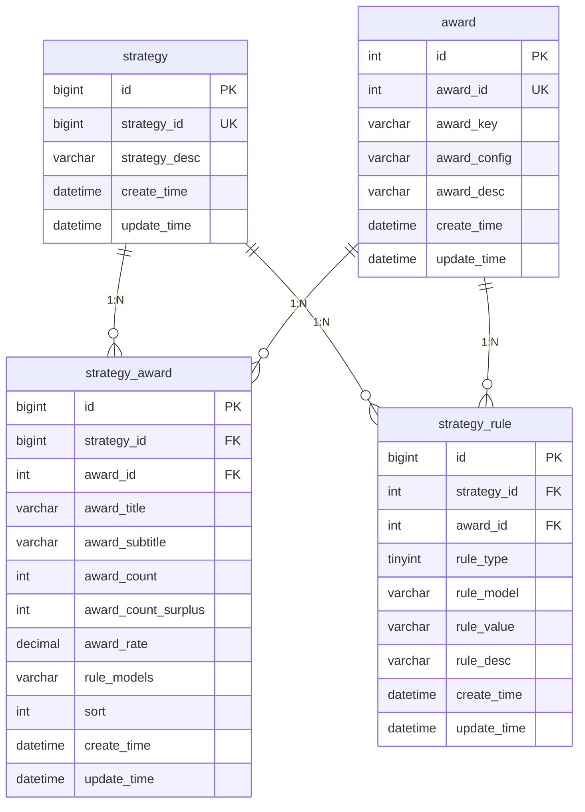

#### 1.2.4 业务规则设计

##### 规则模型类型

| 规则模型 | 说明 | 应用场景 | 配置示例 |
|----------|------|----------|----------|
| `rule_random` | 随机值计算 | 随机积分奖品 | `1,1000` (1-1000随机积分) |
| `rule_lock` | 解锁机制 | 抽奖次数达到后解锁高级奖品 | `1` (抽奖1次后解锁) |
| `rule_luck_award` | 兜底奖品 | 保底机制，确保用户有奖品 | `1,100` (1-100随机积分) |
| `rule_weight` | 权重规则 | 消耗积分必中奖 | `6000,102,103,104...` |
| `rule_blacklist` | 黑名单规则 | 黑名单用户处理 | `1` (启用黑名单) |

##### 奖品类型

根据数据分析，系统支持以下奖品类型：
- **积分奖品**: 随机积分奖励
- **使用次数**: OpenAI服务使用次数（5次、10次、20次、100次）
- **模型权限**: OpenAI模型访问权限（GPT-4、DALL-E-2、DALL-E-3）
- **组合奖品**: 多种模型权限组合

## 2. 策略概率装配与权重装配机制

### 2.1 核心概念

**抽奖策略就是一套完整的抽奖方案，包含有多少奖品可以抽取，每个奖品的概率是多少，需要遵循哪些规则。**

#### 2.1.1 策略概率装配

**策略概率装配**是将数据库中配置的奖品概率信息转换为高效的**概率查找表**的过程，目的是在抽奖时能够快速、准确地根据概率分布选择奖品。

**核心思想：** 将概率转换为数组索引，通过随机数生成索引来实现概率抽奖。

**技术优势：**
- **O(1)时间复杂度**：通过数组索引直接获取结果
- **内存预计算**：启动时装配，运行时无需计算
- **精确概率控制**：支持小数点后4位精度

#### 2.1.2 策略权重装配

**策略权重装配**是根据用户的**消耗积分**或**等级**等条件，为不同用户群体提供不同奖品池的机制。

**核心思想：** 消耗积分越多，能够获得的奖品种类越丰富，实现"花钱越多，奖品越好"的营销策略。

**业务价值：**

- **差异化营销**：不同用户群体享受不同奖品池
- **消费激励**：鼓励用户消耗更多积分
- **精准运营**：根据用户价值提供对应服务

### 2.2 概率装配算法原理

#### 2.2.1 概率转换算法

假设有以下奖品配置：
- 奖品A：概率 0.01 (1%)
- 奖品B：概率 0.05 (5%)
- 奖品C：概率 0.1 (10%)
- 奖品D：概率 0.84 (84%)

**算法步骤：**

1. **计算概率范围**
```java
// 最小概率：0.01
// 总概率：1.0
// 概率范围：1.0 ÷ 0.01 = 100
BigDecimal rateRange = totalAwardRate.divide(minAwardRate, 0, RoundingMode.CEILING);
```

2. **生成概率查找表**
```java
// 概率范围 = 100
// 奖品A (1%)：占用 100 × 0.01 = 1 个位置
// 奖品B (5%)：占用 100 × 0.05 = 5 个位置
// 奖品C (10%)：占用 100 × 0.1 = 10 个位置
// 奖品D (84%)：占用 100 × 0.84 = 84 个位置

// 最终数组：[A, B,B,B,B,B, C,C,C,C,C,C,C,C,C,C, D,D,D,D...84个D]
```

3. **随机化和索引映射**

   **打乱数组后，转换成Map集合再存入Redis的意义是，直接通过Redis的HGET操作获取单个值，而不需要再次通过Key拿到集合再根据下标或者key来获取Value，在这样的算法设计下，如果存入的是list实际的时间花费是O（N），而存入Map花费的时间仅仅是O（1）**
```java
// 乱序处理，避免规律性
Collections.shuffle(strategyAwardSearchRateTables);

// 转换为Map结构：{索引 -> 奖品ID}
// {0: 102, 1: 105, 2: 102, 3: 104, ...}
```

#### 2.2.2 抽奖执行过程

```java
// 1. 生成随机数：random.nextInt(100) → 假设得到 45
// 2. 从Redis获取：map.get(45) → 假设得到奖品ID 104
// 3. 返回中奖结果：奖品ID 104
```

### 2.3 权重装配机制

#### 2.3.1 权重规则配置

权重规则的配置格式：`积分值:奖品ID列表`

**配置示例：**
```
rule_value: "4000:102,103,104,105 5000:102,103,104,105,106,107 6000:102,103,104,105,106,107,108,109"
```

**含义解释：**
- **4000积分**：可以抽取奖品 102,103,104,105（基础奖品池）
- **5000积分**：可以抽取奖品 102,103,104,105,106,107（中级奖品池）
- **6000积分**：可以抽取奖品 102,103,104,105,106,107,108,109（高级奖品池）

#### 2.3.2 权重装配过程

**装配示例：**

假设原始策略包含奖品：102,103,104,105,106,107,108,109

1. **4000积分级别**：
   - 过滤奖品：保留 102,103,104,105
   - 生成概率表：`strategy_100001_4000:102,103,104,105`

2. **5000积分级别**：
   - 过滤奖品：保留 102,103,104,105,106,107
   - 生成概率表：`strategy_100001_5000:102,103,104,105,106,107`

3. **6000积分级别**：
   - 过滤奖品：保留 102,103,104,105,106,107,108,109
   - 生成概率表：`strategy_100001_6000:102,103,104,105,106,107,108,109`

### 2.4 Redis存储结构设计

#### 2.4.1 存储Key设计

```java
public static class RedisKey {
    // 策略基础信息
    public static String STRATEGY_KEY = "big_market_strategy_key_";
    // 策略奖品列表
    public static String STRATEGY_AWARD_KEY = "big_market_strategy_award_key_";
    // 概率查找表
    public static String STRATEGY_RATE_TABLE_KEY = "big_market_strategy_rate_table_key_";
    // 概率范围
    public static String STRATEGY_RATE_RANGE_KEY = "big_market_strategy_rate_range_key_";
}
```

#### 2.4.2 实际存储示例

**基础策略存储：**
```redis
# 概率查找表
big_market_strategy_rate_table_key_100001: {0: 102, 1: 105, 2: 102, ...}
# 概率范围
big_market_strategy_rate_range_key_100001: 10000
```

**权重策略存储：**
```redis
# 4000积分级别
big_market_strategy_rate_table_key_100001_4000:102,103,104,105: {0: 102, 1: 103, ...}
big_market_strategy_rate_range_key_100001_4000:102,103,104,105: 5000

# 6000积分级别
big_market_strategy_rate_table_key_100001_6000:102,103,104,105,106,107,108,109: {0: 108, 1: 102, ...}
big_market_strategy_rate_range_key_100001_6000:102,103,104,105,106,107,108,109: 10000
```

### 2.5 策略装配时序图解

#### 2.5.1 概率装配处理时序

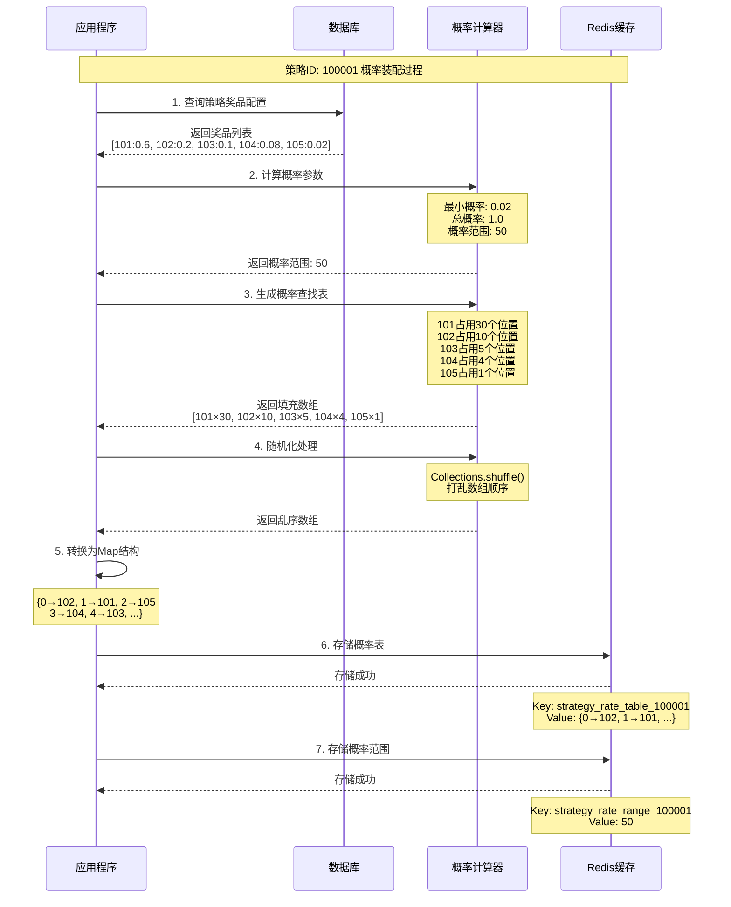

#### 2.5.2 权重装配处理时序

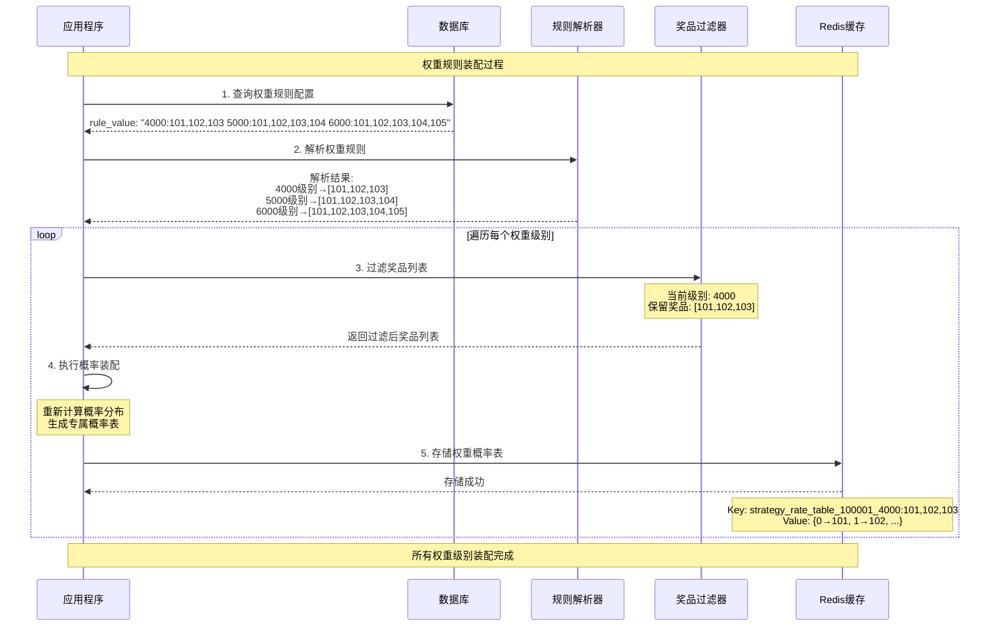

#### 2.5.3 抽奖执行时序

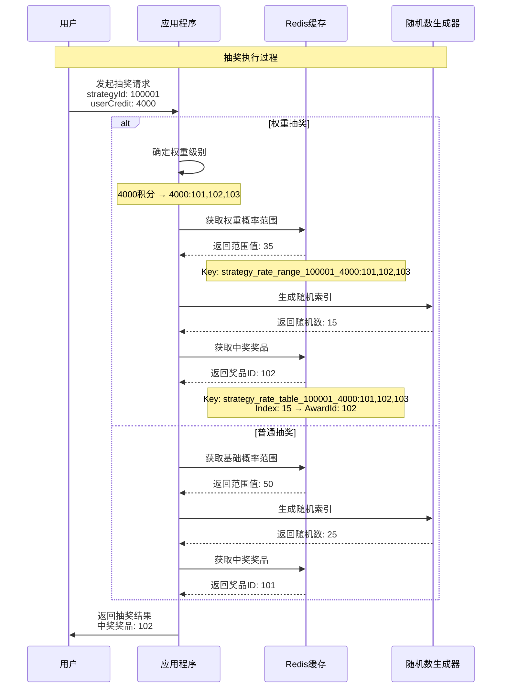

```mermaid

```

### 2.6 核心代码实现

#### 2.6.1 策略装配核心方法

```java
@Service
public class StrategyArmoryDispatch implements IStrategyArmory, IStrategyDispatch {

    /**
     * 装配抽奖策略配置
     * @param strategyId 策略ID
     * @return 装配结果
     */
    @Override
    public boolean assembleLotteryStrategy(Long strategyId) {
        // 1. 查询策略配置
        List<StrategyAwardEntity> strategyAwardEntities = repository.queryStrategyAwardList(strategyId);
        assembleLotteryStrategy(String.valueOf(strategyId), strategyAwardEntities);

        // 2. 权重策略配置 - 使用于 rule_weight 权重规则配置
        StrategyEntity strategyEntity = repository.queryStrategyEntityByStrategyId(strategyId);
        String ruleWeight = strategyEntity.getRuleWeight();
        if (null == ruleWeight) return true;

        StrategyRuleEntity strategyRuleEntity = repository.queryStrategyRule(strategyId, ruleWeight);
        if (null == strategyRuleEntity) {
            throw new AppException(ResponseCode.STRATEGY_RULE_WEIGHT_IS_NULL.getCode(),
                                 ResponseCode.STRATEGY_RULE_WEIGHT_IS_NULL.getInfo());
        }

        Map<String, List<Integer>> ruleWeightValueMap = strategyRuleEntity.getRuleWeightValues();
        Set<String> keys = ruleWeightValueMap.keySet();
        for (String key : keys) {
            List<Integer> ruleWeightValues = ruleWeightValueMap.get(key);
            ArrayList<StrategyAwardEntity> strategyAwardEntitiesClone = new ArrayList<>(strategyAwardEntities);
            strategyAwardEntitiesClone.removeIf(entity -> !ruleWeightValues.contains(entity.getAwardId()));
            assembleLotteryStrategy(String.valueOf(strategyId).concat("_").concat(key), strategyAwardEntitiesClone);
        }

        return true;
    }

    /**
     * 概率装配核心算法
     */
    private void assembleLotteryStrategy(String key, List<StrategyAwardEntity> strategyAwardEntities) {
        // 1. 获取最小概率值
        BigDecimal minAwardRate = strategyAwardEntities.stream()
                .map(StrategyAwardEntity::getAwardRate).min(BigDecimal::compareTo).orElse(BigDecimal.ZERO);

        // 2. 获取概率值总和
        BigDecimal totalAwardRate = strategyAwardEntities.stream()
                .map(StrategyAwardEntity::getAwardRate).reduce(BigDecimal.ZERO, BigDecimal::add);

        // 3. 用 1 % 0.0001 获取概率范围，百分位、千分位、万分位
        BigDecimal rateRange = totalAwardRate.divide(minAwardRate, 0, RoundingMode.CEILING);

        // 4. 生成策略奖品概率查找表
        ArrayList<Integer> strategyAwardSearchRateTables = new ArrayList<>(rateRange.intValue());
        for (StrategyAwardEntity strategyAward : strategyAwardEntities) {
            Integer awardId = strategyAward.getAwardId();
            BigDecimal awardRate = strategyAward.getAwardRate();

            // 计算出每个概率值需要存放到查找表的数量，循环填充
            for (int i=0; i<rateRange.multiply(awardRate).setScale(0, RoundingMode.CEILING).intValue(); i++) {
                strategyAwardSearchRateTables.add(awardId);
            }
        }

        // 5. 对存储的奖品进行乱序操作
        Collections.shuffle(strategyAwardSearchRateTables);

        // 6. 生成出Map集合，key值，对应的就是后续的概率值。通过概率来获得对应的奖品ID
        HashMap<Integer, Integer> shuffledStrategyAwardSearchRateTables = new HashMap<>();
        for (int i=0; i<strategyAwardSearchRateTables.size(); i++) {
            shuffledStrategyAwardSearchRateTables.put(i, strategyAwardSearchRateTables.get(i));
        }

        // 7. 存储到 Redis
        repository.storeStrategyAwardSearchRateTable(key, rateRange, shuffledStrategyAwardSearchRateTables);
    }
}
```

#### 2.6.2 抽奖调度方法

```java
/**
 * 普通抽奖
 */
@Override
public Integer getRandomAwardId(Long strategyId) {
    // 分布式部署下，不一定为当前应用做的策略装配。也就是值不一定会保存到本应用，而是分布式应用，所以需要从 Redis 中获取。
    int rateRange = repository.getRateRange(strategyId);
    // 通过生成的随机值，获取概率值奖品查找表的结果
    return repository.getStrategyAwardAssemble(String.valueOf(strategyId), new SecureRandom().nextInt(rateRange));
}

/**
 * 权重抽奖
 */
@Override
public Integer getRandomAwardId(Long strategyId, String ruleWeightValue) {
    String key = String.valueOf(strategyId).concat("_").concat(ruleWeightValue);
    // 分布式部署下，不一定为当前应用做的策略装配。也就是值不一定会保存到本应用，而是分布式应用，所以需要从 Redis 中获取。
    int rateRange = repository.getRateRange(key);
    // 通过生成的随机值，获取概率值奖品查找表的结果
    return repository.getStrategyAwardAssemble(key, new SecureRandom().nextInt(rateRange));
}
```

### 2.7 详细执行步骤

#### 2.7.1 策略装配详细步骤

**步骤A：数据准备阶段**
1. 从数据库查询策略ID对应的所有奖品配置
2. 获取每个奖品的概率值（BigDecimal类型，精确到小数点后4位）
3. 检查策略是否包含权重规则配置

**步骤B：概率计算阶段**
1. 遍历所有奖品，找出最小概率值（如：0.0001）
2. 计算所有奖品概率的总和（通常为1.0000）
3. 计算概率范围：总和 ÷ 最小值 = 查找表大小（如：10000）

**步骤C：查找表生成阶段**
1. 创建ArrayList，大小为概率范围值
2. 遍历每个奖品：
   - 计算该奖品需要占用的位置数：范围 × 奖品概率
   - 将奖品ID重复添加到ArrayList中对应次数
3. 使用Collections.shuffle()打乱数组顺序
4. 将ArrayList转换为HashMap<索引, 奖品ID>

**步骤D：权重处理阶段**（如果存在权重规则）
1. 解析权重规则字符串：`"4000:102,103,104,105 5000:102,103,104,105,106,107"`
2. 按空格分割得到各个权重级别
3. 对每个权重级别：
   - 按冒号分割得到积分值和奖品列表
   - 过滤原始奖品列表，只保留权重规则中的奖品
   - 为过滤后的奖品列表执行步骤B和C
   - 使用包含权重标识的key存储到Redis

**步骤E：Redis存储阶段**
1. 存储概率范围：`big_market_strategy_rate_range_key_{key}` → 范围值
2. 存储概率查找表：`big_market_strategy_rate_table_key_{key}` → HashMap

#### 2.7.2 抽奖执行详细步骤

**普通抽奖流程：**
1. 接收策略ID参数
2. 从Redis获取概率范围：`getRateRange(strategyId)`
3. 生成随机索引：`new SecureRandom().nextInt(rateRange)`
4. 从Redis概率表获取奖品：`getStrategyAwardAssemble(key, randomIndex)`
5. 返回中奖奖品ID

**权重抽奖流程：**
1. 接收策略ID和权重值参数
2. 构造权重key：`strategyId + "_" + ruleWeightValue`
3. 从Redis获取对应权重级别的概率范围
4. 生成随机索引并获取奖品ID
5. 返回中奖结果

### 2.8 实际使用示例

#### 2.8.1 配置示例

**数据库配置：**

```sql
-- 策略表
INSERT INTO strategy (strategy_id, strategy_desc, rule_models)
VALUES (100001, '新用户注册抽奖', 'rule_weight');

-- 奖品表
INSERT INTO award (award_id, award_key, award_config, award_desc) VALUES
(101, 'user_credit_random', '1,100', '随机积分1-100'),
(102, 'user_credit_random', '1,200', '随机积分1-200'),
(103, 'openai_use_count', '5', 'OpenAI使用次数5次'),
(104, 'openai_use_count', '10', 'OpenAI使用次数10次'),
(105, 'openai_model', 'gpt-4', 'GPT-4模型权限');

-- 策略奖品关联表
INSERT INTO strategy_award (strategy_id, award_id, award_title, award_rate) VALUES
(100001, 101, '随机积分', 0.6000),
(100001, 102, '随机积分Plus', 0.2000),
(100001, 103, '5次使用权', 0.1000),
(100001, 104, '10次使用权', 0.0800),
(100001, 105, 'GPT-4权限', 0.0200);

-- 策略规则表
INSERT INTO strategy_rule (strategy_id, rule_type, rule_model, rule_value, rule_desc) VALUES
(100001, 1, 'rule_weight', '4000:101,102,103 5000:101,102,103,104 6000:101,102,103,104,105', '权重规则配置');
```

#### 2.8.2 代码使用示例

```java
@Test
public void testStrategyArmory() {
    // 1. 装配策略
    boolean success = strategyArmory.assembleLotteryStrategy(100001L);
    log.info("策略装配结果：{}", success);

    // 2. 普通抽奖测试
    for (int i = 0; i < 10; i++) {
        Integer awardId = strategyDispatch.getRandomAwardId(100001L);
        log.info("普通抽奖结果：{}", awardId);
    }

    // 3. 权重抽奖测试
    // 4000积分用户（只能抽到基础奖品）
    for (int i = 0; i < 5; i++) {
        Integer awardId = strategyDispatch.getRandomAwardId(100001L, "4000:101,102,103");
        log.info("4000积分抽奖结果：{}", awardId);
    }

    // 6000积分用户（可以抽到所有奖品）
    for (int i = 0; i < 5; i++) {
        Integer awardId = strategyDispatch.getRandomAwardId(100001L, "6000:101,102,103,104,105");
        log.info("6000积分抽奖结果：{}", awardId);
    }
}
```

#### 2.8.3 Redis存储结果示例

```redis
# 基础策略概率表（所有奖品）
127.0.0.1:6379> HGETALL big_market_strategy_rate_table_key_100001
1) "0"
2) "101"
3) "1"
4) "102"
5) "2"
6) "101"
...
9999) "101"

# 基础策略概率范围
127.0.0.1:6379> GET big_market_strategy_rate_range_key_100001
"10000"

# 4000积分权重策略概率表（只有101,102,103）
127.0.0.1:6379> HGETALL big_market_strategy_rate_table_key_100001_4000:101,102,103
1) "0"
2) "101"
3) "1"
4) "103"
5) "2"
6) "102"
...

# 6000积分权重策略概率表（包含所有奖品）
127.0.0.1:6379> HGETALL big_market_strategy_rate_table_key_100001_6000:101,102,103,104,105
1) "0"
2) "105"
3) "1"
4) "101"
5) "2"
6) "104"
...
```

这套策略装配机制通过巧妙的算法设计，将复杂的概率计算转换为简单的数组查找，既保证了抽奖的公平性和准确性，又提供了出色的性能表现，是一个非常优秀的抽奖系统核心设计。

## 3. 抽奖前置规则引擎

### 3.1 前置规则概述

#### 3.1.1 什么是抽奖前置规则？

**抽奖前置规则**是在正式执行抽奖逻辑之前，对用户的抽奖资格、权限和条件进行预先检查和过滤的机制。它是抽奖系统的"守门员"，确保只有符合条件的用户才能参与抽奖，并为不同用户提供差异化的抽奖体验。

**核心作用：**
- **资格校验**：检查用户是否有抽奖资格
- **权限控制**：根据用户等级提供不同奖品池
- **风险控制**：黑名单用户拦截和处理
- **业务规则**：实现复杂的营销策略

#### 3.1.2 规则引擎架构设计

**设计模式：** 策略模式 + 工厂模式 + 责任链模式

**核心组件：**
- **规则接口**：`ILogicFilter` - 统一的规则过滤接口
- **规则工厂**：`DefaultLogicFactory` - 管理和创建规则实例
- **规则注解**：`@LogicStrategy` - 标识规则类型
- **规则实体**：`RuleActionEntity` - 封装规则执行结果

### 3.2 规则引擎核心架构

#### 3.2.1 规则过滤接口设计

```java
/**
 * 抽奖规则过滤接口
 */
public interface ILogicFilter<T extends RuleActionEntity.RaffleEntity> {
    RuleActionEntity<T> filter(RuleMatterEntity ruleMatterEntity);
}
```

**接口特点：**
- **泛型设计**：支持不同阶段的规则实体（抽奖前、抽奖中、抽奖后）
- **统一入参**：`RuleMatterEntity` 包含规则执行所需的所有参数
- **统一出参**：`RuleActionEntity` 封装规则执行结果和后续动作

#### 3.2.2 规则工厂设计

```java
@Service
public class DefaultLogicFactory {
    public Map<String, ILogicFilter<?>> logicFilterMap = new ConcurrentHashMap<>();

    public DefaultLogicFactory(List<ILogicFilter<?>> logicFilters) {
        logicFilters.forEach(logic -> {
            LogicStrategy strategy = AnnotationUtils.findAnnotation(logic.getClass(), LogicStrategy.class);
            if (null != strategy) {
                logicFilterMap.put(strategy.logicMode().getCode(), logic);
            }
        });
    }

    public <T extends RuleActionEntity.RaffleEntity> Map<String, ILogicFilter<T>> openLogicFilter() {
        return (Map<String, ILogicFilter<T>>) (Map<?, ?>) logicFilterMap;
    }
}
```

**工厂特点：**
- **自动注册**：通过注解自动发现和注册规则实现
- **类型安全**：泛型确保类型安全
- **高性能**：使用ConcurrentHashMap提供线程安全的高性能访问

#### 3.2.3 规则执行结果设计

```java
@Data
@Builder
public class RuleActionEntity<T extends RuleActionEntity.RaffleEntity> {
    private String code = RuleLogicCheckTypeVO.ALLOW.getCode();
    private String info = RuleLogicCheckTypeVO.ALLOW.getInfo();
    private String ruleModel;
    private T data;
}
```

**结果类型：**
- **ALLOW (0000)**：放行，执行后续流程
- **TAKE_OVER (0001)**：接管，规则引擎控制后续流程

### 3.3 已实现的前置规则

#### 3.3.1 权重规则 (rule_weight)

**功能描述：** 根据用户积分等级，动态确定用户可参与的奖品池范围。

**规则配置格式：**
```
rule_value: "4000:102,103,104,105 5000:102,103,104,105,106,107 6000:102,103,104,105,106,107,108,109"
```

**核心实现：**

```java
@Component
@LogicStrategy(logicMode = DefaultLogicFactory.LogicModel.RULE_WIGHT)
public class RuleWeightLogicFilter implements ILogicFilter<RuleActionEntity.RaffleBeforeEntity> {

    @Override
    public RuleActionEntity<RuleActionEntity.RaffleBeforeEntity> filter(RuleMatterEntity ruleMatterEntity) {
        // 1. 获取用户积分（当前写死，实际应从数据库查询）
        Long userScore = 4500L;

        // 2. 解析权重规则配置
        Map<Long, String> analyticalValueGroup = getAnalyticalValue(ruleValue);

        // 3. 找出用户积分对应的权重级别
        Long nextValue = analyticalSortedKeys.stream()
                .filter(key -> userScore >= key)
                .findFirst()
                .orElse(null);

        if (null != nextValue) {
            return RuleActionEntity.<RuleActionEntity.RaffleBeforeEntity>builder()
                    .data(RuleActionEntity.RaffleBeforeEntity.builder()
                            .strategyId(strategyId)
                            .ruleWeightValueKey(analyticalValueGroup.get(nextValue))
                            .build())
                    .code(RuleLogicCheckTypeVO.TAKE_OVER.getCode())
                    .build();
        }

        return RuleActionEntity.<RuleActionEntity.RaffleBeforeEntity>builder()
                .code(RuleLogicCheckTypeVO.ALLOW.getCode())
                .build();
    }
}
```

**执行逻辑：**
1. 获取用户当前积分
2. 解析权重规则配置，得到积分-奖品映射
3. 根据用户积分找到对应的权重级别
4. 返回权重值Key，用于后续的权重抽奖

**业务价值：**
- **差异化服务**：不同积分用户享受不同奖品池
- **消费激励**：鼓励用户消耗更多积分获得更好奖品
- **精准营销**：根据用户价值提供对应的奖励

#### 3.3.2 黑名单规则 (rule_blacklist)

**功能描述：** 对黑名单用户进行拦截，直接返回指定的兜底奖品，避免正常抽奖流程。

**规则配置格式：**
```
rule_value: "100:user001,user002,user003"
```
- `100`：黑名单用户获得的兜底奖品ID
- `user001,user002,user003`：黑名单用户列表

**核心实现：**

```java
@Component
@LogicStrategy(logicMode = DefaultLogicFactory.LogicModel.RULE_BLACKLIST)
public class RuleBackListLogicFilter implements ILogicFilter<RuleActionEntity.RaffleBeforeEntity> {

    @Override
    public RuleActionEntity<RuleActionEntity.RaffleBeforeEntity> filter(RuleMatterEntity ruleMatterEntity) {
        String userId = ruleMatterEntity.getUserId();

        // 查询黑名单规则配置
        String ruleValue = repository.queryStrategyRuleValue(ruleMatterEntity.getStrategyId(),
                                                           ruleMatterEntity.getAwardId(),
                                                           ruleMatterEntity.getRuleModel());

        // 解析配置：100:user001,user002,user003
        String[] splitRuleValue = ruleValue.split(Constants.COLON);
        Integer awardId = Integer.parseInt(splitRuleValue[0]);
        String[] userBlackIds = splitRuleValue[1].split(Constants.SPLIT);

        // 检查用户是否在黑名单中
        for (String userBlackId : userBlackIds) {
            if (userId.equals(userBlackId)) {
                return RuleActionEntity.<RuleActionEntity.RaffleBeforeEntity>builder()
                        .ruleModel(DefaultLogicFactory.LogicModel.RULE_BLACKLIST.getCode())
                        .data(RuleActionEntity.RaffleBeforeEntity.builder()
                                .strategyId(ruleMatterEntity.getStrategyId())
                                .awardId(awardId)
                                .build())
                        .code(RuleLogicCheckTypeVO.TAKE_OVER.getCode())
                        .build();
            }
        }

        return RuleActionEntity.<RuleActionEntity.RaffleBeforeEntity>builder()
                .code(RuleLogicCheckTypeVO.ALLOW.getCode())
                .build();
    }
}
```

**执行逻辑：**
1. 获取用户ID
2. 查询黑名单规则配置
3. 解析配置得到兜底奖品ID和黑名单用户列表
4. 检查当前用户是否在黑名单中
5. 如果在黑名单中，直接返回兜底奖品；否则放行

### 3.4 规则执行流程

#### 3.4.1 规则执行时序图

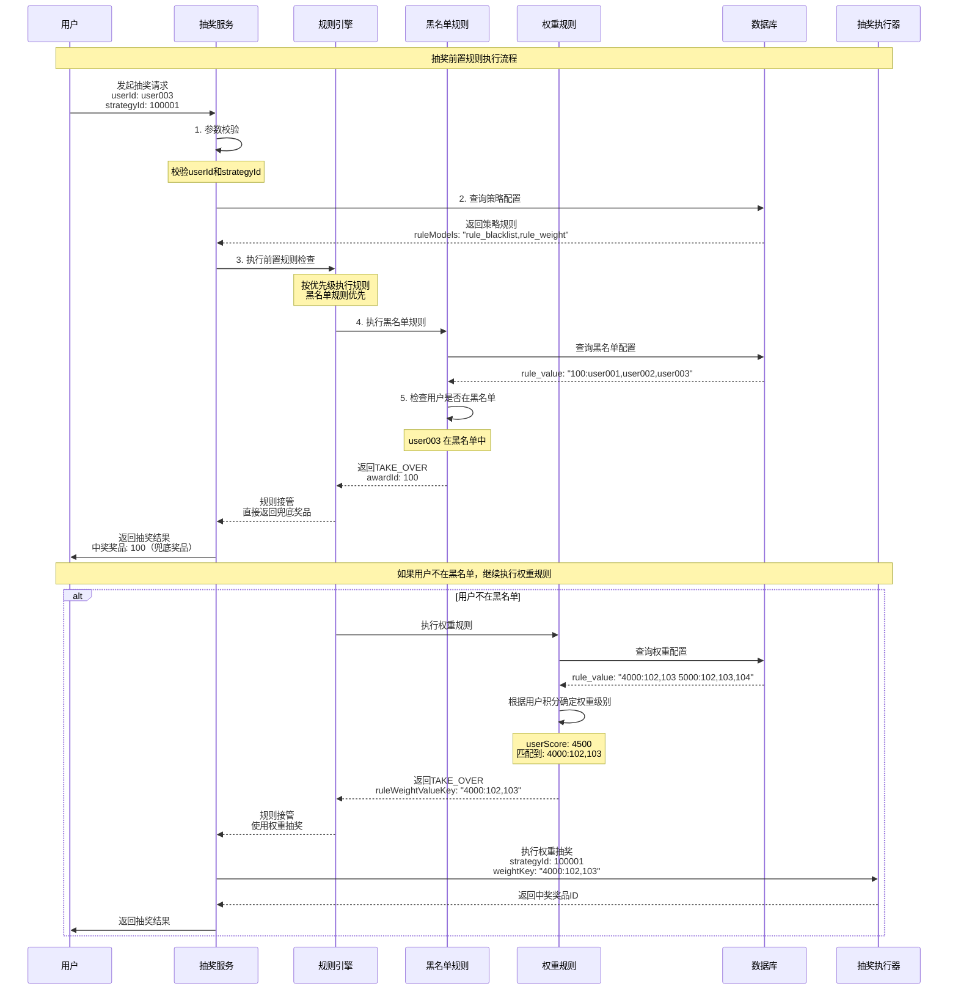

#### 3.4.2 规则优先级和执行顺序

**规则执行原则：**
1. **黑名单规则优先**：最高优先级，一旦命中立即返回
2. **权重规则次之**：在黑名单检查通过后执行
3. **其他规则**：按配置顺序依次执行
4. **短路机制**：任何规则返回TAKE_OVER都会中断后续规则执行

**核心执行代码：**

```java
@Override
protected RuleActionEntity<RuleActionEntity.RaffleBeforeEntity> doCheckRaffleBeforeLogic(
        RaffleFactorEntity raffleFactorEntity, String... logics) {

    Map<String, ILogicFilter<RuleActionEntity.RaffleBeforeEntity>> logicFilterGroup = logicFactory.openLogicFilter();

    // 1. 黑名单规则优先过滤
    String ruleBackList = Arrays.stream(logics)
            .filter(str -> str.contains(DefaultLogicFactory.LogicModel.RULE_BLACKLIST.getCode()))
            .findFirst()
            .orElse(null);

    if (StringUtils.isNotBlank(ruleBackList)) {
        ILogicFilter<RuleActionEntity.RaffleBeforeEntity> logicFilter =
            logicFilterGroup.get(DefaultLogicFactory.LogicModel.RULE_BLACKLIST.getCode());

        RuleActionEntity<RuleActionEntity.RaffleBeforeEntity> ruleActionEntity =
            logicFilter.filter(ruleMatterEntity);

        // 黑名单命中则直接返回
        if (!RuleLogicCheckTypeVO.ALLOW.getCode().equals(ruleActionEntity.getCode())) {
            return ruleActionEntity;
        }
    }

    // 2. 其他规则按顺序执行
    List<String> ruleList = Arrays.stream(logics)
            .filter(s -> !s.equals(DefaultLogicFactory.LogicModel.RULE_BLACKLIST.getCode()))
            .collect(Collectors.toList());

    RuleActionEntity<RuleActionEntity.RaffleBeforeEntity> ruleActionEntity = null;
    for (String ruleModel : ruleList) {
        ILogicFilter<RuleActionEntity.RaffleBeforeEntity> logicFilter = logicFilterGroup.get(ruleModel);
        ruleActionEntity = logicFilter.filter(ruleMatterEntity);

        // 非放行结果则中断执行
        if (!RuleLogicCheckTypeVO.ALLOW.getCode().equals(ruleActionEntity.getCode())) {
            return ruleActionEntity;
        }
    }

    return ruleActionEntity;
}
```

#### 3.4.3 规则结果处理

**抽奖主流程中的规则结果处理：**

```java
@Override
public RaffleAwardEntity performRaffle(RaffleFactorEntity raffleFactorEntity) {
    // 1. 参数校验
    String userId = raffleFactorEntity.getUserId();
    Long strategyId = raffleFactorEntity.getStrategyId();

    // 2. 策略查询
    StrategyEntity strategy = repository.queryStrategyEntityByStrategyId(strategyId);

    // 3. 抽奖前规则过滤
    RuleActionEntity<RuleActionEntity.RaffleBeforeEntity> ruleActionEntity =
        this.doCheckRaffleBeforeLogic(raffleFactorEntity, strategy.ruleModels());

    // 4. 根据规则结果执行不同逻辑
    if (RuleLogicCheckTypeVO.TAKE_OVER.getCode().equals(ruleActionEntity.getCode())) {
        if (DefaultLogicFactory.LogicModel.RULE_BLACKLIST.getCode().equals(ruleActionEntity.getRuleModel())) {
            // 黑名单用户：直接返回兜底奖品
            return RaffleAwardEntity.builder()
                    .awardId(ruleActionEntity.getData().getAwardId())
                    .build();
        } else if (DefaultLogicFactory.LogicModel.RULE_WIGHT.getCode().equals(ruleActionEntity.getRuleModel())) {
            // 权重用户：使用权重抽奖
            RuleActionEntity.RaffleBeforeEntity raffleBeforeEntity = ruleActionEntity.getData();
            String ruleWeightValueKey = raffleBeforeEntity.getRuleWeightValueKey();
            Integer awardId = strategyDispatch.getRandomAwardId(strategyId, ruleWeightValueKey);
            return RaffleAwardEntity.builder()
                    .awardId(awardId)
                    .build();
        }
    }

    // 5. 规则放行：执行普通抽奖
    Integer awardId = strategyDispatch.getRandomAwardId(strategyId);
    return RaffleAwardEntity.builder()
            .awardId(awardId)
            .build();
}
```

### 3.5 规则扩展机制

#### 3.5.1 新增规则的步骤

**步骤1：定义规则枚举**
```java
public enum LogicModel {
    RULE_WIGHT("rule_weight","【抽奖前规则】根据抽奖权重返回可抽奖范围KEY"),
    RULE_BLACKLIST("rule_blacklist","【抽奖前规则】黑名单规则过滤"),
    RULE_LOCK("rule_lock","【抽奖前规则】抽奖次数解锁规则"),  // 新增规则
}
```

**步骤2：实现规则逻辑**
```java
@Component
@LogicStrategy(logicMode = DefaultLogicFactory.LogicModel.RULE_LOCK)
public class RuleLockLogicFilter implements ILogicFilter<RuleActionEntity.RaffleBeforeEntity> {

    @Override
    public RuleActionEntity<RuleActionEntity.RaffleBeforeEntity> filter(RuleMatterEntity ruleMatterEntity) {
        // 实现具体的规则逻辑
        return ruleActionEntity;
    }
}
```

**步骤3：配置数据库规则**
```sql
INSERT INTO strategy_rule (strategy_id, rule_type, rule_model, rule_value, rule_desc)
VALUES (100001, 1, 'rule_lock', '3', '抽奖3次后解锁高级奖品');
```

**步骤4：更新策略配置**
```sql
UPDATE strategy SET rule_models = 'rule_blacklist,rule_weight,rule_lock' WHERE strategy_id = 100001;
```

#### 3.5.2 规则设计原则

1. **单一职责**：每个规则只负责一个特定的业务逻辑
2. **无状态设计**：规则实现应该是无状态的，便于并发执行
3. **可配置性**：规则的具体参数应该通过数据库配置，而不是硬编码
4. **向后兼容**：新增规则不应该影响现有规则的执行
5. **性能考虑**：规则执行应该高效，避免复杂的数据库查询

### 3.6 测试示例和使用场景

#### 3.6.1 黑名单规则测试

**测试配置：**
```sql
-- 策略规则配置
INSERT INTO strategy_rule (strategy_id, rule_type, rule_model, rule_value, rule_desc)
VALUES (100001, 1, 'rule_blacklist', '100:user001,user002,user003', '黑名单用户兜底奖品');

-- 策略配置
UPDATE strategy SET rule_models = 'rule_blacklist,rule_weight' WHERE strategy_id = 100001;
```

**测试代码：**
```java
@Test
public void test_performRaffle_blacklist() {
    RaffleFactorEntity raffleFactorEntity = RaffleFactorEntity.builder()
            .userId("user003")  // 黑名单用户
            .strategyId(100001L)
            .build();

    RaffleAwardEntity raffleAwardEntity = raffleStrategy.performRaffle(raffleFactorEntity);

    log.info("请求参数：{}", JSON.toJSONString(raffleFactorEntity));
    log.info("测试结果：{}", JSON.toJSONString(raffleAwardEntity));
    // 预期结果：awardId = 100（兜底奖品）
}
```

**测试结果：**
```
请求参数：{"strategyId":100001,"userId":"user003"}
测试结果：{"awardId":100}
```

#### 3.6.2 权重规则测试

**测试配置：**
```sql
-- 权重规则配置
INSERT INTO strategy_rule (strategy_id, rule_type, rule_model, rule_value, rule_desc)
VALUES (100001, 1, 'rule_weight', '4000:102,103,104,105 5000:102,103,104,105,106,107 6000:102,103,104,105,106,107,108,109', '权重规则配置');
```

**测试代码：**
```java
@Test
public void test_performRaffle_weight() {
    // 设置用户积分为4500
    ReflectionTestUtils.setField(ruleWeightLogicFilter, "userScore", 4500L);

    RaffleFactorEntity raffleFactorEntity = RaffleFactorEntity.builder()
            .userId("xiaofuge")  // 普通用户
            .strategyId(100001L)
            .build();

    RaffleAwardEntity raffleAwardEntity = raffleStrategy.performRaffle(raffleFactorEntity);

    log.info("请求参数：{}", JSON.toJSONString(raffleFactorEntity));
    log.info("测试结果：{}", JSON.toJSONString(raffleAwardEntity));
    // 预期结果：awardId 在 102,103,104,105 范围内
}
```

#### 3.6.3 规则组合测试

**测试场景：** 黑名单用户 + 权重规则

```java
@Test
public void test_performRaffle_blacklist_priority() {
    // 即使设置了高积分，黑名单用户仍然只能获得兜底奖品
    ReflectionTestUtils.setField(ruleWeightLogicFilter, "userScore", 10000L);

    RaffleFactorEntity raffleFactorEntity = RaffleFactorEntity.builder()
            .userId("user001")  // 黑名单用户
            .strategyId(100001L)
            .build();

    RaffleAwardEntity raffleAwardEntity = raffleStrategy.performRaffle(raffleFactorEntity);

    // 验证黑名单规则优先级高于权重规则
    assertEquals(100, raffleAwardEntity.getAwardId().intValue());
}
```

### 3.7 业务应用场景

#### 3.7.1 电商平台会员等级抽奖

**场景描述：** 根据用户会员等级提供不同的抽奖奖品池

**规则配置：**
```sql
-- 会员等级权重规则
INSERT INTO strategy_rule (strategy_id, rule_type, rule_model, rule_value, rule_desc)
VALUES (200001, 1, 'rule_weight',
        '1000:201,202 3000:201,202,203,204 5000:201,202,203,204,205,206',
        '会员等级抽奖规则');
```

**奖品配置：**
- **普通会员(1000积分)**：优惠券、小额积分
- **银牌会员(3000积分)**：增加实物小礼品
- **金牌会员(5000积分)**：增加高价值奖品

#### 3.7.2 游戏平台防作弊抽奖

**场景描述：** 对疑似作弊用户进行限制，防止恶意刷奖

**规则配置：**
```sql
-- 作弊用户黑名单
INSERT INTO strategy_rule (strategy_id, rule_type, rule_model, rule_value, rule_desc)
VALUES (300001, 1, 'rule_blacklist',
        '301:cheat_user_001,cheat_user_002,cheat_user_003',
        '作弊用户黑名单');
```

**业务效果：**
- 作弊用户只能获得最低价值奖品
- 保护正常用户的抽奖体验
- 降低平台运营成本

#### 3.7.3 营销活动精准投放

**场景描述：** 根据用户消费能力和活跃度，提供差异化的营销奖励

**多规则组合：**
```sql
-- 组合规则配置
UPDATE strategy SET rule_models = 'rule_blacklist,rule_weight,rule_lock' WHERE strategy_id = 400001;

-- 黑名单规则：限制异常用户
INSERT INTO strategy_rule VALUES (400001, 1, 'rule_blacklist', '401:abnormal_users', '异常用户限制');

-- 权重规则：VIP用户特权
INSERT INTO strategy_rule VALUES (400001, 1, 'rule_weight', '10000:402,403,404,405', 'VIP用户特权');

-- 解锁规则：连续参与奖励
INSERT INTO strategy_rule VALUES (400001, 1, 'rule_lock', '7', '连续7天参与解锁特殊奖品');
```

### 3.8 前置规则引擎总结

#### 3.8.1 技术优势

1. **高度可扩展**：基于策略模式，新增规则无需修改现有代码
2. **配置驱动**：规则参数通过数据库配置，支持动态调整
3. **性能优异**：规则工厂缓存，避免重复创建对象
4. **类型安全**：泛型设计确保编译时类型检查
5. **易于测试**：每个规则独立，便于单元测试

#### 3.8.2 业务价值

1. **风险控制**：有效防范恶意用户和异常行为
2. **精准营销**：根据用户价值提供差异化服务
3. **运营灵活**：支持复杂的营销策略和业务规则
4. **用户体验**：确保合规用户获得良好的抽奖体验
5. **成本控制**：通过规则控制奖品发放，降低运营成本

#### 3.8.3 设计亮点

1. **责任链模式**：规则按优先级顺序执行，支持短路机制
2. **工厂模式**：自动发现和注册规则实现，降低耦合
3. **注解驱动**：通过注解标识规则类型，简化配置
4. **泛型设计**：支持不同阶段的规则实体，提高代码复用
5. **统一接口**：所有规则实现统一接口，便于管理和扩展

这套前置规则引擎为Big-Market抽奖系统提供了强大的业务规则处理能力，既保证了系统的灵活性和可扩展性，又满足了复杂业务场景的需求，是一个设计优秀的规则引擎实现。

## 4. 抽奖中置规则过滤功能

### 4.1 中置规则核心概念

#### 4.1.1 什么是抽奖中置规则过滤？

**抽奖中置规则过滤**是在抽奖算法执行完成、获得初步中奖奖品ID后，对该奖品进行业务规则校验的机制。它位于抽奖流程的中间环节，专门负责对具体奖品的获取条件进行检查。

**关键特征：**
- **执行时机**：抽奖完成后，奖品发放前
- **处理对象**：具体的中奖奖品ID
- **规则粒度**：奖品级别（`rule_type = 2`）
- **业务目标**：控制奖品的获取条件

#### 4.1.2 三阶段规则体系对比

| 规则阶段 | 执行时机 | 处理对象 | 规则类型 | 典型规则 | 业务目标 |
|---------|---------|---------|---------|---------|---------|
| **前置规则** | 抽奖前 | 用户资格 | 策略级别 (rule_type=1) | 黑名单、权重 | 准入控制 |
| **中置规则** | 抽奖后 | 中奖奖品 | 奖品级别 (rule_type=2) | 解锁、限制 | 奖品控制 |
| **后置规则** | 库存扣减后 | 发奖结果 | 兜底处理 | 幸运奖励 | 保底机制 |

#### 4.1.3 规则分类体系

```java
@Getter
@AllArgsConstructor
public enum LogicModel {
    // 前置规则（before）- 策略级别控制
    RULE_WIGHT("rule_weight","【抽奖前规则】根据抽奖权重返回可抽奖范围KEY", "before"),
    RULE_BLACKLIST("rule_blacklist","【抽奖前规则】黑名单规则过滤", "before"),

    // 中置规则（center）- 奖品级别控制
    RULE_LOCK("rule_lock","【抽奖中规则】抽奖N次后，对应奖品可解锁抽奖", "center"),

    // 后置规则（after）- 兜底处理
    RULE_LUCK_AWARD("rule_luck_award","【抽奖后规则】幸运激奖兜底", "after");

    private final String code;
    private final String info;
    private final String type;

    public static boolean isCenter(String code) {
        return "center".equals(LogicModel.valueOf(code.toUpperCase()).type);
    }
}
```

### 4.2 解锁规则 (rule_lock) 详解

#### 4.2.1 业务场景和价值

**业务场景：** 高价值奖品需要用户达到一定的参与次数才能解锁，实现渐进式奖励机制。

**典型应用：**
- **游戏平台**：稀有装备需要抽奖5次后解锁
- **电商平台**：iPhone需要购买3次后解锁
- **内容平台**：VIP权限需要签到7天后解锁

**业务价值：**
- **用户留存**：鼓励用户持续参与活动
- **成本控制**：防止新用户立即获得高价值奖品
- **体验优化**：创造"解锁成就"的游戏化体验
- **数据驱动**：为用户行为分析提供数据支持

#### 4.2.2 数据库配置设计

**奖品表配置：**
```sql
-- 配置需要解锁的奖品
INSERT INTO strategy_award VALUES
(7,100001,107,'增加dall-e-3画图模型','抽奖1次后解锁',200,200,0.2000,'rule_lock,rule_luck_award',7),
(8,100001,108,'增加100次使用','抽奖2次后解锁',199,199,0.1999,'rule_lock,rule_luck_award',8),
(9,100001,109,'解锁全部模型','抽奖6次后解锁',1,1,0.0001,'rule_lock,rule_luck_award',9);
```

**规则表配置：**
```sql
-- 解锁规则配置
INSERT INTO strategy_rule VALUES
(2,100001,107,2,'rule_lock','1','抽奖1次后解锁'),
(3,100001,108,2,'rule_lock','2','抽奖2次后解锁'),
(4,100001,109,2,'rule_lock','6','抽奖6次后解锁');

-- 兜底规则配置（解锁失败时的替代奖品）
INSERT INTO strategy_rule VALUES
(5,100001,107,2,'rule_luck_award','1,100','兜底奖品100以内随机积分'),
(6,100001,108,2,'rule_luck_award','1,100','兜底奖品100以内随机积分'),
(7,100001,109,2,'rule_luck_award','1,100','兜底奖品100以内随机积分');
```

**配置说明：**
- **奖品107**：需要抽奖1次后解锁，解锁失败给1-100随机积分
- **奖品108**：需要抽奖2次后解锁，解锁失败给1-100随机积分
- **奖品109**：需要抽奖6次后解锁，解锁失败给1-100随机积分

#### 4.2.3 解锁规则核心实现

```java
@Slf4j
@Component
@LogicStrategy(logicMode = DefaultLogicFactory.LogicModel.RULE_LOCK)
@RequiredArgsConstructor
public class RuleLockLogicFilter implements ILogicFilter<RuleActionEntity.RaffleCenterEntity> {

    private final IStrategyRepository repository;

    // 用户抽奖次数，后续从数据库/Redis中读取
    private Long userRaffleCount = 0L;

    @Override
    public RuleActionEntity<RuleActionEntity.RaffleCenterEntity> filter(RuleMatterEntity ruleMatterEntity) {
        log.info("规则过滤-次数锁 userId:{} strategyId:{} awardId:{} ruleModel:{}",
                ruleMatterEntity.getUserId(),
                ruleMatterEntity.getStrategyId(),
                ruleMatterEntity.getAwardId(),
                ruleMatterEntity.getRuleModel());

        // 1. 查询规则值配置：当前奖品ID对应的解锁次数
        String ruleValue = repository.queryStrategyRuleValue(
                ruleMatterEntity.getStrategyId(),
                ruleMatterEntity.getAwardId(),
                ruleMatterEntity.getRuleModel());
        long raffleCount = Long.parseLong(ruleValue);

        // 2. 判断用户抽奖次数是否达到解锁要求
        if (userRaffleCount >= raffleCount) {
            // 用户抽奖次数达到要求，规则放行
            return RuleActionEntity.<RuleActionEntity.RaffleCenterEntity>builder()
                    .code(RuleLogicCheckTypeVO.ALLOW.getCode())
                    .info(RuleLogicCheckTypeVO.ALLOW.getInfo())
                    .build();
        }

        // 3. 用户抽奖次数不足，规则拦截
        return RuleActionEntity.<RuleActionEntity.RaffleCenterEntity>builder()
                .code(RuleLogicCheckTypeVO.TAKE_OVER.getCode())
                .info(RuleLogicCheckTypeVO.TAKE_OVER.getInfo())
                .build();
    }
}
```

**核心逻辑：**
1. **查询解锁条件**：根据中奖奖品ID查询需要的抽奖次数
2. **获取用户数据**：查询用户当前的抽奖次数（当前为模拟数据）
3. **条件判断**：比较用户次数与解锁要求
4. **返回结果**：ALLOW（放行）或 TAKE_OVER（拦截）

### 4.3 中置规则执行流程

#### 4.3.1 抽奖主流程集成

```java
@Override
public RaffleAwardEntity performRaffle(RaffleFactorEntity raffleFactorEntity) {
    // 1-3. 前置规则处理（用户资格校验）

    // 4. 默认抽奖流程 - 获取初步中奖结果
    Integer awardId = strategyDispatch.getRandomAwardId(strategyId);

    // 5. 查询奖品规则配置
    StrategyAwardRuleModelVO strategyAwardRuleModelVO =
        repository.queryStrategyAwardRuleModelVO(strategyId, awardId);

    // 6. 抽奖中 - 规则过滤（关键步骤）
    RuleActionEntity<RuleActionEntity.RaffleCenterEntity> ruleActionCenterEntity =
        this.doCheckRaffleCenterLogic(RaffleFactorEntity.builder()
                .userId(userId)
                .strategyId(strategyId)
                .awardId(awardId)  // 传入中奖的奖品ID
                .build(),
            strategyAwardRuleModelVO.raffleCenterRuleModelList());

    // 7. 处理中置规则结果
    if (RuleLogicCheckTypeVO.TAKE_OVER.getCode().equals(ruleActionCenterEntity.getCode())){
        log.info("【临时日志】中奖中规则拦截，通过抽奖后规则 rule_luck_award 走兜底奖励。");
        return RaffleAwardEntity.builder()
                .awardDesc("中奖中规则拦截，通过抽奖后规则 rule_luck_award 走兜底奖励。")
                .build();
    }

    // 8. 中置规则放行，返回原始中奖结果
    return RaffleAwardEntity.builder()
            .awardId(awardId)
            .build();
}
```

#### 4.3.2 中置规则检查方法

```java
@Override
protected RuleActionEntity<RuleActionEntity.RaffleCenterEntity> doCheckRaffleCenterLogic(
        RaffleFactorEntity raffleFactorEntity, String... logics) {

    if (logics == null || 0 == logics.length) {
        return RuleActionEntity.<RuleActionEntity.RaffleCenterEntity>builder()
                .code(RuleLogicCheckTypeVO.ALLOW.getCode())
                .info(RuleLogicCheckTypeVO.ALLOW.getInfo())
                .build();
    }

    Map<String, ILogicFilter<RuleActionEntity.RaffleCenterEntity>> logicFilterGroup =
        logicFactory.openLogicFilter();

    RuleActionEntity<RuleActionEntity.RaffleCenterEntity> ruleActionEntity = null;
    for (String ruleModel : logics) {
        ILogicFilter<RuleActionEntity.RaffleCenterEntity> logicFilter =
            logicFilterGroup.get(ruleModel);

        // 构造规则物料实体
        RuleMatterEntity ruleMatterEntity = new RuleMatterEntity();
        ruleMatterEntity.setUserId(raffleFactorEntity.getUserId());
        ruleMatterEntity.setAwardId(raffleFactorEntity.getAwardId());  // 关键：奖品ID
        ruleMatterEntity.setStrategyId(raffleFactorEntity.getStrategyId());
        ruleMatterEntity.setRuleModel(ruleModel);

        // 执行规则过滤
        ruleActionEntity = logicFilter.filter(ruleMatterEntity);

        log.info("抽奖中规则过滤 userId: {} awardId: {} ruleModel: {} code: {} info: {}",
                raffleFactorEntity.getUserId(),
                raffleFactorEntity.getAwardId(),
                ruleModel,
                ruleActionEntity.getCode(),
                ruleActionEntity.getInfo());

        // 非放行结果则中断执行
        if (!RuleLogicCheckTypeVO.ALLOW.getCode().equals(ruleActionEntity.getCode())) {
            return ruleActionEntity;
        }
    }

    return ruleActionEntity;
}
```

### 4.4 测试示例和业务场景

#### 4.4.1 解锁规则测试

**测试配置：**
```sql
-- 配置解锁规则
INSERT INTO strategy_rule (strategy_id, award_id, rule_type, rule_model, rule_value, rule_desc) VALUES
(100001, 107, 2, 'rule_lock', '1', '抽奖1次后解锁'),
(100001, 108, 2, 'rule_lock', '2', '抽奖2次后解锁'),
(100001, 109, 2, 'rule_lock', '6', '抽奖6次后解锁');

-- 配置奖品规则关联
UPDATE strategy_award SET rule_models = 'rule_lock,rule_luck_award'
WHERE strategy_id = 100001 AND award_id IN (107, 108, 109);
```

**测试代码：**
```java
@Test
public void test_performRaffle_with_lock_rule() {
    // 设置用户抽奖次数为0（新用户）
    ReflectionTestUtils.setField(ruleLockLogicFilter, "userRaffleCount", 0L);

    RaffleFactorEntity raffleFactorEntity = RaffleFactorEntity.builder()
            .userId("xiaofuge")
            .strategyId(100001L)
            .build();

    RaffleAwardEntity raffleAwardEntity = raffleStrategy.performRaffle(raffleFactorEntity);

    log.info("请求参数：{}", JSON.toJSONString(raffleFactorEntity));
    log.info("测试结果：{}", JSON.toJSONString(raffleAwardEntity));

    // 如果抽中需要解锁的奖品，应该被拦截并走兜底奖励
    if (raffleAwardEntity.getAwardDesc() != null) {
        assertTrue(raffleAwardEntity.getAwardDesc().contains("中奖中规则拦截"));
    }
}

@Test
public void test_performRaffle_unlock_award() {
    // 设置用户抽奖次数为2（已达到解锁条件）
    ReflectionTestUtils.setField(ruleLockLogicFilter, "userRaffleCount", 2L);

    // 多次抽奖，验证解锁奖品能够正常获得
    for (int i = 0; i < 10; i++) {
        RaffleFactorEntity raffleFactorEntity = RaffleFactorEntity.builder()
                .userId("xiaofuge")
                .strategyId(100001L)
                .build();

        RaffleAwardEntity raffleAwardEntity = raffleStrategy.performRaffle(raffleFactorEntity);
        log.info("第{}次抽奖结果：{}", i+1, JSON.toJSONString(raffleAwardEntity));
    }
}
```

#### 4.4.2 实际运行效果

**新用户抽奖（次数不足）：**
```
规则过滤-次数锁 userId:xiaofuge strategyId:100001 awardId:107 ruleModel:rule_lock
抽奖中规则过滤 userId: xiaofuge awardId: 107 ruleModel: rule_lock code: 0001 info: 规则接管
【临时日志】中奖中规则拦截，通过抽奖后规则 rule_luck_award 走兜底奖励。
测试结果：{"awardDesc":"中奖中规则拦截，通过抽奖后规则 rule_luck_award 走兜底奖励。"}
```

**老用户抽奖（次数足够）：**
```
规则过滤-次数锁 userId:xiaofuge strategyId:100001 awardId:107 ruleModel:rule_lock
抽奖中规则过滤 userId: xiaofuge awardId: 107 ruleModel: rule_lock code: 0000 info: 规则放行
测试结果：{"awardId":107}
```

#### 4.4.3 业务应用场景

**场景1：游戏新手引导**
- **需求**：新用户前几次抽奖只能获得基础奖品，随着游戏深入逐步解锁高级奖品
- **配置**：
  ```sql
  -- 稀有装备需要抽奖5次后解锁
  INSERT INTO strategy_rule VALUES (200001, 2001, 2, 'rule_lock', '5', '稀有装备解锁');
  -- 传说装备需要抽奖10次后解锁
  INSERT INTO strategy_rule VALUES (200001, 2002, 2, 'rule_lock', '10', '传说装备解锁');
  ```

**场景2：电商平台会员激励**
- **需求**：高价值奖品需要用户达到一定购买次数才能获得
- **配置**：
  ```sql
  -- iPhone需要购买3次后解锁
  INSERT INTO strategy_rule VALUES (300001, 3001, 2, 'rule_lock', '3', 'iPhone解锁');
  -- 豪华旅游套餐需要购买10次后解锁
  INSERT INTO strategy_rule VALUES (300001, 3002, 2, 'rule_lock', '10', '豪华旅游解锁');
  ```

**场景3：内容平台用户留存**
- **需求**：优质内容权限需要用户连续签到一定天数才能解锁
- **配置**：
  ```sql
  -- VIP内容需要签到7天后解锁
  INSERT INTO strategy_rule VALUES (400001, 4001, 2, 'rule_lock', '7', 'VIP内容解锁');
  -- 专属课程需要签到30天后解锁
  INSERT INTO strategy_rule VALUES (400001, 4002, 2, 'rule_lock', '30', '专属课程解锁');
  ```

### 4.5 中置规则引擎总结

#### 4.5.1 技术特色

1. **精确控制**：针对具体奖品进行精细化控制，而非策略级别的粗粒度控制
2. **时机恰当**：在抽奖完成后执行，不影响抽奖算法的公平性和随机性
3. **灵活配置**：通过数据库配置规则参数，支持运营人员动态调整
4. **扩展性强**：基于统一的规则引擎框架，易于添加新的中置规则类型
5. **性能优异**：规则检查逻辑简单高效，不影响抽奖整体性能

#### 4.5.2 业务价值

1. **用户激励**：通过解锁机制激励用户持续参与，提高用户粘性和活跃度
2. **运营策略**：支持复杂的运营策略，如新手引导、会员激励、忠诚度奖励
3. **风险控制**：防止用户过早获得高价值奖品，有效控制运营成本
4. **精准营销**：根据用户行为数据提供个性化的奖品体验
5. **数据驱动**：为运营决策提供精确的数据支持，优化奖品配置策略

#### 4.5.3 设计亮点

1. **分阶段处理**：将规则按执行时机分类（前置、中置、后置），职责清晰
2. **类型安全**：使用泛型确保不同阶段规则的类型安全
3. **统一框架**：前置、中置、后置规则使用统一的处理框架，降低维护成本
4. **配置驱动**：规则逻辑与配置分离，提高系统灵活性
5. **可观测性**：详细的日志记录，便于问题排查和效果分析

#### 4.5.4 核心执行流程

**完整抽奖流程：**
1. **前置规则**：用户资格校验（黑名单、权重等）
2. **抽奖执行**：概率算法计算，获得初步中奖奖品ID
3. **中置规则**：对中奖奖品进行解锁条件检查
4. **结果处理**：
   - 解锁成功 → 正常获得奖品
   - 解锁失败 → 执行后置规则（兜底奖励）

#### 4.5.5 未来扩展方向

**可扩展的中置规则类型：**
- **时间限制规则 (rule_time_limit)**：特定时间段内限制某些奖品
- **频次限制规则 (rule_frequency_limit)**：限制用户获得同类奖品的频次
- **条件组合规则 (rule_condition_combo)**：多个条件组合判断
- **动态概率规则 (rule_dynamic_rate)**：根据用户行为动态调整奖品概率
- **库存限制规则 (rule_stock_limit)**：根据奖品库存动态控制

#### 4.5.6 与其他规则的协同

**规则协同机制：**
- **前置规则 + 中置规则**：先控制用户资格，再控制奖品获取
- **中置规则 + 后置规则**：解锁失败时自动触发兜底奖励
- **多规则组合**：支持一个奖品配置多个中置规则

**示例配置：**
```sql
-- 奖品同时配置解锁规则和兜底规则
UPDATE strategy_award SET rule_models = 'rule_lock,rule_luck_award'
WHERE strategy_id = 100001 AND award_id = 107;
```

这套抽奖中置规则过滤功能为Big-Market抽奖系统提供了强大的奖品级别控制能力，实现了从"用户控制"到"奖品控制"的精细化管理，是现代抽奖系统不可或缺的重要组成部分。通过解锁机制，不仅提升了用户体验和参与度，还为运营人员提供了灵活的策略配置工具，充分体现了技术服务业务的设计理念。

## 5. 抽奖责任链模式详解

### 5.1 责任链模式重构背景

#### 5.1.1 重构前的过滤器模式

**原有实现方式：**
- 使用`ILogicFilter`接口定义过滤规则
- 每个过滤器返回`RuleActionEntity`结果对象
- 在`DefaultRaffleStrategy`中顺序调用各个过滤器
- 需要判断每个过滤器的返回结果决定是否继续执行

**过滤器模式的调用方式：**
```java
// 过滤器模式的调用逻辑
for (String ruleModel : ruleList) {
    ILogicFilter<RuleActionEntity.RaffleBeforeEntity> logicFilter = logicFilterGroup.get(ruleModel);
    ruleActionEntity = logicFilter.filter(ruleMatterEntity);
    // 非放行结果则顺序过滤
    if (!RuleLogicCheckTypeVO.ALLOW.getCode().equals(ruleActionEntity.getCode())) {
        return ruleActionEntity;
    }
}
```

**过滤器模式的问题：**
1. **调用方复杂**：需要在调用方处理复杂的条件判断
2. **耦合度高**：调用方需要了解每个过滤器的具体返回值含义
3. **扩展性差**：新增规则类型时，调用方的判断逻辑会越来越复杂
4. **维护困难**：业务逻辑分散在调用方和过滤器中

#### 5.1.2 责任链模式的优势

**重构后的实现方式：**
- 使用`ILogicChain`接口定义责任链节点
- 每个节点直接返回最终结果（奖品ID）或传递给下一个节点
- 通过`DefaultChainFactory`动态构建责任链
- 链式调用，自动传递到下一个节点

**责任链模式的调用方式：**
```java
// 责任链模式的调用逻辑
ILogicChain logicChain = defaultChainFactory.openLogicChain(strategyId);
Integer awardId = logicChain.logic(userId, strategyId);
```

### 5.2 责任链核心架构设计

#### 5.2.1 接口层设计

**责任链接口：**
```java
/**
 * 责任链接口
 */
public interface ILogicChain extends ILogicChainArmory{
    /**
     * 责任链接口
     * @param userId 用户Id
     * @param strategyId 策略Id
     * @return 奖品Id
     */
    Integer logic(String userId, Long strategyId);
}
```

**装配接口：**
```java
/**
 * 装配接口
 */
public interface ILogicChainArmory {
    ILogicChain appendNext(ILogicChain next);
    ILogicChain next();
}
```

#### 5.2.2 抽象责任链实现

**抽象基类：**
```java
public abstract class AbstractLogicChain implements ILogicChain{
    private ILogicChain next;  // 持有下一个节点的引用

    @Override
    public ILogicChain appendNext(ILogicChain next) {
        this.next = next;  // 设置下一个节点
        return next;       // 返回下一个节点，支持链式调用
    }

    @Override
    public ILogicChain next() {
        return next;       // 获取下一个节点
    }

    protected abstract String ruleModel();
}
```

**设计特点：**
- **链式结构**：每个节点持有下一个节点的引用
- **链式调用**：`appendNext`方法返回下一个节点，支持链式构建
- **模板方法**：抽象方法`ruleModel()`由子类实现

### 5.3 具体责任链节点实现

#### 5.3.1 黑名单责任链节点

**功能描述：** 检查用户是否在黑名单中，如果在黑名单中直接返回固定奖品，否则传递给下一个节点。

**核心实现：**
```java
@Slf4j
@Component("rule_blacklist")
@RequiredArgsConstructor
public class BlackListLogicChain extends AbstractLogicChain {

    private final IStrategyRepository repository;

    @Override
    public Integer logic(String userId, Long strategyId) {
        log.info("抽奖责任链-黑名单 userId: {} strategyId: {} ruleModel: {}", userId, strategyId, ruleModel());

        String ruleValue = repository.queryStrategyRuleValue(strategyId, ruleModel());
        String[] splitRuleValue = ruleValue.split(Constants.COLON);
        Integer awardId = Integer.parseInt(splitRuleValue[0]);

        // 检查是否在黑名单中
        String[] userBlackIds = splitRuleValue[1].split(Constants.SPLIT);
        for (String userBlackId : userBlackIds) {
            if (userId.equals(userBlackId)) {
                // 情况1: 命中黑名单，直接返回固定奖品，不再传递
                log.info("抽奖责任链-黑名单接管 userId: {} strategyId: {} ruleModel: {} awardId: {}", userId, strategyId, ruleModel(), awardId);
                return awardId; // 直接返回，链条终止
            }
        }

        // 情况2: 未命中黑名单，传递给下一个节点
        log.info("抽奖责任链-黑名单放行 userId: {} strategyId: {} ruleModel: {}", userId, strategyId, ruleModel());
        return next().logic(userId, strategyId); // 调用下一个节点的logic方法
    }

    @Override
    protected String ruleModel() {
        return "rule_blacklist";
    }
}
```

**执行逻辑：**
1. **解析配置**：从数据库获取黑名单配置 `"100:user001,user002,user003"`
2. **检查用户**：判断当前用户是否在黑名单中
3. **处理结果**：
   - 在黑名单中：直接返回固定奖品ID，链条终止
   - 不在黑名单中：调用`next().logic()`传递给下一个节点

#### 5.3.2 权重责任链节点

**功能描述：** 根据用户积分等级，决定是否使用权重抽奖，如果权重命中则直接返回权重抽奖结果，否则传递给下一个节点。

**核心实现：**
```java
@Slf4j
@Component("rule_weight")
@RequiredArgsConstructor
public class RuleWeightLogicChain extends AbstractLogicChain {

    private final IStrategyRepository repository;
    private final IStrategyDispatch strategyDispatch;

    // 用户积分，实际应从数据库查询
    private final Long userScore = 4500L;

    @Override
    public Integer logic(String userId, Long strategyId) {
        log.info("抽奖责任链-权重开始 userId: {} strategyId: {} ruleModel: {}", userId, strategyId, ruleModel());

        String ruleValue = repository.queryStrategyRuleValue(strategyId, ruleModel());

        // 1. 根据用户ID查询用户抽奖消耗的积分值
        Map<Long, String> analyticalValueGroup = getAnalyticalValue(ruleValue);
        if (null == analyticalValueGroup || analyticalValueGroup.isEmpty()) {
            // 情况1: 没有权重配置，直接传递给下一个节点
            return next().logic(userId, strategyId);
        }

        // 2. 转换Keys值，并默认排序
        List<Long> analyticalSortedKeys = new ArrayList<>(analyticalValueGroup.keySet());
        Collections.sort(analyticalSortedKeys);

        // 3. 找出最小符合的值
        Long nextValue = analyticalSortedKeys.stream()
                .filter(key -> userScore >= key)
                .findFirst()
                .orElse(null);

        // 4. 权重抽奖
        if (null != nextValue) {
            // 情况2: 权重命中，直接返回抽奖结果，不再传递
            Integer awardId = strategyDispatch.getRandomAwardId(strategyId, analyticalValueGroup.get(nextValue));
            log.info("抽奖责任链-权重接管 userId: {} strategyId: {} ruleModel: {} awardId: {}", userId, strategyId, ruleModel(), awardId);
            return awardId; // 直接返回，链条终止
        }

        // 情况3: 权重未命中，传递给下一个节点
        log.info("抽奖责任链-权重放行 userId: {} strategyId: {} ruleModel: {}", userId, strategyId, ruleModel());
        return next().logic(userId, strategyId); // 调用下一个节点的logic方法
    }

    @Override
    protected String ruleModel() {
        return "rule_weight";
    }
}
```

**执行逻辑：**
1. **解析权重配置**：`"4000:102,103,104,105 5000:102,103,104,105,106,107"`
2. **匹配用户积分**：找到用户积分对应的权重级别
3. **处理结果**：
   - 权重命中：使用权重抽奖，直接返回结果，链条终止
   - 权重未命中：传递给下一个节点

#### 5.3.3 兜底责任链节点

**功能描述：** 作为责任链的最后一个节点，执行默认的随机抽奖逻辑，确保链条不会出现空指针异常。

**核心实现：**
```java
@Slf4j
@Component("default")
@RequiredArgsConstructor
public class DefaultLogicChain extends AbstractLogicChain {

    protected final IStrategyDispatch strategyDispatch;

    @Override
    public Integer logic(String userId, Long strategyId) {
        // 兜底节点：直接进行随机抽奖，不再传递
        Integer awardId = strategyDispatch.getRandomAwardId(strategyId);
        log.info("抽奖责任链-默认处理 userId: {} strategyId: {} ruleModel: {} awardId: {}", userId, strategyId, ruleModel(), awardId);
        return awardId; // 直接返回，链条终止
    }

    @Override
    protected String ruleModel() {
        return "default";
    }
}
```

**设计意义：**
- **兜底保障**：确保责任链总是能返回结果
- **避免空指针**：防止链条末尾调用`next()`时出现空指针异常
- **默认行为**：提供系统的默认抽奖行为

### 5.4 责任链工厂设计

#### 5.4.1 工厂核心功能

**责任链工厂：**
```java
@Service
public class DefaultChainFactory {

    private final Map<String, ILogicChain> logicChainGroup;
    private IStrategyRepository repository;

    public DefaultChainFactory(Map<String, ILogicChain> logicChainGroup, IStrategyRepository repository) {
        this.logicChainGroup = logicChainGroup;
        this.repository = repository;
    }

    /**
     * 通过策略ID，构建责任链
     * @param strategyId 策略ID
     * @return LogicChain
     */
    public ILogicChain openLogicChain(Long strategyId){
        StrategyEntity strategy = repository.queryStrategyEntityByStrategyId(strategyId);
        String[] ruleModels = strategy.ruleModels();

        // 如果未配置策略规则，则只装填一个默认责任链
        if (null == ruleModels || 0 == ruleModels.length) return logicChainGroup.get("default");

        // 按照配置顺序装填用户配置的责任链；rule_blacklist、rule_weight
        ILogicChain logicChain = logicChainGroup.get(ruleModels[0]);
        ILogicChain current = logicChain;
        for (int i = 1; i < ruleModels.length; i++) {
            ILogicChain nextChain = logicChainGroup.get(ruleModels[i]);
            current = current.appendNext(nextChain);
        }

        // 责任链的最后装填默认责任链
        current.appendNext(logicChainGroup.get("default"));

        return logicChain;
    }
}
```

#### 5.4.2 责任链构建过程详解

**构建步骤分析：**

假设策略配置的规则是 `["rule_blacklist", "rule_weight"]`：

**步骤1：获取第一个节点**
```java
ILogicChain logicChain = logicChainGroup.get(ruleModels[0]); // 获取 BlackListLogicChain
```
此时链条状态：`BlackListLogicChain (next = null)`

**步骤2：添加后续节点**
```java
for (int i = 1; i < ruleModels.length; i++) {
    ILogicChain nextChain = logicChainGroup.get(ruleModels[i]); // 获取 RuleWeightLogicChain
    current = current.appendNext(nextChain); // 将 RuleWeightLogicChain 设置为 BlackListLogicChain 的下一个节点
}
```
此时链条状态：`BlackListLogicChain -> RuleWeightLogicChain (next = null)`

**步骤3：添加兜底节点**
```java
current.appendNext(logicChainGroup.get("default")); // 将 DefaultLogicChain 设置为最后一个节点
```
最终链条状态：`BlackListLogicChain -> RuleWeightLogicChain -> DefaultLogicChain (next = null)`

### 5.5 节点间传递机制详解

#### 5.5.1 传递条件和逻辑

**每个节点的两种选择：**
1. **处理并终止**：当前节点能够处理请求，直接返回结果
2. **传递给下一个**：当前节点无法处理或不需要处理，调用`next().logic()`

**参数传递机制：**
```java
// 参数在整个链条中保持不变
return next().logic(userId, strategyId); // 原样传递参数
```

**返回值传递机制：**
```java
// 每个节点都返回Integer类型的奖品ID
public Integer logic(String userId, Long strategyId) {
    // 处理逻辑...
    if (shouldHandle) {
        return awardId; // 直接返回结果
    } else {
        return next().logic(userId, strategyId); // 返回下一个节点的结果
    }
}
```

#### 5.5.2 完整执行流程示例

**场景设置：**
- 用户：`user123`
- 策略ID：`100001L`
- 配置的规则链：`["rule_blacklist", "rule_weight"]`

**场景1：用户在黑名单中**
```
1. 调用: logicChain.logic("user123", 100001L)
2. BlackListLogicChain.logic() 执行
   - 检查黑名单: user123 在黑名单中
   - 返回: 固定奖品ID 101
   - 链条终止，不再调用后续节点

最终结果: 101
```

**场景2：用户不在黑名单，但权重命中**
```
1. 调用: logicChain.logic("user123", 100001L)
2. BlackListLogicChain.logic() 执行
   - 检查黑名单: user123 不在黑名单中
   - 调用: next().logic("user123", 100001L)
3. RuleWeightLogicChain.logic() 执行
   - 检查权重: 用户积分4500，命中4000权重档位
   - 返回: 权重抽奖结果 102
   - 链条终止

最终结果: 102
```

**场景3：用户不在黑名单，权重也未命中**
```
1. 调用: logicChain.logic("user123", 100001L)
2. BlackListLogicChain.logic() 执行
   - 检查黑名单: user123 不在黑名单中
   - 调用: next().logic("user123", 100001L)
3. RuleWeightLogicChain.logic() 执行
   - 检查权重: 用户积分不足，未命中任何权重档位
   - 调用: next().logic("user123", 100001L)
4. DefaultLogicChain.logic() 执行
   - 进行默认随机抽奖
   - 返回: 随机抽奖结果 103
   - 链条终止

最终结果: 103
```

### 5.6 抽奖策略中的使用

#### 5.6.1 主流程集成

**抽奖策略中的责任链使用：**
```java
@Override
public RaffleAwardEntity performRaffle(RaffleFactorEntity raffleFactorEntity) {
    // 1. 参数校验
    String userId = raffleFactorEntity.getUserId();
    Long strategyId = raffleFactorEntity.getStrategyId();

    // 2. 责任链处理抽奖（关键步骤）
    ILogicChain logicChain = defaultChainFactory.openLogicChain(strategyId);
    Integer awardId = logicChain.logic(userId, strategyId);

    // 3. 查询奖品规则「抽奖中（拿到奖品ID时，过滤规则）、抽奖后（扣减完奖品库存后过滤，抽奖中拦截和无库存则走兜底）」
    StrategyAwardRuleModelVO strategyAwardRuleModelVO = repository.queryStrategyAwardRuleModelVO(strategyId, awardId);

    // 4. 抽奖中 - 规则过滤
    RuleActionEntity<RuleActionEntity.RaffleCenterEntity> ruleActionCenterEntity = this.doCheckRaffleCenterLogic(RaffleFactorEntity.builder()
            .userId(userId)
            .strategyId(strategyId)
            .awardId(awardId)
            .build(), strategyAwardRuleModelVO.raffleCenterRuleModelList());

    if (RuleLogicCheckTypeVO.TAKE_OVER.getCode().equals(ruleActionCenterEntity.getCode())){
        log.info("【临时日志】中奖中规则拦截，通过抽奖后规则 rule_luck_award 走兜底奖励。");
        return RaffleAwardEntity.builder()
                .awardDesc("中奖中规则拦截，通过抽奖后规则 rule_luck_award 走兜底奖励。")
                .build();
    }

    return RaffleAwardEntity.builder()
            .awardId(awardId)
            .build();
}
```

**重构对比：**

**重构前（过滤器模式）：**
```java
// 复杂的条件判断逻辑
if (RuleLogicCheckTypeVO.TAKE_OVER.getCode().equals(ruleActionEntity.getCode())) {
    if (DefaultLogicFactory.LogicModel.RULE_BLACKLIST.getCode().equals(ruleActionEntity.getRuleModel())) {
        // 黑名单返回固定的奖品ID
        return RaffleAwardEntity.builder()
                .awardId(ruleActionEntity.getData().getAwardId())
                .build();
    } else if (DefaultLogicFactory.LogicModel.RULE_WIGHT.getCode().equals(ruleActionEntity.getRuleModel())) {
        // 权重用户使用权重抽奖
        RuleActionEntity.RaffleBeforeEntity raffleBeforeEntity = ruleActionEntity.getData();
        String ruleWeightValueKey = raffleBeforeEntity.getRuleWeightValueKey();
        Integer awardId = strategyDispatch.getRandomAwardId(strategyId, ruleWeightValueKey);
        return RaffleAwardEntity.builder()
                .awardId(awardId)
                .build();
    }
}
```

**重构后（责任链模式）：**
```java
// 简洁的调用方式
ILogicChain logicChain = defaultChainFactory.openLogicChain(strategyId);
Integer awardId = logicChain.logic(userId, strategyId);
```

### 5.10 责任链模式总结

#### 5.10.1 核心价值

责任链模式在Big-Market抽奖系统中的核心价值体现在：

1. **简化调用**：将复杂的规则处理逻辑简化为一次方法调用
2. **提高灵活性**：支持动态配置规则链，适应业务变化
3. **降低耦合**：调用方与具体规则实现解耦，提高系统稳定性
4. **增强扩展性**：新增规则成本低，系统扩展能力强

#### 5.10.2 设计亮点

1. **工厂模式集成**：通过工厂动态构建责任链，支持配置化管理
2. **Spring集成**：利用Spring的依赖注入自动装配责任链节点
3. **兜底机制**：通过默认节点确保责任链总是能返回结果
4. **日志完善**：详细的日志记录便于问题排查和效果分析

#### 5.10.3 实际效果

通过责任链模式的重构，Big-Market抽奖系统实现了：

1. **代码简化**：调用方代码从复杂的条件判断简化为一行调用
2. **维护性提升**：规则逻辑集中在各自的节点中，便于维护
3. **扩展性增强**：新增规则只需实现接口，无需修改现有代码
4. **配置化管理**：支持通过数据库配置动态调整规则链

总的来说，责任链模式的引入显著提升了Big-Market抽奖系统的架构质量，为系统的长期发展奠定了坚实的基础。虽然在调试和结果信息方面有所牺牲，但通过完善的日志记录可以很好地弥补这些不足，整体上是一个成功的架构重构案例。

## 6. 规则树设计模式详解

### 6.1 规则树模式概述

#### 6.1.1 什么是规则树模式？

**规则树模式**是一种基于决策树思想的设计模式，用于处理复杂的业务规则判断和流程控制。在Big-Market项目中，规则树主要用于处理**抽奖中到抽奖后**的复杂业务流程，通过树状结构来组织和执行多个相互关联的规则。

**核心特征：**
- **树状结构**：规则以树的形式组织，有根节点、中间节点和叶子节点
- **条件分支**：每个节点根据条件判断结果决定下一个执行节点
- **动态流转**：根据业务逻辑动态选择执行路径
- **结果导向**：最终返回具体的业务处理结果

#### 6.1.2 规则树与责任链的区别

| 对比维度 | 责任链模式 | 规则树模式 |
|---------|-----------|-----------|
| **结构形态** | 线性链条 | 树状结构 |
| **执行路径** | 顺序执行，单一路径 | 条件分支，多路径选择 |
| **适用场景** | 抽奖前的用户资格校验 | 抽奖中到抽奖后的复杂决策 |
| **决策方式** | 每个节点决定是否继续 | 每个节点决定下一个分支 |
| **复杂度** | 相对简单，线性处理 | 相对复杂，支持复杂决策逻辑 |

### 6.2 规则树核心架构设计

#### 6.2.1 核心接口设计

**规则树节点接口：**
```java
/**
 * 规则树接口
 */
public interface ILogicTreeNode {
    DefaultTreeFactory.TreeActionEntity logic(String userId, Long strategyId, Integer awardId);
}
```

**决策树引擎接口：**
```java
/**
 * 规则树组合接口
 */
public interface IDecisionTreeEngine {
    DefaultTreeFactory.StrategyAwardData process(String userId, Long strategyId, Integer awardId);
}
```

#### 6.2.2 数据模型设计

**规则树值对象：**
```java
@Data
@Builder
public class RuleTreeVO {
    /** 规则树ID */
    private Integer treeId;
    /** 规则树名称 */
    private String treeName;
    /** 规则树描述 */
    private String treeDesc;
    /** 规则根节点 */
    private String treeRootRuleNode;
    /** 规则节点 */
    private Map<String, RuleTreeNodeVO> treeNodeMap;
}
```

**规则树节点值对象：**
```java
@Data
@Builder
public class RuleTreeNodeVO {
    /** 规则树ID */
    private Integer treeId;
    /** 规则Key */
    private String ruleKey;
    /** 规则描述 */
    private String ruleDesc;
    /** 规则比值 */
    private String ruleValue;
    /** 规则连线 */
    private List<RuleTreeNodeLineVO> treeNodeLineVOList;
}
```

**规则树连线值对象：**
```java
@Data
@Builder
public class RuleTreeNodeLineVO {
    /** 规则树ID */
    private Integer treeId;
    /** 规则Key节点 From */
    private String ruleNodeFrom;
    /** 规则Key节点 To */
    private String ruleNodeTo;
    /** 限定类型；1:=;2:>;3:<;4:>=;5<=;6:enum[枚举范围] */
    private RuleLimitTypeVO ruleLimitType;
    /** 限定值（到下个节点） */
    private RuleLogicCheckTypeVO ruleLimitValue;
}
```

### 6.3 规则树工厂设计

#### 6.3.1 工厂核心实现

```java
@Service
@RequiredArgsConstructor
public class DefaultTreeFactory {
    private final Map<String, ILogicTreeNode> logicTreeNodeGroup;

    public IDecisionTreeEngine openLogicTree(RuleTreeVO ruleTreeVO) {
        return new DecisionTreeEngine(logicTreeNodeGroup, ruleTreeVO);
    }

    /**
     * 决策树动作实体
     */
    @Data
    @Builder
    public static class TreeActionEntity {
        private RuleLogicCheckTypeVO ruleLogicCheckType;
        private StrategyAwardData strategyAwardData;
    }

    @Data
    @Builder
    public static class StrategyAwardData {
        /** 抽奖奖品ID - 内部流转使用 */
        private Integer awardId;
        /** 抽奖奖品规则 */
        private String awardRuleValue;
    }
}
```

#### 6.3.2 决策树引擎实现

```java
@Slf4j
@RequiredArgsConstructor
public class DecisionTreeEngine implements IDecisionTreeEngine {

    private final Map<String, ILogicTreeNode> logicTreeNodeGroup;
    private final RuleTreeVO ruleTreeVO;

    @Override
    public DefaultTreeFactory.StrategyAwardData process(String userId, Long strategyId, Integer awardId) {
        DefaultTreeFactory.StrategyAwardData strategyAwardData = null;

        // 获取基础信息
        String nextNode = ruleTreeVO.getTreeRootRuleNode();
        Map<String, RuleTreeNodeVO> treeNodeMap = ruleTreeVO.getTreeNodeMap();

        // 获取起始节点「根节点记录了第一个要执行的规则」
        RuleTreeNodeVO ruleTreeNode = treeNodeMap.get(nextNode);
        while (null != nextNode) {
            // 获取决策节点
            ILogicTreeNode logicTreeNode = logicTreeNodeGroup.get(ruleTreeNode.getRuleKey());

            // 决策节点计算
            DefaultTreeFactory.TreeActionEntity logicEntity = logicTreeNode.logic(userId, strategyId, awardId);
            RuleLogicCheckTypeVO ruleLogicCheckTypeVO = logicEntity.getRuleLogicCheckType();
            strategyAwardData = logicEntity.getStrategyAwardData();

            log.info("决策树引擎【{}】treeId:{} node:{} code:{}",
                    ruleTreeVO.getTreeName(), ruleTreeVO.getTreeId(), nextNode, ruleLogicCheckTypeVO.getCode());

            // 获取下个节点
            nextNode = nextNode(ruleLogicCheckTypeVO.getCode(), ruleTreeNode.getTreeNodeLineVOList());
            ruleTreeNode = treeNodeMap.get(nextNode);
        }

        // 返回最终结果
        return strategyAwardData;
    }

    public String nextNode(String matterValue, List<RuleTreeNodeLineVO> treeNodeLineVOList) {
        if (null == treeNodeLineVOList || treeNodeLineVOList.isEmpty()) return null;
        for (RuleTreeNodeLineVO nodeLine : treeNodeLineVOList) {
            if (decisionLogic(matterValue, nodeLine)) {
                return nodeLine.getRuleNodeTo();
            }
        }
        throw new RuntimeException("决策树引擎，nextNode 计算失败，未找到可执行节点！");
    }

    public boolean decisionLogic(String matterValue, RuleTreeNodeLineVO nodeLine) {
        switch (nodeLine.getRuleLimitType()) {
            case EQUAL:
                return matterValue.equals(nodeLine.getRuleLimitValue().getCode());
            // 以下规则暂时不需要实现
            case GT:
            case LT:
            case GE:
            case LE:
            default:
                return false;
        }
    }
}
```

### 6.4 具体规则树节点实现

#### 6.4.1 次数锁节点

```java
@Slf4j
@Component("rule_lock")
public class RuleLockLogicTreeNode implements ILogicTreeNode {
    @Override
    public DefaultTreeFactory.TreeActionEntity logic(String userId, Long strategyId, Integer awardId) {
        // 简化实现：直接放行
        return DefaultTreeFactory.TreeActionEntity.builder()
                .ruleLogicCheckType(RuleLogicCheckTypeVO.ALLOW)
                .build();
    }
}
```

#### 6.4.2 库存节点

```java
@Slf4j
@Component("rule_stock")
public class RuleStockLogicTreeNode implements ILogicTreeNode {
    @Override
    public DefaultTreeFactory.TreeActionEntity logic(String userId, Long strategyId, Integer awardId) {
        // 库存检查逻辑（当前为模拟实现）
        return DefaultTreeFactory.TreeActionEntity.builder()
                .ruleLogicCheckType(RuleLogicCheckTypeVO.TAKE_OVER)
                .build();
    }
}
```

#### 6.4.3 兜底奖励节点

```java
@Slf4j
@Component("rule_lock_award")
public class RuleLuckAwardLogicTreeNode implements ILogicTreeNode {
    @Override
    public DefaultTreeFactory.TreeActionEntity logic(String userId, Long strategyId, Integer awardId) {
        // 兜底奖励：返回固定的兜底奖品
        return DefaultTreeFactory.TreeActionEntity.builder()
                .ruleLogicCheckType(RuleLogicCheckTypeVO.TAKE_OVER)
                .strategyAwardData(DefaultTreeFactory.StrategyAwardData.builder()
                        .awardId(101)
                        .awardRuleValue("1,100")
                        .build())
                .build();
    }
}
```

### 6.5 规则树执行流程详解

#### 6.5.1 决策树执行过程

**执行步骤：**

1. **初始化阶段**
   - 获取规则树配置（RuleTreeVO）
   - 确定根节点作为起始执行点
   - 构建节点映射表

2. **循环执行阶段**
   ```java
   while (null != nextNode) {
       // 1. 根据节点Key获取具体的规则节点实现
       ILogicTreeNode logicTreeNode = logicTreeNodeGroup.get(ruleTreeNode.getRuleKey());
   
       // 2. 执行节点业务逻辑
       TreeActionEntity logicEntity = logicTreeNode.logic(userId, strategyId, awardId);
   
       // 3. 获取执行结果
       RuleLogicCheckTypeVO ruleLogicCheckTypeVO = logicEntity.getRuleLogicCheckType();
       strategyAwardData = logicEntity.getStrategyAwardData();
   
       // 4. 根据执行结果确定下一个节点
       nextNode = nextNode(ruleLogicCheckTypeVO.getCode(), ruleTreeNode.getTreeNodeLineVOList());
       ruleTreeNode = treeNodeMap.get(nextNode);
   }
   ```

3. **结果返回阶段**
   - 返回最终的策略奖品数据
   - 包含奖品ID和规则值信息

#### 6.5.2 节点路径选择逻辑

**路径选择机制：**
```java
public String nextNode(String matterValue, List<RuleTreeNodeLineVO> treeNodeLineVOList) {
    if (null == treeNodeLineVOList || treeNodeLineVOList.isEmpty()) return null;

    for (RuleTreeNodeLineVO nodeLine : treeNodeLineVOList) {
        if (decisionLogic(matterValue, nodeLine)) {
            return nodeLine.getRuleNodeTo();
        }
    }

    throw new RuntimeException("决策树引擎，nextNode 计算失败，未找到可执行节点！");
}
```

**决策逻辑：**
```java
public boolean decisionLogic(String matterValue, RuleTreeNodeLineVO nodeLine) {
    switch (nodeLine.getRuleLimitType()) {
        case EQUAL:
            return matterValue.equals(nodeLine.getRuleLimitValue().getCode());
        case GT:
            // 大于比较逻辑
        case LT:
            // 小于比较逻辑
        // ... 其他比较类型
        default:
            return false;
    }
}
```

### 6.6 规则树在抽奖流程中的集成

#### 6.6.1 抽奖流程整体架构

```java
@Override
public RaffleAwardEntity performRaffle(RaffleFactorEntity raffleFactorEntity) {
    String userId = raffleFactorEntity.getUserId();
    Long strategyId = raffleFactorEntity.getStrategyId();

    // 1. 参数校验
    // ...

    // 2. 责任链处理抽奖（抽奖前规则）
    ILogicChain logicChain = defaultChainFactory.openLogicChain(strategyId);
    Integer awardId = logicChain.logic(userId, strategyId);

    // 3. 查询奖品规则配置
    StrategyAwardRuleModelVO strategyAwardRuleModelVO = repository.queryStrategyAwardRuleModelVO(strategyId, awardId);

    // 4. 抽奖中 - 规则过滤（传统过滤器方式）
    RuleActionEntity<RuleActionEntity.RaffleCenterEntity> ruleActionCenterEntity =
        this.doCheckRaffleCenterLogic(RaffleFactorEntity.builder()
                .userId(userId)
                .strategyId(strategyId)
                .awardId(awardId)
                .build(), strategyAwardRuleModelVO.raffleCenterRuleModelList());

    // 5. 规则树处理（抽奖中到抽奖后的复杂流程）
    // 这里是规则树的集成点，用于处理更复杂的业务逻辑
    if (RuleLogicCheckTypeVO.TAKE_OVER.getCode().equals(ruleActionCenterEntity.getCode())){
        log.info("【临时日志】中奖中规则拦截，通过抽奖后规则 rule_luck_award 走兜底奖励。");

        // 可以在这里集成规则树处理
        // IDecisionTreeEngine treeEngine = defaultTreeFactory.openLogicTree(ruleTreeVO);
        // StrategyAwardData result = treeEngine.process(userId, strategyId, awardId);

        return RaffleAwardEntity.builder()
                .awardDesc("中奖中规则拦截，通过抽奖后规则 rule_luck_award 走兜底奖励。")
                .build();
    }

    return RaffleAwardEntity.builder()
            .awardId(awardId)
            .build();
}
```

#### 6.6.2 规则树执行时序图

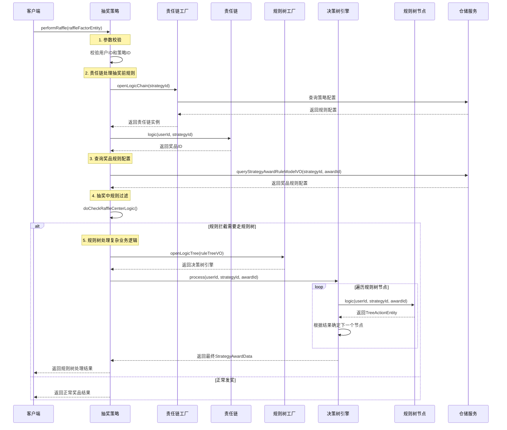

### 6.7 规则树的优势和特点

#### 6.7.1 设计优势

**1. 灵活的决策路径**
- 支持复杂的条件分支逻辑
- 可以根据不同条件选择不同的处理路径
- 比线性的责任链更适合复杂的业务决策

**2. 可视化的业务流程**
- 树状结构直观展示业务流程
- 便于业务人员理解和维护
- 支持流程图的可视化展示

**3. 高度的可配置性**
- 通过数据库配置规则树结构
- 支持动态调整业务流程
- 无需修改代码即可改变业务逻辑

**4. 良好的扩展性**
- 新增节点只需实现ILogicTreeNode接口
- 支持复杂的节点间关系配置
- 便于业务规则的快速迭代

#### 6.7.2 技术特点

**1. 状态机模式的应用**
- 每个节点代表一个状态
- 节点间的连线代表状态转换条件
- 支持复杂的状态转换逻辑

**2. 策略模式的集成**
- 每个节点实现不同的业务策略
- 通过工厂模式管理节点实例
- 支持运行时的策略选择

**3. 组合模式的体现**
- 规则树本身是一个组合结构
- 支持树的嵌套和组合
- 便于构建复杂的业务规则体系

#### 6.7.3 与责任链模式的协同

**分工明确：**
- **责任链**：处理抽奖前的用户资格校验（线性逻辑）
- **规则树**：处理抽奖中到抽奖后的复杂决策（树状逻辑）

**协同工作：**
```java
// 1. 责任链处理用户资格
ILogicChain logicChain = defaultChainFactory.openLogicChain(strategyId);
Integer awardId = logicChain.logic(userId, strategyId);

// 2. 规则树处理复杂业务逻辑
IDecisionTreeEngine treeEngine = defaultTreeFactory.openLogicTree(ruleTreeVO);
StrategyAwardData result = treeEngine.process(userId, strategyId, awardId);
```

### 6.8 规则树模式总结

#### 6.8.1 核心价值

**1. 业务逻辑可视化**
- 将复杂的业务流程以树状结构展现
- 便于业务人员理解和维护
- 支持业务流程的图形化配置

**2. 决策路径灵活化**
- 支持多分支的条件判断
- 可以根据不同条件选择不同路径
- 比线性处理更适合复杂业务场景

**3. 配置管理动态化**
- 通过数据库配置规则树结构
- 支持运行时动态调整业务流程
- 无需重启系统即可生效

**4. 系统扩展模块化**
- 新增业务规则只需实现节点接口
- 支持规则的热插拔和组合
- 便于系统的持续演进

#### 6.8.2 适用场景

**规则树模式特别适用于：**
1. **复杂的业务决策流程**
2. **需要多条件判断的场景**
3. **业务流程经常变化的系统**
4. **需要可视化配置的业务规则**
5. **多路径选择的处理逻辑**

规则树模式为Big-Market抽奖系统提供了处理复杂业务逻辑的强大工具，与责任链模式形成了完美的互补，共同构建了一个灵活、可扩展、易维护的规则引擎体系。通过规则树，系统能够优雅地处理抽奖中到抽奖后的各种复杂场景，为业务的快速发展提供了坚实的技术支撑。

## 7. 模板模式串联抽奖规则实现

### 7.1 模板模式概述

**模板模式**是一种行为型设计模式，它在抽象类中定义了算法的骨架，将一些步骤延迟到子类中实现。在Big-Market项目中，模板模式用于串联整个抽奖流程，将责任链、规则树等设计模式有机地组合在一起。

**核心特征：**
- **算法骨架固定**：抽奖流程的主要步骤在抽象类中定义
- **步骤可扩展**：具体的规则处理逻辑由子类实现
- **流程标准化**：确保所有抽奖策略都遵循统一的处理流程
- **职责分离**：将不同阶段的处理逻辑分离到不同的方法中

### 7.2 抽象模板类设计

```java
@Slf4j
public abstract class AbstractRaffleStrategy implements IRaffleStrategy, IRaffleStock{

    // 策略仓储服务
    protected IStrategyRepository repository;
    // 策略调度服务
    protected IStrategyDispatch strategyDispatch;
    // 抽奖的责任链
    protected final DefaultChainFactory defaultChainFactory;
    // 规则树工厂
    protected final DefaultTreeFactory defaultTreeFactory;

    @Override
    public RaffleAwardEntity performRaffle(RaffleFactorEntity raffleFactorEntity) {
        // 1. 参数校验
        String userId = raffleFactorEntity.getUserId();
        Long strategyId = raffleFactorEntity.getStrategyId();
        if (null == strategyId || StringUtils.isBlank(userId)) {
            throw new AppException(ResponseCode.ILLEGAL_PARAMETER.getCode(), ResponseCode.ILLEGAL_PARAMETER.getInfo());
        }

        // 2. 责任链抽奖计算【这步拿到的是初步的抽奖ID，之后需要根据ID处理抽奖】
        DefaultChainFactory.StrategyAwardVO chainStrategyAwardVO = raffleLogicChain(userId, strategyId);
        log.info("抽奖策略计算-责任链 {} {} {} {}", userId, strategyId, chainStrategyAwardVO.getAwardId(), chainStrategyAwardVO.getLogicModel());

        // 非默认抽奖（黑名单、权重等）直接返回结果
        if (!DefaultChainFactory.LogicModel.RULE_DEFAULT.getCode().equals(chainStrategyAwardVO.getLogicModel())) {
            return RaffleAwardEntity.builder()
                    .awardId(chainStrategyAwardVO.getAwardId())
                    .build();
        }

        // 3. 规则树抽奖过滤【奖品ID，会根据抽奖次数判断、库存判断、兜底兜里返回最终的可获得奖品信息】
        DefaultTreeFactory.StrategyAwardVO treeStrategyAwardVO = raffleLogicTree(userId, strategyId, chainStrategyAwardVO.getAwardId());
        log.info("抽奖策略计算-规则树 {} {} {} {}", userId, strategyId, treeStrategyAwardVO.getAwardId(), treeStrategyAwardVO.getAwardRuleValue());

        // 4. 返回抽奖结果
        return RaffleAwardEntity.builder()
                .awardId(treeStrategyAwardVO.getAwardId())
                .awardConfig(treeStrategyAwardVO.getAwardRuleValue())
                .build();
    }

    /**
     * 抽奖计算，责任链抽象方法
     */
    public abstract DefaultChainFactory.StrategyAwardVO raffleLogicChain(String userId, Long strategyId);

    /**
     * 抽奖结果过滤，决策树抽象方法
     */
    public abstract DefaultTreeFactory.StrategyAwardVO raffleLogicTree(String userId, Long strategyId, Integer awardId);
}
```

**模板方法的执行流程：**

1. **参数校验阶段**：验证用户ID和策略ID的有效性
2. **责任链处理阶段**：通过责任链处理抽奖前的规则（黑名单、权重等）
3. **规则树过滤阶段**：通过规则树处理抽奖中到抽奖后的复杂逻辑
4. **结果返回阶段**：构建并返回最终的抽奖结果

### 7.3 具体模板实现类

```java
@Service
@Slf4j
public class DefaultRaffleStrategy extends AbstractRaffleStrategy {

    public DefaultRaffleStrategy(IStrategyRepository repository, IStrategyDispatch strategyDispatch,
                               DefaultChainFactory defaultChainFactory, DefaultTreeFactory defaultTreeFactory) {
        super(repository, strategyDispatch, defaultChainFactory, defaultTreeFactory);
    }

    @Override
    public DefaultChainFactory.StrategyAwardVO raffleLogicChain(String userId, Long strategyId) {
        ILogicChain logicChain = defaultChainFactory.openLogicChain(strategyId);
        return logicChain.logic(userId, strategyId);
    }

    @Override
    public DefaultTreeFactory.StrategyAwardVO raffleLogicTree(String userId, Long strategyId, Integer awardId) {
        StrategyAwardRuleModelVO strategyAwardRuleModelVO = repository.queryStrategyAwardRuleModelVO(strategyId, awardId);
        if (null == strategyAwardRuleModelVO) {
            return DefaultTreeFactory.StrategyAwardVO.builder().awardId(awardId).build();
        }
        RuleTreeVO ruleTreeVO = repository.queryRuleTreeVOByTreeId(strategyAwardRuleModelVO.getRuleModels());
        if (null == ruleTreeVO) {
            throw new RuntimeException("存在抽奖策略配置的规则模型 Key，未在库表 rule_tree、rule_tree_node、rule_tree_line 配置对应的规则树信息 " + strategyAwardRuleModelVO.getRuleModels());
        }
        IDecisionTreeEngine treeEngine = defaultTreeFactory.openLogicTree(ruleTreeVO);
        return treeEngine.process(userId, strategyId, awardId);
    }

    @Override
    public StrategyAwardStockKeyVO takeQueueValue() throws InterruptedException {
        return repository.takeQueueValue();
    }

    @Override
    public void updateStrategyAwardStock(Long strategyId, Integer awardId) {
        repository.updateStrategyAwardStock(strategyId, awardId);
    }
}
```

**具体实现的职责：**
- **责任链集成**：调用责任链工厂创建并执行责任链
- **规则树集成**：调用规则树工厂创建并执行决策树
- **库存管理**：实现库存队列的消费和数据库更新逻辑

### 7.4 模板模式的优势和特点

#### 7.4.1 设计优势

**1. 流程标准化**
- 所有抽奖策略都遵循统一的处理流程
- 确保关键步骤不会被遗漏
- 便于系统的维护和扩展

**2. 职责分离**
- 抽象类定义算法骨架，具体类实现细节
- 责任链处理抽奖前规则，规则树处理抽奖后逻辑
- 每个组件职责单一，便于测试和维护

**3. 扩展性强**
- 新增抽奖策略只需继承抽象类并实现抽象方法
- 可以灵活组合不同的责任链和规则树
- 支持业务规则的快速迭代

**4. 代码复用**
- 公共的处理逻辑在抽象类中实现
- 避免重复代码，提高开发效率
- 统一的异常处理和日志记录

#### 7.4.2 模式协同工作

**1. 模板模式 + 责任链模式**
- 模板模式定义整体流程框架
- 责任链模式处理抽奖前的规则过滤
- 两者结合实现了灵活的规则处理机制

**2. 模板模式 + 规则树模式**
- 模板模式控制规则树的调用时机
- 规则树模式处理复杂的业务决策
- 实现了抽奖中到抽奖后的完整处理

**3. 多模式集成优势**
- 各模式职责清晰，互不干扰
- 可以独立演进和优化
- 形成了完整的抽奖规则引擎体系

### 7.5 模板模式总结

#### 7.5.1 核心价值

**1. 架构统一性**
- 提供了标准的抽奖处理流程
- 确保所有抽奖策略的一致性
- 便于系统的整体管控和优化

**2. 业务灵活性**
- 支持不同类型的抽奖策略实现
- 可以灵活组合各种规则处理方式
- 适应快速变化的业务需求

**3. 技术先进性**
- 采用了多种设计模式的组合应用
- 体现了现代分布式系统的设计理念
- 为系统扩展提供了良好的架构基础

#### 7.5.2 适用场景

**模板模式特别适用于：**
1. **流程相对固定但细节可变的场景**
2. **需要统一处理流程的业务系统**
3. **多种策略需要协同工作的复杂系统**
4. **对扩展性和维护性要求较高的项目**

模板模式在Big-Market抽奖系统中起到了承上启下的关键作用，它不仅串联了责任链和规则树等设计模式，还为整个抽奖系统提供了坚实的架构基础，确保了系统的可扩展性、可维护性和高性能。

## 8. 不超卖库存规则实现

### 8.1 库存扣减核心机制

**不超卖库存的核心思想：**
- **Redis原子操作**：使用Redis的`DECR`命令进行原子性库存扣减
- **分布式锁**：通过`SETNX`命令实现分布式锁，防止并发问题
- **异步更新**：使用延迟队列异步更新数据库，减少数据库压力
- **最终一致性**：保证缓存和数据库的最终一致性

### 8.2 库存扣减实现

```java
@Override
public Boolean subtractionAwardStock(String cacheKey) {
    // 1. 原子性扣减库存
    long surplus = redisService.decr(cacheKey);

    // 2. 库存不足处理
    if (surplus < 0) {
        redisService.setValue(cacheKey, 0);
        return false;
    }

    // 3. 分布式锁防止超卖
    String lockKey = cacheKey + Constants.UNDERLINE + surplus;
    Boolean lock = redisService.setNx(lockKey);
    if (!lock) {
        log.info("策略奖品库存加锁失败 {}", lockKey);
    }
    return lock;
}
```

**库存扣减流程解析：**

1. **原子扣减**：使用`redisService.decr(cacheKey)`原子性地将库存减1
2. **边界检查**：如果扣减后库存小于0，说明库存不足，重置为0并返回失败
3. **分布式锁**：使用`cacheKey + "_" + surplus`作为锁键，通过`SETNX`获取分布式锁
4. **防止超卖**：只有成功获取锁的请求才能真正扣减库存

**不超卖的保障机制：**

| 机制 | 作用 | 实现方式 |
|------|------|----------|
| **原子操作** | 确保库存扣减的原子性 | Redis DECR命令 |
| **分布式锁** | 防止并发扣减导致超卖 | Redis SETNX命令 |
| **边界检查** | 防止库存为负数 | 检查扣减后的值 |
| **锁键唯一** | 确保每次扣减的锁唯一 | cacheKey + "_" + surplus |

### 8.3 规则树中的库存节点

```java
@Slf4j
@Component("rule_stock")
public class RuleStockLogicTreeNode implements ILogicTreeNode {

    @Resource
    private IStrategyDispatch strategyDispatch;
    @Resource
    private IStrategyRepository strategyRepository;

    @Override
    public DefaultTreeFactory.TreeActionEntity logic(String userId, Long strategyId, Integer awardId, String ruleValue) {
        log.info("规则过滤-库存扣减 userId：{} strategyId：{} awardId：{}", userId, strategyId, awardId);

        // 1. 扣减库存
        Boolean status = strategyDispatch.subtractionAwardStock(strategyId, awardId);

        // 2. 扣减成功处理
        if (status) {
            // 写入延迟队列，延迟消费更新数据库记录
            strategyRepository.awardStockConsumeSendQueue(StrategyAwardStockKeyVO.builder()
                    .strategyId(strategyId)
                    .awardId(awardId)
                    .build());

            return DefaultTreeFactory.TreeActionEntity.builder()
                    .ruleLogicCheckType(RuleLogicCheckTypeVO.TAKE_OVER)
                    .strategyAwardVO(DefaultTreeFactory.StrategyAwardVO.builder()
                            .awardId(awardId)
                            .awardRuleValue(ruleValue)
                            .build())
                    .build();
        }

        // 3. 扣减失败，走兜底奖励
        return DefaultTreeFactory.TreeActionEntity.builder()
                .ruleLogicCheckType(RuleLogicCheckTypeVO.TAKE_OVER)
                .strategyAwardVO(DefaultTreeFactory.StrategyAwardVO.builder()
                        .awardId(101)  // 兜底奖品ID
                        .awardRuleValue("1,100")
                        .build())
                .build();
    }
}
```

**库存节点的处理逻辑：**

1. **库存扣减**：调用策略调度服务进行库存扣减
2. **成功处理**：扣减成功后发送到延迟队列，返回原奖品
3. **失败处理**：扣减失败时返回兜底奖品，保证用户体验

### 8.4 延迟队列异步更新

**延迟队列的作用：**
- **减少数据库压力**：避免每次库存扣减都直接操作数据库
- **提高性能**：异步处理，不阻塞主流程
- **批量处理**：可以将多个库存更新操作合并处理
- **容错机制**：即使更新失败也不影响用户体验

```java
@Override
public void awardStockConsumeSendQueue(StrategyAwardStockKeyVO strategyAwardStockKeyVO) {
    String cacheKey = Constants.RedisKey.STRATEGY_AWARD_COUNT_QUEUE_KEY;
    RBlockingQueue<StrategyAwardStockKeyVO> blockingQueue = redisService.getBlockingQueue(cacheKey);
    RDelayedQueue<StrategyAwardStockKeyVO> delayedQueue = redisService.getDelayedQueue(blockingQueue);
    // 延迟3秒后处理，避免频繁更新数据库
    delayedQueue.offer(strategyAwardStockKeyVO, 3, TimeUnit.SECONDS);
}

@Override
public StrategyAwardStockKeyVO takeQueueValue() {
    String cacheKey = Constants.RedisKey.STRATEGY_AWARD_COUNT_QUEUE_KEY;
    RBlockingQueue<StrategyAwardStockKeyVO> destinationQueue = redisService.getBlockingQueue(cacheKey);
    return destinationQueue.poll();
}

@Override
public void updateStrategyAwardStock(Long strategyId, Integer awardId) {
    StrategyAward strategyAward = new StrategyAward();
    strategyAward.setStrategyId(strategyId);
    strategyAward.setAwardId(awardId);
    strategyAwardDao.updateStrategyAwardStock(strategyAward);
}
```

**延迟队列的工作流程：**

1. **入队**：库存扣减成功后，将库存更新信息发送到延迟队列
2. **延迟**：设置3秒延迟，避免频繁的数据库操作
3. **出队**：定时任务从队列中获取待更新的库存信息
4. **更新**：执行数据库更新操作，保持数据一致性

### 8.5 定时任务消费队列

```java
@Slf4j
@Component()
@RequiredArgsConstructor
public class UpdateAwardCount {

    private final IRaffleStock raffleStock;

    @Scheduled(cron = "0/5 * * * * ?")
    public void exec() {
        try {
            log.info("定时任务，更新奖品消耗库存【延迟队列获取，降低对数据库的更新频次，不要产生竞争】");
            StrategyAwardStockKeyVO strategyAwardStockKeyVO = raffleStock.takeQueueValue();
            if (null == strategyAwardStockKeyVO) return;

            log.info("定时任务，更新奖品消耗库存 strategyId:{} awardId:{}",
                    strategyAwardStockKeyVO.getStrategyId(), strategyAwardStockKeyVO.getAwardId());
            raffleStock.updateStrategyAwardStock(strategyAwardStockKeyVO.getStrategyId(), strategyAwardStockKeyVO.getAwardId());
        } catch (Exception e) {
            log.error("定时任务，更新奖品消耗库存失败", e);
        }
    }
}
```

**定时任务的设计特点：**

- **定时执行**：每5秒执行一次，平衡实时性和性能
- **非阻塞**：如果队列为空直接返回，不阻塞线程
- **异常处理**：捕获异常并记录日志，保证任务稳定运行
- **批量处理**：可以在一次执行中处理多个库存更新

### 8.6 数据库更新SQL

```sql
update strategy_award
set award_count_surplus = award_count_surplus - 1
where strategy_id = #{strategyId} and award_id = #{awardId} and award_count_surplus > 0
```

**SQL设计要点：**
- **条件更新**：只有在库存大于0时才执行更新
- **原子操作**：单条SQL保证更新的原子性
- **防止负数**：通过条件判断防止库存变为负数

### 8.7 不超卖库存执行时序图

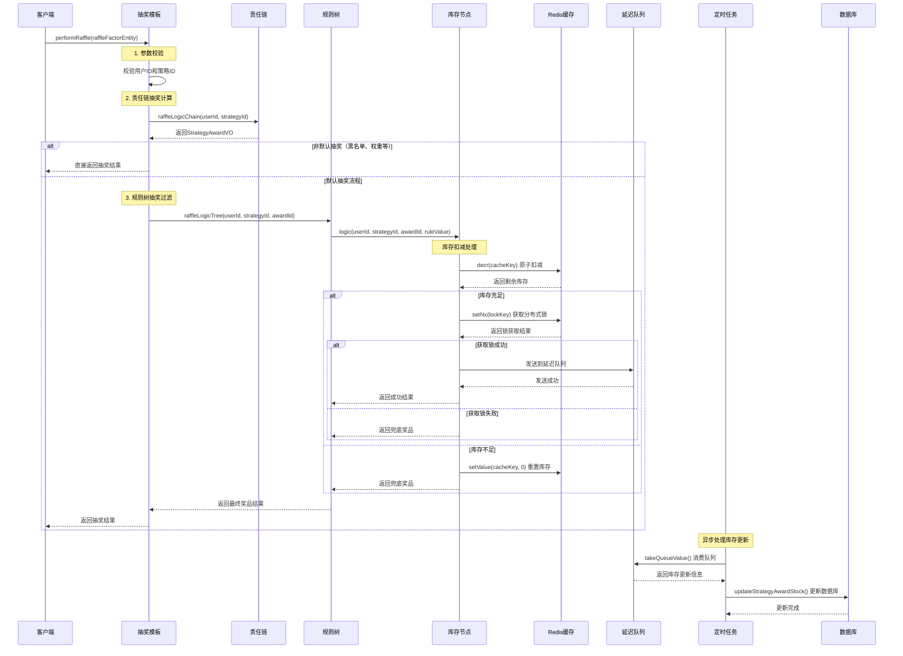

### 8.8 库存控制的技术特点

#### 8.8.1 高并发处理能力

**1. Redis原子操作**
- 使用Redis的DECR命令保证库存扣减的原子性
- 避免了传统数据库锁带来的性能瓶颈
- 支持大量并发请求的高效处理

**2. 分布式锁机制**
- 通过SETNX命令实现分布式锁
- 防止并发扣减导致的超卖问题
- 锁键设计保证每次扣减的唯一性

**3. 性能优化策略**
- 缓存优先策略，减少数据库访问
- 异步更新机制，提高系统响应速度
- 延迟队列批量处理，优化资源使用

#### 8.8.2 数据一致性保障

**1. 最终一致性模型**
- 采用最终一致性，平衡性能和一致性要求
- 缓存和数据库通过异步机制保持同步
- 定时任务确保数据的最终一致性

**2. 异常恢复机制**
- 库存扣减失败时的回滚处理
- 延迟队列的重试机制
- 完善的日志记录便于问题排查

**3. 容错处理**
- 库存不足时提供兜底奖品
- 异常情况下的降级处理
- 系统故障时的数据保护机制

### 8.9 不超卖库存规则总结

#### 8.9.1 核心价值

**1. 业务安全性**
- 彻底解决了高并发场景下的超卖问题
- 保证了抽奖活动的公平性和准确性
- 维护了用户体验和品牌信誉

**2. 技术先进性**
- 采用了Redis分布式锁的最佳实践
- 实现了高性能的库存管理方案
- 体现了现代分布式系统的设计理念

**3. 系统稳定性**
- 完善的异常处理和降级机制
- 异步处理减少了系统耦合度
- 定时任务保证了数据的最终一致性

#### 8.9.2 适用场景

**不超卖库存规则特别适用于：**
1. **高并发的商品秒杀场景**
2. **限量奖品的抽奖活动**
3. **需要精确库存控制的业务系统**
4. **对数据一致性要求较高的分布式系统**

不超卖库存规则的实现展示了在分布式高并发场景下如何通过技术手段保证业务的准确性和系统的稳定性。这种设计不仅解决了传统库存管理的痛点，还为类似的业务场景提供了可复用的技术方案。

## 9. 抽奖API接口实现

### 9.1 API接口架构设计

#### 9.1.1 接口层次结构

Big-Market项目的抽奖API接口采用了分层架构设计，主要包括以下层次：

- **API接口层**：定义对外暴露的接口规范
- **Controller层**：处理HTTP请求和响应
- **应用服务层**：业务逻辑编排和协调
- **领域服务层**：核心业务逻辑实现
- **基础设施层**：数据持久化和外部服务调用

#### 9.1.2 核心接口定义

**抽奖服务接口：**
```java
/**
 * 抽奖服务接口
 */
public interface IRaffleService {

    /**
     * 策略装配接口
     * @param strategyId 策略Id
     * @return 装配结果
     */
    Response<Boolean> strategyArmory(Long strategyId);

    /**
     * 查询抽奖奖品列表配置
     * @param requestDTO 抽奖奖品列表请求参数
     * @return 奖品列表数据
     */
    Response<List<RaffleAwardListResponseDTO>> queryRaffleAwardList(RaffleAwardListRequestDTO requestDTO);

    /**
     * 随机抽奖接口
     * @param requestDTO 抽奖请求参数
     * @return 抽奖结果
     */
    Response<RaffleResponseDTO> randomRaffle(RaffleRequestDTO requestDTO);
}
```

**接口功能说明：**
- **策略装配**：将抽奖策略配置加载到缓存中，提高抽奖性能
- **奖品列表查询**：获取指定策略下的所有奖品信息
- **随机抽奖**：执行抽奖逻辑，返回中奖结果

### 9.2 请求响应模型设计

#### 9.2.1 请求模型

**抽奖请求DTO：**
```java
@Data
public class RaffleRequestDTO {
    // 抽奖策略ID
    private Long strategyId;
}
```

**奖品列表请求DTO：**
```java
@Data
public class RaffleAwardListRequestDTO {
    /** 抽奖策略Id */
    private Long strategyId;
}
```

#### 9.2.2 响应模型

**抽奖响应DTO：**
```java
@Data
@Builder
@AllArgsConstructor
@NoArgsConstructor
public class RaffleResponseDTO {
    // 奖品ID
    private Integer awardId;
    // 排序编号
    private Integer awardIndex;
}
```

**奖品列表响应DTO：**
```java
@Data
@Builder
@AllArgsConstructor
@NoArgsConstructor
public class RaffleAwardListResponseDTO {
    // 奖品Id
    private Integer awardId;
    // 奖品标题
    private String awardTitle;
    // 奖品副标题（抽奖一次后解锁）
    private String awardSubTitle;
    // 排序编号
    private Integer sort;
}
```

#### 9.2.3 统一响应格式

**通用响应模型：**
```java
@Data
@Builder
public class Response<T> {
    private String code;    // 响应码
    private String info;    // 响应信息
    private T data;         // 响应数据
}
```

**响应码枚举：**
```java
public enum ResponseCode {
    SUCCESS("0000", "调用成功"),
    UN_ERROR("0001", "调用失败"),
    ILLEGAL_PARAMETER("0002", "非法参数");

    private final String code;
    private final String info;
}
```

### 9.3 Controller层实现

#### 9.3.1 抽奖控制器

```java
@Slf4j
@RestController()
@CrossOrigin("${app.config.cross-origin}")
@RequestMapping("/api/${app.config.api-version}/raffle/")
@RequiredArgsConstructor
public class RaffleController implements IRaffleService {

    private final IStrategyArmory strategyArmory;
    private final IRaffleAward raffleAward;
    private final IRaffleStrategy raffleStrategy;

    /**
     * 策略装配，将策略信息装配到缓存中
     */
    @GetMapping(value = "strategy_armory")
    @Override
    public Response<Boolean> strategyArmory(@RequestParam Long strategyId) {
        try {
            log.info("抽奖策略装配开始 strategyId：{}", strategyId);
            boolean armoryStatus = strategyArmory.assembleLotteryStrategy(strategyId);
            Response<Boolean> response = Response.<Boolean>builder()
                    .code(ResponseCode.SUCCESS.getCode())
                    .info(ResponseCode.SUCCESS.getInfo())
                    .data(armoryStatus)
                    .build();
            log.info("抽奖策略装配完成 strategyId：{}", strategyId);
            return response;
        } catch (Exception e) {
            log.error("抽奖策略装配失败 strategyId={}", strategyId);
            return Response.<Boolean>builder()
                    .code(ResponseCode.UN_ERROR.getCode())
                    .info(ResponseCode.UN_ERROR.getInfo())
                    .build();
        }
    }

    /**
     * 查询奖品列表
     */
    @GetMapping(value = "query_raffle_award_list")
    @Override
    public Response<List<RaffleAwardListResponseDTO>> queryRaffleAwardList(@RequestBody RaffleAwardListRequestDTO requestDTO) {
        try {
            log.info("查询抽奖奖品列表开始 strategyId：{}", requestDTO.getStrategyId());
            // 查询奖品配置
            List<StrategyAwardEntity> strategyAwardEntities = raffleAward.queryRaffleStrategyAwardList(requestDTO.getStrategyId());
            List<RaffleAwardListResponseDTO> raffleAwardListResponseDTOS = new ArrayList<>(strategyAwardEntities.size());
            for (StrategyAwardEntity strategyAward : strategyAwardEntities) {
                raffleAwardListResponseDTOS.add(RaffleAwardListResponseDTO.builder()
                        .awardId(strategyAward.getAwardId())
                        .awardTitle(strategyAward.getAwardTitle())
                        .awardSubTitle(strategyAward.getAwardSubTitle())
                        .sort(strategyAward.getSort())
                        .build());
            }
            Response<List<RaffleAwardListResponseDTO>> response = Response.<List<RaffleAwardListResponseDTO>>builder()
                    .code(ResponseCode.SUCCESS.getCode())
                    .info(ResponseCode.SUCCESS.getInfo())
                    .data(raffleAwardListResponseDTOS)
                    .build();
            log.info("查询抽奖奖品列表配置完成 strategyId：{} response: {}", requestDTO.getStrategyId(), JSON.toJSONString(response));
            return response;
        } catch (Exception e) {
            log.error("查询抽奖奖品列表失败 strategyId={}", requestDTO.getStrategyId());
            return Response.<List<RaffleAwardListResponseDTO>>builder()
                    .code(ResponseCode.UN_ERROR.getCode())
                    .info(ResponseCode.UN_ERROR.getInfo())
                    .build();
        }
    }

    /**
     * 随机抽奖接口
     */
    @PostMapping(value = "random_raffle")
    @Override
    public Response<RaffleResponseDTO> randomRaffle(@RequestBody RaffleRequestDTO requestDTO) {
        try {
            log.info("随机抽奖开始 strategyId: {}", requestDTO.getStrategyId());
            // 调用抽奖接口
            RaffleAwardEntity raffleAwardEntity = raffleStrategy.performRaffle(RaffleFactorEntity.builder()
                    .userId("system")
                    .strategyId(requestDTO.getStrategyId())
                    .build());
            // 封装返回结果
            Response<RaffleResponseDTO> response = Response.<RaffleResponseDTO>builder()
                    .code(ResponseCode.SUCCESS.getCode())
                    .info(ResponseCode.SUCCESS.getInfo())
                    .data(RaffleResponseDTO.builder()
                            .awardId(raffleAwardEntity.getAwardId())
                            .awardIndex(raffleAwardEntity.getSort())
                            .build())
                    .build();
            log.info("随机抽奖完成 strategyId: {} response: {}", requestDTO.getStrategyId(), JSON.toJSONString(response));
            return response;
        } catch (AppException e) {
            log.error("随机抽奖失败 strategyId：{} {}", requestDTO.getStrategyId(), e.getInfo());
            return Response.<RaffleResponseDTO>builder()
                    .code(e.getCode())
                    .info(e.getInfo())
                    .build();
        } catch (Exception e) {
            log.error("随机抽奖失败 strategyId：{}", requestDTO.getStrategyId(), e);
            return Response.<RaffleResponseDTO>builder()
                    .code(ResponseCode.UN_ERROR.getCode())
                    .info(ResponseCode.UN_ERROR.getInfo())
                    .build();
        }
    }
}
```

#### 9.3.2 Controller设计特点

**1. 统一异常处理**
- 区分业务异常（AppException）和系统异常
- 不同异常返回不同的错误码和信息
- 完善的日志记录便于问题排查

**2. 请求响应转换**
- 将内部领域对象转换为API响应对象
- 隐藏内部实现细节，只暴露必要信息
- 保持API接口的稳定性

**3. 配置化路由**
- 使用配置文件管理API版本和跨域设置
- 支持灵活的路由配置
- 便于API版本管理和升级

### 9.4 领域服务集成

#### 9.4.1 核心领域接口

**抽奖策略接口：**
```java
public interface IRaffleStrategy {
    RaffleAwardEntity performRaffle(RaffleFactorEntity raffleFactorEntity);
}
```

**抽奖奖品接口：**
```java
public interface IRaffleAward {
    /**
     * 根据策略ID查询抽奖奖品列表配置
     * @param strategyId 策略ID
     * @return 奖品列表
     */
    List<StrategyAwardEntity> queryRaffleStrategyAwardList(Long strategyId);
}
```

**策略装配接口：**
```java
public interface IStrategyArmory {
    /**
     * 装配抽奖策略配置
     * @param strategyId 策略ID
     */
    boolean assembleLotteryStrategy(Long strategyId);
}
```

#### 9.4.2 领域实体模型

**抽奖因子实体：**
```java
@Data
@Builder
@AllArgsConstructor
@NoArgsConstructor
public class RaffleFactorEntity {
    private String userId;      // 用户ID
    private Long strategyId;    // 策略ID
    private Integer awardId;    // 奖品ID
}
```

**抽奖奖品实体：**
```java
@Data
@Builder
@AllArgsConstructor
@NoArgsConstructor
public class RaffleAwardEntity {
    private Integer awardId;    // 奖品ID
    private String awardConfig; // 奖品配置
    private Integer sort;       // 排序编号
}
```

**策略奖品实体：**
```java
@Data
@Builder
@AllArgsConstructor
@NoArgsConstructor
public class StrategyAwardEntity {
    private Long strategyId;        // 抽奖策略ID
    private Integer awardId;        // 抽奖奖品ID
    private String awardTitle;      // 抽奖奖品标题
    private String awardSubTitle;   // 抽奖奖品副标题
    private Integer awardCount;     // 奖品库存总量
    private Integer awardCountSurplus; // 奖品库存剩余
    private BigDecimal awardRate;   // 奖品中奖概率
    private Integer sort;           // 排序
}
```

## 10. 抽奖完整流程详解

### 10.1 抽奖流程概述

Big-Market抽奖系统的完整流程包括以下几个主要阶段：

1. **策略装配阶段**：将抽奖策略配置加载到缓存
2. **奖品查询阶段**：获取可抽奖品列表
3. **抽奖执行阶段**：执行完整的抽奖逻辑
4. **结果返回阶段**：返回抽奖结果给用户

### 10.2 策略装配流程

#### 10.2.1 装配目的

**策略装配的主要目的：**
- **性能优化**：将数据库中的配置预加载到Redis缓存
- **概率计算**：构建奖品概率查找表，提高抽奖效率
- **规则预处理**：解析和缓存各种抽奖规则
- **库存初始化**：将奖品库存信息同步到缓存

#### 10.2.2 装配过程

**装配流程步骤：**
1. **查询策略配置**：从数据库获取策略基本信息
2. **查询奖品配置**：获取策略下的所有奖品信息
3. **构建概率表**：根据奖品概率构建查找表
4. **缓存规则配置**：将各种规则配置存储到Redis
5. **初始化库存**：将奖品库存信息同步到缓存

**关键代码逻辑：**
```java
@Override
public boolean assembleLotteryStrategy(Long strategyId) {
    // 1. 查询策略配置
    List<StrategyAwardEntity> strategyAwardEntities = strategyAwardDao.queryStrategyAwardListByStrategyId(strategyId);

    // 2. 构建概率查找表
    assembleLotteryStrategy(String.valueOf(strategyId), strategyAwardEntities);

    // 3. 权重规则配置装配
    StrategyEntity strategyEntity = strategyDao.queryStrategyByStrategyId(strategyId);
    String ruleWeight = strategyEntity.getRuleWeight();
    if (null != ruleWeight) {
        StrategyRuleEntity strategyRuleEntity = strategyRuleDao.queryStrategyRule(strategyId, ruleWeight);
        if (null != strategyRuleEntity) {
            Map<String, List<Integer>> ruleWeightValueMap = strategyRuleEntity.getRuleWeightValues();
            for (String key : ruleWeightValueMap.keySet()) {
                List<Integer> ruleWeightValues = ruleWeightValueMap.get(key);
                ArrayList<StrategyAwardEntity> strategyAwardEntitiesClone = new ArrayList<>(strategyAwardEntities);
                strategyAwardEntitiesClone.removeIf(entity -> !ruleWeightValues.contains(entity.getAwardId()));
                assembleLotteryStrategy(strategyId + "_" + key, strategyAwardEntitiesClone);
            }
        }
    }

    return true;
}
```

### 10.3 抽奖执行流程

#### 10.3.1 完整执行链路

**抽奖执行的完整链路：**
```
API请求 → Controller → 模板方法 → 责任链 → 规则树 → 库存扣减 → 结果返回
```

#### 10.3.2 详细执行步骤

**步骤1：API请求处理**
```java
@PostMapping(value = "random_raffle")
public Response<RaffleResponseDTO> randomRaffle(@RequestBody RaffleRequestDTO requestDTO) {
    // 构建抽奖因子
    RaffleFactorEntity raffleFactorEntity = RaffleFactorEntity.builder()
            .userId("system")
            .strategyId(requestDTO.getStrategyId())
            .build();

    // 调用抽奖策略
    RaffleAwardEntity raffleAwardEntity = raffleStrategy.performRaffle(raffleFactorEntity);

    // 返回结果
    return buildResponse(raffleAwardEntity);
}
```

**步骤2：模板方法执行**
```java
@Override
public RaffleAwardEntity performRaffle(RaffleFactorEntity raffleFactorEntity) {
    // 1. 参数校验
    String userId = raffleFactorEntity.getUserId();
    Long strategyId = raffleFactorEntity.getStrategyId();

    // 2. 责任链抽奖计算
    DefaultChainFactory.StrategyAwardVO chainStrategyAwardVO = raffleLogicChain(userId, strategyId);

    // 3. 非默认抽奖直接返回
    if (!DefaultChainFactory.LogicModel.RULE_DEFAULT.getCode().equals(chainStrategyAwardVO.getLogicModel())) {
        return buildRaffleAwardEntity(strategyId, chainStrategyAwardVO.getAwardId(), null);
    }

    // 4. 规则树抽奖过滤
    DefaultTreeFactory.StrategyAwardVO treeStrategyAwardVO = raffleLogicTree(userId, strategyId, chainStrategyAwardVO.getAwardId());

    // 5. 返回抽奖结果
    return buildRaffleAwardEntity(strategyId, treeStrategyAwardVO.getAwardId(), treeStrategyAwardVO.getAwardRuleValue());
}
```

**步骤3：责任链处理**
```java
@Override
public DefaultChainFactory.StrategyAwardVO raffleLogicChain(String userId, Long strategyId) {
    ILogicChain logicChain = defaultChainFactory.openLogicChain(strategyId);
    return logicChain.logic(userId, strategyId);
}
```

**步骤4：规则树处理**
```java
@Override
public DefaultTreeFactory.StrategyAwardVO raffleLogicTree(String userId, Long strategyId, Integer awardId) {
    // 查询奖品规则配置
    StrategyAwardRuleModelVO strategyAwardRuleModelVO = repository.queryStrategyAwardRuleModelVO(strategyId, awardId);
    if (null == strategyAwardRuleModelVO) {
        return DefaultTreeFactory.StrategyAwardVO.builder().awardId(awardId).build();
    }

    // 查询规则树配置
    RuleTreeVO ruleTreeVO = repository.queryRuleTreeVOByTreeId(strategyAwardRuleModelVO.getRuleModels());
    if (null == ruleTreeVO) {
        throw new RuntimeException("规则树配置不存在");
    }

    // 执行规则树
    IDecisionTreeEngine treeEngine = defaultTreeFactory.openLogicTree(ruleTreeVO);
    return treeEngine.process(userId, strategyId, awardId);
}
```

### 10.4 抽奖完整流程时序图

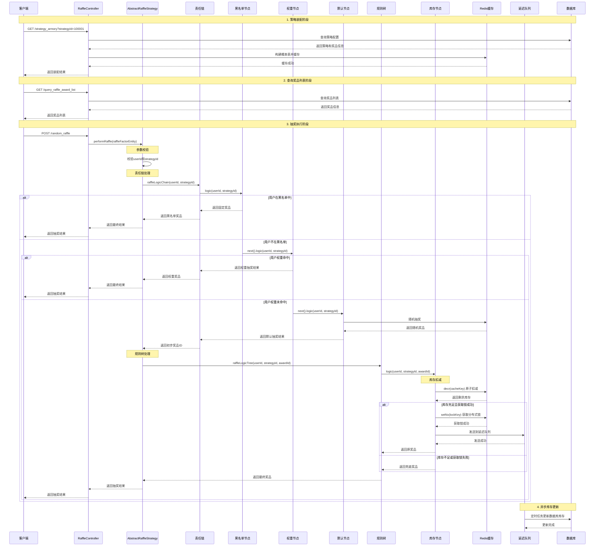

### 10.5 抽奖流程关键节点

#### 10.5.1 责任链节点处理

**黑名单节点：**

- **功能**：检查用户是否在黑名单中
- **处理逻辑**：命中黑名单直接返回固定奖品，否则传递给下一个节点
- **业务价值**：实现特殊用户的定向奖品发放

**权重节点：**
- **功能**：根据用户积分等级进行权重抽奖
- **处理逻辑**：匹配用户积分对应的权重档位，进行权重抽奖
- **业务价值**：实现差异化的抽奖体验

**默认节点：**
- **功能**：执行标准的随机抽奖逻辑
- **处理逻辑**：基于概率表进行随机抽奖
- **业务价值**：保证系统的基础抽奖功能

#### 10.5.2 规则树节点处理

**库存节点：**
- **功能**：检查和扣减奖品库存
- **处理逻辑**：原子性扣减库存，成功则继续，失败则返回兜底奖品
- **业务价值**：防止超卖，保证奖品发放的准确性

**次数锁节点：**
- **功能**：检查用户抽奖次数是否满足解锁条件
- **处理逻辑**：验证用户抽奖次数，决定是否可以获得特定奖品
- **业务价值**：增加用户粘性，鼓励多次参与

**兜底奖励节点：**
- **功能**：提供保底奖品，确保用户总能获得奖励
- **处理逻辑**：返回固定的兜底奖品
- **业务价值**：保证用户体验，避免空手而归

### 10.6 抽奖流程总结

#### 10.6.1 流程优势

**1. 模块化设计**
- 每个处理节点职责单一，便于维护和扩展
- 责任链和规则树分别处理不同阶段的业务逻辑
- 模板方法统一流程，保证处理的一致性

**2. 高性能处理**
- 策略装配预加载配置到缓存，提高抽奖效率
- Redis原子操作保证高并发场景下的数据一致性
- 异步队列处理库存更新，减少主流程耗时

**3. 业务灵活性**
- 支持多种抽奖规则的灵活组合
- 可以通过配置动态调整抽奖策略
- 兜底机制保证用户体验

**4. 系统稳定性**
- 完善的异常处理和降级机制
- 分布式锁防止超卖问题
- 详细的日志记录便于问题排查

#### 10.6.2 适用场景

**Big-Market抽奖系统特别适用于：**
1. **电商平台的营销活动**：支持复杂的抽奖规则和大量并发
2. **游戏行业的抽奖系统**：满足多样化的奖品配置需求
3. **金融行业的积分兑换**：支持基于用户等级的差异化奖励
4. **社交平台的互动活动**：提供灵活的奖品配置和用户体验

Big-Market抽奖系统通过完整的API接口实现，为用户提供了便捷的抽奖服务。整个系统从策略装配到抽奖执行，再到结果返回，形成了一个完整的闭环，既保证了业务的灵活性，又确保了系统的稳定性和高性能。

## 11. 抽奖活动流水入库功能

### 11.1 功能概述

抽奖活动流水入库功能是Big-Market系统中的核心业务模块，主要负责处理用户参与抽奖活动时的订单创建、账户更新和流水记录。该功能确保了用户抽奖次数的准确管理和活动参与记录的完整性。

#### 11.1.1 核心功能

**1. 活动订单创建**
- 根据SKU创建抽奖活动订单
- 生成唯一订单号，记录用户参与信息
- 关联活动信息和抽奖策略

**2. 用户账户管理**
- 创建或更新用户活动账户
- 管理用户的总次数、日次数、月次数
- 维护剩余次数信息

**3. 事务流水记录**
- 记录完整的活动参与流水
- 支持业务幂等性处理
- 提供订单状态跟踪

#### 11.1.2 业务价值

- **数据一致性**：通过事务保证订单和账户数据的一致性
- **业务幂等**：防止重复下单，确保业务操作的准确性
- **流水追踪**：完整记录用户参与活动的历史轨迹
- **次数管控**：精确控制用户的抽奖参与次数

### 11.2 核心实体模型

#### 11.2.1 活动订单实体 (ActivityOrderEntity)

活动订单实体是流水入库功能的核心数据模型，记录用户参与活动的完整信息。

**主要属性：**
- `userId`: 用户ID，标识参与用户
- `sku`: 商品SKU，关联具体活动商品
- `activityId`: 活动ID，关联抽奖活动
- `activityName`: 活动名称
- `strategyId`: 抽奖策略ID
- `orderId`: 订单ID，系统生成的唯一标识
- `orderTime`: 下单时间
- `totalCount/dayCount/monthCount`: 各维度的参与次数
- `state`: 订单状态
- `outBusinessNo`: 外部业务单号，用于幂等控制

#### 11.2.2 活动账户实体 (ActivityAccountEntity)

活动账户实体管理用户在特定活动中的参与次数信息。

**主要属性：**
- `userId`: 用户ID
- `activityId`: 活动ID
- `totalCount/totalCountSurplus`: 总次数及剩余次数
- `dayCount/dayCountSurplus`: 日次数及剩余次数
- `monthCount/monthCountSurplus`: 月次数及剩余次数

#### 11.2.3 订单聚合对象 (CreateOrderAggregate)

订单聚合对象封装了创建订单所需的完整信息，体现了DDD中聚合的概念。

**聚合内容：**
- 用户基本信息
- 活动参与次数信息
- 活动订单实体
- 业务操作上下文

### 11.3 服务架构设计

#### 11.3.1 抽象服务层 (AbstractRaffleActivity)

抽象服务层定义了活动订单处理的标准流程，采用模板方法模式。

**核心流程：**
1. **参数校验**：验证输入参数的有效性
2. **基础信息查询**：获取活动、SKU、次数配置信息
3. **规则校验**：执行活动参与规则检查
4. **订单构建**：构建订单聚合对象
5. **订单保存**：执行事务性保存操作
6. **结果返回**：返回订单号

**模板方法：**
```java
// 抽象方法，由具体实现类完成
protected abstract void doSaveOrder(CreateOrderAggregate createOrderAggregate);
protected abstract CreateOrderAggregate buildOrderAggregate(...);
```

#### 11.3.2 具体服务实现 (RaffleActivityService)

具体服务实现类负责实际的业务逻辑处理。

**订单构建逻辑：**
- 设置用户和活动基本信息
- 生成12位随机订单号
- 设置订单状态为已完成
- 配置各维度参与次数

**订单保存逻辑：**
- 委托给仓储层执行具体的数据持久化操作

### 11.4 数据持久化层

#### 11.4.1 仓储接口 (IActivityRepository)

仓储接口定义了活动相关的数据访问契约。

**核心方法：**
- `queryActivitySku()`: 查询活动SKU信息
- `queryRaffleActivityByActivityId()`: 查询活动详情
- `queryRaffleActivityCountByActivityCountId()`: 查询次数配置
- `doSaveOrder()`: 保存订单聚合

#### 11.4.2 仓储实现 (ActivityRepository)

仓储实现类负责具体的数据访问逻辑，集成了缓存和事务处理。

**缓存策略：**
- 活动信息优先从Redis缓存获取
- 次数配置信息缓存提高查询效率
- 缓存键采用统一的命名规范

**事务处理：**
```java
// 编程式事务处理
transactionTemplate.execute(status -> {
    try {
        // 1. 写入订单
        raffleActivityOrderDao.insert(raffleActivityOrder);
        // 2. 更新账户
        int count = raffleActivityAccountDao.updateAccountQuota(raffleActivityAccount);
        // 3. 创建账户 - 更新为0，则账户不存在，创建新账户
        if (0 == count) {
            raffleActivityAccountDao.insert(raffleActivityAccount);
        }
        return 1;
    } catch (DuplicateKeyException e) {
        status.setRollbackOnly();
        throw new AppException(ResponseCode.INDEX_DUP.getCode());
    }
});
```

### 11.5 业务规则处理

#### 11.5.1 规则链处理

在订单创建过程中，系统会执行一系列业务规则校验：

**规则校验流程：**
1. 获取规则链实例
2. 执行规则校验逻辑
3. 根据校验结果决定是否继续处理

**规则类型：**
- 活动状态校验
- 用户参与资格校验
- 次数限制校验
- 其他业务规则

#### 11.5.2 异常处理机制

**幂等性处理：**
- 通过`outBusinessNo`实现业务幂等
- 捕获`DuplicateKeyException`异常
- 返回统一的错误码

**事务回滚：**
- 异常情况下自动回滚事务
- 保证数据的一致性
- 记录详细的错误日志

### 11.6 分库分表支持

#### 11.6.1 ShardingSphere集成

系统集成了ShardingSphere实现分库分表功能：

**路由策略：**
- 根据`userId`自动进行分库分表路由
- 保证同一用户的数据在同一分片
- 支持水平扩展

**事务支持：**
- 支持分布式事务处理
- 保证跨分片操作的一致性

### 11.7 接口设计

#### 11.7.1 订单创建接口

**接口定义：**
```java
public interface IRaffleOrder {
    // SKU订单创建
    ActivityOrderEntity createRaffleActivityOrder(ActivityShopCartEntity activityShopCartEntity);

    // 充值订单创建
    String createSkuRechargeOrder(SkuRechargeEntity skuRechargeEntity);
}
```

**接口特点：**
- 支持两种订单创建方式
- 返回不同类型的结果
- 提供清晰的业务语义

#### 11.7.2 数据传输对象

**购物车实体 (ActivityShopCartEntity)：**
- 封装SKU购买信息
- 用于简单的活动参与

**充值实体 (SkuRechargeEntity)：**
- 封装充值相关信息
- 支持外部业务单号
- 用于复杂的次数充值场景

### 11.8 实现链路UML图

#### 11.8.1 类图关系

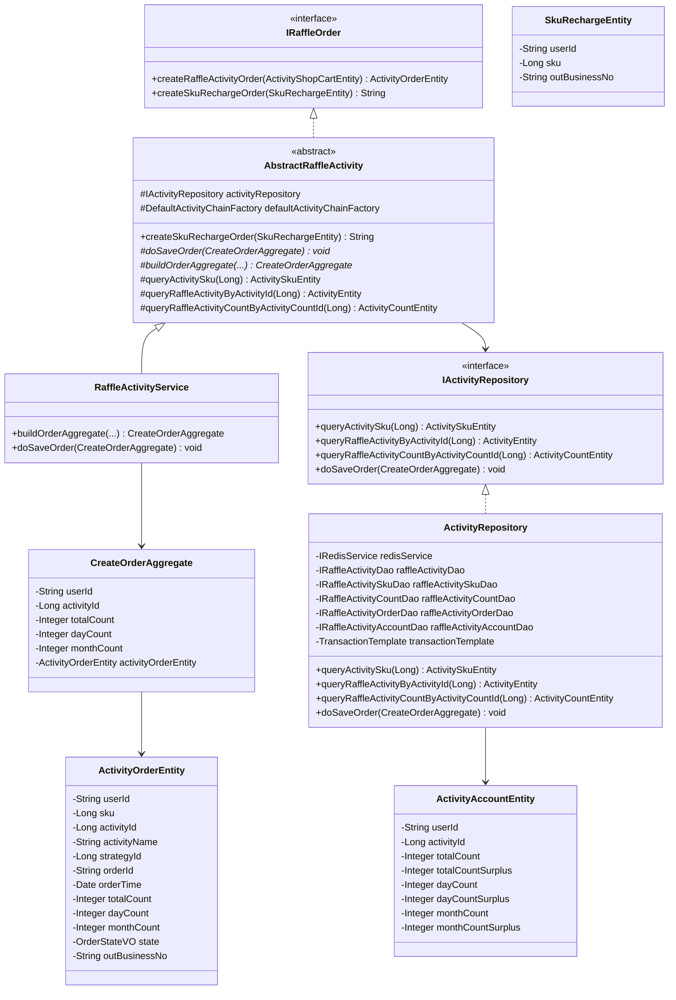

#### 11.8.2 时序图 - 订单创建流程

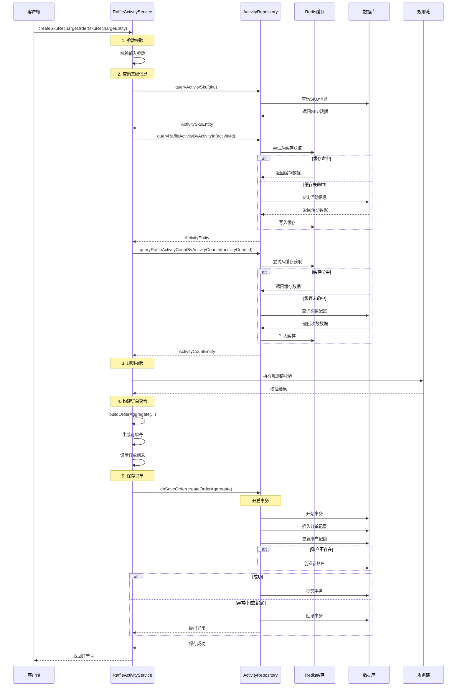

#### 11.8.3 活动图 - 业务处理流程

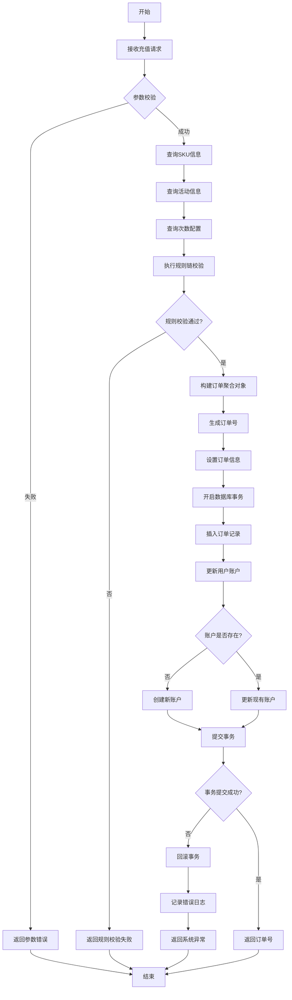

### 11.9 技术特点与优势

#### 11.9.1 设计模式应用

**1. 模板方法模式**
- `AbstractRaffleActivity`定义标准流程
- 子类实现具体的业务逻辑
- 保证流程的一致性和可扩展性

**2. 策略模式**
- 不同的规则校验策略
- 灵活的业务规则配置
- 便于规则的动态调整

**3. 聚合模式**
- `CreateOrderAggregate`封装相关数据
- 保证数据的完整性和一致性
- 体现DDD设计思想

#### 11.9.2 性能优化

**1. 缓存策略**
- Redis缓存活动和次数配置信息
- 减少数据库查询压力
- 提高系统响应速度

**2. 事务优化**
- 编程式事务控制
- 精确控制事务边界
- 避免长事务影响性能

**3. 分库分表**
- 基于userId的分片策略
- 支持水平扩展
- 提高系统并发能力

#### 11.9.3 可靠性保障

**1. 幂等性设计**
- 外部业务单号防重
- 数据库唯一索引约束
- 异常情况下的优雅处理

**2. 事务一致性**
- ACID特性保证
- 异常自动回滚
- 数据完整性验证

**3. 异常处理**
- 分层异常处理机制
- 详细的错误日志记录
- 统一的错误码返回

### 11.10 功能总结

抽奖活动流水入库功能是Big-Market系统的重要组成部分，它通过完善的架构设计和技术实现，为用户提供了可靠的活动参与服务。

#### 11.10.1 核心价值

**1. 业务完整性**
- 完整的订单生命周期管理
- 准确的用户次数控制
- 可靠的流水记录追踪

**2. 技术先进性**
- DDD架构设计
- 多种设计模式应用
- 高性能缓存策略

**3. 系统稳定性**
- 完善的异常处理机制
- 强一致性事务保证
- 分布式架构支持

#### 11.10.2 扩展性

该功能具有良好的扩展性，可以支持：
- 新的业务规则添加
- 不同类型的活动订单
- 更复杂的次数管理策略
- 多样化的支付方式

通过这套完整的流水入库功能，Big-Market系统能够为各种营销活动提供强有力的技术支撑，确保业务的顺利开展和用户体验的持续优化。

## 12. MQ处理活动SKU库存一致性功能

### 12.1 功能概述

MQ处理活动SKU库存一致性功能是Big-Market系统中的核心库存管理模块，主要解决高并发场景下缓存库存与数据库库存的一致性问题。该功能通过责任链模式进行活动校验，使用Redis原子操作进行库存扣减，并结合延迟队列和RabbitMQ消息机制确保最终一致性。

#### 12.1.1 核心功能

**1. 活动责任链校验**
- 活动基础信息校验（日期、状态、库存）
- SKU库存扣减处理
- 责任链模式确保校验流程的完整性

**2. 库存扣减机制**
- Redis DECR原子操作扣减缓存库存
- 分布式锁机制防止超卖
- 库存消耗完毕后的MQ消息通知

**3. 延迟队列处理**
- 库存扣减后发送延迟队列消息
- 定时任务消费队列进行趋势更新
- 降低数据库更新频次，避免竞争

**4. RabbitMQ消息驱动**
- 库存为0时发送MQ消息
- 直接清空数据库库存
- 保证缓存与数据库的强一致性

#### 12.1.2 业务价值

- **高并发支持**：Redis原子操作保证高并发场景下的性能
- **数据一致性**：多层机制确保缓存与数据库的最终一致性
- **防超卖保护**：分布式锁和原子操作防止库存超卖
- **性能优化**：延迟队列减少数据库压力，提升系统性能

### 12.2 责任链校验机制

#### 12.2.1 责任链架构设计

活动校验采用责任链模式，将不同的校验逻辑分离到独立的处理节点中。

**责任链组成：**
1. **ActivityBaseActionChain** - 基础信息校验
2. **ActivitySkuStockActionChain** - 库存扣减处理

**责任链工厂：**
```java
@Service
public class DefaultActivityChainFactory {
    public DefaultActivityChainFactory(Map<String, IActionChain> actionChainGroup) {
        actionChain = actionChainGroup.get(ActionModel.activity_base_action.code);
        actionChain.appendNext(actionChainGroup.get(ActionModel.activity_sku_stock_action.getCode()));
    }
}
```

#### 12.2.2 基础信息校验 (ActivityBaseActionChain)

基础信息校验节点负责验证活动的基本条件。

**校验内容：**
- **活动状态校验**：确保活动处于开放状态
- **活动日期校验**：验证当前时间在活动有效期内
- **SKU库存校验**：检查剩余库存是否大于0

**核心实现：**
```java
@Override
public boolean action(ActivitySkuEntity activitySkuEntity, ActivityEntity activityEntity, ActivityCountEntity activityCountEntity) {
    // 校验活动状态
    if (!ActivityStateVO.open.equals(activityEntity.getState())) {
        throw new AppException(ResponseCode.ACTIVITY_STATE_ERROR.getCode());
    }

    // 校验活动日期
    Date currentDate = new Date();
    if (activityEntity.getBeginDateTime().after(currentDate) ||
        activityEntity.getEndDateTime().before(currentDate)) {
        throw new AppException(ResponseCode.ACTIVITY_DATE_ERROR.getCode());
    }

    // 校验SKU库存
    if (activitySkuEntity.getStockCountSurplus() <= 0) {
        throw new AppException(ResponseCode.ACTIVITY_SKU_STOCK_ERROR.getCode());
    }

    return next().action(activitySkuEntity, activityEntity, activityCountEntity);
}
```

#### 12.2.3 库存扣减处理 (ActivitySkuStockActionChain)

库存扣减节点负责实际的库存操作和后续处理。

**处理流程：**
1. 调用库存扣减服务
2. 扣减成功后发送延迟队列消息
3. 返回处理结果

**核心实现：**
```java
@Override
public boolean action(ActivitySkuEntity activitySkuEntity, ActivityEntity activityEntity, ActivityCountEntity activityCountEntity) {
    // 扣减库存
    boolean status = activityDispatch.subtractionActivitySkuStock(activitySkuEntity.getSku(), activityEntity.getEndDateTime());

    if (status) {
        // 写入延迟队列，延迟消费更新库存记录
        activityRepository.activitySkuStockConsumeSendQueue(ActivitySkuStockKeyVO.builder()
                .sku(activitySkuEntity.getSku())
                .activityId(activityEntity.getActivityId())
                .build());
        return true;
    }

    throw new AppException(ResponseCode.ACTIVITY_SKU_STOCK_ERROR.getCode());
}
```

### 12.3 库存扣减核心机制

#### 12.3.1 Redis原子操作

库存扣减使用Redis的DECR命令保证原子性操作。

**扣减逻辑：**
```java
@Override
public boolean subtractionActivitySkuStock(Long sku, String cacheKey, Date endDateTime) {
    long surplus = redisService.decr(cacheKey);

    if (surplus == 0) {
        // 库存消耗完毕，发送MQ消息更新数据库
        eventPublisher.publish(activitySkuStockZeroMessageEvent.topic(),
                              activitySkuStockZeroMessageEvent.buildEventMessage(sku));
        return false;
    } else if (surplus < 0) {
        // 库存小于0，恢复为0
        redisService.setAtomicLong(cacheKey, 0);
        return false;
    }

    // 分布式锁防护
    String lockKey = cacheKey + Constants.UNDERLINE + surplus;
    long expireMillis = endDateTime.getTime() - System.currentTimeMillis() + TimeUnit.DAYS.toMillis(1);
    Boolean lock = redisService.setNx(lockKey, expireMillis, TimeUnit.MILLISECONDS);

    return lock;
}
```

#### 12.3.2 分布式锁机制

**锁的设计思路：**
1. **锁键构成**：`cacheKey + "_" + surplus`（如：activity_sku_100_99）
2. **锁的作用**：防止运营手动恢复库存时的超卖问题
3. **锁的时效**：活动结束时间 + 1天延迟

**防护机制：**
- 每个库存数量对应一个独立的锁
- 锁定所有可用库存位置
- 即使有库存恢复操作也不会超卖

#### 12.3.3 库存状态处理

**三种库存状态：**
1. **surplus > 0**：正常扣减，加锁成功返回true
2. **surplus = 0**：库存耗尽，发送MQ消息，返回false
3. **surplus < 0**：异常状态，重置为0，返回false

### 12.4 延迟队列机制

#### 12.4.1 延迟队列设计

延迟队列用于异步更新数据库库存，减少数据库操作频次。

**队列实现：**
```java
@Override
public void activitySkuStockConsumeSendQueue(ActivitySkuStockKeyVO activitySkuStockKeyVO) {
    String cacheKey = Constants.RedisKey.ACTIVITY_SKU_COUNT_QUEUE_KEY;
    RBlockingQueue<ActivitySkuStockKeyVO> blockingQueue = redisService.getBlockingQueue(cacheKey);
    RDelayedQueue<ActivitySkuStockKeyVO> delayedQueue = redisService.getDelayedQueue(blockingQueue);
    delayedQueue.offer(activitySkuStockKeyVO, 3, TimeUnit.SECONDS);
}
```

**队列特点：**
- 使用Redisson的延迟队列实现
- 3秒延迟处理，避免频繁数据库操作
- 支持高并发场景下的消息处理

#### 12.4.2 定时任务消费

定时任务负责消费延迟队列中的消息，进行数据库更新。

**任务实现：**
```java
@Scheduled(cron = "0/5 * * * * ?")
public void exec() {
    ActivitySkuStockKeyVO activitySkuStockKeyVO = skuStock.takeQueueValue();
    if (null == activitySkuStockKeyVO) return;

    skuStock.updateActivitySkuStock(activitySkuStockKeyVO.getSku());
}
```

**任务特点：**
- 每5秒执行一次
- 批量处理队列消息
- 降低数据库更新频次

### 12.5 RabbitMQ消息机制

#### 12.5.1 消息事件设计

当库存消耗为0时，系统会发送RabbitMQ消息进行最终的库存清理。

**事件定义：**
```java
@Component
public class ActivitySkuStockZeroMessageEvent extends BaseEvent<Long> {
    @Value("${spring.rabbitmq.listener.topic.activity_sku_stock_zero}")
    private String topic;

    @Override
    public BaseEvent.EventMessage<Long> buildEventMessage(Long sku) {
        return BaseEvent.EventMessage.<Long>builder()
                .id(RandomStringUtils.randomNumeric(11))
                .timestamp(new Date())
                .data(sku)
                .build();
    }
}
```

#### 12.5.2 消息监听处理

RabbitMQ监听器负责处理库存清零消息。

**监听器实现：**
```java
@RabbitListener(queuesToDeclare = @Queue(value = "activity_sku_stock_zero"))
public void listener(String message) {
    BaseEvent.EventMessage<Long> eventMessage = JSON.parseObject(message,
            new TypeReference<BaseEvent.EventMessage<Long>>() {}.getType());
    Long sku = eventMessage.getData();

    // 清空数据库库存
    skuStock.clearActivitySkuStock(sku);
    // 清空延迟队列
    skuStock.clearQueueValue();
}
```

**处理逻辑：**
1. 解析MQ消息获取SKU信息
2. 直接清空数据库中的库存
3. 清空延迟队列避免重复处理

### 12.6 活动装配预热

#### 12.6.1 装配机制

活动装配负责将数据库中的库存信息预热到Redis缓存中。

**装配实现：**
```java
@Override
public boolean assembleActivitySku(Long sku) {
    // 预热活动sku库存
    ActivitySkuEntity activitySkuEntity = activityRepository.queryActivitySku(sku);
    cacheActivitySkuStockCount(sku, activitySkuEntity.getStockCount());

    // 预热活动信息
    activityRepository.queryRaffleActivityByActivityId(activitySkuEntity.getActivityId());

    // 预热活动次数配置
    activityRepository.queryRaffleActivityCountByActivityCountId(activitySkuEntity.getActivityCountId());

    return true;
}
```

#### 12.6.2 缓存策略

**缓存键设计：**
- 活动SKU库存：`activity_sku_stock_count_key + sku`
- 活动信息：`activity_key + activityId`
- 次数配置：`activity_count_key + activityCountId`

**缓存特点：**
- 避免重复缓存相同数据
- 支持高并发访问
- 提升系统响应速度

### 12.7 实现链路UML图

#### 12.7.1 类图关系

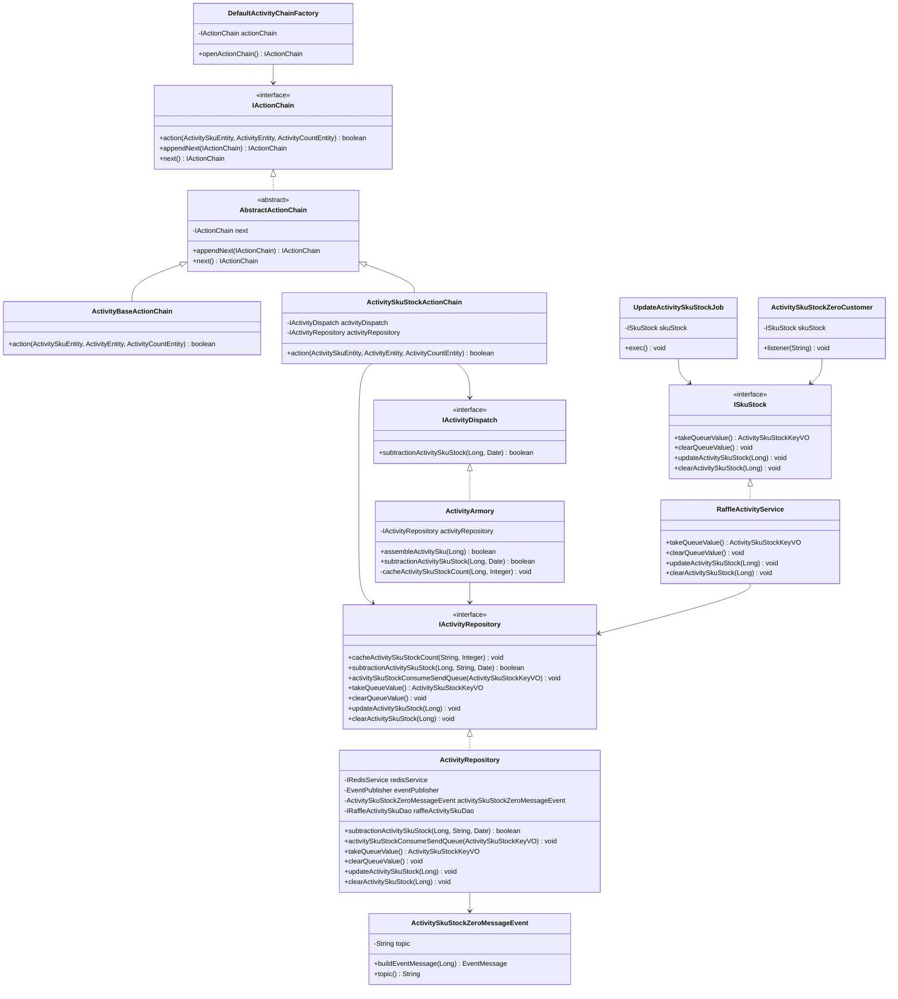

#### 12.7.2 时序图 - 库存扣减完整流程

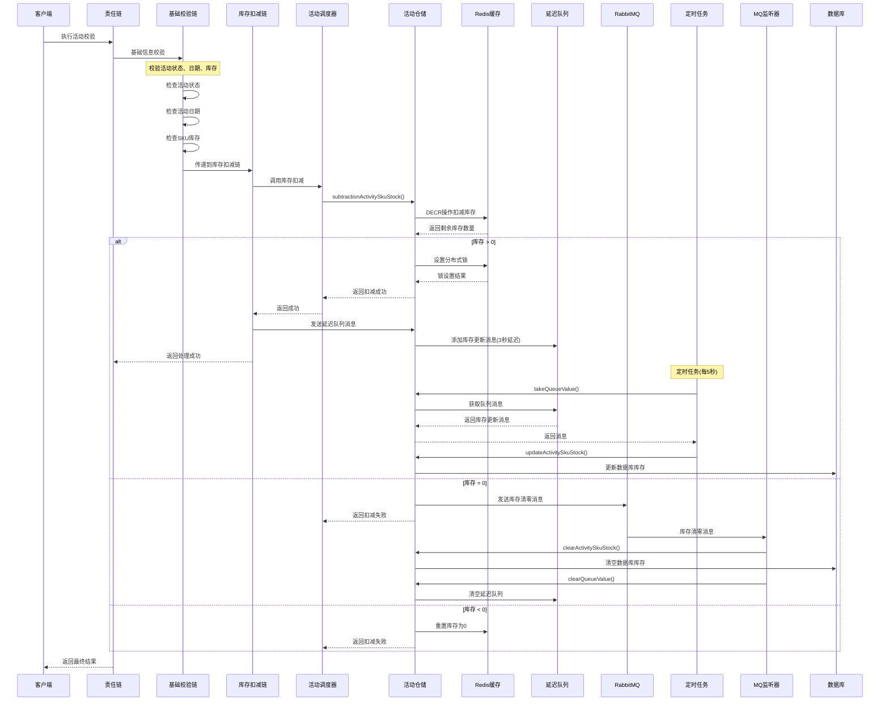

#### 12.7.3 活动图 - 库存一致性处理流程

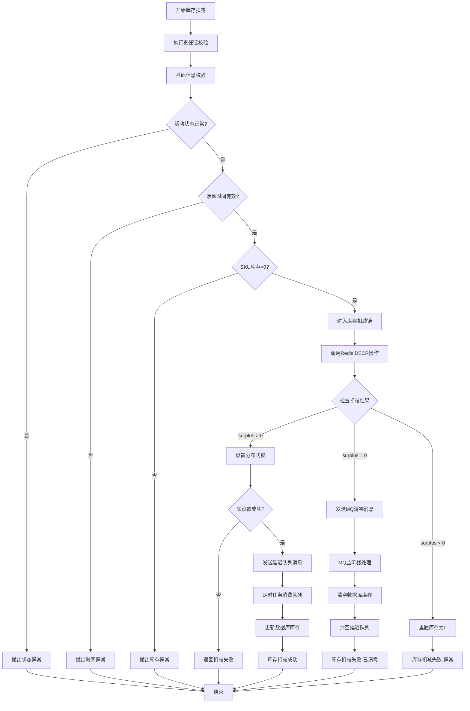

#### 12.7.4 组件交互图 - 系统架构视图

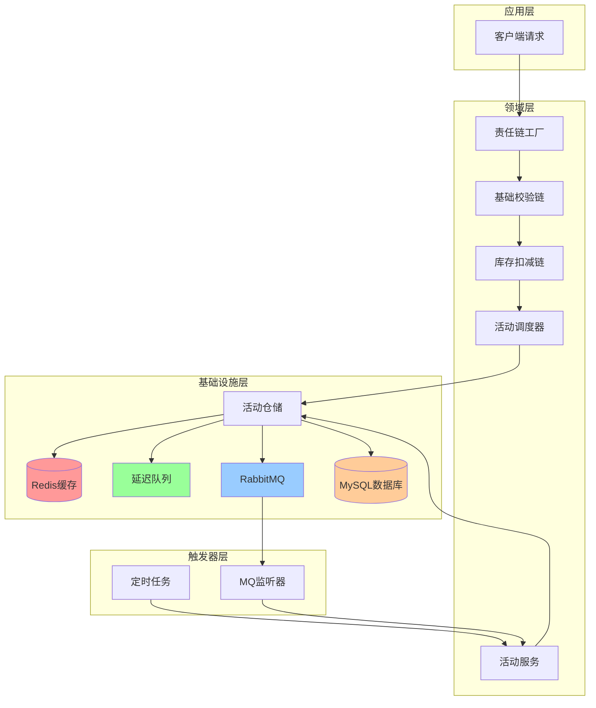

### 12.8 技术特点与优势

#### 12.8.1 高并发处理能力

**1. Redis原子操作**
- DECR命令保证原子性
- 支持高并发场景下的库存扣减
- 避免传统锁机制的性能瓶颈

**2. 分布式锁防护**
- 基于Redis的分布式锁实现
- 防止运营操作导致的超卖问题
- 锁的粒度精确到具体库存数量

**3. 异步处理机制**
- 延迟队列异步更新数据库
- 减少主流程的响应时间
- 提升系统整体吞吐量

#### 12.8.2 数据一致性保障

**1. 最终一致性**
- 延迟队列保证趋势一致性
- MQ消息保证强一致性
- 多层机制确保数据正确性

**2. 异常处理机制**
- 库存异常状态的自动修复
- 消息重试和错误恢复
- 完善的日志记录和监控

**3. 幂等性设计**
- 消息处理的幂等性保证
- 避免重复操作导致的数据错误
- 支持系统的高可用性

#### 12.8.3 系统架构优势

**1. 责任链模式**
- 校验逻辑的模块化设计
- 易于扩展和维护
- 清晰的处理流程

**2. 事件驱动架构**
- 松耦合的组件设计
- 支持系统的水平扩展
- 提高系统的可维护性

**3. 缓存优先策略**
- 减少数据库访问压力
- 提升系统响应速度
- 支持大规模并发访问

### 12.9 功能总结

MQ处理活动SKU库存一致性功能是Big-Market系统中的关键技术实现，它通过多种技术手段的组合，有效解决了高并发场景下的库存管理问题。

#### 12.9.1 核心价值

**1. 技术创新性**
- Redis + MQ的混合架构
- 延迟队列的巧妙应用
- 分布式锁的精细化设计

**2. 业务适用性**
- 支持高并发抽奖场景
- 保证库存数据的准确性
- 提供良好的用户体验

**3. 系统稳定性**
- 多层次的异常处理
- 完善的监控和日志
- 高可用的架构设计

#### 12.9.2 适用场景

该功能特别适用于：
1. **电商秒杀活动**：高并发库存扣减场景
2. **游戏道具发放**：精确的库存控制需求
3. **营销活动管理**：复杂的库存状态处理
4. **积分商城系统**：库存与用户账户的一致性

通过这套完整的库存一致性处理机制，Big-Market系统能够在保证高性能的同时，确保数据的准确性和一致性，为各种营销活动提供可靠的技术支撑。

## 13. 领取活动扣减账户额度功能

### 11.1 功能概述

#### 11.1.1 业务背景

**领取活动扣减账户额度功能**是用户参与抽奖活动的核心业务流程，负责在用户领取活动时扣减相应的账户额度，并创建参与活动的订单记录。该功能实现了多层级的账户管理和精确的事务控制。

**核心业务价值：**
- **额度管控**：精确控制用户的参与次数和频率
- **多维限制**：支持总额度、月额度、日额度的多层级控制
- **数据一致性**：通过事务保证账户扣减和订单创建的原子性
- **分库分表**：支持大规模用户数据的水平扩展

#### 11.1.2 账户体系设计

**三级账户体系：**

| 账户类型 | 表名 | 控制维度 | 业务含义 |
|---------|------|---------|---------|
| **总账户** | `raffle_activity_account` | 活动总参与次数 | 用户在该活动中的总可用次数 |
| **月账户** | `raffle_activity_account_month` | 每月参与次数 | 用户每月最多可参与的次数 |
| **日账户** | `raffle_activity_account_day` | 每日参与次数 | 用户每天最多可参与的次数 |

**账户关系：**
- **总账户**：控制用户在整个活动期间的总参与次数
- **月账户**：在总账户基础上，限制每月的参与频率
- **日账户**：在月账户基础上，限制每日的参与频率
- **层级关系**：日账户 ≤ 月账户 ≤ 总账户

### 11.2 数据库表结构设计

#### 11.2.1 总账户表 (raffle_activity_account)

```sql
CREATE TABLE `raffle_activity_account` (
    `id` bigint(11) unsigned NOT NULL AUTO_INCREMENT COMMENT '自增ID',
    `user_id` varchar(32) NOT NULL COMMENT '用户ID',
    `activity_id` bigint(12) NOT NULL COMMENT '活动ID',
    `total_count` int(8) NOT NULL COMMENT '总次数',
    `total_count_surplus` int(8) NOT NULL COMMENT '总次数-剩余',
    `day_count` int(8) NOT NULL COMMENT '日次数',
    `day_count_surplus` int(8) NOT NULL COMMENT '日次数-剩余',
    `month_count` int(8) NOT NULL COMMENT '月次数',
    `month_count_surplus` int(8) NOT NULL COMMENT '月次数-剩余',
    `create_time` datetime NOT NULL DEFAULT CURRENT_TIMESTAMP COMMENT '创建时间',
    `update_time` datetime NOT NULL DEFAULT CURRENT_TIMESTAMP ON UPDATE CURRENT_TIMESTAMP COMMENT '更新时间',
    PRIMARY KEY (`id`),
    UNIQUE KEY `uq_user_activity_id` (`user_id`, `activity_id`)
) ENGINE=InnoDB DEFAULT CHARSET=utf8mb4 COMMENT='抽奖活动账户表';
```

#### 11.2.2 月账户表 (raffle_activity_account_month)

```sql
CREATE TABLE `raffle_activity_account_month` (
    `id` bigint(11) unsigned NOT NULL AUTO_INCREMENT COMMENT '自增ID',
    `user_id` varchar(32) NOT NULL COMMENT '用户ID',
    `activity_id` bigint(12) NOT NULL COMMENT '活动ID',
    `month` varchar(7) NOT NULL COMMENT '月份(yyyy-mm)',
    `month_count` int(8) NOT NULL COMMENT '月次数',
    `month_count_surplus` int(8) NOT NULL COMMENT '月次数-剩余',
    `create_time` datetime NOT NULL DEFAULT CURRENT_TIMESTAMP COMMENT '创建时间',
    `update_time` datetime NOT NULL DEFAULT CURRENT_TIMESTAMP ON UPDATE CURRENT_TIMESTAMP COMMENT '更新时间',
    PRIMARY KEY (`id`),
    UNIQUE KEY `uq_user_activity_month` (`user_id`, `activity_id`, `month`)
) ENGINE=InnoDB DEFAULT CHARSET=utf8mb4 COMMENT='抽奖活动账户表-月';
```

#### 11.2.3 日账户表 (raffle_activity_account_day)

```sql
CREATE TABLE `raffle_activity_account_day` (
    `id` bigint(11) unsigned NOT NULL AUTO_INCREMENT COMMENT '自增ID',
    `user_id` varchar(32) NOT NULL COMMENT '用户ID',
    `activity_id` bigint(12) NOT NULL COMMENT '活动ID',
    `day` varchar(10) NOT NULL COMMENT '日期(yyyy-mm-dd)',
    `day_count` int(8) NOT NULL COMMENT '日次数',
    `day_count_surplus` int(8) NOT NULL COMMENT '日次数-剩余',
    `create_time` datetime NOT NULL DEFAULT CURRENT_TIMESTAMP COMMENT '创建时间',
    `update_time` datetime NOT NULL DEFAULT CURRENT_TIMESTAMP ON UPDATE CURRENT_TIMESTAMP COMMENT '更新时间',
    PRIMARY KEY (`id`),
    UNIQUE KEY `uq_user_activity_day` (`user_id`, `activity_id`, `day`)
) ENGINE=InnoDB DEFAULT CHARSET=utf8mb4 COMMENT='抽奖活动账户表-日';
```

#### 11.2.4 用户抽奖订单表 (user_raffle_order)

```sql
CREATE TABLE `user_raffle_order` (
    `id` int(11) unsigned NOT NULL AUTO_INCREMENT,
    `user_id` varchar(32) NOT NULL COMMENT '用户ID',
    `activity_id` bigint(12) NOT NULL COMMENT '活动ID',
    `activity_name` varchar(64) NOT NULL COMMENT '活动名称',
    `strategy_id` bigint(8) NOT NULL COMMENT '抽奖策略ID',
    `order_id` varchar(12) NOT NULL COMMENT '订单ID',
    `order_time` datetime NOT NULL COMMENT '下单时间',
    `order_state` varchar(16) NOT NULL DEFAULT 'create' COMMENT '订单状态；create-创建、used-已使用、cancel-已作废',
    `create_time` datetime NOT NULL DEFAULT CURRENT_TIMESTAMP COMMENT '创建时间',
    `update_time` datetime NOT NULL DEFAULT CURRENT_TIMESTAMP ON UPDATE CURRENT_TIMESTAMP COMMENT '更新时间',
    PRIMARY KEY (`id`),
    UNIQUE KEY `uq_user_activity_order` (`user_id`, `activity_id`, `order_id`),
    KEY `idx_user_id` (`user_id`),
    KEY `idx_activity_id` (`activity_id`),
    KEY `idx_order_id` (`order_id`)
) ENGINE=InnoDB DEFAULT CHARSET=utf8mb4 COMMENT='用户抽奖订单表';
```

### 11.3 分库分表配置

#### 11.3.1 ShardingSphere配置

**分片策略：**
- **分库策略**：根据`userId`进行分库，使用取模算法
- **分表策略**：根据`userId`进行分表，使用取模算法
- **分片算法**：`userId % 2 + 1`（分库），`userId % 4`（分表）

```yaml
spring:
  shardingsphere:
    datasource:
      names: ds0,ds1,ds2
      ds1:
        type: com.zaxxer.hikari.HikariDataSource
        driver-class-name: com.mysql.cj.jdbc.Driver
        jdbc-url: jdbc:mysql://127.0.0.1:13306/big_market?useUnicode=true
        username: root
        password: Hgy@123
      ds2:
        type: com.zaxxer.hikari.HikariDataSource
        driver-class-name: com.mysql.cj.jdbc.Driver
        jdbc-url: jdbc:mysql://127.0.0.1:13307/big_market?useUnicode=true
        username: root
        password: Hgy@123

    rules:
      sharding:
        default-database-strategy:
          standard:
            sharding-column: userId
            sharding-algorithm-name: database-inline
        tables:
          raffle_activity_account:
            actual-data-nodes: ds$->{1..2}.raffle_activity_account_$->{0..3}
            table-strategy:
              standard:
                sharding-column: userId
                sharding-algorithm-name: table-inline
          raffle_activity_account_month:
            actual-data-nodes: ds$->{1..2}.raffle_activity_account_month_$->{0..3}
            table-strategy:
              standard:
                sharding-column: userId
                sharding-algorithm-name: table-inline
          raffle_activity_account_day:
            actual-data-nodes: ds$->{1..2}.raffle_activity_account_day_$->{0..3}
            table-strategy:
              standard:
                sharding-column: userId
                sharding-algorithm-name: table-inline
          user_raffle_order:
            actual-data-nodes: ds$->{1..2}.user_raffle_order_$->{0..3}
            table-strategy:
              standard:
                sharding-column: userId
                sharding-algorithm-name: table-inline

        sharding-algorithms:
          database-inline:
            type: INLINE
            props:
              algorithm-expression: ds$->{userId % 2 + 1}
          table-inline:
            type: INLINE
            props:
              algorithm-expression: $->{table}_$->{userId % 4}
```

#### 11.3.2 分片优势

**技术优势：**
- **水平扩展**：支持海量用户数据的存储和查询
- **性能提升**：分散数据库压力，提高并发处理能力
- **高可用性**：单库故障不影响其他分片的正常服务
- **透明化**：应用层无需关心分片逻辑，由ShardingSphere自动路由

**业务优势：**
- **用户隔离**：不同用户的数据分布在不同分片，天然隔离
- **查询效率**：基于userId的查询能够精确路由到目标分片
- **扩容简单**：可以通过增加分片节点实现平滑扩容

### 11.4 核心业务流程

#### 11.4.1 领取活动业务流程图

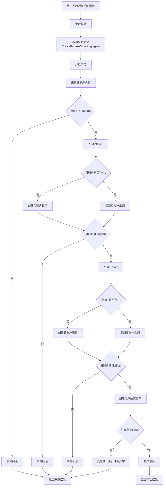

#### 11.4.2 账户额度过滤流程图

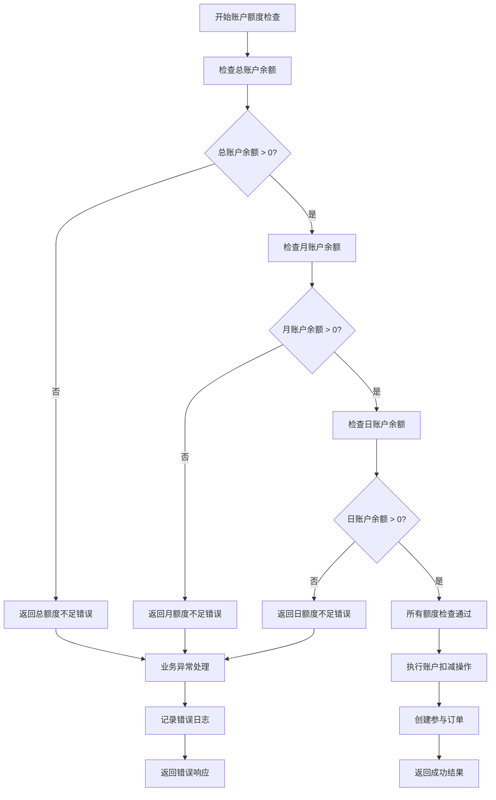

#### 11.4.3 业务流程说明

**核心业务步骤：**

1. **参数校验阶段**
   - 验证用户ID和活动ID的有效性
   - 检查活动状态和时间范围
   - 构建业务聚合对象

2. **账户额度检查阶段**
   - 按层级顺序检查：总账户 → 月账户 → 日账户
   - 任一层级额度不足则直接返回错误
   - 所有层级检查通过才能继续执行

3. **事务执行阶段**
   - 在单一事务中完成所有数据库操作
   - 按顺序执行：总账户扣减 → 月账户处理 → 日账户处理 → 订单创建
   - 任一步骤失败都会触发事务回滚

4. **异常处理阶段**
   - 处理业务异常（额度不足、重复操作等）
   - 处理技术异常（数据库连接、唯一索引冲突等）
   - 记录详细的错误日志便于问题排查

### 11.5 核心代码实现

#### 11.5.1 聚合对象设计

**CreatePartakeOrderAggregate聚合根：**

```java
@Data
@Builder
@AllArgsConstructor
@NoArgsConstructor
public class CreatePartakeOrderAggregate {
    /**
     * 用户ID
     */
    private String userId;

    /**
     * 活动ID
     */
    private Long activityId;

    /**
     * 账户总额度
     */
    private ActivityAccountEntity activityAccountEntity;

    /**
     * 是否存在月账户
     */
    private boolean isExistAccountMonth = true;

    /**
     * 账户月额度
     */
    private ActivityAccountMonthEntity activityAccountMonthEntity;

    /**
     * 是否存在日账户
     */
    private boolean isExistAccountDay = true;

    /**
     * 账户日额度
     */
    private ActivityAccountDayEntity activityAccountDayEntity;

    /**
     * 抽奖单实体
     */
    private UserRaffleOrderEntity userRaffleOrderEntity;
}
```

**聚合对象特点：**
- **业务完整性**：包含一次完整业务操作所需的所有实体
- **事务边界**：聚合内的所有操作在同一事务中执行
- **数据一致性**：通过聚合保证相关数据的一致性
- **领域封装**：将复杂的业务逻辑封装在聚合内部

#### 11.5.2 仓储层实现

**ActivityRepository.saveCreatePartakeOrderAggregate方法：**

```java
@Override
public void saveCreatePartakeOrderAggregate(CreatePartakeOrderAggregate createPartakeOrderAggregate) {
    String userId = createPartakeOrderAggregate.getUserId();
    Long activityId = createPartakeOrderAggregate.getActivityId();
    ActivityAccountEntity activityAccountEntity = createPartakeOrderAggregate.getActivityAccountEntity();
    ActivityAccountMonthEntity activityAccountMonthEntity = createPartakeOrderAggregate.getActivityAccountMonthEntity();
    ActivityAccountDayEntity activityAccountDayEntity = createPartakeOrderAggregate.getActivityAccountDayEntity();
    UserRaffleOrderEntity userRaffleOrderEntity = createPartakeOrderAggregate.getUserRaffleOrderEntity();

    // ShardingSphere会根据userId自动进行分库分表路由
    transactionTemplate.execute(status -> {
        try {
            // 1. 更新总账户
            int totalCount = activityAccountDao.updateActivityAccountSubtractionQuota(
                    ActivityAccountPO.builder()
                            .userId(userId)
                            .activityId(activityId)
                            .build());
            if (1 != totalCount) {
                status.setRollbackOnly();
                log.warn("写入创建参与活动记录，更新总账户额度不足，异常 userId: {} activityId: {}", userId, activityId);
                throw new AppException(ResponseCode.ACCOUNT_QUOTA_ERROR.getCode(), ResponseCode.ACCOUNT_QUOTA_ERROR.getInfo());
            }

            // 2. 创建或更新月账户，true = 存在月账户、false = 不存在月账户
            if (createPartakeOrderAggregate.isExistAccountMonth()) {
                int updateMonthCount = activityAccountMonthDao.updateActivityAccountMonthSubtractionQuota(
                        ActivityAccountMonthPO.builder()
                                .userId(userId)
                                .activityId(activityId)
                                .month(activityAccountMonthEntity.getMonth())
                                .build());
                if (1 != updateMonthCount) {
                    status.setRollbackOnly();
                    log.warn("写入创建参与活动记录，更新月账户额度不足，异常 userId: {} activityId: {} month: {}", userId, activityId, activityAccountMonthEntity.getMonth());
                    throw new AppException(ResponseCode.ACCOUNT_MONTH_QUOTA_ERROR.getCode(), ResponseCode.ACCOUNT_MONTH_QUOTA_ERROR.getInfo());
                }
            } else {
                activityAccountMonthDao.insertActivityAccountMonth(ActivityAccountMonthPO.builder()
                        .userId(activityAccountMonthEntity.getUserId())
                        .activityId(activityAccountMonthEntity.getActivityId())
                        .month(activityAccountMonthEntity.getMonth())
                        .monthCount(activityAccountMonthEntity.getMonthCount())
                        .monthCountSurplus(activityAccountMonthEntity.getMonthCountSurplus() - 1)
                        .build());
            }

            // 3. 创建或更新日账户，true = 存在日账户、false = 不存在日账户
            if (createPartakeOrderAggregate.isExistAccountDay()) {
                int updateDayCount = activityAccountDayDao.updateActivityAccountDaySubtractionQuota(
                        ActivityAccountDayPO.builder()
                                .userId(userId)
                                .activityId(activityId)
                                .day(activityAccountDayEntity.getDay())
                                .build());
                if (1 != updateDayCount) {
                    status.setRollbackOnly();
                    log.warn("写入创建参与活动记录，更新日账户额度不足，异常 userId: {} activityId: {} day: {}", userId, activityId, activityAccountDayEntity.getDay());
                    throw new AppException(ResponseCode.ACCOUNT_DAY_QUOTA_ERROR.getCode(), ResponseCode.ACCOUNT_DAY_QUOTA_ERROR.getInfo());
                }
            } else {
                activityAccountDayDao.insertActivityAccountDay(ActivityAccountDayPO.builder()
                        .userId(activityAccountDayEntity.getUserId())
                        .activityId(activityAccountDayEntity.getActivityId())
                        .day(activityAccountDayEntity.getDay())
                        .dayCount(activityAccountDayEntity.getDayCount())
                        .dayCountSurplus(activityAccountDayEntity.getDayCountSurplus() - 1)
                        .build());
            }

            // 4. 写入参与活动订单
            userRaffleOrderDao.insert(UserRaffleOrderPO.builder()
                    .userId(userRaffleOrderEntity.getUserId())
                    .activityId(userRaffleOrderEntity.getActivityId())
                    .activityName(userRaffleOrderEntity.getActivityName())
                    .strategyId(userRaffleOrderEntity.getStrategyId())
                    .orderId(userRaffleOrderEntity.getOrderId())
                    .orderTime(userRaffleOrderEntity.getOrderTime())
                    .orderState(userRaffleOrderEntity.getOrderState().getCode())
                    .build());

            return 1;
        } catch (DuplicateKeyException e) {
            status.setRollbackOnly();
            log.error("写入创建参与活动记录，唯一索引冲突 userId: {} activityId: {}", userId, activityId, e);
            throw new AppException(ResponseCode.INDEX_DUP.getCode(), e);
        }
    });
}
```

### 11.6 事务控制和异常处理

#### 11.6.1 事务边界设计

**事务范围：**
- **单一事务**：整个账户扣减和订单创建过程在一个事务中完成
- **原子性保证**：要么全部成功，要么全部回滚
- **一致性维护**：确保账户余额和订单状态的一致性

**事务控制策略：**
```java
// 使用编程式事务模板
transactionTemplate.execute(status -> {
    try {
        // 1. 更新总账户
        // 2. 处理月账户
        // 3. 处理日账户
        // 4. 创建订单
        return 1;
    } catch (DuplicateKeyException e) {
        status.setRollbackOnly();
        throw new AppException(ResponseCode.INDEX_DUP.getCode(), e);
    }
});
```

#### 11.6.2 异常处理机制

**异常类型和处理策略：**

| 异常类型 | 触发条件 | 处理策略 | 错误码 |
|---------|---------|---------|--------|
| **总额度不足** | 总账户余额为0 | 事务回滚，返回错误信息 | ERR_BIZ_006 |
| **月额度不足** | 月账户余额为0 | 事务回滚，返回错误信息 | ERR_BIZ_007 |
| **日额度不足** | 日账户余额为0 | 事务回滚，返回错误信息 | ERR_BIZ_008 |
| **唯一索引冲突** | 重复创建订单 | 事务回滚，返回错误信息 | 0003 |

**异常处理代码：**
```java
// 总账户额度检查
if (1 != totalCount) {
    status.setRollbackOnly();
    log.warn("写入创建参与活动记录，更新总账户额度不足，异常 userId: {} activityId: {}", userId, activityId);
    throw new AppException(ResponseCode.ACCOUNT_QUOTA_ERROR.getCode(), ResponseCode.ACCOUNT_QUOTA_ERROR.getInfo());
}

// 唯一索引冲突处理
catch (DuplicateKeyException e) {
    status.setRollbackOnly();
    log.error("写入创建参与活动记录，唯一索引冲突 userId: {} activityId: {}", userId, activityId, e);
    throw new AppException(ResponseCode.INDEX_DUP.getCode(), e);
}
```

### 11.7 技术架构优化

#### 11.7.1 从自制组件到ShardingSphere的迁移

**迁移背景：**
- **原有方案**：使用自制的`db-router-spring-boot-starter`组件
- **迁移原因**：自制组件维护成本高，功能有限，稳定性不如成熟方案
- **目标方案**：使用Apache ShardingSphere，功能更强大，社区支持更好

**迁移过程：**

**步骤1：移除自制组件依赖**
```xml
<!-- 注释掉自制分库分表组件 -->
<!--
<dependency>
    <groupId>cn.bugstack.middleware</groupId>
    <artifactId>db-router-spring-boot-starter</artifactId>
    <version>1.0.2</version>
</dependency>
-->
```

**步骤2：移除dbRouter相关代码**
```java
// 移除前的代码
try {
    // 统一切换路由，以下事务内的所有操作，都走一个路由
    dbRouter.doRouter(userId);
    transactionTemplate.execute(status -> {
        // 业务逻辑
    });
} finally {
    dbRouter.clear();
}

// 迁移后的代码
// ShardingSphere会根据userId自动进行分库分表路由
transactionTemplate.execute(status -> {
    // 业务逻辑
});
```

**步骤3：配置ShardingSphere分片规则**
```yaml
spring:
  shardingsphere:
    rules:
      sharding:
        tables:
          raffle_activity_account:
            actual-data-nodes: ds$->{1..2}.raffle_activity_account_$->{0..3}
            table-strategy:
              standard:
                sharding-column: userId
                sharding-algorithm-name: table-inline
```

#### 11.7.2 ShardingSphere的技术优势

**功能优势：**
- **自动路由**：根据分片键自动路由到正确的数据源和表
- **透明化**：应用层无需关心分片逻辑，完全透明
- **SQL兼容**：支持标准SQL，无需修改业务代码
- **事务支持**：支持分布式事务，保证数据一致性

**性能优势：**
- **连接池管理**：智能的数据库连接池管理
- **查询优化**：自动进行SQL优化和执行计划选择
- **并行执行**：支持跨分片的并行查询执行
- **结果合并**：自动合并多分片的查询结果

**运维优势：**
- **监控支持**：提供丰富的监控指标和管理界面
- **配置热更新**：支持动态修改分片配置
- **故障转移**：支持主从切换和故障自动转移
- **数据迁移**：提供数据迁移和扩容工具

### 11.8 业务场景和应用价值

#### 11.8.1 典型业务场景

**场景1：电商平台会员抽奖**
- **总额度控制**：VIP用户每月10次，普通用户每月3次
- **日额度控制**：每天最多1次，防止用户一次性用完所有次数
- **月额度控制**：每月重置，保证用户每月都有参与机会

**场景2：游戏平台签到奖励**
- **总额度控制**：活动期间总共可参与30次
- **日额度控制**：每天签到1次获得1次抽奖机会
- **月额度控制**：每月最多10次，鼓励用户分散参与

**场景3：内容平台用户激励**
- **总额度控制**：新用户注册送5次抽奖机会
- **日额度控制**：每天完成任务可获得1次机会
- **月额度控制**：活跃用户每月额外获得3次机会

#### 11.8.2 业务价值分析

**用户体验价值：**

- **公平性保证**：通过额度控制确保每个用户都有公平的参与机会
- **参与感提升**：多层级的额度设计增加用户的参与感和期待感
- **习惯养成**：日额度限制有助于培养用户的日常参与习惯

**运营管理价值：**
- **成本控制**：精确控制奖品发放数量，有效管理运营成本
- **用户留存**：通过额度限制鼓励用户长期参与，提高留存率
- **数据分析**：详细的参与记录为运营分析提供数据支持

**技术架构价值：**
- **扩展性强**：分库分表架构支持海量用户的并发访问
- **性能优异**：通过分片减少单库压力，提高系统整体性能
- **可维护性**：清晰的业务逻辑和数据结构，便于后续维护和扩展

### 11.9 功能总结

#### 11.9.1 核心技术特点

**架构设计特点：**
- **DDD领域驱动**：清晰的领域模型和业务边界
- **聚合根设计**：通过聚合对象保证业务一致性
- **分库分表支持**：支持大规模数据的水平扩展
- **事务控制精确**：精确的事务边界和异常处理

**代码实现特点：**
- **代码简洁**：移除冗余的try-catch和路由代码
- **逻辑清晰**：业务流程清晰，易于理解和维护
- **扩展性强**：易于添加新的账户类型和业务规则
- **性能优异**：高效的数据库操作和事务处理

#### 11.9.2 业务价值体现

**用户价值：**
- **体验优化**：流畅的参与流程，清晰的额度提示
- **公平保证**：多层级额度控制，确保参与公平性
- **激励机制**：通过额度设计激励用户持续参与

**运营价值：**
- **精准控制**：精确控制用户参与频率和总量
- **成本管理**：有效控制奖品发放成本
- **数据驱动**：丰富的数据支持运营决策

**技术价值：**
- **高可用性**：分布式架构保证系统高可用
- **高性能**：分库分表提供优异的并发处理能力
- **易维护性**：清晰的代码结构和业务逻辑

#### 11.9.3 设计亮点

**业务设计亮点：**
- **三级账户体系**：总账户、月账户、日账户的层级设计
- **聚合对象模式**：通过聚合保证业务操作的原子性
- **幂等性保证**：通过唯一索引防止重复操作

**技术设计亮点：**

- **分库分表透明化**：应用层无需关心分片逻辑
- **事务控制精确**：编程式事务确保数据一致性
- **异常处理完善**：全面的异常处理和错误码设计

## 14. 写入中奖记录和任务补偿发送MQ功能

### 12.1 功能概述

#### 12.1.1 业务背景

**写入中奖记录和任务补偿发送MQ功能**是抽奖系统的核心后置处理流程，负责在用户中奖后记录中奖信息并通过消息队列异步发送奖品。该功能采用事务内写入记录、事务外发送消息的设计模式，并通过任务补偿机制保证消息的最终一致性。从用户中奖到发奖，通常来说我们会做异步解耦，因为一些奖品的方法并不是都是在抽奖系统，而是各种 RPC/HTTP 接口来发放，这些接口有些时候会有超时的问题，需要重试处理。所以需要数据库写入一条记录，之后记录一个状态。之后奖品真正发放完以后，在更新这个这个状态。

那么这里的写入记录和发送 MQ 消息，不能用事务解决，事务主要是数据库事务，但 MQ 消息不是数据库事务。所以需要写入一个 task 表，通过任务补偿的方式进行处理。

**核心业务价值：**

- **数据持久化**：确保中奖记录的可靠存储
- **异步解耦**：通过MQ实现发奖流程的异步处理
- **消息可靠性**：通过任务补偿机制保证消息最终发送成功
- **分库分表支持**：支持海量中奖记录的水平扩展

#### 12.1.2 系统架构设计

**核心组件：**

| 组件 | 职责 | 实现方式 |
|------|------|----------|
| **AwardRepository** | 中奖记录存储和消息发送 | 聚合根模式，事务控制 |
| **SendMessageTaskJob** | 任务补偿定时扫描 | 定时任务，线程池处理 |
| **TaskRepository** | 任务状态管理 | 数据持久化，状态更新 |
| **EventPublisher** | 消息发布 | RabbitMQ消息发送 |

**处理流程：**
- **主流程**：事务内写入记录 → 事务外发送消息 → 更新任务状态
- **补偿流程**：定时扫描失败任务 → 重新发送消息 → 更新任务状态

### 12.2 数据库表结构设计

#### 12.2.1 用户中奖记录表 (user_award_record)

```sql
CREATE TABLE `user_award_record` (
    `id` bigint(11) unsigned NOT NULL AUTO_INCREMENT COMMENT '自增ID',
    `user_id` varchar(32) NOT NULL COMMENT '用户ID',
    `activity_id` bigint(12) NOT NULL COMMENT '活动ID',
    `strategy_id` bigint(8) NOT NULL COMMENT '抽奖策略ID',
    `order_id` varchar(12) NOT NULL COMMENT '抽奖订单ID【作为幂等使用】',
    `award_id` int(8) NOT NULL COMMENT '奖品ID',
    `award_title` varchar(128) NOT NULL COMMENT '奖品标题（名称）',
    `award_time` datetime NOT NULL COMMENT '中奖时间',
    `award_state` varchar(16) NOT NULL DEFAULT 'create' COMMENT '奖品状态；create-创建、completed-发奖完成',
    `create_time` datetime NOT NULL DEFAULT CURRENT_TIMESTAMP COMMENT '创建时间',
    `update_time` datetime NOT NULL DEFAULT CURRENT_TIMESTAMP ON UPDATE CURRENT_TIMESTAMP COMMENT '更新时间',
    PRIMARY KEY (`id`),
    UNIQUE KEY `uq_user_activity_order` (`user_id`, `activity_id`, `order_id`),
    KEY `idx_user_id` (`user_id`),
    KEY `idx_activity_id` (`activity_id`),
    KEY `idx_award_state` (`award_state`)
) ENGINE=InnoDB DEFAULT CHARSET=utf8mb4 COMMENT='用户中奖记录表';
```

#### 12.2.2 任务表 (task)

```sql
CREATE TABLE `task` (
    `id` bigint(11) unsigned NOT NULL AUTO_INCREMENT COMMENT '自增ID',
    `user_id` varchar(32) NOT NULL COMMENT '用户ID',
    `topic` varchar(32) NOT NULL COMMENT '消息主题',
    `message_id` varchar(11) NOT NULL COMMENT '消息编号',
    `message` varchar(512) NOT NULL COMMENT '消息主体',
    `state` varchar(16) NOT NULL DEFAULT 'create' COMMENT '任务状态；create-创建、completed-完成、fail-失败',
    `create_time` datetime NOT NULL DEFAULT CURRENT_TIMESTAMP COMMENT '创建时间',
    `update_time` datetime NOT NULL DEFAULT CURRENT_TIMESTAMP ON UPDATE CURRENT_TIMESTAMP COMMENT '更新时间',
    PRIMARY KEY (`id`),
    UNIQUE KEY `uq_message_id` (`message_id`),
    KEY `idx_state` (`state`),
    KEY `idx_create_time` (`create_time`)
) ENGINE=InnoDB DEFAULT CHARSET=utf8mb4 COMMENT='任务表，发送MQ';
```

### 12.3 分库分表配置

#### 12.3.1 ShardingSphere配置

```yaml
spring:
  shardingsphere:
    rules:
      sharding:
        tables:
          user_award_record:
            actual-data-nodes: ds$->{1..2}.user_award_record_$->{0..3}
            table-strategy:
              standard:
                sharding-column: userId
                sharding-algorithm-name: table-inline
          task:
            actual-data-nodes: ds$->{1..2}.task_$->{0..3}
            table-strategy:
              standard:
                sharding-column: userId
                sharding-algorithm-name: table-inline
```

**分片策略：**
- **分库策略**：根据`userId`进行分库，算法：`userId % 2 + 1`
- **分表策略**：根据`userId`进行分表，算法：`userId % 4`
- **数据隔离**：同一用户的中奖记录和任务记录在同一分片中

### 12.4 核心业务流程

#### 12.4.1 写入中奖记录主流程图

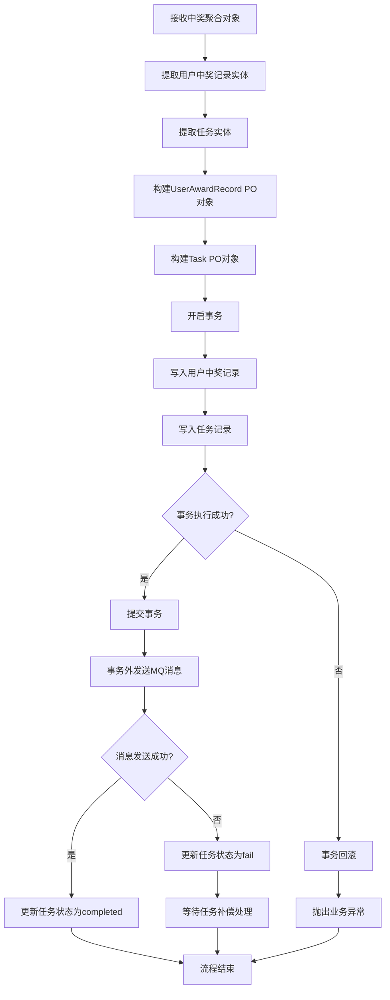

#### 12.4.2 任务补偿流程图

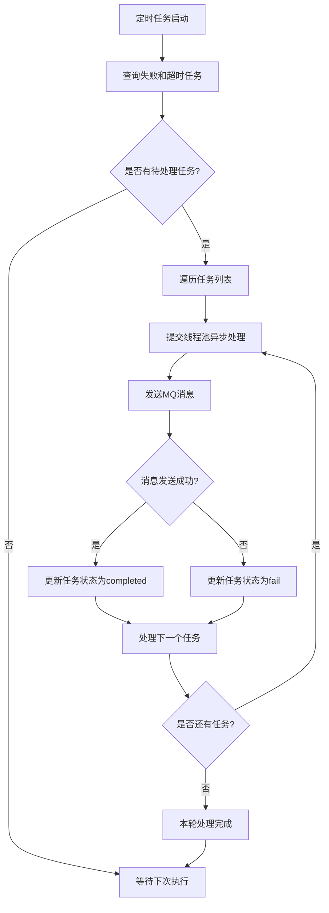

#### 12.4.3 消息发送时序图

```mermaid
sequenceDiagram
    participant Client as 客户端
    participant Award as AwardRepository
    participant DB as 数据库
    participant MQ as RabbitMQ
    participant Job as SendMessageTaskJob
    participant Task as TaskService

    Note over Client,Task: 主流程：写入中奖记录和发送消息

    Client->>Award: saveUserAwardRecord(aggregate)
    Award->>Award: 构建PO对象

    Award->>DB: 开启事务
    Award->>DB: insert user_award_record
    Award->>DB: insert task
    DB-->>Award: 事务提交成功

    Award->>MQ: 发送中奖消息
    alt 消息发送成功
        MQ-->>Award: 发送成功
        Award->>DB: 更新task状态为completed
    else 消息发送失败
        MQ-->>Award: 发送失败
        Award->>DB: 更新task状态为fail
    end

    Award-->>Client: 返回处理结果

    Note over Client,Task: 补偿流程：定时任务重试

    Job->>Task: queryNoSendMessageTaskList()
    Task->>DB: 查询失败和超时任务
    DB-->>Task: 返回任务列表
    Task-->>Job: 返回待处理任务

    loop 处理每个任务
        Job->>Task: sendMessage(taskEntity)
        Task->>MQ: 重新发送消息
        alt 重发成功
            MQ-->>Task: 发送成功
            Job->>Task: updateTaskSendMessageCompleted()
            Task->>DB: 更新状态为completed
        else 重发失败
            MQ-->>Task: 发送失败
            Job->>Task: updateTaskSendMessageFail()
            Task->>DB: 更新状态为fail
        end
    end
```

### 12.5 核心代码实现

#### 12.5.1 AwardRepository核心方法

```java
@Override
public void saveUserAwardRecord(UserAwardRecordAggregate userAwardRecordAggregate) {
    UserAwardRecordEntity userAwardRecordEntity = userAwardRecordAggregate.getUserAwardRecordEntity();
    TaskEntity taskEntity = userAwardRecordAggregate.getTaskEntity();
    String userId = userAwardRecordEntity.getUserId();
    Long activityId = userAwardRecordEntity.getActivityId();
    Integer awardId = userAwardRecordEntity.getAwardId();

    UserAwardRecord userAwardRecord = new UserAwardRecord();
    userAwardRecord.setUserId(userAwardRecordEntity.getUserId());
    userAwardRecord.setActivityId(userAwardRecordEntity.getActivityId());
    userAwardRecord.setStrategyId(userAwardRecordEntity.getStrategyId());
    userAwardRecord.setOrderId(userAwardRecordEntity.getOrderId());
    userAwardRecord.setAwardId(userAwardRecordEntity.getAwardId());
    userAwardRecord.setAwardTitle(userAwardRecordEntity.getAwardTitle());
    userAwardRecord.setAwardTime(userAwardRecordEntity.getAwardTime());
    userAwardRecord.setAwardState(userAwardRecordEntity.getAwardState().getCode());

    Task task = new Task();
    task.setUserId(taskEntity.getUserId());
    task.setTopic(taskEntity.getTopic());
    task.setMessageId(taskEntity.getMessageId());
    task.setMessage(JSON.toJSONString(taskEntity.getMessage()));
    task.setState(taskEntity.getState().getCode());

    // ShardingSphere会根据userId自动进行分库分表路由
    transactionTemplate.execute(status -> {
        try {
            // 写入记录
            userAwardRecordDao.insert(userAwardRecord);
            // 写入任务
            taskDao.insert(task);
            return 1;
        } catch (DuplicateKeyException e) {
            status.setRollbackOnly();
            log.error("写入中奖记录，唯一索引冲突 userId: {} activityId: {} awardId: {}", userId, activityId, awardId, e);
            throw new AppException(ResponseCode.INDEX_DUP.getCode(), e);
        }
    });

    try {
        // 发送消息【在事务外执行，如果失败还有任务补偿】
        eventPublisher.publish(taskEntity.getTopic(), taskEntity.getMessage());
        // 更新数据库记录，task 任务表
        taskDao.updateTaskSendMessageCompleted(task);
    } catch (Exception e) {
        log.error("写入中奖记录，发送MQ消息失败 userId: {} topic: {}", userId, task.getTopic(), e);
        taskDao.updateTaskSendMessageFail(task);
    }
}
```

#### 12.5.2 SendMessageTaskJob定时任务

```java
@Slf4j
@Component()
@RequiredArgsConstructor
public class SendMessageTaskJob {

    private final ITaskService taskService;
    private final ThreadPoolExecutor executor;

    @Scheduled(cron = "0/5 * * * * ?")
    public void exec() {
        try {
            List<TaskEntity> taskEntities = taskService.queryNoSendMessageTaskList();
            if (taskEntities.isEmpty()) return;

            for (TaskEntity taskEntity : taskEntities) {
                executor.execute(() -> {
                    try {
                        taskService.sendMessage(taskEntity);
                        taskService.updateTaskSendMessageCompleted(taskEntity.getUserId(), taskEntity.getMessageId());
                    } catch (Exception e) {
                        log.error("定时任务，发送MQ消息失败 userId: {} topic: {}", taskEntity.getUserId(), taskEntity.getTopic());
                        taskService.updateTaskSendMessageFail(taskEntity.getUserId(), taskEntity.getMessageId());
                    }
                });
            }
        } catch (Exception e) {
            log.error("定时任务，扫描MQ任务表发送消息失败。", e);
        }
    }
}
```

#### 12.5.3 技术架构优化

**从自制组件到ShardingSphere的迁移：**

**迁移前（自制db-router）：**
```java
// 复杂的手动路由逻辑
try {
    dbRouter.doRouter(userId);
    transactionTemplate.execute(status -> {
        // 业务逻辑
        return 1;
    });
} finally {
    dbRouter.clear();
}
```

**迁移后（ShardingSphere）：**
```java
// 简化的自动路由
transactionTemplate.execute(status -> {
    // 业务逻辑，ShardingSphere自动路由
    return 1;
});
```

**迁移优势：**
- **代码简化**：移除手动路由逻辑，代码更简洁
- **自动路由**：ShardingSphere根据分片键自动路由
- **透明化**：应用层无需关心分片逻辑
- **性能优化**：减少手动路由的开销

### 12.6 事务控制和异常处理

#### 12.6.1 事务边界设计

**事务控制策略：**
- **事务内操作**：写入中奖记录、写入任务记录
- **事务外操作**：发送MQ消息、更新任务状态

**事务边界原因：**
- **数据一致性**：确保中奖记录和任务记录同时成功或失败
- **消息可靠性**：即使消息发送失败，也有任务补偿机制
- **性能考虑**：避免长事务影响数据库性能

#### 12.6.2 异常处理机制

**异常类型分类：**

| 异常类型 | 处理策略 | 业务影响 | 恢复机制 |
|---------|---------|---------|---------|
| **唯一索引冲突** | 事务回滚，抛出业务异常 | 防止重复中奖记录 | 幂等性保证 |
| **数据库连接异常** | 事务回滚，抛出系统异常 | 数据写入失败 | 重试机制 |
| **MQ发送失败** | 更新任务状态为fail | 消息未发送 | 任务补偿 |
| **任务补偿失败** | 记录错误日志 | 消息延迟发送 | 下次定时任务重试 |

**异常处理代码：**
```java
try {
    // 写入记录
    userAwardRecordDao.insert(userAwardRecord);
    // 写入任务
    taskDao.insert(task);
    return 1;
} catch (DuplicateKeyException e) {
    status.setRollbackOnly();
    log.error("写入中奖记录，唯一索引冲突 userId: {} activityId: {} awardId: {}", userId, activityId, awardId, e);
    throw new AppException(ResponseCode.INDEX_DUP.getCode(), e);
}
```

#### 12.6.3 错误码设计

**业务错误码：**
```java
public enum ResponseCode {
    INDEX_DUP("0001", "数据库唯一索引冲突"),
    MQ_SEND_FAIL("0002", "MQ消息发送失败"),
    TASK_PROCESS_FAIL("0003", "任务处理失败");
}
```

### 12.7 业务场景和应用价值

#### 12.7.1 典型业务场景

**场景1：电商平台抽奖活动**
- **业务需求**：用户参与抽奖后，需要记录中奖信息并异步发放奖品
- **技术实现**：
  - 中奖记录写入`user_award_record`表
  - 发奖任务写入`task`表
  - 通过MQ异步通知发奖系统
  - 任务补偿确保消息最终发送

**场景2：游戏平台道具发放**
- **业务需求**：玩家抽中游戏道具后，需要实时更新背包系统
- **技术实现**：
  - 道具中奖记录持久化存储
  - 通过MQ通知游戏服务器更新玩家背包
  - 补偿机制处理网络异常情况

**场景3：内容平台会员权益**
- **业务需求**：用户抽中会员权益后，需要激活相应服务
- **技术实现**：
  - 权益中奖记录存储
  - 通过MQ通知权益系统激活服务
  - 定时任务处理激活失败的情况

#### 12.7.2 应用价值分析

**用户体验价值：**
- **响应速度快**：异步处理不影响用户抽奖体验
- **数据可靠性**：完整的中奖记录便于用户查询
- **服务稳定性**：补偿机制确保奖品最终发放

**运营管理价值：**
- **数据统计**：完整的中奖数据支持运营分析
- **异常监控**：任务状态监控便于及时发现问题
- **成本控制**：精确的发奖记录支持成本核算

**技术架构价值：**
- **系统解耦**：抽奖系统与发奖系统通过MQ解耦
- **水平扩展**：分库分表支持海量数据存储
- **高可用性**：补偿机制提高系统可用性

### 12.8 功能总结

#### 12.8.1 核心技术特点

**数据存储技术：**
- **分库分表**：基于ShardingSphere实现用户维度的数据分片
- **事务控制**：使用TransactionTemplate进行编程式事务管理
- **幂等性保证**：通过唯一索引防止重复数据写入

**消息处理技术：**
- **异步解耦**：事务外发送MQ消息，避免分布式事务复杂性
- **任务补偿**：定时任务扫描失败消息，实现最终一致性
- **线程池处理**：异步处理补偿任务，提高处理效率

**架构迁移技术：**
- **组件替换**：从自制db-router迁移到ShardingSphere
- **代码简化**：移除手动路由逻辑，提高代码可维护性
- **透明化处理**：应用层无需关心分片逻辑

#### 12.8.2 业务价值体现

**数据可靠性：**
- 完整记录用户中奖信息，支持数据追溯和统计分析
- 通过事务保证中奖记录和任务记录的一致性
- 唯一索引防止重复中奖记录的产生

**系统稳定性：**
- 异步消息处理不影响用户抽奖体验
- 任务补偿机制确保消息最终发送成功
- 分库分表支持系统水平扩展

**运营支持：**
- 详细的中奖记录支持运营数据分析
- 任务状态监控便于及时发现和处理异常
- 灵活的消息机制支持多种发奖场景

#### 12.8.3 设计思路

**事务设计思路：**
- **事务边界控制**：将数据写入操作放在事务内，消息发送放在事务外
- **补偿机制设计**：通过任务表记录消息发送状态，定时任务进行补偿
- **异常处理策略**：区分业务异常和系统异常，采用不同的处理策略

**分库分表设计思路：**
- **分片键选择**：使用userId作为分片键，保证同一用户数据在同一分片
- **路由透明化**：通过ShardingSphere实现自动路由，简化应用层逻辑
- **数据一致性**：同一用户的中奖记录和任务记录在同一分片中

**消息处理设计思路：**
- **异步解耦设计**：通过MQ实现抽奖系统与发奖系统的解耦
- **可靠性保证**：通过任务补偿机制保证消息的最终一致性
- **性能优化**：使用线程池异步处理补偿任务，提高处理效率

#### 12.8.4 流程设计

**主流程设计：**
1. **数据准备**：构建中奖记录PO对象和任务PO对象
2. **事务写入**：在同一事务中写入中奖记录和任务记录
3. **消息发送**：事务提交后异步发送MQ消息
4. **状态更新**：根据消息发送结果更新任务状态

**补偿流程设计：**
1. **定时扫描**：每5秒扫描一次失败和超时的任务
2. **异步处理**：使用线程池异步处理每个补偿任务
3. **重试机制**：重新发送消息并更新任务状态
4. **循环补偿**：持续进行补偿直到消息发送成功

**异常处理流程：**
1. **异常分类**：区分数据库异常、MQ异常、业务异常
2. **回滚策略**：数据库异常时进行事务回滚
3. **补偿触发**：MQ异常时触发任务补偿机制
4. **日志记录**：记录详细的异常信息便于问题排查

## 15. 抽奖活动串联开发

### 15.1 概述

抽奖活动串联是整个抽奖系统的核心流程，它将活动参与、策略执行、奖品发放等多个领域模块有机地串联在一起，形成完整的抽奖业务链路。本次开发主要实现了从用户发起抽奖请求到最终返回抽奖结果的完整流程。

### 15.2 架构设计

#### 15.2.1 接口层设计

**IRaffleActivityService 接口**
- **位置**: `big-market-api/src/main/java/cn/hgy/trigger/api/IRaffleActivityService.java`
- **职责**: 抽奖活动服务的对外接口，提供装配和抽奖功能
- **主要方法**:
  - `armory(Long activityId)`: 活动装配，数据预热缓存
  - `draw(ActivityDrawRequestDTO request)`: 活动抽奖接口

**IRaffleStrategyService 接口重命名**
- **原名**: IRaffleService
- **新名**: IRaffleStrategyService
- **目的**: 更好地区分活动服务和策略服务的职责边界

#### 15.2.2 控制器层实现

**RaffleActivityController**
- **位置**: `Big-Market-trigger/src/main/java/cn/hgy/trigger/http/RaffleActivityController.java`
- **职责**: 抽奖活动服务的HTTP接口实现，负责领域模块的串联
- **依赖注入**:
  - `IRaffleActivityPartakeService`: 抽奖活动参与服务
  - `IRaffleStrategy`: 抽奖策略服务
  - `IAwardService`: 奖品服务
  - `IActivityArmory`: 活动装配服务
  - `IStrategyArmory`: 策略装配服务

### 15.3 抽奖活动串联流程

#### 15.3.1 装配流程 (armory方法)

```java
@RequestMapping(value = "armory", method = RequestMethod.GET)
public Response<Boolean> armory(@RequestParam Long activityId) {
    // 1. 活动装配 - 预热活动SKU、活动信息、活动次数配置
    activityArmory.assembleActivitySkuByActivityId(activityId);

    // 2. 策略装配 - 预热抽奖策略配置
    strategyArmory.assembleLotteryStrategyByActivityId(activityId);

    return success;
}
```

**装配内容**:
- 活动SKU库存信息缓存
- 活动基本信息缓存
- 活动次数配置缓存
- 抽奖策略配置缓存

#### 15.3.2 抽奖流程 (draw方法)

完整的抽奖流程包含以下5个核心步骤：

**步骤1: 参数校验**
```java
// 1. 参数校验
if (StringUtils.isBlank(request.getUserId()) || null == request.getActivityId()) {
    throw new AppException(ResponseCode.ILLEGAL_PARAMETER.getCode(),
                          ResponseCode.ILLEGAL_PARAMETER.getInfo());
}
```

**步骤2: 参与活动 - 创建参与记录订单**
```java
// 2. 参与活动 - 创建参与记录订单
UserRaffleOrderEntity orderEntity = raffleActivityPartakeService
    .createOrder(request.getUserId(), request.getActivityId());
```

**核心逻辑**:
- 校验活动状态和时间有效性
- 查询是否存在未使用的抽奖订单
- 进行额度账户过滤（日额度、月额度、总额度）
- 构建用户抽奖订单
- 保存聚合对象（事务操作）

**步骤3: 抽奖策略 - 执行抽奖**
```java
// 3. 抽奖策略 - 执行抽奖
RaffleAwardEntity raffleAwardEntity = raffleStrategy.performRaffle(
    RaffleFactorEntity.builder()
        .userId(orderEntity.getUserId())
        .strategyId(orderEntity.getStrategyId())
        .build());
```

**抽奖策略执行流程**:
- 参数校验
- 责任链抽奖计算（黑名单、权重等规则处理）
- 规则树抽奖过滤（库存判断、次数限制、兜底处理）
- 返回最终抽奖结果

**步骤4: 存放结果 - 写入中奖记录**
```java
// 4. 存放结果 - 写入中奖记录
UserAwardRecordEntity userAwardRecord = UserAwardRecordEntity.builder()
    .userId(orderEntity.getUserId())
    .activityId(orderEntity.getActivityId())
    .strategyId(orderEntity.getStrategyId())
    .orderId(orderEntity.getOrderId())
    .awardId(raffleAwardEntity.getAwardId())
    .awardTitle(raffleAwardEntity.getAwardTitle())
    .awardTime(new Date())
    .awardState(AwardStateVO.create)
    .build();
awardService.saveUserAwardRecord(userAwardRecord);
```

**步骤5: 返回结果**
```java
// 5. 返回结果
return Response.<ActivityDrawResponseDTO>builder()
    .code(ResponseCode.SUCCESS.getCode())
    .info(ResponseCode.SUCCESS.getInfo())
    .data(ActivityDrawResponseDTO.builder()
            .awardId(raffleAwardEntity.getAwardId())
            .awardTitle(raffleAwardEntity.getAwardTitle())
            .awardIndex(raffleAwardEntity.getSort())
            .build())
    .build();
```

### 15.4 核心实体类

#### 15.4.1 请求响应DTO

**ActivityDrawRequestDTO**
```java
public class ActivityDrawRequestDTO {
    private String userId;    // 用户ID
    private Long activityId;  // 活动ID
}
```

**ActivityDrawResponseDTO**
```java
public class ActivityDrawResponseDTO {
    private Integer awardId;     // 奖品ID
    private String awardTitle;   // 奖品标题
    private Integer awardIndex;  // 排序编号
}
```

#### 13.4.2 领域实体

**UserRaffleOrderEntity (用户抽奖订单实体)**
```java
public class UserRaffleOrderEntity {
    private String userId;                    // 用户ID
    private Long activityId;                  // 活动ID
    private String activityName;              // 活动名称
    private Long strategyId;                  // 抽奖策略ID
    private String orderId;                   // 订单ID
    private Date orderTime;                   // 下单时间
    private UserRaffleOrderStateVO orderState; // 订单状态
}
```

**RaffleFactorEntity (抽奖因子实体)**
```java
public class RaffleFactorEntity {
    private String userId;     // 用户ID
    private Long strategyId;   // 策略ID
    private Integer awardId;   // 奖品ID
}
```

**RaffleAwardEntity (抽奖奖品实体)**
```java
public class RaffleAwardEntity {
    private String awardTitle;  // 奖品标题
    private Integer awardId;    // 奖品ID
    private String awardConfig; // 奖品配置
    private Integer sort;       // 排序
}
```

**UserAwardRecordEntity (用户中奖记录实体)**
```java
public class UserAwardRecordEntity {
    private String userId;        // 用户ID
    private Long activityId;      // 活动ID
    private Long strategyId;      // 抽奖策略ID
    private String orderId;       // 抽奖订单ID
    private Integer awardId;      // 奖品ID
    private String awardTitle;    // 奖品标题
    private Date awardTime;       // 中奖时间
    private AwardStateVO awardState; // 奖品状态
}
```

### 13.6 抽奖活动串联时序图

```mermaid
sequenceDiagram
    participant User as 用户
    participant Controller as RaffleActivityController
    participant PartakeService as 活动参与服务
    participant Strategy as 抽奖策略服务
    participant AwardService as 奖品服务
    participant DB as 数据库
    participant Cache as 缓存

    Note over User,Cache: 抽奖活动串联完整流程

    User->>Controller: 1. 发起抽奖请求<br/>ActivityDrawRequestDTO

    Controller->>Controller: 2. 参数校验<br/>userId, activityId

    Controller->>PartakeService: 3. 创建参与订单<br/>createOrder(userId, activityId)

    PartakeService->>DB: 3.1 校验活动状态
    PartakeService->>DB: 3.2 查询未使用订单
    PartakeService->>DB: 3.3 额度账户过滤
    PartakeService->>DB: 3.4 保存聚合对象
    PartakeService-->>Controller: 返回UserRaffleOrderEntity

    Controller->>Strategy: 4. 执行抽奖策略<br/>performRaffle(RaffleFactorEntity)

    Strategy->>Strategy: 4.1 责任链规则处理
    Strategy->>Cache: 4.2 获取概率配置
    Strategy->>Strategy: 4.3 规则树过滤
    Strategy-->>Controller: 返回RaffleAwardEntity

    Controller->>AwardService: 5. 保存中奖记录<br/>saveUserAwardRecord()
    AwardService->>DB: 5.1 写入中奖记录
    AwardService-->>Controller: 保存成功

    Controller->>User: 6. 返回抽奖结果<br/>ActivityDrawResponseDTO
```

**业务价值：**
- **用户体验**：流畅的抽奖流程和快速的响应速度
- **运营支持**：完整的数据记录支持运营分析和决策
- **系统稳定**：健壮的异常处理保证系统稳定运行
- **扩展能力**：灵活的架构设计支持业务快速迭代

## 15. 活动信息API迭代和功能完善

### 15.1 概述

本次迭代主要完成了四个重要功能的开发和优化：
1. **抽奖列表API增强**：提供带有活动和用户属性信息判断的抽奖列表数据
2. **奖品解锁状态展示**：前端可以渲染出奖品是否被加锁并提示用户还需要抽奖几次才能解锁
3. **Redis序列化优化**：完善Redis序列化操作，为Redisson添加序列化设置
4. **缓存过期时间优化**：为抽奖策略加锁的key设置过期时间为活动结束时间

### 15.2 抽奖列表API增强

#### 15.2.1 功能需求

**业务场景：**
- 前端需要展示抽奖奖品列表，包含奖品基本信息
- 需要显示奖品的解锁状态（已解锁/未解锁）
- 对于未解锁的奖品，需要提示用户还需要抽奖几次才能解锁
- 根据用户当前的抽奖次数动态计算解锁状态

**技术要求：**
- 查询策略奖品列表
- 获取奖品的解锁规则配置
- 查询用户当前抽奖次数
- 计算奖品解锁状态和剩余次数

#### 15.2.2 核心实现

**控制器层实现**

```java
@RequestMapping(value = "query_raffle_award_list", method = RequestMethod.POST)
@Override
public Response<List<RaffleAwardListResponseDTO>> queryRaffleAwardList(@RequestBody RaffleAwardListRequestDTO request) {
    try {
        log.info("查询抽奖奖品列表配开始 userId:{} activityId：{}", request.getUserId(), request.getActivityId());

        // 1. 参数校验
        if (StringUtils.isBlank(request.getUserId()) || null == request.getActivityId()) {
            throw new AppException(ResponseCode.ILLEGAL_PARAMETER.getCode(), ResponseCode.ILLEGAL_PARAMETER.getInfo());
        }

        // 2. 查询奖品配置
        List<StrategyAwardEntity> strategyAwardEntities = raffleAward.queryRaffleStrategyAwardListByActivityId(request.getActivityId());

        // 3. 获取规则配置
        String[] treeIds = strategyAwardEntities.stream()
                .map(StrategyAwardEntity::getRuleModels)
                .filter(ruleModel -> ruleModel != null && !ruleModel.isEmpty())
                .toArray(String[]::new);

        // 4. 查询规则配置 - 获取奖品的解锁限制，抽奖N次后解锁
        Map<String, Integer> ruleLockCountMap = raffleRule.queryAwardRuleLockCount(treeIds);

        // 5. 查询抽奖次数 - 用户已经参与的抽奖次数
        Integer dayPartakeCount = raffleActivityAccountQuotaService.queryRaffleActivityAccountDayPartakeCount(request.getActivityId(), request.getUserId());

        // 6. 遍历填充数据
        List<RaffleAwardListResponseDTO> raffleAwardListResponseDTOS = new ArrayList<>(strategyAwardEntities.size());
        for (StrategyAwardEntity strategyAward : strategyAwardEntities) {
            Integer awardRuleLockCount = ruleLockCountMap.get(strategyAward.getRuleModels());
            raffleAwardListResponseDTOS.add(RaffleAwardListResponseDTO.builder()
                    .awardId(strategyAward.getAwardId())
                    .awardTitle(strategyAward.getAwardTitle())
                    .awardSubtitle(strategyAward.getAwardSubtitle())
                    .sort(strategyAward.getSort())
                    .awardRuleLockCount(awardRuleLockCount)
                    .isAwardUnlock(null == awardRuleLockCount || dayPartakeCount >= awardRuleLockCount)
                    .waitUnLockCount(null == awardRuleLockCount || awardRuleLockCount <= dayPartakeCount ? 0 : awardRuleLockCount - dayPartakeCount)
                    .build());
        }

        Response<List<RaffleAwardListResponseDTO>> response = Response.<List<RaffleAwardListResponseDTO>>builder()
                .code(ResponseCode.SUCCESS.getCode())
                .info(ResponseCode.SUCCESS.getInfo())
                .data(raffleAwardListResponseDTOS)
                .build();

        log.info("查询抽奖奖品列表配置完成 userId:{} activityId：{} response: {}", request.getUserId(), request.getActivityId(), JSON.toJSONString(response));
        return response;
    } catch (Exception e) {
        log.error("查询抽奖奖品列表配置失败 userId:{} activityId：{}", request.getUserId(), request.getActivityId(), e);
        return Response.<List<RaffleAwardListResponseDTO>>builder()
                .code(ResponseCode.UN_ERROR.getCode())
                .info(ResponseCode.UN_ERROR.getInfo())
                .build();
    }
}
```

**响应DTO设计**

```java
@Data
@Builder
@AllArgsConstructor
@NoArgsConstructor
public class RaffleAwardListResponseDTO {
    // 奖品ID
    private Integer awardId;
    // 奖品标题
    private String awardTitle;
    // 奖品副标题【抽奖1次后解锁】
    private String awardSubtitle;
    // 排序编号
    private Integer sort;
    // 奖品次数规则 - 抽奖N次后解锁，未配置则为空
    private Integer awardRuleLockCount;
    // 奖品是否解锁 - true 已解锁、false 未解锁
    private Boolean isAwardUnlock;
    // 等待解锁次数 - 规定的抽奖N次解锁减去用户已经抽奖次数
    private Integer waitUnLockCount;
}
```

#### 15.2.3 业务逻辑分析

**解锁状态计算逻辑：**

1. **获取解锁规则**：从规则树配置中获取奖品的解锁次数要求
2. **查询用户次数**：获取用户当天的抽奖参与次数
3. **计算解锁状态**：
   - `isAwardUnlock = (awardRuleLockCount == null) || (dayPartakeCount >= awardRuleLockCount)`
   - 如果奖品没有解锁规则，则默认已解锁
   - 如果用户抽奖次数 >= 解锁要求次数，则已解锁
4. **计算剩余次数**：
   - `waitUnLockCount = max(0, awardRuleLockCount - dayPartakeCount)`
   - 计算用户还需要抽奖多少次才能解锁该奖品

**数据查询优化：**
- 批量查询规则配置，避免N+1查询问题
- 使用Stream API进行数据转换和过滤
- 一次性查询用户抽奖次数，避免重复查询

### 15.3 用户抽奖次数查询实现

#### 15.3.1 数据库查询实现

**DAO层实现**

```java
@Mapper
public interface IRaffleActivityAccountDayDao {
    Integer queryRaffleActivityAccountDayPartakeCount(RaffleActivityAccountDay raffleActivityAccountDay);
}
```

**SQL映射实现**

```xml
<select id="queryRaffleActivityAccountDayPartakeCount"
        parameterType="cn.hgy.infrastructure.persistent.po.RaffleActivityAccountDay"
        resultType="java.lang.Integer">
    select day_count - day_count_surplus
    from raffle_activity_account_day
    where user_id = #{userId} and activity_id = #{activityId} and day = #{day}
</select>
```

**Repository层实现**

```java
@Override
public Integer queryRaffleActivityAccountDayPartakeCount(Long activityId, String userId) {
    RaffleActivityAccountDay raffleActivityAccountDay = new RaffleActivityAccountDay();
    raffleActivityAccountDay.setUserId(userId);
    raffleActivityAccountDay.setActivityId(activityId);
    raffleActivityAccountDay.setDay(raffleActivityAccountDay.currentDay());

    Integer dayPartakeCount = raffleActivityAccountDayDao.queryRaffleActivityAccountDayPartakeCount(raffleActivityAccountDay);
    return null == dayPartakeCount ? 0 : dayPartakeCount;
}
```

#### 15.3.2 分库分表支持

**ShardingSphere配置**
```yaml
raffle_activity_account_day:
  actual-data-nodes: ds$->{1..2}.raffle_activity_account_day_$->{0..3}
  table-strategy:
    standard:
      sharding-column: userId
      sharding-algorithm-name: table-inline
```

**分片规则：**
- **分库规则**：根据 `userId % 2 + 1` 分到 ds1 或 ds2
- **分表规则**：根据 `userId % 4` 分到 0-3 四个表
- **自动路由**：ShardingSphere自动根据userId进行分库分表路由

### 15.4 Redis序列化优化

#### 15.4.1 优化背景

**问题分析：**
- 原有Redis配置使用默认序列化方式
- 对象序列化效率不高，存储空间占用较大
- 缺少类型信息，反序列化时可能出现类型丢失

**优化目标：**
- 使用FastJSON进行序列化，提高性能
- 保留类型信息，确保反序列化正确性
- 减少存储空间占用

#### 15.4.2 Redisson序列化配置

**自定义编解码器实现**

```java
@Configuration
@EnableConfigurationProperties(RedisClientConfigProperties.class)
public class RedisClientConfig {

    @Bean("redissonClient")
    public RedissonClient redissonClient(ConfigurableApplicationContext applicationContext, RedisClientConfigProperties properties) {
        Config config = new Config();
        // 设定编解码器
        config.setCodec(new RedisCodec());

        config.useSingleServer()
                .setAddress("redis://" + properties.getHost() + ":" + properties.getPort())
                .setPassword(properties.getPassword())
                .setConnectionPoolSize(properties.getPoolSize())
                .setConnectionMinimumIdleSize(properties.getMinIdleSize())
                .setIdleConnectionTimeout(properties.getIdleTimeout())
                .setConnectTimeout(properties.getConnectTimeout())
                .setRetryAttempts(properties.getRetryAttempts())
                .setRetryInterval(properties.getRetryInterval())
                .setPingConnectionInterval(properties.getPingInterval())
                .setKeepAlive(properties.isKeepAlive());

        return Redisson.create(config);
    }

    static class RedisCodec extends BaseCodec {

        private final Encoder encoder = in -> {
            ByteBuf out = ByteBufAllocator.DEFAULT.buffer();
            try {
                ByteBufOutputStream os = new ByteBufOutputStream(out);
                JSON.writeTo(os, in, JSONWriter.Feature.WriteClassName);
                return os.buffer();
            } catch (Exception e) {
                out.release();
                throw new IOException(e);
            }
        };

        private final Decoder<Object> decoder = (buf, state) -> JSON.parseObject(new ByteBufInputStream(buf), Object.class);

        @Override
        public Decoder<Object> getValueDecoder() {
            return decoder;
        }

        @Override
        public Encoder getValueEncoder() {
            return encoder;
        }
    }
}
```

#### 15.4.3 序列化特性

**FastJSON序列化特性：**
1. **WriteClassName**：序列化时写入类名信息
2. **高性能**：FastJSON具有优秀的序列化性能
3. **类型安全**：反序列化时能够正确恢复对象类型
4. **空间优化**：相比Java原生序列化，占用空间更小

**配置效果：**
- 所有存储到Redis的对象都使用FastJSON序列化
- 保留完整的类型信息，确保反序列化正确性
- 提高序列化/反序列化性能
- 减少网络传输和存储开销

### 15.5 抽奖策略加锁过期时间优化

#### 15.5.1 优化需求

**业务场景：**
- 抽奖时需要对库存进行加锁，防止超卖
- 原有加锁没有设置过期时间，可能导致锁永久存在
- 活动结束后，锁应该自动释放

**优化目标：**
- 为抽奖策略加锁的key设置过期时间
- 过期时间设置为活动结束时间 + 1天缓冲
- 确保活动结束后锁能够自动释放

#### 15.5.2 库存扣减加锁优化

**活动SKU库存加锁**

```java
@Override
public boolean subtractionActivitySkuStock(Long sku, String cacheKey, Date endDateTime) {
    long surplus = redisService.decr(cacheKey);
    if (surplus == 0) {
        // 库存消耗没了以后，发送MQ消息，更新数据库库存
        eventPublisher.publish(activitySkuStockZeroMessageEvent.topic(), activitySkuStockZeroMessageEvent.buildEventMessage(sku));
        return false;
    } else if (surplus < 0) {
        // 库存小于0，恢复为0个
        redisService.setAtomicLong(cacheKey, 0);
        return false;
    }

    // 1. 按照cacheKey decr 后的值，如 99、98、97 和 key 组成为库存锁的key进行使用。
    // 2. 加锁为了兜底，如果后续有恢复库存，手动处理等【运营是人来操作，会有这种情况发放，系统要做防护】，也不会超卖。因为所有的可用库存key，都被加锁了。
    // 3. 设置加锁时间为活动到期 + 延迟1天
    String lockKey = cacheKey + Constants.UNDERLINE + surplus;
    long expireMillis = endDateTime.getTime() - System.currentTimeMillis() + TimeUnit.DAYS.toMillis(1);
    Boolean lock = redisService.setNx(lockKey, expireMillis, TimeUnit.MILLISECONDS);
    if (!lock) {
        log.info("活动sku库存加锁失败 {}", lockKey);
    }
    return lock;
}
```

**策略奖品库存加锁**

```java
@Override
public Boolean subtractionAwardStock(String cacheKey, Date endDateTime) {
    long surplus = redisService.decr(cacheKey);
    if (surplus < 0) {
        redisService.setValue(cacheKey, 0);
        return false;
    }

    String lockKey = cacheKey + Constants.UNDERLINE + surplus;
    Boolean lock = false;
    if (null != endDateTime) {
        long expireMillis = endDateTime.getTime() - System.currentTimeMillis() + TimeUnit.DAYS.toMillis(1);
        lock = redisService.setNx(lockKey, expireMillis, TimeUnit.MILLISECONDS);
    } else {
        lock = redisService.setNx(lockKey);
    }

    if (!lock) {
        log.info("策略奖品库存加锁失败 {}", lockKey);
    }
    return lock;
}
```

#### 15.5.3 加锁机制设计

**加锁Key设计：**
- **格式**：`{cacheKey}_{surplus}`
- **示例**：`strategy_award_count_100001_101_99`
- **含义**：策略100001奖品101的第99个库存位

**过期时间计算：**
```java
long expireMillis = endDateTime.getTime() - System.currentTimeMillis() + TimeUnit.DAYS.toMillis(1);
```
- **基准时间**：活动结束时间
- **缓冲时间**：额外增加1天
- **自动释放**：过期后Redis自动删除锁

**加锁目的：**
1. **防止超卖**：确保库存扣减的原子性
2. **运营保护**：防止手动恢复库存时出现超卖
3. **资源管理**：活动结束后自动释放锁资源

### 15.6 队列清空功能调整

#### 15.6.1 调整背景

**原有设计：**
- 抽奖sku消耗完毕后，会清空相关队列
- 使用统一的队列处理机制
- 清空操作可能影响其他正在处理的任务

**调整原因：**
- 目前使用的是一套队列系统
- 避免清空操作影响到其他队列中的任务
- 库存更新不会受到影响，只是队列处理方式调整

#### 15.6.2 队列处理机制

**延迟队列设计：**

```java
@Override
public void activitySkuStockConsumeSendQueue(ActivitySkuStockKeyVO activitySkuStockKeyVO) {
    String cacheKey = Constants.RedisKey.ACTIVITY_SKU_COUNT_QUEUE_KEY;
    RBlockingQueue<ActivitySkuStockKeyVO> blockingQueue = redisService.getBlockingQueue(cacheKey);
    RDelayedQueue<ActivitySkuStockKeyVO> delayedQueue = redisService.getDelayedQueue(blockingQueue);
    delayedQueue.offer(activitySkuStockKeyVO, 3, TimeUnit.SECONDS);
}
```

**队列消费处理：**

```java
@Scheduled(cron = "0/5 * * * * ?")
public void exec() {
    try {
        ActivitySkuStockKeyVO activitySkuStockKeyVO = skuStock.takeQueueValue();
        if (null == activitySkuStockKeyVO) return;
        log.info("定时任务，更新活动sku库存 sku:{} activityId:{}", activitySkuStockKeyVO.getSku(), activitySkuStockKeyVO.getActivityId());
        skuStock.updateActivitySkuStock(activitySkuStockKeyVO.getSku());
    } catch (Exception e) {
        log.error("定时任务，更新活动sku库存失败，原因：{}", e.getMessage(), e);
    }
}
```

**调整说明：**
- 暂时移除队列清空逻辑
- 保持现有的延迟队列处理机制
- 确保库存更新功能不受影响
- 避免误清空其他重要队列数据

### 15.7 API接口测试

#### 15.7.1 抽奖列表API测试

**测试接口：**
```
POST http://localhost:8091/api/v1/raffle/strategy/query_raffle_award_list
Content-Type: application/json

{
    "activityId": 100301,
    "userId": "xiaofuge"
}
```

**响应示例：**
```json
{
    "code": "0000",
    "info": "调用成功",
    "data": [
        {
            "awardId": 101,
            "awardTitle": "随机积分",
            "awardSubtitle": "1-100随机积分",
            "sort": 1,
            "awardRuleLockCount": null,
            "isAwardUnlock": true,
            "waitUnLockCount": 0
        },
        {
            "awardId": 107,
            "awardTitle": "dall-e-3画图模型",
            "awardSubtitle": "抽奖1次后解锁",
            "sort": 7,
            "awardRuleLockCount": 1,
            "isAwardUnlock": false,
            "waitUnLockCount": 1
        },
        {
            "awardId": 108,
            "awardTitle": "增加100次使用",
            "awardSubtitle": "抽奖2次后解锁",
            "sort": 8,
            "awardRuleLockCount": 2,
            "isAwardUnlock": false,
            "waitUnLockCount": 2
        }
    ]
}
```

#### 15.7.2 测试场景分析

**场景1：新用户（抽奖次数为0）**
- 无解锁规则的奖品：`isAwardUnlock = true, waitUnLockCount = 0`
- 需要1次解锁的奖品：`isAwardUnlock = false, waitUnLockCount = 1`
- 需要2次解锁的奖品：`isAwardUnlock = false, waitUnLockCount = 2`

**场景2：老用户（抽奖次数为3）**
- 无解锁规则的奖品：`isAwardUnlock = true, waitUnLockCount = 0`
- 需要1次解锁的奖品：`isAwardUnlock = true, waitUnLockCount = 0`
- 需要2次解锁的奖品：`isAwardUnlock = true, waitUnLockCount = 0`
- 需要6次解锁的奖品：`isAwardUnlock = false, waitUnLockCount = 3`

### 15.8 系统架构优化

#### 15.8.1 数据流转优化

**查询链路优化：**
```mermaid
sequenceDiagram
    participant Frontend as 前端
    participant Controller as 控制器
    participant Service as 业务服务
    participant Repository as 仓储层
    participant DB as 数据库
    participant Redis as 缓存

    Frontend->>Controller: 查询奖品列表
    Controller->>Service: 获取策略奖品列表
    Service->>Repository: 查询奖品配置
    Repository->>DB: 查询策略奖品
    DB-->>Repository: 返回奖品数据
    Repository-->>Service: 返回奖品实体列表

    Controller->>Service: 获取解锁规则配置
    Service->>Repository: 批量查询规则配置
    Repository->>DB: 查询规则树节点
    DB-->>Repository: 返回规则配置
    Repository-->>Service: 返回规则映射

    Controller->>Service: 查询用户抽奖次数
    Service->>Repository: 查询当日参与次数
    Repository->>DB: 分库分表查询
    DB-->>Repository: 返回参与次数
    Repository-->>Service: 返回次数数据

    Controller->>Controller: 计算解锁状态
    Controller-->>Frontend: 返回完整列表
```

#### 15.8.2 性能优化策略

**批量查询优化：**
1. **规则配置批量查询**：一次性获取所有奖品的规则配置
2. **用户数据单次查询**：避免重复查询用户抽奖次数
3. **缓存策略应用**：利用Redis缓存减少数据库访问

**内存计算优化：**
1. **Stream API使用**：高效的数据转换和过滤
2. **Map结构优化**：使用HashMap进行O(1)查找
3. **对象复用**：减少不必要的对象创建

### 15.9 总结

#### 15.9.1 功能完善成果

**抽奖列表API增强：**
1. **完整信息展示**：提供奖品基本信息、解锁状态、剩余次数
2. **动态计算**：根据用户实际抽奖次数动态计算解锁状态
3. **用户体验优化**：前端可以清晰展示奖品解锁进度

**Redis序列化优化：**
1. **性能提升**：使用FastJSON提高序列化性能
2. **类型安全**：保留类型信息，确保反序列化正确性
3. **存储优化**：减少Redis存储空间占用

**缓存过期优化：**
1. **资源管理**：加锁key自动过期，释放Redis资源
2. **业务对齐**：过期时间与活动生命周期对齐
3. **系统稳定**：避免锁资源永久占用

#### 15.9.2 技术亮点

**架构设计亮点：**
1. **分层清晰**：控制器、服务、仓储层职责明确
2. **数据聚合**：一次接口调用获取完整业务数据
3. **计算下沉**：业务计算逻辑在服务层完成

**性能优化亮点：**
1. **批量处理**：减少数据库交互次数
2. **缓存策略**：合理的缓存过期时间设置
3. **序列化优化**：高效的对象序列化方案

**用户体验亮点：**
1. **状态透明**：清晰展示奖品解锁状态
2. **进度提示**：告知用户解锁所需次数
3. **实时更新**：基于用户实际数据动态计算

#### 15.9.3 业务价值

**运营价值：**
- **用户引导**：通过解锁机制引导用户持续参与
- **数据驱动**：提供完整的用户行为数据支持
- **灵活配置**：支持不同奖品的差异化解锁策略

**技术价值：**
- **系统性能**：优化的序列化和缓存策略提升性能
- **资源管理**：合理的过期时间设置优化资源利用
- **扩展能力**：清晰的架构设计支持功能扩展

**用户价值：**
- **透明体验**：清晰的奖品状态和解锁进度展示
- **激励机制**：解锁机制增强用户参与动力
- **公平公正**：基于真实数据的解锁状态计算

这次迭代通过API增强、序列化优化、缓存策略完善等多个维度的改进，显著提升了系统的功能完整性、性能表现和用户体验，为抽奖系统的进一步发展奠定了坚实的基础。

## 16. 用户行为返利入账系统

### 16.1 概述

用户行为返利入账系统是Big-Market项目中的重要业务模块，主要负责处理用户的各种行为（如签到、支付等）产生的返利奖励，并将这些奖励以积分、商品等形式发放给用户。本次开发重点解决了分库分表路由组件的兼容性问题，将原有的自制路由组件替换为ShardingSphere，实现了更加标准化和高效的数据分片处理。

### 16.2 系统架构设计

#### 16.2.1 领域层设计
- **BehaviorRebateService**: 行为返利领域服务，负责核心业务逻辑
- **IBehaviorRebateRepository**: 行为返利仓储接口，定义数据访问规范
- **BehaviorRebateAggregate**: 行为返利聚合根，封装完整的业务操作
- **BehaviorRebateOrderEntity**: 返利订单实体，记录返利详情
- **TaskEntity**: 任务实体，处理MQ消息发送

#### 16.2.2 基础设施层设计
- **BehaviorRebateRepository**: 仓储实现类，支持ShardingSphere分库分表
- **IUserBehaviorRebateOrderDao**: 用户行为返利订单DAO
- **ITaskDao**: 任务表DAO，支持MQ消息管理
- **IDailyBehaviorRebateDao**: 日常行为返利配置DAO

### 16.3 分库分表架构升级

#### 16.3.1 原有架构问题
```java
// 原有自制路由组件使用方式
@DBRouterStrategy(splitTable = true)
public interface IUserBehaviorRebateOrderDao {
    void insert(UserBehaviorRebateOrder userBehaviorRebateOrder);
}

// 手动路由处理
try {
    dbRouter.doRouter(userId);
    transactionTemplate.execute(status -> {
        // 业务逻辑
        return 1;
    });
} finally {
    dbRouter.clear();
}
```

#### 16.3.2 ShardingSphere架构优势
```java
// ShardingSphere自动路由
@Mapper
public interface IUserBehaviorRebateOrderDao {
    void insert(UserBehaviorRebateOrder userBehaviorRebateOrder);
}

// 自动分库分表处理
transactionTemplate.execute(status -> {
    // ShardingSphere会根据userId自动进行分库分表路由
    userBehaviorRebateOrderDao.insert(userBehaviorRebateOrder);
    taskDao.insert(task);
    return 1;
});
```

### 16.4 ShardingSphere配置实现

#### 16.4.1 分片规则配置
```yaml
spring:
  shardingsphere:
    rules:
      sharding:
        tables:
          user_behavior_rebate_order:
            actual-data-nodes: ds$->{1..2}.user_behavior_rebate_order_$->{0..3}
            table-strategy:
              standard:
                sharding-column: userId
                sharding-algorithm-name: table-inline
          task:
            actual-data-nodes: ds$->{1..2}.task_$->{0..3}
            table-strategy:
              standard:
                sharding-column: userId
                sharding-algorithm-name: table-inline
```

#### 16.4.2 分片算法说明
- **分库策略**: `ds$->{userId % 2 + 1}` - 根据用户ID模2+1分到ds1或ds2
- **分表策略**: `$->{table}_$->{userId % 4}` - 根据用户ID模4分到0-3四个表
- **分片键**: `userId` - 确保同一用户的数据在同一分片中

### 16.5 核心业务流程

#### 16.5.1 行为返利处理流程
```mermaid
sequenceDiagram
    participant User as 用户
    participant Service as BehaviorRebateService
    participant Repo as BehaviorRebateRepository
    participant DB as 数据库
    participant MQ as 消息队列

    User->>Service: 触发行为返利
    Service->>Service: 查询返利配置
    Service->>Service: 构建返利聚合
    Service->>Repo: 保存返利记录
    Repo->>DB: 写入返利订单(ShardingSphere自动路由)
    Repo->>DB: 写入任务记录(ShardingSphere自动路由)
    Repo->>MQ: 发送返利消息
    MQ-->>Service: 消息发送结果
    Service-->>User: 返利处理完成
```

#### 16.5.2 数据一致性保证
- **事务管理**: 使用`TransactionTemplate`确保数据一致性
- **幂等性**: 通过唯一索引防止重复处理
- **补偿机制**: 任务表记录MQ发送状态，支持失败重试

### 16.6 技术实现要点

#### 16.6.1 仓储层实现
```java
@Override
public void saveUserRebateRecord(String userId, List<BehaviorRebateAggregate> behaviorRebateAggregates) {
    // ShardingSphere会根据userId自动进行分库分表路由
    transactionTemplate.execute(status -> {
        try {
            for (BehaviorRebateAggregate behaviorRebateAggregate : behaviorRebateAggregates) {
                // 保存返利订单
                userBehaviorRebateOrderDao.insert(userBehaviorRebateOrder);
                // 保存任务记录
                taskDao.insert(task);
            }
            return 1;
        } catch (DuplicateKeyException e) {
            status.setRollbackOnly();
            throw new AppException(ResponseCode.INDEX_DUP.getCode(), e);
        }
    });

    // 异步发送MQ消息
    for (BehaviorRebateAggregate behaviorRebateAggregate : behaviorRebateAggregates) {
        // 发送消息处理
    }
}
```

#### 16.6.2 任务管理系统
```java
@Override
public void sendMessage(TaskEntity taskEntity) {
    try {
        // 发送消息
        eventPublisher.publish(taskEntity.getTopic(), taskEntity.getMessage());
        // 更新为发送成功
        updateTaskSendMessageCompleted(taskEntity.getUserId(), taskEntity.getMessageId());
    } catch (Exception e) {
        // 更新为发送失败
        updateTaskSendMessageFail(taskEntity.getUserId(), taskEntity.getMessageId());
    }
}
```

### 16.7 数据库表设计

#### 16.7.1 用户行为返利订单表
```sql
CREATE TABLE user_behavior_rebate_order (
    id BIGINT AUTO_INCREMENT PRIMARY KEY,
    user_id VARCHAR(32) NOT NULL COMMENT '用户ID',
    order_id VARCHAR(12) NOT NULL COMMENT '订单ID',
    behavior_type VARCHAR(16) NOT NULL COMMENT '行为类型',
    rebate_desc VARCHAR(128) NOT NULL COMMENT '返利描述',
    rebate_type VARCHAR(16) NOT NULL COMMENT '返利类型',
    rebate_config VARCHAR(32) NOT NULL COMMENT '返利配置',
    biz_id VARCHAR(128) NOT NULL COMMENT '业务ID',
    create_time DATETIME DEFAULT CURRENT_TIMESTAMP,
    update_time DATETIME DEFAULT CURRENT_TIMESTAMP ON UPDATE CURRENT_TIMESTAMP,
    UNIQUE KEY uk_user_id_biz_id (user_id, biz_id)
) COMMENT='用户行为返利流水订单表';
```

#### 16.7.2 任务表
```sql
CREATE TABLE task (
    id VARCHAR(32) PRIMARY KEY,
    user_id VARCHAR(32) NOT NULL COMMENT '用户ID',
    topic VARCHAR(32) NOT NULL COMMENT '消息主题',
    message_id VARCHAR(11) NOT NULL COMMENT '消息ID',
    message TEXT NOT NULL COMMENT '消息内容',
    state VARCHAR(16) NOT NULL COMMENT '任务状态',
    create_time DATETIME DEFAULT CURRENT_TIMESTAMP,
    update_time DATETIME DEFAULT CURRENT_TIMESTAMP ON UPDATE CURRENT_TIMESTAMP
) COMMENT='任务表，发送MQ';
```

### 16.8 测试验证

#### 16.8.1 单用户测试
```java
@Test
public void test_saveUserRebateRecord() {
    BehaviorRebateOrderEntity behaviorRebateOrderEntity = BehaviorRebateOrderEntity.builder()
            .userId("xiaofuge")
            .orderId("20241026001")
            .behaviorType(BehaviorTypeVO.SIGN.getCode())
            .rebateDesc("签到返利")
            .rebateType("sku")
            .rebateConfig("9011")
            .bizId("xiaofuge_sign_20241026")
            .build();

    // 测试ShardingSphere自动分库分表
    behaviorRebateRepository.saveUserRebateRecord("xiaofuge", behaviorRebateAggregates);
}
```

#### 16.8.2 多用户分片测试
```java
@Test
public void test_saveUserRebateRecord_MultipleUsers() {
    String[] userIds = {"user001", "user002", "user003", "user004"};

    for (String userId : userIds) {
        // 测试不同用户的分库分表路由
        behaviorRebateRepository.saveUserRebateRecord(userId, behaviorRebateAggregates);
        log.info("用户 {} 的返利记录保存成功，ShardingSphere根据userId自动路由", userId);
    }
}
```

### 16.9 系统优势与特点

#### 16.9.1 技术优势
- **标准化分片**: 使用ShardingSphere标准分片方案，替代自制路由组件
- **自动路由**: 无需手动处理分库分表逻辑，降低代码复杂度
- **事务一致性**: 支持分布式事务，确保数据一致性
- **高性能**: 自动分片提升查询和写入性能

#### 16.9.2 业务特点
- **多行为支持**: 支持签到、支付等多种用户行为
- **灵活返利**: 支持积分、商品等多种返利类型
- **异步处理**: MQ异步发送，提升系统响应速度
- **补偿机制**: 任务表记录发送状态，支持失败重试

### 16.10 总结

用户行为返利入账系统的成功实现，标志着Big-Market项目在分库分表技术栈上的重要升级。通过将自制路由组件替换为ShardingSphere，不仅提升了系统的标准化程度，还显著降低了代码复杂度和维护成本。

**核心成果**：
- ✅ 完成ShardingSphere分库分表配置和集成
- ✅ 实现用户行为返利完整业务流程
- ✅ 建立任务管理和MQ消息处理机制
- ✅ 保证数据一致性和系统高可用性

**技术价值**：
- 🚀 标准化的分库分表解决方案
- 🔧 自动化的数据路由和事务管理
- 📊 高性能的数据存储和查询能力
- 🛡️ 完善的异常处理和补偿机制

这套系统为后续的用户积分管理、奖励发放等功能奠定了坚实的技术基础，同时也为其他业务模块的分库分表改造提供了标准化的实施方案。
